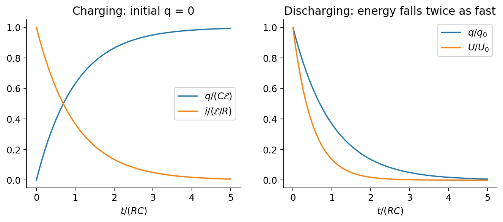
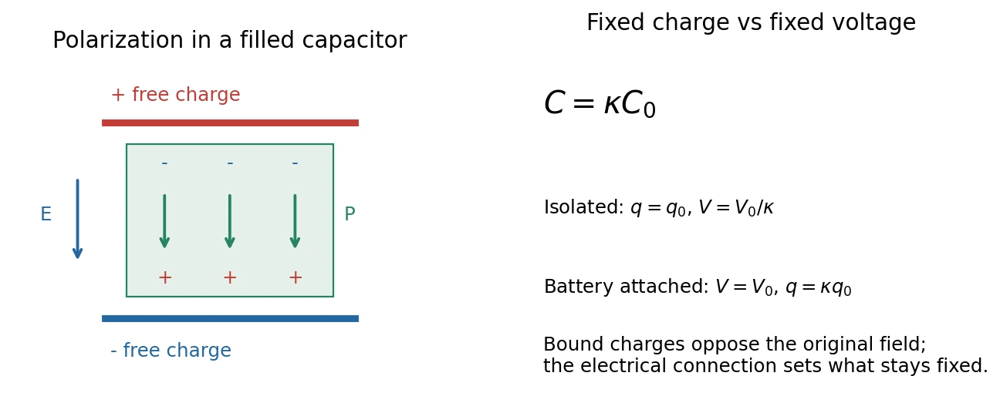

# 7 · DC Circuits, RC Transients, and Dielectrics

[Course index](index.md) · [Previous](06-current-resistance-and-capacitance.md) · [Next](08-magnetic-force-and-motion.md)

## 1. Circuit variables, meters, and ground

Current describes charge flow; a node potential describes electrical energy per charge relative to a reference. A source supplies energy, resistors dissipate it, and capacitors store it.

| Element / instrument | Connection or equation | Meaning |
| --- | --- | --- |
| Ammeter（电流表） | In series; ideally $R_A=0$ | Measures branch current with negligible added voltage drop. |
| Voltmeter（电压表） | In parallel; ideally $R_V\to\infty$ | Measures a potential difference while drawing negligible current. |
| Ground（接地） | Choose a reference node $V=0$ | An earth connection can exchange charge; circuit reference ground need not be earth. |
| Resistor | $v_R=Ri$ | Passive voltage drop in the direction of conventional current. |
| Capacitor | $q=Cv_C$, $i=C\,dv_C/dt$ | Fixed linear capacitance, with current entering the labeled positive terminal. |

A real meter changes the circuit. Its effect is small when $R_A$ is much smaller than the resistance in the measured current path, or $R_V$ is much larger than the circuit's resistance seen at the voltage terminals. The classroom's approximately 100:1 comparison is a useful 1%-scale loading estimate, not a universal instrument specification.

## 2. Electromotive force and Kirchhoff's rules

An emf source uses chemical, mechanical, or other energy to move charge against the electrostatic force internally:

$$
\mathcal E=\frac{dW_{\mathrm{source}}}{dq},\qquad [\mathcal E]=\mathrm V.
$$

**Emf（电动势） is energy per charge, not a mechanical force.** An electrostatic field does zero net work around a closed path; the source's nonelectrostatic action supplies the energy dissipated elsewhere.

- **Junction rule:** $\sum i_{\mathrm{in}}=\sum i_{\mathrm{out}}$ when no charge accumulates at the node.
- **Loop rule:** the signed voltage rises and drops sum to zero in the lumped circuit model, with any induced emf included explicitly.

| Traversal | Signed voltage change |
| --- | --- |
| Resistor along assumed current | $-iR$ |
| Resistor opposite assumed current | $+iR$ |
| Ideal source from $-$ to $+$ | $+\mathcal E$ |
| Capacitor from labeled $+$ to $-$ | $-q/C$ |

Assign current directions first, write independent node/loop equations, and solve; a negative current means the actual direction is reversed. Complicated networks cannot always be reduced by inspection to series and parallel parts.

For a battery of internal resistance $r$ driving load $R$,

$$
i=\frac{\mathcal E}{R+r},\qquad V_{\mathrm{terminal}}=\mathcal E-ir=iR.
$$

The terminal voltage differs from the emf while current flows. The displayed formula describes a discharging battery; current driven into its positive terminal reverses the internal-drop sign.

### Series and parallel combinations

| Connection | Resistors | Capacitors |
| --- | --- | --- |
| Series | $R_{\mathrm{eq}}=\sum R_j$; same current | $1/C_{\mathrm{eq}}=\sum1/C_j$; equal charge magnitudes for neutral intermediate nodes |
| Parallel | $1/R_{\mathrm{eq}}=\sum1/R_j$; same voltage | $C_{\mathrm{eq}}=\sum C_j$; same voltage |

These are ideal lumped-element relations; initial charge on a floating intermediate node must be accounted for separately.

## 3. Electrical power and capacitor energy

With the passive sign convention, absorbed power is $P=vi$. A resistor converts electrical energy into heat:

$$
P_R=i^2R=\frac{v_R^2}{R}.
$$

For a source driving current out of its positive terminal, delivered power is $\mathcal Ei$. In a simple steady circuit, $\mathcal Ei=i^2(R+r)$; average carrier kinetic energy need not grow while the lattice heats.

Charging a linear capacitor requires progressively more work because $v=q/C$ increases:

$$
dU=v\,dq=\frac qC\,dq,\qquad
\boxed{U_C=\frac{q^2}{2C}=\frac12Cv^2=\frac12qv.}
$$

Using $qv$ for the stored energy overcounts the work: the voltage was not equal to its final value throughout charging.

## 4. RC charging and discharging（充放电）

For a series resistor, capacitor, and constant ideal source, let $q$ be the charge on the capacitor plate receiving positive current, so $i=dq/dt$:

$$
R\frac{dq}{dt}+\frac qC=\mathcal E,\qquad \tau_C=RC.
$$

For any initial charge $q_i$,

$$
q(t)=C\mathcal E+(q_i-C\mathcal E)e^{-t/\tau_C}.
$$

For an initially uncharged capacitor,

$$
\boxed{q=C\mathcal E(1-e^{-t/\tau_C}),\quad
i=\frac{\mathcal E}{R}e^{-t/\tau_C},\quad
v_C=\mathcal E(1-e^{-t/\tau_C}).}
$$

At $t=\tau_C$, charge reaches $1-e^{-1}\approx63.2\%$ of its final value. At long times the ideal capacitor carries no DC current. Finite $R$ prevents its voltage from jumping instantaneously.

For source-free discharge from $q_0$,

$$
\boxed{q=q_0e^{-t/\tau_C},\qquad
i=\frac{dq}{dt}=-\frac{q_0}{RC}e^{-t/\tau_C}.}
$$

The minus sign refers to the retained charging-current direction. The discharge current magnitude is $q/(RC)$.

Energy checks:

$$
\mathcal Ei=i^2R+\frac{dU_C}{dt},\qquad
U_C(t)=U_C(0)e^{-2t/(RC)}\quad\text{during discharge}.
$$

Charging from zero through a resistor with a constant source supplies $C\mathcal E^2$: half remains in the capacitor and half is dissipated. This result assumes the ideal RC setup, not every possible charging protocol.

## 5. Energy stored in an electric field

For parallel plates in vacuum, $C=\epsilon_0A/d$, $v=Ed$, and the gap volume is $Ad$. Thus

$$
U_C=\frac12\epsilon_0E^2Ad,\qquad
\boxed{u_E=\frac12\epsilon_0E^2.}
$$

The vacuum expression applies locally beyond the parallel-plate example, and total field energy is $U_E=\int u_E\,d\mathcal V$ when finite. An ideal point charge has a divergent self-energy; interaction energies exclude that singular self-contribution.

## 6. Dielectrics: free and bound charge（自由电荷与束缚电荷）

A dielectric is an insulator whose charges respond to an applied field:

- **Polar molecules** have permanent dipoles. A field biases their otherwise thermally disordered orientations.
- **Nonpolar molecules** acquire induced dipoles through small relative displacements of positive and negative charge.

Both mechanisms produce polarization; the material remains approximately neutral in its bulk if polarization is uniform. Bound charges at its surfaces generate a field opposing the original field in the filled parallel-plate geometry. Strong enough fields can cause **dielectric breakdown（介质击穿）** and conduction.

For a homogeneous linear isotropic dielectric,

$$
\epsilon=\kappa\epsilon_0,\qquad C=\kappa C_0.
$$

| Fully inserting a dielectric | Isolated capacitor: fixed $q$ | Connected to ideal battery: fixed $v$ |
| --- | --- | --- |
| Capacitance | $\kappa C_0$ | $\kappa C_0$ |
| Field and voltage | $E_0/\kappa$, $v_0/\kappa$ | $E_0$, $v_0$ |
| Free plate charge | $q_0$ | $\kappa q_0$ |
| Stored energy | $U_0/\kappa$ | $\kappa U_0$ |

**中文提示：**先判断电荷还是电压保持不变，再讨论电场与能量。接着电池时，电池也参与能量交换，不能只看电容器的能量变化。

For fixed free charge $q$, the bound face-charge magnitude is $q_b=q(1-1/\kappa)$. The ordinary Gauss law counts **all** enclosed charge:

$$
\epsilon_0\oint\mathbf E\cdot d\mathbf A=Q_{\mathrm{free}}+Q_{\mathrm{bound}}.
$$

Replacing $\epsilon_0$ by $\epsilon$ is justified only with the appropriate homogeneous linear material model and boundary conditions. Static $\kappa$ is not automatically the optical-frequency permittivity used in [class 15](15-light-reflection-and-refraction.md).

## 7. Polarization and electric displacement

The start of class 8 completes this part. Polarization is dipole moment per unit volume:

$$
\mathbf P=\frac{d\mathbf p}{d\mathcal V},\qquad [P]=\mathrm{C/m^2}.
$$

Its bound charge densities are

$$
\boxed{\rho_b=-\nabla\cdot\mathbf P,\qquad
\sigma_b=\mathbf P\cdot\hat{\mathbf n},}
$$

where $\hat{\mathbf n}$ points outward from the dielectric. Uniform $\mathbf P$ gives no bulk bound charge but can give nonzero surface charge.

Define **electric displacement（电位移）** by

$$
\boxed{\mathbf D=\epsilon_0\mathbf E+\mathbf P,\qquad
\nabla\cdot\mathbf D=\rho_{\mathrm{free}},\qquad
\oint\mathbf D\cdot d\mathbf A=Q_{\mathrm{free}}.}
$$

For linear isotropic response, $\mathbf P=\epsilon_0\chi_e\mathbf E$, $\kappa=1+\chi_e$, and $\mathbf D=\epsilon\mathbf E$. The definition of $\mathbf D$ is more general than this constitutive relation. It is not generally “the field from free charges alone”; it is an auxiliary field whose divergence counts free charge.

In a linear nondispersive medium, the combined reversible electric/material energy density is $u_E=\tfrac12\mathbf E\cdot\mathbf D$. Nonlinear, dispersive, or hysteretic media require a more careful energy treatment.

## Related homework（知识点应用）

- [Ch. 7, Ex. 3 · Wheatstone bridge](homework/03-conductors-and-circuits.md#ch07-ex03).
- [Ch. 7, Ex. 5 · Three-resistor RC transient](homework/03-conductors-and-circuits.md#ch07-ex05).
- [Ch. 7, Ex. 9 · Capacitor force including battery work](homework/03-conductors-and-circuits.md#ch07-ex09).

## Sources and checks

Lecture 7 pp. 3–24: circuits and RC response; pp. 25–32, 43–46: energy and dielectric mechanisms; pp. 36–42: network combinations. Polarization formulas come from the first approximately 30 minutes of class 8. Check meter loading, loop signs, $q$-versus-$v$ constraints, and the distinction between free and total charge.
