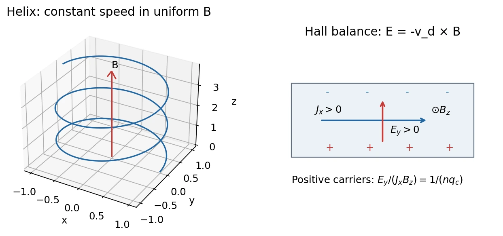

# 8 · Magnetic Force, Charged-Particle Motion, and the Hall Effect

[Course index](index.md) · [Previous](07-dc-circuits-and-dielectrics.md) · [Next](09-fields-of-currents.md)

The dielectric discussion at the start of class 8 is completed in [class 7](07-dc-circuits-and-dielectrics.md). This chapter begins with magnetic force.

## 1. Lorentz force（洛伦兹力）

For a charge $q$ moving at velocity $\mathbf v$,

$$
\boxed{\mathbf F=q(\mathbf E+\mathbf v\times\mathbf B),\qquad
F_B=|q|vB\sin\theta.}
$$

All fields and velocities refer to the same inertial frame. Use the right-hand rule for $\mathbf v\times\mathbf B$, then reverse the result for negative $q$. Magnetic force vanishes for a stationary charge or motion parallel to $\mathbf B$.

$$
\mathbf F_B\cdot\mathbf v=0,\qquad
1\ \mathrm T=1\ \mathrm{N/(A\,m)}=10^4\ \mathrm G.
$$

A magnetic field changes the direction of a free charge's velocity, not its kinetic energy. Electric fields can change that energy.

Magnetic field lines are tangent to $\mathbf B$; a bar magnet's exterior lines emerge from its north end and enter its south end, continuing through the magnet. Cutting a magnet creates smaller dipoles, not isolated poles. The dipole model should not be confused with two physical magnetic charges.

## 2. Crossed fields and Thomson's measurement

For perpendicular $\mathbf E$ and $\mathbf B$, an undeflected beam satisfies

$$
\mathbf E+\mathbf v\times\mathbf B=0,\qquad v=E/B
$$

for the selected travel direction. The cancellation is independent of charge magnitude and mass: the arrangement selects speed.

With the magnetic field removed, an initially horizontal beam traversing electric plates of length $\ell$ has, in the nonrelativistic small-deflection model,

$$
|y|=\frac{|q|E}{2m}\left(\frac\ell v\right)^2,
\qquad
\frac{|q|}{m}=\frac{2|y|v^2}{E\ell^2}
=\frac{2|y|E}{B^2\ell^2}.
$$

Here $y$ is the deflection **at the plate exit**; a downstream screen adds a further drift distance. An alternative uses acceleration through voltage $V_a$:

$$
\frac12mv^2=|q|V_a,\qquad
\frac{|q|}{m}=\frac{E^2}{2V_aB^2}.
$$

Deflection direction identifies the negative sign of the electron charge; deflection or acceleration measurements plus the selected speed give its charge-to-mass ratio.

## 3. Circular and helical motion

In a uniform magnetic field with no electric field,

$$
\boxed{r_L=\frac{mv_\perp}{|q|B},\quad
\omega_c=\frac{|q|B}{m},\quad
T_c=\frac{2\pi m}{|q|B}.}
$$

These are nonrelativistic results. The perpendicular velocity produces circular motion; $v_\parallel$ stays constant and adds a translation along $\mathbf B$. The helix pitch is

$$
h=v_\parallel T_c.
$$

The orbit's handedness depends on the charge sign and field direction. Its radius depends on $v_\perp$, while its cyclotron frequency does not depend on speed in this approximation.

### Magnetic mirrors and cyclotrons

In a slowly varying, sufficiently smooth field, a gyrating particle can reflect from a stronger-field region. The approximate adiabatic invariant is $mv_\perp^2/(2B)$; increasing $B$ raises perpendicular kinetic energy and reduces parallel kinetic energy while total kinetic energy stays constant. Reflection is conditional on the incoming pitch angle, not guaranteed for every particle. This clarifies the classroom mirror picture; see the [University of Colorado magnetic-mirror lecture](https://impact.colorado.edu/Kempf%20Teaching%20Portfolio/PHYS5150_2023/Scripts/plasma%207%20Magnetic%20mirrors.pdf).

A cyclotron bends the particle inside two hollow electrodes (“dees”) and accelerates it electrically across their gap. The RF voltage reverses every half orbit, with drive angular frequency $\omega_c$. Increasing speed increases the radius. At relativistic speeds, $r=p_\perp/(|q|B)$ and $\omega_c=|q|B/(\gamma m)$; the simple fixed-frequency synchronization fails. The **electric gap field**, not the magnetic bending field, supplies the kinetic energy.

## 4. Hall effect（霍尔效应）

Take conventional current density $J_x$, magnetic field $B_z$, and one carrier species of density $n$ and signed charge $q_c$. Sideways accumulation stops when

$$
q_c(\mathbf E_H+\mathbf v_d\times\mathbf B)=0.
$$

Since $(\mathbf v_d\times\mathbf B)_y=-v_{d,x}B_z$,

$$
E_y=v_{d,x}B_z=\frac{J_xB_z}{nq_c},\qquad
\boxed{R_H\equiv\frac{E_y}{J_xB_z}=\frac1{nq_c}.}
$$

For electrons, $R_H=-1/(ne)$; for positive carriers it is positive. If the strip has width $w$ along $y$ and thickness $t$ along $z$,

$$
|V_H|=|E_y|w=\frac{|iB_z|}{n|q_c|t}.
$$

With voltage defined as $V(y=w)-V(y=0)$, its signed value is $-E_yw$. Explicit contact order prevents sign errors. Hall measurements estimate carrier sign and density in the one-carrier model; multiband transport need not obey $R_H=1/(nq_c)$.

The quantum-Hall slide shows plateaus in the transverse resistance and strongly reduced longitudinal resistance. Their characteristic scale is $h/e^2$; the integer effect has $|R_{xy}|=h/(\nu e^2)$ with integer filling $\nu$, while fractional states have fractional filling. This quantum low-dimensional effect is distinct from the classical calculation; see the [Royal Swedish Academy background](https://www.nobelprize.org/uploads/2018/06/advanced-physicsprize1998.pdf).

## 5. Force on a current-carrying wire

Summing carrier forces over a wire segment gives

$$
\boxed{d\mathbf F=i\,d\boldsymbol\ell\times\mathbf B,\qquad
\mathbf F=i\mathbf L\times\mathbf B}
$$

for a straight segment in a uniform field. $\mathbf L$ points along conventional current. Reversing either current or field reverses the force; changing the carrier sign at fixed conventional current does not.

For a curved wire or nonuniform field, integrate $i\,d\boldsymbol\ell\times\mathbf B$. Do not use the wire's total arc length as a vector. For a closed loop in a uniform field, $\oint d\boldsymbol\ell=0$, so the net force vanishes, though a torque may remain.

## 6. Torque, magnetic moment, and a motor

A planar $N$-turn current loop of area $A$ has moment

$$
\boxed{\boldsymbol\mu=NiA\hat{\mathbf n},\qquad
\boldsymbol\tau=\boldsymbol\mu\times\mathbf B,\qquad
U=-\boldsymbol\mu\cdot\mathbf B.}
$$

The normal follows the right-hand rule from the current. Opposite forces on a rectangular loop form a couple, giving $\tau=NiAB\sin\theta$, where $\theta$ is between the **normal** and the field. The result applies to any planar loop in a uniform field.

Alignment minimizes $U$; anti-alignment is unstable. A DC motor reverses loop current every half turn using a commutator, so the torque can continue driving rotation. The supplied motor appendix is discussed at the beginning of class 9.

**Why can magnetic forces drive mechanical motion without doing work on a charge?** A moving conductor's carriers have both bulk and drift velocities. Magnetic forces transfer energy between those components, but $q(\mathbf v_{\mathrm{bulk}}+\mathbf v_d)\times\mathbf B$ remains perpendicular to their total velocity. The electrical source supplies a motor's output energy; induced emf and the source must be included in the full energy balance.

**中文提示：**洛伦兹力对单个载流子的总速度不做功，不等于“有电源的载流线圈不能输出机械功”。不要把漂移速度、导线整体速度与总速度混为一谈。

## Sources and checks

Lecture 8 pp. 3–18: Lorentz force, beam measurements, motion, and Hall effect; pp. 19–26: wire forces and loop torque; pp. 30–31: vector identity and motor. Class 9's opening discussion supplies dipole energy and work accounting. Check charge signs, velocity components, Hall-contact orientation, and the normal used in $\boldsymbol\mu$.
