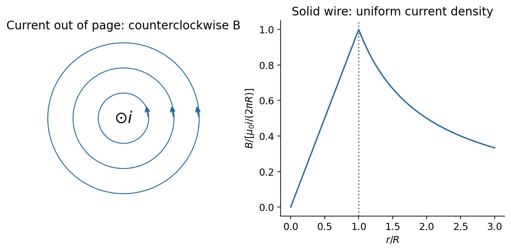

# 9 · Magnetic Fields of Currents and Ampère's Law

[Course index](index.md) · [Previous](08-magnetic-force-and-motion.md) · [Next](10-magnetic-dipoles-and-materials.md)

## 1. Biot–Savart law（毕奥–萨伐尔定律）

For a steady current in vacuum, a source element at $\mathbf r'$ contributes

$$
\boxed{d\mathbf B(\mathbf r)=\frac{\mu_0}{4\pi}
\frac{i\,d\boldsymbol\ell'\times\hat{\mathbf R}}{R^2},\qquad
\mathbf R=\mathbf r-\mathbf r'.}
$$

The vector $d\boldsymbol\ell'$ points along conventional current. Integrate over the source; add fields as vectors. For a volume-current density,

$$
\mathbf B(\mathbf r)=\frac{\mu_0}{4\pi}\int
\frac{\mathbf J(\mathbf r')\times\mathbf R}{R^3}\,d\mathcal V'.
$$

The magnetic source element is $i\,d\boldsymbol\ell'$, rather than the scalar $dq$ of Coulomb's law. An observation point along the line of one straight current element receives zero contribution from that element because the cross product vanishes. Magnetostatic formulas do not replace the full retarded-field laws for rapidly changing sources.

## 2. Straight wire and parallel-current force

For an infinite wire, take perpendicular distance $s$ and source coordinate $z'$. All contributions point azimuthally, with

$$
B(s)=\frac{\mu_0i}{4\pi}\int_{-\infty}^{\infty}
\frac{s\,dz'}{(s^2+z'^2)^{3/2}}
=\boxed{\frac{\mu_0i}{2\pi s}.}
$$

The right-hand grip rule gives the circulation direction. For a finite segment, the same integral gives

$$
B=\frac{\mu_0i}{4\pi s}(\sin\alpha_2-\sin\alpha_1),
$$

where $\alpha_j=\arctan(z'_j/s)$ are signed endpoint angles measured from the perpendicular to the wire. A semi-infinite wire starting at the perpendicular foot gives $\mu_0i/(4\pi s)$.

Two parallel long wires separated by $d$ exert force per length

$$
\boxed{\frac FL=\frac{\mu_0|i_1i_2|}{2\pi d}.}
$$

Find one wire's field at the other, then apply $i\mathbf L\times\mathbf B$. Equal current directions attract; opposite directions repel.

The force relation historically defined the ampere. Since the 2019 SI revision the ampere is defined using the fixed elementary charge; consequently $\mu_0\approx4\pi\times10^{-7}\ \mathrm{N/A^2}$ is a close numerical value rather than an exact defining constant. See [NIST's SI definition](https://www.nist.gov/pml/special-publication-330/sp-330-section-2).

## 3. Ampère's circuital law（安培环路定律）

For steady currents,

$$
\boxed{\oint_C\mathbf B\cdot d\boldsymbol\ell=\mu_0I_{\mathrm{enc}}.}
$$

Choose a loop orientation; the corresponding positive surface normal follows the right-hand rule. Count currents through the spanning surface algebraically. Currents outside the loop affect the field on it but contribute zero net circulation.

As with Gauss's law, a symmetric mathematical loop is useful only if the **physical sources** supply the required symmetry. An isolated circular coil does not generally allow $B$ to be extracted by a simple Ampèrian loop.

### Uniform current inside a solid wire

For radius $R$, total current $i$, and uniform $J_z$, an interior circle encloses $i_{\mathrm{enc}}=i s^2/R^2$. Hence

$$
B(s)=
\begin{cases}
\displaystyle\frac{\mu_0i}{2\pi R^2}s,&s<R,\\[4pt]
\displaystyle\frac{\mu_0i}{2\pi s},&s\ge R.
\end{cases}
$$

The field is continuous at the surface, grows linearly inside, and falls as $1/s$ outside. Nonuniform current density requires integrating $J$ over the enclosed cross section.

### Infinite current sheet

A sheet at $z=0$ carries surface-current density $\mathbf K=K\hat{\mathbf x}$, in A/m. A rectangular loop crosses the sheet, giving $2B\ell=\mu_0K\ell$. Thus

$$
\boxed{\mathbf B_{z>0}=-\frac{\mu_0K}{2}\hat{\mathbf y},\qquad
\mathbf B_{z<0}=+\frac{\mu_0K}{2}\hat{\mathbf y}.}
$$

The magnitudes are equal but the directions opposite. Do not confuse $\mathbf K$ in A/m with volume-current density $\mathbf J$ in A/m².

## 4. Solenoid and toroid

A long tightly wound solenoid with turn density $n=N/\ell$ has approximately uniform interior field. An Ampèrian rectangle has a nonzero contribution only on its interior axial side:

$$
Bh=\mu_0i(nh),\qquad
\boxed{B\simeq\mu_0ni.}
$$

For an infinitely long ideal solenoid, the exterior field is zero. Real solenoids have return flux and end fields; the approximation is best well inside and far from the ends. At fixed $n$ the ideal result is independent of length and radius; at fixed $N$, changing length changes $n$.

For an ideal toroid of $N$ turns, a circular interior loop of radius $s$ gives

$$
\boxed{B(s)=\frac{\mu_0Ni}{2\pi s}.}
$$

The field is azimuthal and varies across the toroid's cross section. It is zero in the central hole and outside the windings in the ideal symmetric limit, with negligible leakage and feed-wire fields. Approximate uniformity requires a thin cross section compared with the mean radius.

## 5. Local field equations

Stokes's theorem changes the circulation law into

$$
\int_S(\nabla\times\mathbf B)\cdot d\mathbf A
=\mu_0\int_S\mathbf J\cdot d\mathbf A,
\qquad
\boxed{\nabla\times\mathbf B=\mu_0\mathbf J}
$$

for steady sources. The divergence of the Biot–Savart integral vanishes because $\mathbf R/R^3=-\nabla(1/R)$ is curl-free in the observation coordinates. Consequently

$$
\boxed{\nabla\cdot\mathbf B=0,\qquad
\oint_S\mathbf B\cdot d\mathbf A=0.}
$$

Gauss's magnetic law also holds for time-dependent fields in classical electromagnetism. It states that there are no magnetic-source endpoints in that theory. Divergence-free lines can be closed or extend to infinity; “every line is a finite closed loop” is too restrictive.

| Static field | Divergence | Curl |
| --- | --- | --- |
| Electric | $\rho_q/\epsilon_0$ | $0$ |
| Magnetic | $0$ | $\mu_0\mathbf J$ |

**中文提示：**长直导线外部的磁场线虽然是圆形，当地却有 $\mathbf J=0$，所以旋度为零。绕线一周的环量非零，是因为环路包围了有电流或奇点的区域；不能用“线弯曲”判断旋度。

For changing charge distributions, $\nabla\times\mathbf B=\mu_0\mathbf J$ is incomplete; [class 14](14-maxwell-equations-and-waves.md) adds displacement current.

## Related homework（知识点应用）

- [Ch. 9, Ex. 2 · Rotating spherical shell](homework/04-magnetic-force-and-fields.md#ch09-ex02).
- [Ch. 9, Ex. 7 · Ampère paths with winding numbers](homework/04-magnetic-force-and-fields.md#ch09-ex07).
- [Ch. 9, Ex. 9 · Force across a toroid](homework/04-magnetic-force-and-fields.md#ch09-ex09).

## Sources and checks

Lecture 9 pp. 3–18: Biot–Savart, wires, circulation, and sheet; pp. 19–25: solenoid/toroid; pp. 26–30: local equations; pp. 34–38: curl and Stokes's theorem. Check current-normal signs, enclosed rather than total current, and the steady-source assumption.
