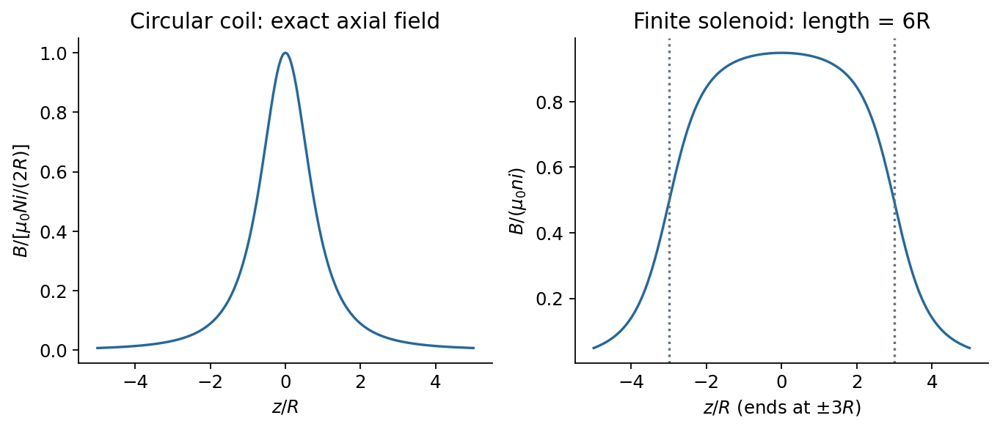
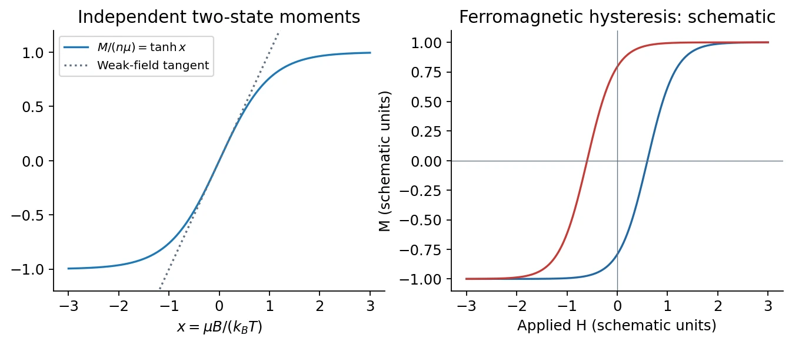

# 10 · Magnetic Dipoles and Magnetic Materials

[Course index](index.md) · [Previous](09-fields-of-currents.md) · [Next](11-electromagnetic-induction.md)

## 1. Magnetic moment: origin and response

A current loop, an atom, or a permanent magnet can have a magnetic dipole moment. For a planar coil,

$$
\boldsymbol\mu=NiA\hat{\mathbf n},\qquad
\boldsymbol\tau=\boldsymbol\mu\times\mathbf B_{\mathrm{ext}},\qquad
U=-\boldsymbol\mu\cdot\mathbf B_{\mathrm{ext}}.
$$

The moment has units A·m² = J/T. Parallel alignment minimizes energy; zero torque at anti-alignment is unstable. For a fixed small moment in a nonuniform field, $\mathbf F=\nabla(\boldsymbol\mu\cdot\mathbf B)$: translational attraction or repulsion requires a field gradient.

Atomic magnetism involves **orbital angular momentum（轨道角动量）** and **spin（自旋）**. For a classical charge orbit, $\boldsymbol\mu_{\mathrm{orb}}=(q/2m)\mathbf L$. Electron spin has its own gyromagnetic factor; it is intrinsic angular momentum, not a literal charged sphere spinning about an axis. Microscopic magnetic moments do not in general arise only from orbital currents.

## 2. Circular arc, coil, and dipole field

At the center of an arc of radius $R$ subtending angle $\varphi$ in radians,

$$
B=\frac{\mu_0i\varphi}{4\pi R}.
$$

The field is normal to the arc's plane. A full loop gives $\mu_0i/(2R)$; radial connecting segments contribute zero at the center because $d\boldsymbol\ell\parallel\mathbf R$.

For an $N$-turn circular coil, symmetry cancels transverse components on its axis. Biot–Savart gives

$$
dB_z=\frac{\mu_0i}{4\pi}\frac{R\,d\ell}{(R^2+z^2)^{3/2}},\qquad
\boxed{B_z(z)=\frac{\mu_0NiR^2}{2(R^2+z^2)^{3/2}}.}
$$

Its limits are $B_z(0)=\mu_0Ni/(2R)$ and $B_z\simeq\mu_0\mu/(2\pi z^3)$ for $z\gg R$, with $\mu=Ni\pi R^2$. Matching limiting cases can suggest this expression, but does not prove the interpolation; the integral supplies the proof.

For a localized magnetic dipole at far-field distance $r$,

$$
\mathbf B_{\mathrm{dip}}\simeq\frac{\mu_0}{4\pi r^3}
\left[3(\boldsymbol\mu\cdot\hat{\mathbf r})\hat{\mathbf r}-\boldsymbol\mu\right].
$$

It has the same far-field angular structure as an electric dipole, while magnetic flux still has zero divergence. This expression is not the finite coil's near field.

### Finite-solenoid check

Class 10 adds the fields of circular turns to recover the solenoid result. For radius $R$, length $\ell$, and center $z=0$,

$$
B_z(z)=\frac{\mu_0ni}{2}
\left[\frac{z+\ell/2}{\sqrt{R^2+(z+\ell/2)^2}}
-\frac{z-\ell/2}{\sqrt{R^2+(z-\ell/2)^2}}\right].
$$

For $\ell\gg R$, the field deep inside tends to $\mu_0ni$ and near an end to $\mu_0ni/2$. This explains the limits of the infinite-solenoid approximation.

## 3. Magnetization（磁化强度）

Define net magnetic moment per unit volume:

$$
\mathbf M=\frac1{\mathcal V}\sum_j\boldsymbol\mu_j,\qquad [M]=\mathrm{A/m}.
$$

Magnetization describes both response to a field and a source of additional magnetic field. A useful macroscopic convention is

$$
\mathbf B=\mu_0(\mathbf H+\mathbf M).
$$

For a linear isotropic material, $\mathbf M=\chi_m\mathbf H$ and $\mu_r=1+\chi_m$. This linear relation does not describe an entire ferromagnetic hysteresis loop; sample shape and demagnetizing fields can make the internal $\mathbf H$ differ from the applied field.

## 4. Paramagnetism（顺磁性） and Curie's law

Independent permanent moments are disordered at zero applied field by thermal fluctuations. A field biases them toward lower-energy orientations.

The slides' two-state model allows moments parallel or antiparallel to a field of magnitude $B$:

$$
U_+=-\mu B,\qquad U_-=+\mu B,\qquad
p_\pm=\frac{e^{\pm x}}{e^x+e^{-x}},\quad x=\frac{\mu B}{k_BT}.
$$

For number density $n$,

$$
\boxed{M=n\mu\tanh x.}
$$

At $x\ll1$, $\tanh x\simeq x$, giving $M\simeq n\mu^2B/(k_BT)\propto B/T$ (**Curie's law**). At large positive $x$, $M\to n\mu$: saturation prevents indefinite linear growth.

The coefficient depends on the microscopic allowed orientations. A classical freely rotating dipole has a different weak-field coefficient from this two-state model; the slides' proportionality should not be treated as a universal numerical constant. Weak paramagnets are attracted toward stronger fields because the aligned moments lower their energy there.

## 5. Diamagnetism（抗磁性）

An applied field induces a moment opposing the field; weak diamagnets have $\chi_m<0$ and tend to move toward weaker fields. Diamagnetic contributions exist even when stronger magnetic responses mask them.

In the slide's classical fixed-radius orbital model, slowly switching on an axial field induces an azimuthal electric field. Its torque changes the orbit, leading to

$$
\Delta\mu_z=-\frac{q^2R^2}{4m}B.
$$

Both initially clockwise and counterclockwise orbits acquire the same opposing correction. This is a qualitative induced-current model, not a complete classical explanation of atomic magnetism. The changing field's electric component changes the speed; a static magnetic Lorentz force alone does not do that work.

Superconducting screening is a much stronger, distinct quantum response; magnetic levitation does not imply that ordinary weak diamagnetism and superconductivity have the same microscopic origin.

## 6. Collective magnetism, domains, and hysteresis

A schematic interaction model uses unit spin directions $\mathbf s_j$ and moment magnitude $\mu$:

$$
U=-J\sum_{\langle ij\rangle}\mathbf s_i\cdot\mathbf s_j
-\mu\sum_j\mathbf s_j\cdot\mathbf B_{\mathrm{ext}}.
$$

For $J>0$, aligned neighboring spins lower the interaction energy. Exchange interactions, rather than only the classical dipole field, are central to ordinary ferromagnetism. Thermal agitation competes with ordering; equilibrium minimizes the free energy $F=U-TS$, not energy alone.

- Below a **Curie temperature $T_C$**, a ferromagnet can have spontaneous magnetization in zero applied field.
- Above $T_C$, long-range ferromagnetic order disappears. The transition temperature is related to an interaction-energy scale, with details depending on structure and dimensionality.
- A macroscopic specimen can contain **domains（磁畴）** with different magnetization directions, giving little net moment even while each domain is ordered.
- Applied fields move domain walls and rotate domains. Irreversibility produces **hysteresis（磁滞）**, including remanence and a coercive field needed to reverse magnetization.

*The hysteresis curves are illustrative, not measured data or a microscopic model.*

**中文提示：**顺磁体的各磁矩主要响应外场；铁磁体还依赖磁矩之间的集体相互作用。铁磁体“总磁矩为零”可能只是磁畴抵消，并不等于局部无序。

### Broader classification and classroom context

| Response / order | Distinguishing feature |
| --- | --- |
| Diamagnetic | Induced opposing moment; weak negative susceptibility. |
| Paramagnetic | Field-biased moments without spontaneous long-range order in the considered regime. |
| Ferromagnetic | Parallel collective order and possible spontaneous net magnetization. |
| Antiferromagnetic（反铁磁） | Opposing ordered sublattices with compensated moments in the simple case. |
| Ferrimagnetic（亚铁磁） | Opposing sublattices with unequal moments, leaving a net moment. |

The spin-glass introduction concerns disorder and competing interactions that frustrate simple ordering, rather than just random high-temperature spins. The [Nobel 2021 background](https://www.nobelprize.org/uploads/2021/10/popular-physicsprize2021-2.pdf) explains that context; detailed spin-glass theory is not part of these lessons.

Class 11 completes the phase-transition discussion: an ordered state selects a magnetization direction and breaks a symmetry of the disordered phase. It then introduces the **anomalous Hall effect**: magnetization can add a transverse response beyond the ordinary applied-field term. A remanently magnetized suitable material can retain that response at zero applied field. The **quantum anomalous Hall effect** is a distinct quantized regime in appropriate magnetic topological systems, not a property of every ferromagnet. The classroom's example is [Chang et al., Science 340, 167–170 (2013)](https://doi.org/10.1126/science.1234414); no band-topology calculation is required here.

## Related homework（知识点应用）

- [Ch. 9, Ex. 2 · Ring superposition for a spherical shell](homework/04-magnetic-force-and-fields.md#ch09-ex02).
- [Ch. 10, Ex. 1 · Far-field dipole derivation and interaction energy](homework/05-dipoles-and-induction.md#ch10-ex01).

## Sources and checks

Lecture 10 pp. 5–15: moments and coil fields; pp. 16–27: material response; p. 29 and the opening approximately 22 minutes of class 11: anomalous Hall and ordering. The finite-solenoid integration and microscopic angular-momentum discussion come from class 10. Check field uniformity, far-field limits, the chosen moment model, and whether a response is induced or spontaneous.
