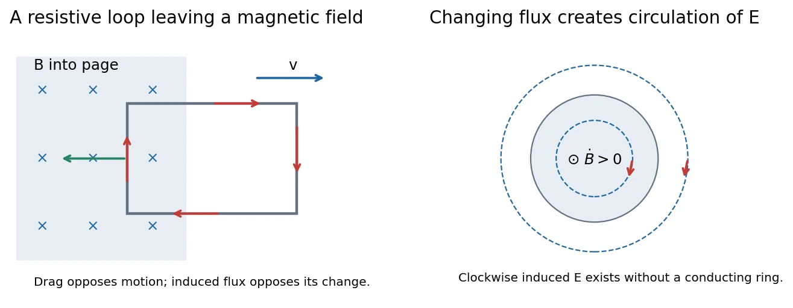

# 11 · Faraday's Law and Electromagnetic Induction

[Course index](index.md) · [Previous](10-magnetic-dipoles-and-materials.md) · [Next](12-inductance-and-rl-circuits.md)

## 1. Magnetic flux and Faraday's law（法拉第电磁感应定律）

The experiments establish two ways to induce an emf: move a magnet relative to a loop, or change a nearby circuit's current while both circuits remain stationary. The common variable is the magnetic flux through the loop:

$$
\Phi_B=\int_S\mathbf B\cdot d\mathbf A,\qquad
[\Phi_B]=\mathrm{T\,m^2}=\mathrm{Wb}.
$$

Choose the loop direction and surface normal together by the right-hand rule. Then

$$
\boxed{\mathcal E=-\frac{d\Phi_B}{dt}.}
$$

For $N$ turns all linking the same flux, $\mathcal E=-N\,d\Phi_B/dt$. More generally, differentiate the total **flux linkage（磁通链）** $\Lambda=\sum_j\Phi_{B,j}$.

Flux can change through a change in $B$, enclosed area, orientation, or the fraction of the circuit lying in the field. For a rigid flat loop in uniform $\mathbf B$, $\Phi_B=BA\cos\theta$, where $\theta$ is between the field and the area normal.

## 2. Lenz's law and direction（楞次定律）

The induced current's magnetic response opposes the **change in flux** that produces it. It need not oppose the existing field.

| External flux | Induced magnetic response |
| --- | --- |
| Increasing in $+\hat{\mathbf n}$ direction | Toward $-\hat{\mathbf n}$ |
| Decreasing in $+\hat{\mathbf n}$ direction | Toward $+\hat{\mathbf n}$ |

Determine the external flux change first, infer the induced-field direction, then use the current-loop right-hand rule. Reversing the chosen normal changes both flux and signed emf, leaving the physical answer unchanged.

An approaching magnet induces a response resisting approach; moving it away reverses the current. The external work can become Joule heat. Otherwise induction would generate energy while reinforcing its own cause.

An induced **emf** can exist without a closed conducting path. A current additionally requires an electrical response path; for a resistive quasistatic loop with negligible self-inductance, $i=\mathcal E/R$.

## 3. Motional emf and mechanical energy

For a conductor moving at bulk velocity $\mathbf u$ through a magnetic field, carriers experience $q\mathbf u\times\mathbf B$. A perpendicular rod of length $\ell$ moving at speed $u$ has emf magnitude

$$
|\mathcal E|=B\ell u.
$$

For an open rod, charge separation builds a balancing electric field; for a closed resistive circuit it can drive current.

Consider a rectangular loop being pulled out of a uniform field. While its overlap length is $x$, $|\Phi_B|=B\ell x$. With constant speed $u$,

$$
|\mathcal E|=B\ell u,\quad
|i|=\frac{B\ell u}{R},\quad
F_{\mathrm{drag}}=|i|\ell B=\frac{B^2\ell^2u}{R}.
$$

The forces on the two transverse connecting sides cancel; the remaining force opposes extraction. The required mechanical power is

$$
\boxed{P_{\mathrm{ext}}=F_{\mathrm{drag}}u
=\frac{B^2\ell^2u^2}{R}=i^2R.}
$$

The external agent supplies the dissipated energy. If self-inductance is significant, part of the input initially changes magnetic energy and $i=\mathcal E/R$ is insufficient.

Eddy currents（涡流） extend the same mechanism to bulk conductors: induction can produce magnetic damping or heating. Applications discussed in class include suppressing unwanted vibration and induction heating. Their effectiveness depends on the actual field and conductor geometry.

## 4. Induced electric field: no conductor required

Removing the wire does not remove the electric field produced by changing magnetic flux. For a **fixed** closed contour,

$$
\boxed{\oint_C\mathbf E\cdot d\boldsymbol\ell
=-\frac{d}{dt}\int_S\mathbf B\cdot d\mathbf A,\qquad
\nabla\times\mathbf E=-\frac{\partial\mathbf B}{\partial t}.}
$$

Stokes's theorem gives the differential form. The time derivative is partial because the field may vary with position as well as time.

### Circular-field example

In a quasistatic model, an axial field $B(t)\hat{\mathbf z}$ fills a cylindrical region of radius $a$. Rotational symmetry makes the induced field azimuthal. A circle of radius $r$ gives

$$
\boxed{E_\phi(r)=
\begin{cases}
\displaystyle-\frac r2\frac{dB}{dt},&r<a,\\[4pt]
\displaystyle-\frac{a^2}{2r}\frac{dB}{dt},&r>a.
\end{cases}}
$$

The outside field is nonzero although the local prescribed $B$ is zero there: the loop still encloses changing flux. The sign is clockwise for increasing $+z$ flux. The formula is continuous at $a$ and does not require an actual conducting ring.

## 5. Moving versus fixed contours

For a material loop moving at local velocity $\mathbf u$, the general circuit emf is

$$
\boxed{\mathcal E=\oint_{C(t)}(\mathbf E+\mathbf u\times\mathbf B)\cdot d\boldsymbol\ell
=-\frac{d}{dt}\int_{S(t)}\mathbf B\cdot d\mathbf A.}
$$

The first term includes induced electric field; the second describes motional force. For a fixed loop, $\mathbf u=0$. For a moving loop in a time-independent magnetic field, the changing flux can come entirely from the motion. Thus one must not replace the total flux derivative for a moving circuit by an integral of only $\partial\mathbf B/\partial t$.

**中文提示：**“磁场随时间变”与“回路在磁场中移动”都能改变磁通；前者对应感生电场，后者还必须计入 $\mathbf u\times\mathbf B$。

## 6. What changes about electric potential?

Electrostatic fields obey $\oint\mathbf E\cdot d\boldsymbol\ell=0$ and can be written $-\nabla V$. Induced fields can have nonzero circulation, so a single scalar potential cannot represent the **entire** electric field or define every two-point voltage independently of path.

This does not make all scalar potentials meaningless. In the more general description,

$$
\mathbf E=-\nabla V-\frac{\partial\mathbf A}{\partial t},\qquad
\mathbf B=\nabla\times\mathbf A.
$$

The vector-potential term supplies the nonconservative part. In practical lumped circuits, terminal voltages remain useful when the measurement paths and regions of changing flux are treated consistently, as in class 12.

## 7. Electric and magnetic fields in different frames

The latter part of class 11 explains why “electric” and “magnetic” are frame-dependent parts of one electromagnetic field. Charge is invariant, but charge density, current density, and field components can change under a boost.

Let $S'$ move with velocity $\mathbf u$ relative to $S$, and resolve components parallel/perpendicular to $\mathbf u$. In vacuum,

$$
\begin{aligned}
\mathbf E'_\parallel&=\mathbf E_\parallel,&
\mathbf E'_\perp&=\gamma(\mathbf E_\perp+\mathbf u\times\mathbf B),\\
\mathbf B'_\parallel&=\mathbf B_\parallel,&
\mathbf B'_\perp&=\gamma\left(\mathbf B_\perp-\frac{\mathbf u\times\mathbf E}{c^2}\right),
\end{aligned}
\qquad \gamma=\frac1{\sqrt{1-u^2/c^2}}.
$$

At $u\ll c$, this reduces to $\mathbf E'\simeq\mathbf E+\mathbf u\times\mathbf B$ and $\mathbf B'\simeq\mathbf B-\mathbf u\times\mathbf E/c^2$.

For stationary oppositely charged sheets, a parallel boost changes transverse charge spacing and hence the surface density by $\gamma$. It gives $E'_\perp=\gamma E_\perp$ and a magnetic field from the now-moving sheets. A field parallel to the boost remains unchanged. For a purely magnetic laboratory field, a moving observer instead sees $\mathbf E'_\perp=\gamma\mathbf u\times\mathbf B$.

The same induction experiment can therefore have different electric/magnetic force decompositions in different frames. One must transform fields, velocities, geometry, and time consistently; emf is not generally a frame-invariant scalar. The six field components transform together rather than forming an ordinary four-vector.

## Related homework（知识点应用）

- [Ch. 11, Ex. 1 · Loop moving away from a wire](homework/05-dipoles-and-induction.md#ch11-ex01).
- [Ch. 11, Ex. 3 · Sinusoidal pickup-loop emf](homework/05-dipoles-and-induction.md#ch11-ex03).
- [Ch. 11, Ex. 4 · Induced field and constrained particle](homework/05-dipoles-and-induction.md#ch11-ex04).
- [Ch. 11, Ex. 7 · Faraday disk and moving flux path](homework/05-dipoles-and-induction.md#ch11-ex07).
- [Ch. 14, Ex. 4 · Induction torque on charged shells](homework/07-maxwell-equations-and-energy.md#ch14-ex04).

- [2023 midterm Q4](midterm/solutions-2023.md#solution-4): Faraday disk, terminal voltage, braking torque, and rotational decay.

## Sources and checks

Lecture 11 pp. 5–20: flux induction and energy transfer; pp. 21–26: induced field and potential limitation; pp. 29–38 and the classroom's latter half: inertial frames and field transformations. Check whether the contour moves, distinguish emf from current, and oppose the flux **change** rather than automatically opposing the field.
