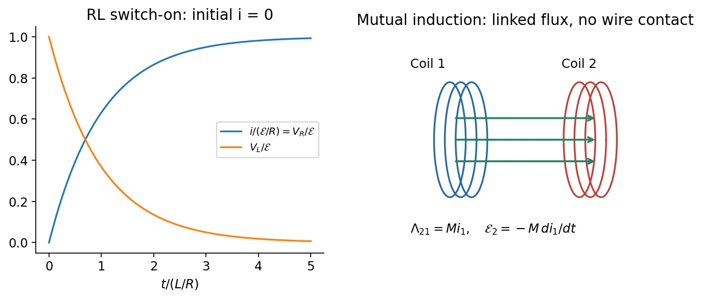

# 12 · Inductance, RL Circuits, and Magnetic Energy

[Course index](index.md) · [Previous](11-electromagnetic-induction.md) · [Next](13-lc-rlc-and-ac-circuits.md)

## 1. Flux linkage and self-inductance（自感）

A current creates magnetic flux through its own circuit. For fixed geometry and linear magnetic response,

$$
\boxed{\Lambda=Li,\qquad L=\frac\Lambda i,\qquad
1\ \mathrm H=1\ \mathrm{Wb/A}=1\ \mathrm{V\,s/A}.}
$$

For $N$ turns all linking the same flux, $\Lambda=N\Phi_B$. The total flux linkage, not one turn's flux, defines the inductance. The slides initially assume vacuum/air cores without nearby magnetic materials; in general $L$ depends on material response as well as geometry and can become nonlinear.

### Long solenoid

With $n=N/\ell$, cross-sectional area $A$, and negligible end fields,

$$
B=\mu_0ni,\qquad
\Lambda=NAB=\mu_0n^2\ell A\,i,
$$

so

$$
\boxed{L=\mu_0n^2\ell A=\frac{\mu_0N^2A}{\ell},\qquad
\frac L\ell=\mu_0n^2A.}
$$

The square in $N$ reflects both a stronger source field and more turns linking that field. The expression assumes a tightly wound solenoid with length much larger than radius.

## 2. Self-induced emf and terminal voltage

Faraday's law gives

$$
\mathcal E_L=-\frac{d\Lambda}{dt}=-L\frac{di}{dt}
$$

for constant $L$. The self-emf opposes the **change** in current: it opposes an increase but supports the existing current during a decrease.

With current entering the labeled positive terminal, the ideal inductor's passive terminal voltage is

$$
\boxed{v_L=L\frac{di}{dt}.}
$$

The opposing emf and the terminal voltage use different sign conventions; they are not competing laws. A winding with resistance $r$ has $v=ri+L\,di/dt$. In a nonlinear core one must use $d\Lambda/dt$, not assume a constant $L$.

The winding's interior field can be nonconservative. Terminal voltage is a lumped-circuit quantity defined with a consistent lead path outside the strongly changing-flux region; it is not proof that a global electrostatic potential exists throughout the coil.

## 3. RL switch-on and decay

For an initially current-free series circuit,

$$
L\frac{di}{dt}+Ri=\mathcal E,\qquad
\tau_L=\frac LR.
$$

The general constant-source solution is

$$
i(t)=\frac{\mathcal E}{R}+
\left(i(0)-\frac{\mathcal E}{R}\right)e^{-t/\tau_L}.
$$

For $i(0)=0$,

$$
\boxed{i=\frac{\mathcal E}{R}(1-e^{-t/\tau_L}),\qquad
v_R=\mathcal E(1-e^{-t/\tau_L}),\qquad
v_L=\mathcal E e^{-t/\tau_L}.}
$$

At $t=0^+$ the inductor supports the applied voltage and current is still zero. At long times an ideal inductor has zero voltage drop and acts as a DC short circuit. Current cannot jump without an impulsive voltage.

If the source is removed while a closed resistive discharge path remains,

$$
i(t)=i_0e^{-t/\tau_L},\qquad
v_L=-Ri.
$$

Opening an inductive circuit without a suitable path can instead generate a large voltage; an ideal exponential-decay formula presupposes the specified discharge circuit.

| Feature | RC circuit | RL circuit |
| --- | --- | --- |
| Time constant | $RC$ | $L/R$ |
| State continuous for finite drive | Capacitor voltage / charge | Inductor current |
| Energy stored | $q^2/(2C)$ | $Li^2/2$ |
| Ideal DC limit | Capacitor open | Inductor short |

## 4. Magnetic energy and energy density

Multiply the RL equation by $i$:

$$
\mathcal Ei=i^2R+Li\frac{di}{dt}.
$$

The source supplies heat plus increasing magnetic energy. Integrating $dU_B=Li\,di$ gives

$$
\boxed{U_B=\frac12Li^2.}
$$

For an ideal long solenoid occupying volume $A\ell$,

$$
u_B=\frac{U_B}{A\ell}
=\frac12\mu_0n^2i^2
=\boxed{\frac{B^2}{2\mu_0}}.
$$

The vacuum field energy density is therefore

$$
\boxed{u=\frac12\epsilon_0E^2+\frac{B^2}{2\mu_0}.}
$$

The magnetic expression is not restricted to a solenoid in vacuum. In a linear reversible nondispersive medium, the corresponding magnetic/material energy is $\tfrac12\mathbf B\cdot\mathbf H$; hysteretic media require accounting for dissipation rather than blindly substituting $\mu$.

## 5. Mutual inductance（互感）

Current $i_1$ in coil 1 can link flux through coil 2:

$$
\Lambda_{21}=N_2\Phi_{21}=M_{21}i_1,\qquad
\boxed{\mathcal E_2=-M_{21}\frac{di_1}{dt}.}
$$

For fixed reciprocal linear configurations, $M_{21}=M_{12}=M$. Coil orientation sets its sign; reversing one winding reverses the signed coupling. If geometry changes, differentiate $Mi_1$ rather than treating $M$ as constant.

### Small coil at the center of a larger coil

Let $R_2\ll R_1$ for concentric coplanar coils of $N_1,N_2$ turns. Across the small coil, the larger coil's field is approximately uniform:

$$
B_1\simeq\frac{\mu_0N_1i_1}{2R_1},\qquad
\boxed{M\simeq\frac{\mu_0N_1N_2\pi R_2^2}{2R_1}.}
$$

The classroom also computes the reverse linkage. Approximate coil 2 as dipole $\mu_2=N_2i_2\pi R_2^2$. In its equatorial plane far from the small coil, $B_z\simeq-\mu_0\mu_2/(4\pi r^3)$. The return flux outside radius $R_1$ is

$$
\int_{R_1}^{\infty}B_z\,2\pi r\,dr=-\frac{\mu_0\mu_2}{2R_1}.
$$

Zero total planar flux gives the opposite flux through the larger loop. Multiplying by $N_1$ yields the same $M$. Integrating the dipole approximation down to $r=0$ would be invalid; the outside-return-flux argument avoids its singularity.

## 6. Classroom applications

- **Transformer:** linked changing flux transfers energy between electrically isolated circuits. For ideal windings sharing the same flux, voltage magnitudes satisfy $|v_2/v_1|=N_2/N_1$; steady DC produces no sustained secondary induction. Real transfer depends on coupling, loading, and losses.
- **Magnetic measurement:** a known drive winding sets an applied-field scale; a pickup winding measures $-N\,d\Phi_B/dt$. Integrating the pickup signal recovers changing flux, permitting a calibrated magnetic response or hysteresis measurement.
- **Signal coupling:** mutual induction can couple AC signals without a direct conductive connection. It does not imply complete isolation from every parasitic capacitive or magnetic disturbance.

**中文提示：**自感是本回路的电流改变本回路的磁通；互感是一个回路的电流改变另一个回路的磁通。两者都遵循法拉第定律，区别在于磁通由谁产生。

## Related homework（知识点应用）

- [Ch. 12, Ex. 5 · Current reversal, voltage polarity, and energy](homework/06-inductance-and-ac-circuits.md#ch12-ex05).
- [Ch. 12, Ex. 7 · Internal inductance and flux linkage](homework/06-inductance-and-ac-circuits.md#ch12-ex07).
- [Ch. 12, Ex. 9 · Mutual inductance and source work](homework/06-inductance-and-ac-circuits.md#ch12-ex09).

## Sources and checks

Lecture 12 pp. 4–15: inductance and RL response; pp. 17–23: energy; pp. 24–28: mutual induction. The classroom adds magnetic measurement, transformer use, and the reverse-linkage calculation. Check flux versus flux linkage, emf versus passive voltage, and the fixed-geometry/linear-response assumptions.
