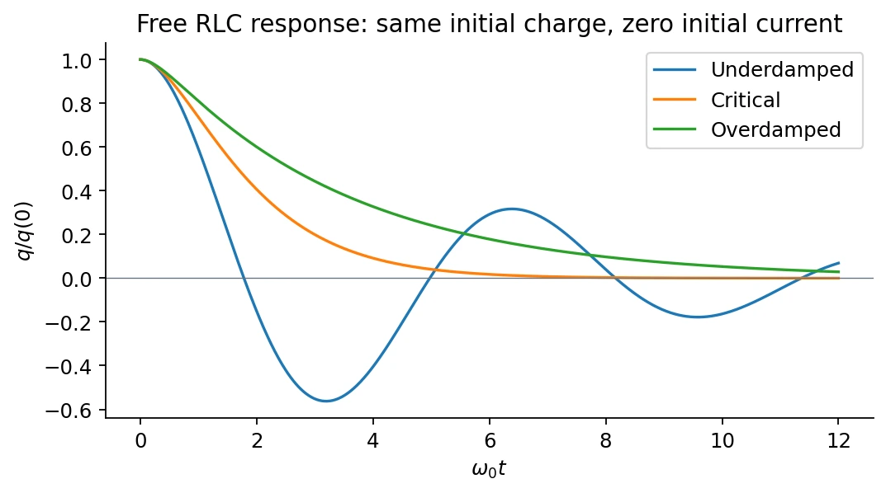
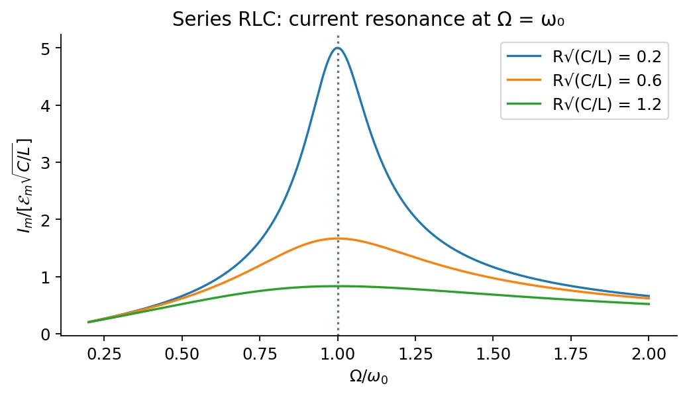

# 13 · LC Oscillations, Damped RLC Circuits, and AC Response

[Course index](index.md) · [Previous](12-inductance-and-rl-circuits.md) · [Next](14-maxwell-equations-and-waves.md)

## 1. Ideal LC oscillations

Choose signed capacitor charge $q$ and current $i=dq/dt$. The ideal circuit's energy is

$$
U=\frac{q^2}{2C}+\frac12Li^2.
$$

Energy conservation, or the loop equation directly, gives

$$
\boxed{L\ddot q+\frac qC=0,\qquad
\omega_0=\frac1{\sqrt{LC}},\qquad T_0=2\pi\sqrt{LC}.}
$$

The loop equation remains valid at instants when $i=0$; an energy derivation should not divide by zero there. The general solution is

$$
q=q_m\cos(\omega_0t+\alpha),\qquad
i=-\omega_0q_m\sin(\omega_0t+\alpha).
$$

Initial charge and initial current determine both constants:

$$
q(0)=q_m\cos\alpha,\qquad
i(0)=-\omega_0q_m\sin\alpha.
$$

Current and charge are a quarter cycle apart. When charge is maximal, current is zero; when charge is zero, current magnitude is maximal. The energy exchange is

$$
U_E=U_0\cos^2(\omega_0t+\alpha),\qquad
U_B=U_0\sin^2(\omega_0t+\alpha),\qquad U_0=\frac{q_m^2}{2C}.
$$

| Mechanical oscillator | LC circuit |
| --- | --- |
| Displacement $x$ | Charge $q$ |
| Velocity $\dot x$ | Current $i$ |
| Mass $m$ | Inductance $L$ |
| Spring constant $k$ | Inverse capacitance $1/C$ |
| $m\ddot x+kx=0$ | $L\ddot q+q/C=0$ |

The scale $\sqrt{LC}$ is $1/\omega_0$, not the full oscillation period.

## 2. Free damped RLC response（阻尼振荡）

A series resistor removes energy at rate $i^2R$:

$$
\frac{dU}{dt}=-Ri^2,\qquad
\boxed{L\ddot q+R\dot q+\frac qC=0.}
$$

Define $\beta=R/(2L)$ and try $q\propto e^{st}$. The characteristic roots are

$$
s_\pm=-\beta\pm\sqrt{\beta^2-\omega_0^2}.
$$

| Regime | Condition | Charge response |
| --- | --- | --- |
| Underdamped（欠阻尼） | $\beta<\omega_0$ | $q=Ae^{-\beta t}\cos(\omega_dt+\alpha)$, $\omega_d=\sqrt{\omega_0^2-\beta^2}$ |
| Critical（临界阻尼） | $\beta=\omega_0$ | $q=(A+Bt)e^{-\beta t}$ |
| Overdamped（过阻尼） | $\beta>\omega_0$ | $q=Ae^{s_+t}+Be^{s_-t}$; both roots real and negative |

The critical resistance is $R_c=2\sqrt{L/C}$. Critical damping gives the boundary between oscillatory and nonoscillatory relaxation and the fastest nonoscillatory settling in the standard comparison with the same initial displacement and zero velocity.

The underdamped **amplitude** decays on time $1/\beta=2L/R$, different from the RL time constant $L/R$. In weak damping, the cycle-averaged energy envelope falls approximately as $e^{-2\beta t}$; the exact instantaneous statement is $\dot U=-Ri^2$.

The slides also use complex frequency: with $q=\operatorname{Re}(\widetilde q e^{j\widetilde\omega t})$ and $j^2=-1$, decay requires $\widetilde\omega=\omega_d+j\beta$. This sign depends on the chosen exponential convention.

## 3. Driven oscillations and phasors（相量）

A rotating $N$-turn coil in a uniform field has $\Lambda=NBA\cos\Omega t$, hence generator emf $\mathcal E=NBA\Omega\sin\Omega t$. Choosing a shifted time origin gives the cosine drive below; its frequency is imposed by the generator.

For a source $\mathcal E(t)=\mathcal E_m\cos\Omega t$,

$$
\boxed{L\ddot q+R\dot q+\frac qC=\mathcal E_m\cos\Omega t.}
$$

The full solution is a decaying free transient plus a forced solution. For $R>0$, the long-time response oscillates at the **drive frequency $\Omega$**, not at the free damped frequency $\omega_d$.

Represent sinusoidal signals by

$$
v(t)=\operatorname{Re}(\widetilde V e^{j\Omega t}),\qquad
i(t)=\operatorname{Re}(\widetilde I e^{j\Omega t}),\qquad
\widetilde Z=\frac{\widetilde V}{\widetilde I}.
$$

Differentiation becomes multiplication by $j\Omega$. The complex impedance combines magnitude and phase:

| Element | Impedance | Current relative to its voltage |
| --- | --- | --- |
| Resistor | $R$ | In phase |
| Inductor | $j\Omega L$ | Lags by $\pi/2$ |
| Capacitor | $1/(j\Omega C)=-j/(\Omega C)$ | Leads by $\pi/2$ |

Series impedances add; parallel admittances add:

$$
\widetilde Z_{\mathrm{series}}=\sum_j\widetilde Z_j,\qquad
\frac1{\widetilde Z_{\mathrm{parallel}}}=\sum_j\frac1{\widetilde Z_j}.
$$

Add the **complex values**, not their magnitudes. These relations assume lumped elements and negligible unmodeled mutual coupling.

## 4. Series RLC impedance and phase

$$
\boxed{\widetilde Z=R+j\left(\Omega L-\frac1{\Omega C}\right),\qquad
|Z|=\sqrt{R^2+\left(\Omega L-\frac1{\Omega C}\right)^2}.}
$$

Let $\phi=\arg\widetilde Z$, so $\tan\phi=(\Omega L-1/(\Omega C))/R$ for $R>0$. With the source phase set to zero,

$$
\boxed{i(t)=I_m\cos(\Omega t-\phi),\qquad I_m=\frac{\mathcal E_m}{|Z|}.}
$$

- $\Omega<\omega_0$: capacitive response; $\phi<0$, current leads.
- $\Omega>\omega_0$: inductive response; $\phi>0$, current lags.
- $\Omega=\omega_0$: reactive contributions cancel; voltage and current are in phase.

**中文提示：**本页把 $\phi$ 定义为“电压相位减电流相位”，所以电流写成 $\cos(\Omega t-\phi)$。若改写为加号，那个相位变量就应当换成 $-\phi$，不能混用两套定义。

## 5. Resonance and selectivity（共振与选频）

For a fixed-amplitude voltage drive and constant $R$,

$$
\boxed{\Omega_{\mathrm{res}}=\omega_0,\qquad
I_{m,\max}=\frac{\mathcal E_m}{R}.}
$$

This is **current resonance** in the series circuit. Other observables, such as capacitor-voltage amplitude, need not peak at exactly the same frequency when damping is appreciable. Ideal $R=0$ at resonance has no finite steady-state current amplitude; the resonant response grows rather than being described by division by zero.

The start of class 14 adds a resonance-width interpretation. Define the quality factor and half-power width by

$$
\boxed{\mathcal Q=\frac{\omega_0L}{R}
=\frac1R\sqrt{\frac LC},\qquad
\Delta\Omega=\frac RL,\qquad
\mathcal Q=\frac{\omega_0}{\Delta\Omega}.}
$$

At the two half-power frequencies, $I_m=I_{m,\max}/\sqrt2$, not $I_{m,\max}/2$. Small resistance gives high $\mathcal Q$ and a narrow peak, useful for selecting a frequency. The formula uses **angular-frequency** width; frequency width in hertz is $\Delta f=\Delta\Omega/(2\pi)$.

### Power accounting

For sinusoidal steady state,

$$
V_{\mathrm{rms}}=\frac{V_m}{\sqrt2},\quad
I_{\mathrm{rms}}=\frac{I_m}{\sqrt2},\quad
\boxed{\langle P\rangle=V_{\mathrm{rms}}I_{\mathrm{rms}}\cos\phi
=\frac12I_m^2R.}
$$

Ideal inductors and capacitors exchange energy with the circuit but absorb zero net energy over a full cycle. This energy check also explains the half-power width. Mechanical resonance, frequency selection, and resonant electromagnetic absorption are the classroom's qualitative applications; detailed MRI or quantum-transition theory is not developed here.

## Related homework（知识点应用）

- [Ch. 13, Ex. 2 · Series–parallel AC network](homework/06-inductance-and-ac-circuits.md#ch13-ex02).
- [Ch. 13, Ex. 4 · Coupled RLC normal modes](homework/06-inductance-and-ac-circuits.md#ch13-ex04).
- [Ch. 13, Ex. 5 · LC switching and peak voltage](homework/06-inductance-and-ac-circuits.md#ch13-ex05).

- [Midterm transfer practice 9](midterm/transfer-practice.md#check-9): drive frequency, impedance, phase, and average power.

## Sources and checks

Lecture 13 pp. 3–14: LC dynamics and analogy; pp. 15–20: complex form and damping; pp. 21–28: AC impedance and resonance. Class 14's first approximately ten minutes supplies quality factor/selectivity. Keep $\omega_0$, $\omega_d$, and $\Omega$ distinct; check phase conventions and distinguish amplitude decay, energy decay, and half-power width.
