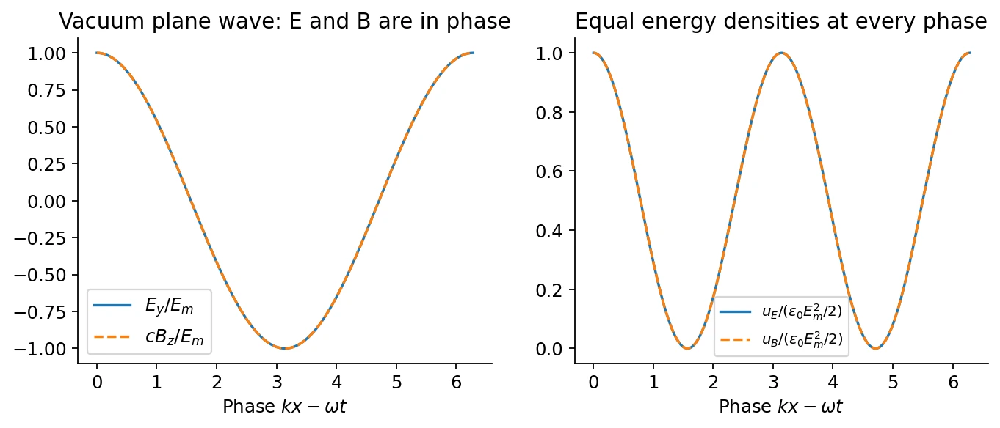

# 14 · Maxwell's Equations and Electromagnetic Waves

[Course index](index.md) · [Previous](13-lc-rlc-and-ac-circuits.md) · [Next](15-light-reflection-and-refraction.md)

## 1. Why magnetostatic Ampère's law is incomplete

For any smooth vector field, $\nabla\cdot(\nabla\times\mathbf B)=0$. Taking the divergence of $\nabla\times\mathbf B=\mu_0\mathbf J$ would therefore require $\nabla\cdot\mathbf J=0$. But charge conservation gives

$$
\nabla\cdot\mathbf J=-\frac{\partial\rho_q}{\partial t},
$$

which need not vanish during charging. Gauss's law identifies a correction:

$$
\frac{\partial\rho_q}{\partial t}=\epsilon_0\nabla\cdot\frac{\partial\mathbf E}{\partial t}.
$$

The **Ampère–Maxwell law** is

$$
\boxed{\nabla\times\mathbf B
=\mu_0\mathbf J+\mu_0\epsilon_0\frac{\partial\mathbf E}{\partial t},\qquad
\mathbf J_d=\epsilon_0\frac{\partial\mathbf E}{\partial t}.}
$$

The new term is the vacuum **displacement-current density（位移电流密度）**. Its divergence restores compatibility with charge conservation. That consistency argument motivates the term; it is not, by itself, a uniqueness proof excluding every imaginable additional divergence-free field term.

## 2. Charging capacitor: independence of spanning surface

For a fixed boundary curve $C$, the integral law is

$$
\boxed{\oint_C\mathbf B\cdot d\boldsymbol\ell
=\mu_0\int_S\mathbf J\cdot d\mathbf A
+\mu_0\epsilon_0\frac d{dt}\int_S\mathbf E\cdot d\mathbf A.}
$$

Choose one spanning surface that cuts a charging wire and another that bows between the capacitor plates. The first receives conduction current $i$; the second receives no conduction through the vacuum gap. Yet both must predict the same circulation.

Neglecting edge effects, $E=Q/(\epsilon_0A)$ in the gap, so

$$
I_d=\epsilon_0\frac{d(EA)}{dt}=\frac{dQ}{dt}=i.
$$

The two surfaces agree once displacement current is included. It is not literal charge transport across the vacuum gap. Statements that exterior $E$ is zero are only the ideal capacitor approximation; the full law counts both terms wherever they occur.

## 3. Maxwell's four equations in vacuum

Here $\rho_q$ and $\mathbf J$ are total physical charge and current densities. Integral forms use fixed surfaces/contours, outward normals on closed surfaces, and the right-hand orientation on open ones.

| Law | Differential form | Integral form |
| --- | --- | --- |
| Electric Gauss | $\nabla\cdot\mathbf E=\rho_q/\epsilon_0$ | $\oint_S\mathbf E\cdot d\mathbf A=Q_{\mathrm{enc}}/\epsilon_0$ |
| Magnetic Gauss | $\nabla\cdot\mathbf B=0$ | $\oint_S\mathbf B\cdot d\mathbf A=0$ |
| Faraday | $\nabla\times\mathbf E=-\partial_t\mathbf B$ | $\oint_C\mathbf E\cdot d\boldsymbol\ell=-d\Phi_B/dt$ |
| Ampère–Maxwell | $\nabla\times\mathbf B=\mu_0\mathbf J+\mu_0\epsilon_0\partial_t\mathbf E$ | $\oint_C\mathbf B\cdot d\boldsymbol\ell=\mu_0I_{\mathrm{enc}}+\mu_0\epsilon_0d\Phi_E/dt$ |

Together with the Lorentz force $\mathbf F=q(\mathbf E+\mathbf v\times\mathbf B)$, these describe classical electromagnetic interactions once sources, initial data, and boundary conditions are supplied. In materials, constitutive response is also needed; $\mathbf D$ and $\mathbf H$ allow a macroscopic formulation in terms of free sources.

The electric and magnetic equations are not fully source-symmetric: electric charges are sources of electric divergence, while classical Maxwell theory contains no magnetic charge. The course mentions magnetic monopoles as a theoretical possibility, not an observed source inserted into these equations.

## 4. Deriving the source-free wave equation

In vacuum with $\rho_q=0$ and $\mathbf J=0$,

$$
\nabla\cdot\mathbf E=\nabla\cdot\mathbf B=0,\qquad
\nabla\times\mathbf E=-\partial_t\mathbf B,\qquad
\nabla\times\mathbf B=\mu_0\epsilon_0\partial_t\mathbf E.
$$

Take the curl of Faraday's law and use the vector identity

$$
\nabla\times(\nabla\times\mathbf E)
=\nabla(\nabla\cdot\mathbf E)-\nabla^2\mathbf E.
$$

This yields, and the magnetic calculation similarly yields,

$$
\boxed{\nabla^2\mathbf E=\frac1{c^2}\partial_t^2\mathbf E,\qquad
\nabla^2\mathbf B=\frac1{c^2}\partial_t^2\mathbf B,\qquad
c=\frac1{\sqrt{\mu_0\epsilon_0}}.}
$$

Each Cartesian field component satisfies a wave equation. The oscillating quantities are field values, not a material medium. Eliminating the coupling to obtain wave equations does not eliminate the original Maxwell constraints on allowable solutions.

## 5. Plane waves: dispersion and transverse structure

Write

$$
\mathbf E=\mathbf E_m\cos(\mathbf k\cdot\mathbf r-\omega t+\alpha),\qquad
\mathbf B=\mathbf B_m\cos(\mathbf k\cdot\mathbf r-\omega t+\alpha).
$$

The wave equation gives $\omega=ck$, with $k=2\pi/\lambda$ and $\omega=2\pi f$. The remaining Maxwell equations impose

$$
\boxed{\mathbf k\cdot\mathbf E_m=\mathbf k\cdot\mathbf B_m=0,\qquad
\mathbf B=\frac1c\hat{\mathbf k}\times\mathbf E.}
$$

For a single traveling vacuum plane wave, $\mathbf E$, $\mathbf B$, and propagation are mutually perpendicular; $E=cB$, and the two fields are in phase. For propagation along $+x$, a choice is $\mathbf E\parallel+\hat{\mathbf y}$ and $\mathbf B\parallel+\hat{\mathbf z}$. Reversing either transverse field reverses the direction of energy flow.

A drawing of sinusoidal field arrows represents values at points on the propagation axis, not the sideways path of a particle. The simple $E=cB$ relation need not hold for arbitrary superpositions, standing waves, or near fields.

## 6. Energy flux, intensity, and spreading

The **Poynting vector（坡印廷矢量）** in vacuum is

$$
\boxed{\mathbf S=\frac1{\mu_0}\mathbf E\times\mathbf B,\qquad
[S]=\mathrm{W/m^2}.}
$$

For fields in vacuum or the nonmagnetic Ohmic model used in the homework, local energy conservation is **Poynting's theorem**:

$$
\boxed{\frac{\partial u}{\partial t}+\nabla\cdot\mathbf S=-\mathbf J\cdot\mathbf E,
\qquad u=\frac{\epsilon_0E^2}{2}+\frac{B^2}{2\mu_0}.}
$$

It follows by dotting the Ampère–Maxwell equation with $\mathbf E/\mu_0$, Faraday's equation with $\mathbf B/\mu_0$, and using $\nabla\cdot(\mathbf E\times\mathbf B)=\mathbf B\cdot(\nabla\times\mathbf E)-\mathbf E\cdot(\nabla\times\mathbf B)$. The term $\mathbf J\cdot\mathbf E$ is field power delivered to matter; for $\mathbf J=\sigma\mathbf E$ it is positive Joule heating. 场能变化、流出边界的能流和物质获得的功率必须一起记账。 [Ch. 14, Ex. 3](homework/07-maxwell-equations-and-energy.md#ch14-ex03) applies this law to inward energy flow into a resistive wire.

For a traveling plane wave,

$$
u_E=\frac12\epsilon_0E^2=\frac{B^2}{2\mu_0}=u_B,\qquad
S=c(u_E+u_B)=\epsilon_0cE^2.
$$

The time-averaged intensity of a sinusoid is

$$
\boxed{I=\langle S\rangle
=\frac12\epsilon_0cE_m^2
=\frac{cB_m^2}{2\mu_0}.}
$$

**中文提示：**行进平面波的电场能和磁场能同时达到峰值，且始终相等；LC 电路中两种能量则交替转换。不要把这两幅图混为一谈。

For an isotropic point source radiating power $P$ into lossless space,

$$
I(r)=\frac{P}{4\pi r^2}.
$$

Far-field wave amplitudes consequently scale as $1/r$. A dipole antenna is not isotropic: radiation depends on direction, although far-field radial spreading still gives $1/r^2$ intensity along a fixed direction. Near-field terms have different distance dependence.

## 7. Generation and the electromagnetic spectrum

An LC oscillator coupled through a transmission line to a dipole antenna drives oscillating charge/current. Accelerating charges radiate at the drive frequency; receiver circuitry responds to the arriving fields. A source is needed to maintain radiation and compensate losses.

Radio, microwave, infrared, visible, ultraviolet, X-ray, and gamma radiation belong to the same electromagnetic spectrum, differing principally in frequency and wavelength. In vacuum they share speed $c$; differences in propagation through matter require the material's frequency-dependent response. Momentum transport and radiation pressure are developed at the beginning of [class 15](15-light-reflection-and-refraction.md).

## Related homework（知识点应用）

- [Ch. 14, Ex. 1 · Displacement current inside a capacitor](homework/07-maxwell-equations-and-energy.md#ch14-ex01).
- [Ch. 14, Ex. 3 · Poynting energy flow into a wire](homework/07-maxwell-equations-and-energy.md#ch14-ex03).
- [Ch. 14, Ex. 4 · Angular impulse from an induced field](homework/07-maxwell-equations-and-energy.md#ch14-ex04).

- [Midterm transfer practice 10–12](midterm/transfer-practice.md#check-10): traveling-wave fields and displacement-current cancellation.

## Sources and checks

Lecture 14 pp. 3–13: Maxwell correction and equations; pp. 14–24: wave equation and plane-wave constraints; pp. 25–29: generation and energy transport; p. 33: Poynting vector. Radiation-pressure appendix pp. 34–37 is treated with the class-15 discussion. Check surface independence, vacuum/source-free assumptions, $E$ versus $E_m$, and amplitude versus intensity decay.
