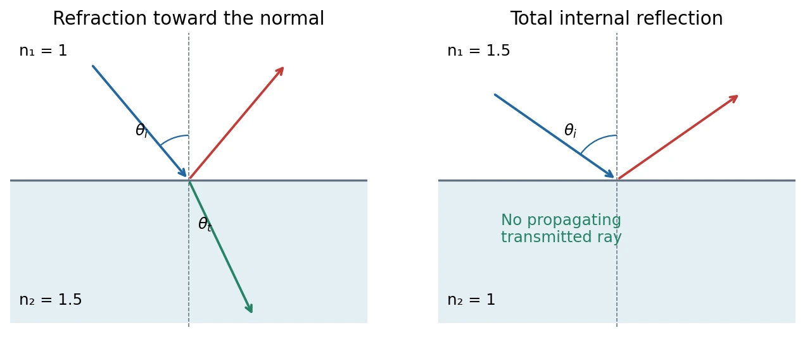

# 15 · Light, Radiation Pressure, Reflection, and Refraction

[Course index](index.md) · [Previous](14-maxwell-equations-and-waves.md) · [Formula sheet](quick-reference.md)

## 1. Light as an electromagnetic wave

Maxwell's source-free equations predict waves traveling in vacuum at

$$
c=\frac1{\sqrt{\mu_0\epsilon_0}}
=299\,792\,458\ \mathrm{m/s}.
$$

The exact number is the SI-defined vacuum speed. Visible light, approximately 400–700 nm in the course's spectrum sketch, is one part of the electromagnetic spectrum. Optical propagation can therefore be understood through the same fields and boundary conditions as other electromagnetic waves.

## 2. Momentum transport and radiation pressure（辐射压）

The opening part of class 15 completes the previous lecture's appendix. Electromagnetic fields in vacuum carry momentum density

$$
\boxed{\mathbf g=\frac{\mathbf S}{c^2}.}
$$

For a unidirectional traveling wave packet of energy $U$, $p=U/c$ along propagation. Absorption or reflection transfers momentum to matter. With average intensity $I$ incident normally on area $A$, an incident energy $IA\,dt$ carries momentum $IA\,dt/c$:

| Ideal surface | Momentum transferred per incident energy | Average pressure |
| --- | --- | --- |
| Perfect absorber | $1/c$ | $p_{\mathrm{rad}}=I/c$ |
| Perfect backward reflector | $2/c$ | $p_{\mathrm{rad}}=2I/c$ |

Reflection doubles the change because the outgoing momentum reverses. For an opaque partially reflecting surface with power reflectivity $\mathcal R$, the same normal-incidence balance gives $(1+\mathcal R)I/c$. Oblique incidence, transmission, or propagation in matter requires its own momentum accounting.

In a finite control volume, field-plus-matter momentum can change through momentum flux across its boundary. A simple zero time derivative of enclosed total momentum is justified only when those boundary transfers vanish or the complete isolated system is included.

## 3. Plane waves, wavefronts, and rays

For a monochromatic plane wave,

$$
\psi(\mathbf r,t)=A\cos(\mathbf k\cdot\mathbf r-\omega t+\alpha).
$$

A **wavefront（波前）** is a constant-phase surface; at fixed time, $\mathbf k\cdot\mathbf r=\mathrm{constant}$ defines planes normal to $\mathbf k$. A **ray（光线）** indicates the propagation direction. Rays are normal to wavefronts in the isotropic media considered here.

Geometrical optics applies when wavelength is small compared with relevant geometry and spatial-variation scales. In a uniform medium rays are straight; at a boundary they can reflect or refract. This approximation does not describe diffraction near wavelength-scale apertures.

## 4. Light in matter: speed, index, wavelength

For a homogeneous isotropic transparent medium, with an approximately local lossless response at the frequency of interest,

$$
\boxed{v_{\mathrm{ph}}=\frac1{\sqrt{\epsilon\mu}}=\frac cn,\qquad
n=\sqrt{\epsilon_r\mu_r}.}
$$

Ordinary transparent optical dielectrics usually have $\mu_r\simeq1$. At a **stationary** interface the incident, reflected, and transmitted waves have the same frequency. Thus

$$
k=\frac{n\omega}{c}=nk_0,\qquad
\boxed{\lambda=\frac{\lambda_0}{n}.}
$$

The frequency stays fixed while speed, wavelength, and wavevector can change. Representative visible-light indices are approximately air 1, water 1.33, and common glass 1.5, but depend on wavelength and physical conditions. Do not use the static dielectric constant of water, about 80, as its visible-frequency $n^2$.

Here $v_{\mathrm{ph}}$ is phase velocity. In a dispersive material, group and signal velocities require separate treatment; the simple constant-index model does not describe all materials or frequencies.

## 5. Reflection and Snell's law

Angles below are measured from the interface **normal**, and all three rays lie in the plane of incidence:

$$
\boxed{\theta_r=\theta_i,\qquad
n_1\sin\theta_i=n_2\sin\theta_t.}
$$

- $n_2>n_1$: the transmitted ray bends toward the normal.
- $n_2<n_1$: it bends away from the normal, when a propagating transmitted ray exists.
- Normal incidence gives no directional bending; index matching gives no ray bending at any angle.

Both reflected and transmitted waves can be present. Direction laws alone do not determine their amplitudes.

For example, incidence from air into $n_2=1.5$ glass at $30^\circ$ gives $\sin\theta_t=1/3$, so $\theta_t\approx19.5^\circ$.

## 6. Total internal reflection（全反射）

Only incidence from **higher to lower index**, $n_1>n_2$, can reach a critical angle:

$$
\boxed{\theta_c=\arcsin\frac{n_2}{n_1}.}
$$

At $\theta_i=\theta_c$, the transmitted ray is tangent to the interface. For $\theta_i>\theta_c$, Snell's law has no real propagating transmitted angle. For an ideal lossless interface with a semi-infinite second medium, incident energy is totally reflected. An evanescent field can still exist in medium 2; total reflection does not require the electromagnetic field there to vanish.

For glass with $n_1=1.5$ into air, $\theta_c\approx41.8^\circ$. Optical fibers use a higher-index core and lower-index cladding to guide light. The classroom's endoscope example uses fiber bundles for illumination and image transmission; not every real fiber is a vacuum-walled geometric tube.

## 7. Fermat's principle（费马原理）

The ray path makes the travel time, equivalently the optical path, **stationary** under small variations:

$$
\boxed{\delta\int\frac{n(\mathbf r)}c\,ds=0.}
$$

The “least time” wording works for the simple examples below; stationary paths are not universally global minima. A ray need not follow the shortest geometrical distance through media of different speeds, and it does not require a photon to plan a route in advance.

### Reflection

Reflect the destination across a planar mirror. The shortest straight path to its image intersects the mirror with equal incident and reflected angles. The image construction therefore recovers $\theta_i=\theta_r$ in a uniform medium.

### Refraction

Take source $S=(0,h)$ above a horizontal interface and destination $P=(a,-b)$ below it. Let the ray cross at $(x,0)$. Then

$$
t(x)=\frac{n_1}{c}\sqrt{h^2+x^2}
+\frac{n_2}{c}\sqrt{b^2+(a-x)^2}.
$$

Stationarity requires

$$
0=\frac{dt}{dx}
=\frac{n_1x}{c\sqrt{h^2+x^2}}
-\frac{n_2(a-x)}{c\sqrt{b^2+(a-x)^2}}.
$$

Recognizing the ratios as the sines of the angles to the normal gives Snell's law.

### Mirage（海市蜃楼／路面幻景）

Air heated near a road is less dense and typically has a lower refractive index than cooler air above it. Gradual refraction bends suitable descending sky rays back upward. The observer extrapolates the arriving light backward and sees a virtual sky image apparently below the road, resembling reflected light from water. The classroom's layer picture approximates a continuous index gradient; there need not be a literal reflecting water surface.

## 8. Huygens's construction（惠更斯原理）

Each point on a wavefront acts as a source of secondary wavelets. After $\Delta t$, the new wavefront is the common forward envelope of wavelets of radius $v\Delta t$.

At an interface, one part of an oblique front enters medium 2 first and propagates at $v_2$, while another remains in medium 1 at $v_1$. The construction gives, for the same geometrical reference length $d$,

$$
\sin\theta_i=\frac{v_1\Delta t}{d},\qquad
\sin\theta_t=\frac{v_2\Delta t}{d},\qquad
\frac{\sin\theta_i}{\sin\theta_t}=\frac{v_1}{v_2}=\frac{n_2}{n_1}.
$$

The front rotates as its two parts advance at different speeds, reproducing Snell's law. The elementary envelope construction determines propagation geometry; amplitudes and suppression of backward waves require a fuller wave treatment.

## 9. Electromagnetic boundary-condition derivation

Fermat and Huygens describe the same direction laws from different viewpoints. Maxwell's equations give a third route. A shrinking rectangular Faraday loop across the interface requires tangential electric-field continuity:

$$
\hat{\mathbf n}\times(\mathbf E_2-\mathbf E_1)=0,
\qquad \mathbf E_1=\mathbf E_i+\mathbf E_r,\quad \mathbf E_2=\mathbf E_t.
$$

For monochromatic waves, this condition must hold at **every time and every boundary point**. Phase matching therefore requires

$$
\boxed{\omega_i=\omega_r=\omega_t,\qquad
\mathbf k_{i,\parallel}=\mathbf k_{r,\parallel}=\mathbf k_{t,\parallel}.}
$$

Incident and reflected waves occupy the same medium, so $k_i=k_r$ and their normal components have opposite propagation directions. Their equal tangential components give $\theta_i=\theta_r$. Since $k_j=n_j\omega/c$, matching the transmitted tangential component gives $n_1\sin\theta_i=n_2\sin\theta_t$.

The remaining amplitude relations, with the magnetic boundary conditions, lead to Fresnel coefficients and polarization by reflection. The class introduces that next step but does not develop its full theory, so it is not included as completed material here.

**中文提示：**“频率相同”和“切向波矢相同”来自边界上对所有时间、所有位置的相位匹配；不是先假定整个波矢都相同。法向分量正是发生反射、折射时可以改变的部分。

## 10. Light in another inertial frame

The appendix uses the [field transformations from class 11](11-electromagnetic-induction.md). Two electromagnetic invariants are

$$
\boxed{\mathbf E\cdot\mathbf B,\qquad E^2-c^2B^2.}
$$

Both vanish for a traveling vacuum plane wave. They remain zero after a Lorentz transformation, so the transformed wave still has perpendicular fields with $E'=cB'$. The SI amplitudes are not equal numerically: the electric field equals **$c$ times** the magnetic field.

A boost can change frequency, direction, and amplitude; invariance of the vacuum light speed does not assert invariance of all wave properties. There is no inertial rest frame traveling alongside a light wave at $c$.

## Sources and checks

The first approximately 30 minutes of class 15 completes radiation momentum/pressure from lecture 14 pp. 33–37. Lecture 15 pp. 5–15 covers rays and refraction; pp. 16–24 gives Fermat/Huygens; pp. 25–30 gives boundary matching; pp. 33–36 gives invariants. The ten-page `chap15.pdf` handout covers the same sequence and was used as a cross-check. Check angles to the normal, fixed interface frequency, total-reflection conditions, and phase velocity versus vacuum light speed.
