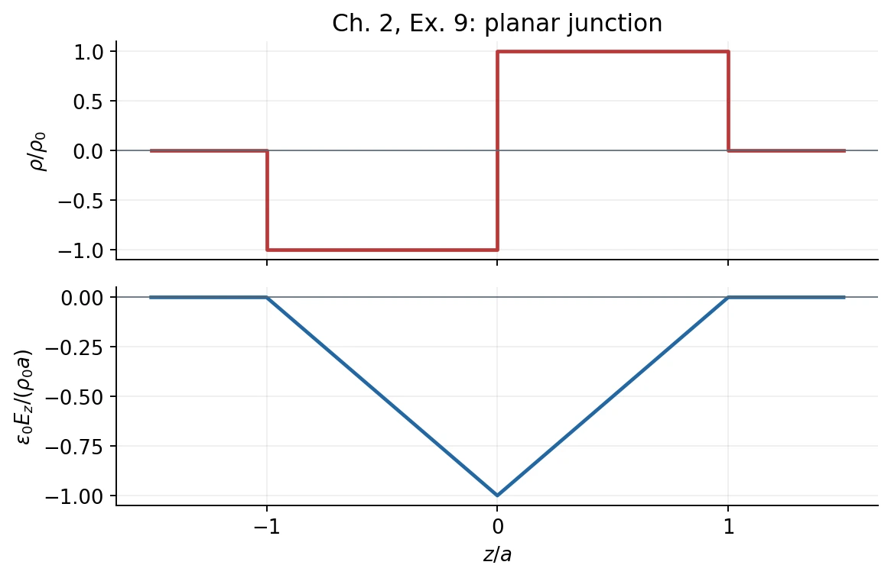

# Homework 1 · Electric Fields and Gauss's Law

[All assignments](index.md) · [Next](02-potential-and-local-laws.md). Here $k=1/(4\pi\epsilon_0)$.

## Ch. 1, Ex. 3 · Force between two dipoles {#ch01-ex03}

**Problem.** Dipole $\mathbf p_2$ is at displacement $\mathbf r$ from $\mathbf p_1$, with $r$ much larger than either dipole's size. Find the force on $\mathbf p_2$ by representing it as charges $\pm q_2$ at $\mathbf r\pm\mathbf d_2/2$ and expanding to first order.

**Method:** [Dipole field](../01-charge-and-electric-field.md#5-electric-dipole) and [Taylor expansion](../mathematical-toolkit.md#2-taylor-expansion-and-controlled-approximations).

**Solution.** With $\mathbf n=\mathbf r/r$ and $\mathbf p_2=q_2\mathbf d_2$,

$$
\mathbf E_1=\frac{k}{r^3}[3(\mathbf p_1\cdot\mathbf n)\mathbf n-\mathbf p_1],
\qquad
\mathbf F=q_2[\mathbf E_1(\mathbf r+\mathbf d_2/2)-\mathbf E_1(\mathbf r-\mathbf d_2/2)]
\simeq(\mathbf p_2\cdot\nabla)\mathbf E_1.
$$

Set $a=\mathbf p_1\cdot\mathbf n$, $b=\mathbf p_2\cdot\mathbf n$. Since
$\nabla(\mathbf p\cdot\mathbf n)=[\mathbf p-(\mathbf p\cdot\mathbf n)\mathbf n]/r$, differentiation gives

$$
\boxed{\mathbf F=\frac{3k}{r^4}
\left[a\mathbf p_2+b\mathbf p_1+(\mathbf p_1\cdot\mathbf p_2)\mathbf n-5ab\mathbf n\right].}
$$

Equivalently, $\mathbf F=-\nabla U$ for
$U=k[\mathbf p_1\cdot\mathbf p_2-3ab]/r^3$, holding both moments fixed. As a sign check, two parallel moments pointing along $\mathbf n$ attract: $\mathbf F=-6kp_1p_2\mathbf n/r^4$.

## Ch. 1, Ex. 7 · Semi-infinite charged rod {#ch01-ex07}

**Problem.** A rod occupies $z\geq0$, with uniform line density $\lambda>0$. Point $P$ is in $z=0$, distance $d>0$ from its end. (a) Find the perpendicular and signed $+z$ field components; show the field makes an acute angle $45^\circ$ with the rod axis. (b) Obtain the infinite-rod field without another integral.

**Method:** [Coulomb integral and superposition](../02-continuous-charge-and-gauss-law.md#1-charge-densities-and-the-coulomb-integral).

**Solution.** Choose $P=(d,0,0)$. A source element at $(0,0,z)$ produces

$$
d\mathbf E=k\lambda\frac{d\hat{\mathbf x}-z\hat{\mathbf z}}{(d^2+z^2)^{3/2}}\,dz.
$$

**(a)** Integrating from $0$ to $\infty$,

$$
E_\perp=k\lambda d\left[\frac{z}{d^2\sqrt{d^2+z^2}}\right]_0^\infty
=\frac{k\lambda}{d},\qquad
E_z=k\lambda\left[\frac1{\sqrt{d^2+z^2}}\right]_0^\infty
=-\frac{k\lambda}{d}.
$$

Thus $\mathbf E=(k\lambda/d)(\hat{\mathbf x}-\hat{\mathbf z})$ and $|\mathbf E|=\sqrt2k\lambda/d$. Equal component magnitudes give $45^\circ$ to the **unoriented axis**, or $135^\circ$ to $+\hat{\mathbf z}$（注意轴线与正轴方向的区别）.

**(b)** Reflect the rod into $z\leq0$: parallel components cancel and perpendicular components add. Therefore

$$
\boxed{\mathbf E_{\mathrm{infinite}}=\frac{\lambda}{2\pi\epsilon_0d}\hat{\mathbf x}.}
$$

## Ch. 1, Ex. 10 · Electric force, gravity, and neutrality {#ch01-ex10}

**Problem.** Use $e=1.60\times10^{-19}\ \mathrm C$, $k=8.99\times10^9\ \mathrm{N\,m^2/C^2}$, $G=6.67\times10^{-11}\ \mathrm{N\,m^2/kg^2}$, $m_e=9.11\times10^{-31}\ \mathrm{kg}$, $m_p=1.673\times10^{-27}\ \mathrm{kg}$, and $m_H=1.674\times10^{-27}\ \mathrm{kg}$. (a) Find the electric/gravitational force ratio for an electron–proton pair. (b) If the electron charge were $-e(1+\delta)$, find $|\delta|$ for which two hydrogen atoms' electric repulsion balances their gravitational attraction. Explain the separation independence in both parts.

**Method:** [Coulomb's inverse-square law](../01-charge-and-electric-field.md#2-coulombs-law-in-vector-form).

**Solution. (a)** Compare magnitudes:

$$
\boxed{\frac{F_E}{F_G}=\frac{ke^2/r^2}{Gm_em_p/r^2}
=\frac{ke^2}{Gm_em_p}\simeq2.26\times10^{39}.}
$$

**(b)** Each atom would have charge $-\delta e$. Balance requires

$$
\frac{k\delta^2e^2}{r^2}=\frac{Gm_H^2}{r^2}
\quad\Longrightarrow\quad
\boxed{|\delta|=\frac{m_H}{e}\sqrt{\frac Gk}\simeq9.01\times10^{-19}.}
$$

Both ratios are independent of $r$ because both forces scale as $r^{-2}$. 电荷的极小相对不平衡，就足以与原子间引力相比。

## Ch. 2, Ex. 4 · Two concentric charged shells {#ch02-ex04}

**Problem.** Two uniformly charged thin spherical shells have radii $R_1<R_2$. The outer shell has surface density $+\sigma$, with $\sigma>0$, and the field vanishes everywhere outside it. Find (a) the inner shell's surface density, (b) the field magnitude between shells, and (c) the field magnitude inside the inner shell.

**Method:** [Spherical symmetry and Gauss's law](../02-continuous-charge-and-gauss-law.md#6-how-symmetry-makes-gausss-law-useful).

**Solution. (a)** An exterior Gaussian sphere has zero flux, so

$$
Q_1+Q_2=0,\qquad Q_2=4\pi R_2^2\sigma,
\qquad \boxed{\sigma_1=-\sigma\frac{R_2^2}{R_1^2}.}
$$

**(b)** Between shells, only $Q_1$ is enclosed:

$$
\boxed{\mathbf E=-\frac{\sigma R_2^2}{\epsilon_0r^2}\hat{\mathbf r},
\qquad E=\frac{\sigma R_2^2}{\epsilon_0r^2}\quad(R_1<r<R_2).}
$$

**(c)** For $r<R_1$, $Q_{\rm enc}=0$ and spherical symmetry gives $\boxed{E=0}$. Zero enclosed charge alone would not suffice without the symmetry.

## Ch. 2, Ex. 6 · Flux through a cube {#ch02-ex06}

**Problem.** A charge $q>0$ and a cube of side $a$ are given; all face normals point outward. Find the flux through each face when the charge is (a) at the center and (b) at a corner.

**Method:** [Flux](../02-continuous-charge-and-gauss-law.md#4-electric-flux) and [Gauss's law](../02-continuous-charge-and-gauss-law.md#5-gausss-law-and-why-it-works).

**Solution. (a)** Six equivalent faces share the total flux:

$$
\boxed{\Phi_{\mathrm{each}}=\frac{q}{6\epsilon_0}.}
$$

**(b)** Assemble eight such cubes about the charged corner. The resulting cube of side $2a$ has the charge at its center. Each of its six faces has flux $q/(6\epsilon_0)$, shared equally by four small squares. Consequently,

$$
\boxed{\Phi_{\mathrm{each\ opposite\ face}}=\frac{q}{24\epsilon_0},
\qquad \Phi_{\mathrm{each\ face\ through\ }q}=0.}
$$

On a face containing the corner the field is tangent except at the singular point; the face flux is defined by excluding that point and taking the limit. Total flux for the small cube is $q/(8\epsilon_0)$. 电荷在边界上时，不能直接把它当作完整的内部电荷代入高斯定律；这里用八分之一立体角的极限。

## Ch. 2, Ex. 9 · Planar p–n junction model {#ch02-ex09}

**Problem.** Infinite layers in $x,y$ have $\rho(z)=-\rho_0$ for $-a<z<0$, $+\rho_0$ for $0<z<a$, and zero for $|z|>a$, with $\rho_0>0$. There is no other charge. (a) Superpose thin-sheet fields to show the exterior field is zero; explain why a pillbox symmetric about $z=0$ gives no field magnitude. (b) Use a pillbox with one end below $-a$ to find the interior field and its maximum magnitude.

**Method:** [Planar Gaussian surfaces](../02-continuous-charge-and-gauss-law.md#6-how-symmetry-makes-gausss-law-useful).

**Solution. (a)** A sheet at $z'$ contributes
$dE_z=\rho(z')\,dz'\operatorname{sgn}(z-z')/(2\epsilon_0)$.
For $z>a$ or $z<-a$, the sign is constant across all sheets and $\int_{-a}^a\rho(z')\,dz'=0$, hence $\mathbf E=0$. The distribution gives $E_z(-z)=E_z(z)$. A symmetric pillbox therefore has both zero enclosed charge and zero net flux, $A[E_z(z)-E_z(-z)]=0$; it gives no magnitude.

**(b)** Place the lower face in the zero-field region. Gauss's law gives
$E_z(z)=\epsilon_0^{-1}\int_{-a}^z\rho(z')\,dz'$, so

$$
\boxed{\mathbf E(z)=
\begin{cases}
0,&|z|\geq a,\\
-\rho_0(z+a)\hat{\mathbf z}/\epsilon_0,&-a<z<0,\\
-\rho_0(a-z)\hat{\mathbf z}/\epsilon_0,&0\leq z<a.
\end{cases}}
$$

The field points from the positive layer to the negative layer. It is continuous and has maximum magnitude $\boxed{E_{\max}=\rho_0a/\epsilon_0}$ at $z=0$.

*Original computed plot for this exercise; [figure record](assets/README.md).*
