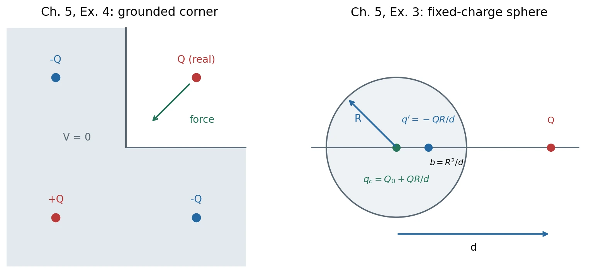
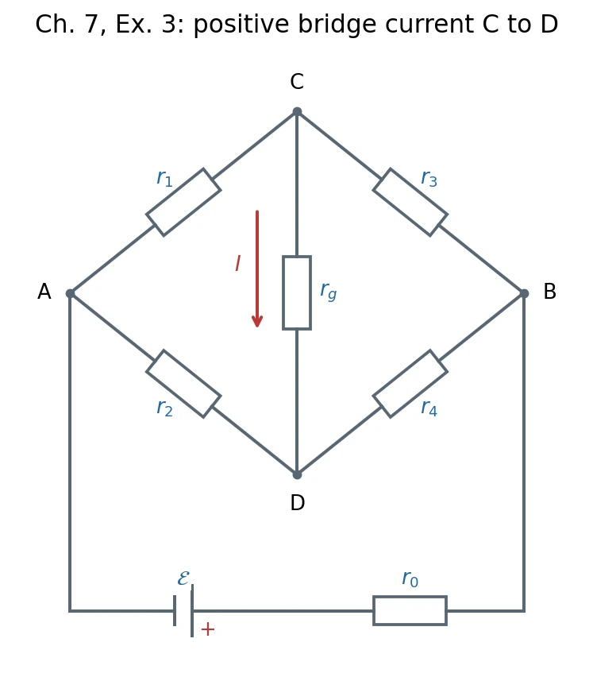
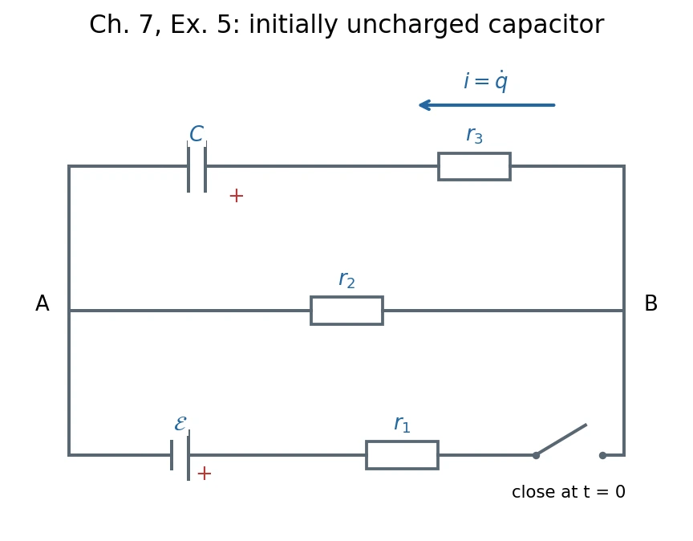

# Homework 3 · Conductors, Transport, and DC Circuits

[All assignments](index.md) · [Previous](02-potential-and-local-laws.md) · [Next](04-magnetic-force-and-fields.md). Here $k=1/(4\pi\epsilon_0)$.

*New construction diagrams for `chap05.pdf`, Ex. 4 (left) and Ex. 3 (right), PDF p. 9 / printed p. 42; [figure record](assets/README.md).*

## Ch. 5, Ex. 3 · An isolated charged conducting sphere {#ch05-ex03}

**Problem.** A point charge $Q$ is outside a thin conducting spherical shell of radius $R$, at center-distance $d>R$. The shell is isolated, with total charge $Q_0$. Find the force on $Q$.

**Method:** [Spherical image construction](../05-conductors-and-image-charges.md#8-classroom-supplement-spherical-image-construction), with a fixed-charge condition.

**Solution.** Let $\hat{\mathbf n}$ point from the center to $Q$. The grounded-sphere images are $q'=-QR/d$ at $b=R^2/d$ along $\hat{\mathbf n}$. For the isolated sphere add a central image

$$
q_c=Q_0-q'=Q_0+\frac{QR}{d}.
$$

The pair $Q,q'$ gives zero potential on the sphere; $q_c$ adds the constant $kq_c/R$ and makes the represented shell charge $q'+q_c=Q_0$. Uniqueness then fixes the exterior solution. The force is the force of both images, excluding the real charge's own field:

$$
\boxed{\mathbf F=
\left[\frac{kQ(Q_0+QR/d)}{d^2}
-\frac{kQ^2Rd}{(d^2-R^2)^2}\right]\hat{\mathbf n}.}
$$

For $Q_0=0$ the net force is attractive. 有净电荷的孤立球需要中心补偿电荷；不能直接套用接地球的单镜像结果。

## Ch. 5, Ex. 4 · Two perpendicular grounded walls {#ch05-ex04}

**Problem.** A charge $Q$ is at $(a,a,0)$, $a>0$. A grounded conductor fills $x<0$ or $y<0$ (including their overlap); the empty region is $x,y>0$. Find the conductor's force on $Q$.

**Method:** [Images and uniqueness](../05-conductors-and-image-charges.md#5-uniqueness-and-the-method-of-images).

**Solution.** Use three images:

| Image position | Charge | Force on the real charge |
| --- | --- | --- |
| $(-a,a,0)$ | $-Q$ | $-kQ^2\hat{\mathbf x}/(4a^2)$ |
| $(a,-a,0)$ | $-Q$ | $-kQ^2\hat{\mathbf y}/(4a^2)$ |
| $(-a,-a,0)$ | $+Q$ | $kQ^2(\hat{\mathbf x}+\hat{\mathbf y})/(8\sqrt2a^2)$ |

Charges cancel in pairs on each boundary plane, so both planes have $V=0$. Superposition gives

$$
\boxed{\mathbf F=-\frac{kQ^2}{4a^2}
\left(1-\frac1{2\sqrt2}\right)(\hat{\mathbf x}+\hat{\mathbf y}).}
$$

It points toward the corner along the bisector, with magnitude $\sqrt2kQ^2[1-1/(2\sqrt2)]/(4a^2)$. A second negative image alone would spoil the first plane's boundary condition; the positive diagonal image restores both.

## Ch. 5, Ex. 8 · Connected spheres and sharp points {#ch05-ex08}

**Problem.** Spheres of radii $R_1>R_2$ are far apart and joined by a thin wire. They carry total charge $Q>0$. Set $V(\infty)=0$, neglect wire charge and mutual influence, and treat each sphere's charge as uniform. (a) Find $Q_1,Q_2$. (b) Find $\sigma_1/\sigma_2$, $E_1/E_2$, and the implication for a conductor's sharp points.

**Method:** [Equipotential conductors](../05-conductors-and-image-charges.md#1-electrostatic-equilibrium-of-a-conductor) and [sphere surface fields](../05-conductors-and-image-charges.md#3-isolated-spherical-conductor).

**Solution. (a)** The connected conductor has one potential:

$$
\frac{kQ_1}{R_1}=\frac{kQ_2}{R_2},\qquad Q_1+Q_2=Q,
\qquad
\boxed{Q_1=\frac{QR_1}{R_1+R_2},\quad Q_2=\frac{QR_2}{R_1+R_2}.}
$$

**(b)** From $\sigma_i=Q_i/(4\pi R_i^2)$ and $E_i=\sigma_i/\epsilon_0$,

$$
\boxed{\frac{\sigma_1}{\sigma_2}=\frac{E_1}{E_2}=\frac{R_2}{R_1}<1.}
$$

The smaller sphere has less total charge but a stronger surface field. This illustrates field enhancement near small-radius, sharp regions（尖端效应）; the exact ratio here relies on the widely separated sphere approximation.

## Ch. 6, Ex. 5 · Wire above a grounded plane {#ch06-ex05}

**Problem.** A long wire of radius $a$ runs parallel to an infinite grounded metal plane, with its axis at height $h\gg a$. The gap is vacuum. Find the capacitance per unit length using a line-charge image.

**Method:** [Plane images](../05-conductors-and-image-charges.md#6-point-charge-above-a-grounded-plane) and [capacitance from $Q/V$](../06-current-resistance-and-capacitance.md#7-capacitors-and-capacitance).

**Solution.** Replace the wire by $+\lambda$ at height $h$ and its image by $-\lambda$ at $-h$. At a field point whose distances from the two lines are $r_+,r_-$,

$$
V=\frac{\lambda}{2\pi\epsilon_0}\ln\frac{r_-}{r_+}.
$$

The plane has $r_-=r_+$, hence $V=0$. On the thin wire, $r_+\simeq a$ and $r_-\simeq2h$, giving

$$
V_{\rm wire}\simeq\frac{\lambda}{2\pi\epsilon_0}\ln\frac{2h}{a},
\qquad
\boxed{C'=\frac{\lambda}{V_{\rm wire}}\simeq\frac{2\pi\epsilon_0}{\ln(2h/a)}.}
$$

$C'$ has units F/m. The stated $h\gg a$ makes the geometric-axis line approximation valid. For comparison, placing the exact image lines at heights $\pm\sqrt{h^2-a^2}$ makes the circular wire an exact equipotential and gives $C'=2\pi\epsilon_0/\operatorname{arcosh}(h/a)$, with the same thin-wire limit.

## Ch. 6, Ex. 7 · Charge at a conductivity interface {#ch06-ex07}

**Problem.** Two long rods, each of area $S$ and conductivities $\sigma_1,\sigma_2$, are joined end to end along $x$. A steady uniform current $I>0$ flows from rod 1 into rod 2 along $+x$. Both permittivities are $\epsilon_0$. (a) Find the fields and explain why they can differ. (b) Find the interface free charge and when it is positive.

**Method:** [Local Ohm's law](../06-current-resistance-and-capacitance.md#3-resistance-resistivity-and-conductivity) and [normal-field discontinuity](../05-conductors-and-image-charges.md#2-boundary-fields-and-surface-charge).

**Solution. (a)** Charge conservation fixes the same $J=I/S$, not the same $E$:

$$
\boxed{\mathbf E_1=\frac{I}{S\sigma_1}\hat{\mathbf x},\qquad
\mathbf E_2=\frac{I}{S\sigma_2}\hat{\mathbf x}.}
$$

**(b)** A thin pillbox across the interface gives $\sigma_{s}=\epsilon_0(E_2-E_1)$, so

$$
\boxed{Q_{\rm interface}=S\sigma_s
=\epsilon_0I\left(\frac1{\sigma_2}-\frac1{\sigma_1}\right).}
$$

It is positive for $\sigma_1>\sigma_2$, zero for equal conductivities, and negative for $\sigma_1<\sigma_2$. 界面电荷建立所需的电场差，使稳态电流连续。

## Ch. 6, Ex. 8 · Hemispherical earth electrode {#ch06-ex08}

**Problem.** A metal hemisphere of radius $a$ is buried with its flat face at the ground surface. Ground conductivity $\sigma$ is much smaller than the metal's; air is nonconducting. Steady current $I$ flows radially out through the ground to a very distant return electrode. Let $V(\infty)=0$. (a) Find $\mathbf J,\mathbf E$ for $r>a$ and the electrode resistance. (b) Find the voltage between feet at $r$ and $r+s$ on one radial line; explain the effect of reducing $s$.

**Method:** [Current density and resistance](../06-current-resistance-and-capacitance.md#3-resistance-resistivity-and-conductivity), using a hemispherical current surface.

**Solution. (a)** Current crosses area $2\pi r^2$, so

$$
\boxed{\mathbf J=\frac I{2\pi r^2}\hat{\mathbf r},\qquad
\mathbf E=\frac I{2\pi\sigma r^2}\hat{\mathbf r}.}
$$

Integrating the field,

$$
V(r)=\int_r^\infty E(s')ds'=\frac I{2\pi\sigma r},
\qquad \boxed{R=\frac{V(a)}I=\frac1{2\pi\sigma a}.}
$$

**(b)** The step voltage（跨步电压）is

$$
\boxed{V(r)-V(r+s)=\frac I{2\pi\sigma}\left(\frac1r-\frac1{r+s}\right)
=\frac{Is}{2\pi\sigma r(r+s)}.}
$$

At fixed $r$, reducing foot separation reduces this voltage and the resulting body current in this model. Near the electrode the radial potential gradient is largest.

## Ch. 7, Ex. 3 · Wheatstone bridge with source resistance {#ch07-ex03}

**Problem.** In the bridge below, $r_1$ joins $A$–$C$, $r_3$ joins $C$–$B$, $r_2$ joins $A$–$D$, $r_4$ joins $D$–$B$, and $r_g$ joins $C$–$D$. The source branch has emf $\mathcal E$ (positive terminal toward $B$) and series resistance $r_0$. (a) Find $I$ through $r_g$, positive from $C$ to $D$. (b) Find the zero-current condition.

*Redrawn from `chap07.pdf`, Fig. 7.7, PDF p. 9 (printed p. 62); [figure record](assets/README.md).*

**Method:** [Kirchhoff node and loop rules](../07-dc-circuits-and-dielectrics.md#2-electromotive-force-and-kirchhoffs-rules).

**Solution. (a)** Set $V_A=0$, $V_B=V$, $V_C=u$, $V_D=w$. The node equations are

$$
\frac u{r_1}+\frac{u-V}{r_3}+\frac{u-w}{r_g}=0,
\qquad
\frac w{r_2}+\frac{w-V}{r_4}+\frac{w-u}{r_g}=0,
$$

$$
\frac{\mathcal E-V}{r_0}=\frac{V-u}{r_3}+\frac{V-w}{r_4},
\qquad I=\frac{u-w}{r_g}.
$$

Solving this linear system gives

$$
\boxed{I=\frac{\mathcal E(r_1r_4-r_2r_3)}{r_g\mathcal A+\mathcal B},}
$$

where

$$
\begin{aligned}
\mathcal A&=(r_1+r_3)(r_2+r_4)+r_0(r_1+r_2+r_3+r_4),\\
\mathcal B&=r_1r_2(r_3+r_4)+r_3r_4(r_1+r_2)
+r_0(r_1+r_2)(r_3+r_4).
\end{aligned}
$$

For an ideal source use the $r_0\to0$ limit (or set $V=\mathcal E$ directly).

**(b)** For positive finite resistances, the denominator is positive; therefore

$$
\boxed{I=0\iff r_1r_4=r_2r_3\iff\frac{r_1}{r_2}=\frac{r_3}{r_4}.}
$$

At balance $V_C=V_D$: the bridge branch draws no current. The balance condition is independent of $r_0$ and $r_g$; the current away from balance is not.

## Ch. 7, Ex. 5 · Charging with three resistors {#ch07-ex05}

**Problem.** Three branches join nodes $A,B$: a capacitor $C$ in series with $r_3$, a resistor $r_2$, and a source $\mathcal E$ (positive toward $B$) in series with $r_1$ and a switch. The capacitor is uncharged when the switch closes at $t=0$. Find the magnitude $q(t)$ of either plate's charge and $q(\infty)$.

*Redrawn from `chap07.pdf`, Fig. 7.9, PDF p. 10 (printed p. 63); [figure record](assets/README.md).*

**Method:** [Kirchhoff rules](../07-dc-circuits-and-dielectrics.md#2-electromotive-force-and-kirchhoffs-rules) and [first-order RC response](../07-dc-circuits-and-dielectrics.md#4-rc-charging-and-discharging).

**Solution.** Let $V=V_B-V_A$, and let $i=\dot q$ flow from $B$ through $r_3$ into the capacitor's positive plate. Then

$$
\frac{\mathcal E-V}{r_1}=\frac V{r_2}+i,
\qquad V=r_3i+\frac qC.
$$

Eliminating $V$ gives

$$
R_*\dot q+\frac qC=\mathcal E_*,\qquad
R_*=r_3+\frac{r_1r_2}{r_1+r_2},\qquad
\mathcal E_*=\frac{r_2}{r_1+r_2}\mathcal E.
$$

With $q(0)=0$,

$$
\boxed{q(t)=C\mathcal E_*\left(1-e^{-t/(CR_*)}\right),
\qquad q(\infty)=\frac{C\mathcal E r_2}{r_1+r_2}.}
$$

At long times the capacitor branch carries no current and the remaining divider fixes its voltage. 时间常数中的电阻是 $r_3+(r_1\parallel r_2)$，不是三个电阻直接相加。

## Ch. 7, Ex. 9 · Capacitor force and battery work {#ch07-ex09}

**Problem.** A vacuum parallel-plate capacitor has area $S$, separation $x$, a fixed lower plate, and a movable upper plate. Ignore edges and move slowly, neglecting kinetic energy and heat. Force $F$ is positive toward increasing $x$. (a) For isolated charges $\pm q$, find $U(x)$ and $F$. (b) With an ideal battery holding voltage $V$, find $U(x)$, battery work for $dx$, and the correct force from energy conservation; explain the failure of simply using $-dU/dx$ and compare with (a).

**Method:** [Capacitor energy and source power](../07-dc-circuits-and-dielectrics.md#3-electrical-power-and-capacitor-energy).

**Solution. (a)** Since $C=\epsilon_0S/x$ and $q$ is fixed,

$$
U(x)=\frac{q^2}{2C}=\frac{q^2x}{2\epsilon_0S},\qquad
\boxed{F=-\left.\frac{dU}{dx}\right|_q=-\frac{q^2}{2\epsilon_0S}.}
$$

**(b)** At fixed $V$,

$$
U(x)=\frac12CV^2=\frac{\epsilon_0SV^2}{2x},\qquad
q(x)=\frac{\epsilon_0SV}{x},\qquad
\delta W_{\rm battery}=V\,dq=-\frac{\epsilon_0SV^2}{x^2}dx.
$$

Energy balance is $dU=\delta W_{\rm battery}-F\,dx$ (the external agent does work $-F\,dx$). Hence

$$
\boxed{F=\frac{\delta W_{\rm battery}}{dx}-\frac{dU}{dx}
=-\frac{\epsilon_0SV^2}{2x^2}.}
$$

Using $-dU/dx$ alone omits energy returned to the battery and gives the wrong sign. Both answers are attractive and agree at $q=CV$: $|F|/S=\epsilon_0E^2/2$. 固定电荷与固定电压的能量系统边界不同，电池做功不能漏掉。
