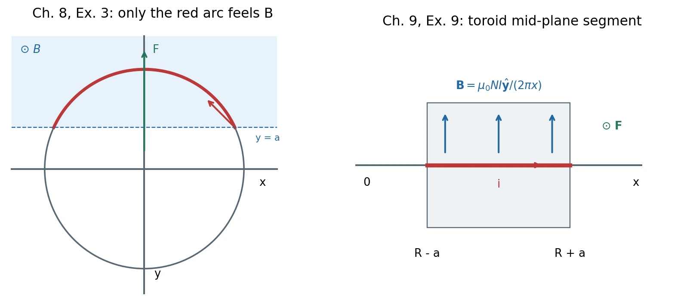

# Homework 4 · Magnetic Force and Current-Generated Fields

[All assignments](index.md) · [Previous](03-conductors-and-circuits.md) · [Next](05-dipoles-and-induction.md).

*New geometry diagrams for Ch. 8, Ex. 3 (left), and Ch. 9, Ex. 9 (right), from the supplied exercises; [figure record](assets/README.md).*

## Ch. 8, Ex. 3 · A loop partly in a magnetic field {#ch08-ex03}

**Problem.** A field $\mathbf B=B\hat{\mathbf z}$ exists only in the region $y\geq a$ of the $xy$ plane. A circular loop of radius $R$, centered at the origin, carries current $I$ counterclockwise seen from $+z$, with $0\leq a<R$. Find its net force.

**Method:** [Force on a current element](../08-magnetic-force-and-motion.md#5-force-on-a-current-carrying-wire).

**Solution.** Only the upper arc is in the field. Parameterize it by
$\mathbf r=R(\cos\theta,\sin\theta,0)$, with $\alpha=\arcsin(a/R)$ and $\alpha\leq\theta\leq\pi-\alpha$. Since $\mathbf B$ is constant on that arc,

$$
\mathbf F=I\int_{\rm arc}d\boldsymbol\ell\times\mathbf B
=I(\mathbf r_{\rm end}-\mathbf r_{\rm start})\times B\hat{\mathbf z}.
$$

The displacement along the current is $-2\sqrt{R^2-a^2}\hat{\mathbf x}$, so

$$
\boxed{\mathbf F=2IB\sqrt{R^2-a^2}\hat{\mathbf y}.}
$$

It reduces to $2IBR\hat{\mathbf y}$ for the upper semicircle ($a=0$), and vanishes as $a\to R$. 不能把整圆代入 $I\oint d\boldsymbol\ell=0$；下半部分没有磁场。

## Ch. 8, Ex. 4 · Torque on a rotating charged disk {#ch08-ex04}

**Problem.** A plastic disk of radius $R$ has uniform surface charge density $\sigma$ and rotates about its axis with angular velocity $\boldsymbol\omega$. A uniform field $\mathbf B$ is perpendicular to the rotation axis. Find the torque magnitude.

**Method:** [Current-loop moment and torque](../08-magnetic-force-and-motion.md#6-torque-magnetic-moment-and-a-motor).

**Solution.** Split the disk into rings. For $\omega=|\boldsymbol\omega|$,

$$
dq=2\pi\sigma r\,dr,\qquad dI=\frac{\omega}{2\pi}dq=\sigma\omega r\,dr,
\qquad d\mu=\pi r^2dI.
$$

Integrating gives the signed vector moment

$$
\boldsymbol\mu=\frac{\pi\sigma R^4}{4}\boldsymbol\omega,
\qquad \boldsymbol\tau=\boldsymbol\mu\times\mathbf B,
\qquad \boxed{|\boldsymbol\tau|=\frac{\pi|\sigma|\omega BR^4}{4}.}
$$

The moment follows $\boldsymbol\omega$ for positive charge and opposes it for negative charge. The disk is insulating: charges rotate with the material rather than redistributing as on a conductor.

## Ch. 8, Ex. 7 · Motion from rest in crossed fields {#ch08-ex07}

**Problem.** Uniform fields are $\mathbf E=E\hat{\mathbf x}$ and $\mathbf B=B\hat{\mathbf z}$, $E,B>0$. A particle of mass $m$ and charge $q\ne0$ starts at rest at the origin. Ignore gravity. (a) Find the mean velocity over one cyclotron period $T=2\pi m/(|q|B)$ and show it is independent of $q,m$. (b) Find the largest $|x|$ and the sign of $q$ for which the particle moves toward $+x$.

**Method:** [Lorentz force](../08-magnetic-force-and-motion.md#1-lorentz-force) and [crossed fields](../08-magnetic-force-and-motion.md#2-crossed-fields-and-thomsons-measurement).

**Solution. (a)** First derive the motion using the signed frequency $\omega_s=qB/m$. The equations are

$$
\dot v_x=\omega_s(v_y+E/B),\qquad
\dot v_y=-\omega_sv_x,\qquad v_z=0.
$$

With zero initial velocity, the shifted vector $(v_x,v_y+E/B)$ rotates uniformly:

$$
\boxed{v_x=\frac EB\sin\omega_st,\qquad
v_y=\frac EB(\cos\omega_st-1),\qquad v_z=0.}
$$

Integrating with $\mathbf r(0)=0$,

$$
\boxed{x=\frac{E}{B\omega_s}(1-\cos\omega_st),\qquad
y=\frac{E}{B\omega_s}\sin\omega_st-\frac EB t,\qquad z=0.}
$$

The positive period and drift are

$$
\boxed{T=\frac{2\pi m}{|q|B},\qquad
\langle\mathbf v\rangle=\frac{\mathbf r(T)-\mathbf r(0)}T
=-\frac EB\hat{\mathbf y}
=\frac{\mathbf E\times\mathbf B}{B^2}.}
$$

The drift does not depend on $q$ or $m$, although the cyclotron motion does.

**(b)** Since $0\leq1-\cos\omega_st\leq2$,

$$
\boxed{|x|_{\max}=\frac{2mE}{|q|B^2}.}
$$

Positive charges stay on the $x\geq0$ side; negative charges stay on $x\leq0$. 漂移方向对两种电荷相同，横向偏转方向相反。

## Ch. 9, Ex. 2 · Field of a rotating charged spherical shell {#ch09-ex02}

**Problem.** A spherical surface of radius $R$ carries uniformly distributed total charge $Q$. It rotates about $z$ with angular speed $\omega$, counterclockwise seen from $+z$. Find the magnetic field magnitude on the axis at $(0,0,z)$ for $|z|<R$ and $|z|>R$.

**Method:** [Biot–Savart superposition](../09-fields-of-currents.md#1-biotsavart-law) and [circular-loop axial field](../10-magnetic-dipoles-and-materials.md#2-circular-arc-coil-and-dipole-field).

**Solution.** Write $\sigma=Q/(4\pi R^2)$ and build the shell from rings at polar angle $\theta$. Each ring has radius $R\sin\theta$, height $R\cos\theta$, and current

$$
dI=\frac{\omega}{2\pi}(\sigma\,2\pi R^2\sin\theta\,d\theta)
=\sigma\omega R^2\sin\theta\,d\theta.
$$

Its axial field contribution gives

$$
B_z=\frac{\mu_0\sigma\omega R^4}{2}
\int_0^\pi\frac{\sin^3\theta\,d\theta}
{(R^2+z^2-2Rz\cos\theta)^{3/2}}.
$$

To evaluate, set $s=|z|$, $u=\cos\theta$, $A=R^2+s^2$, $D=2Rs$. For $s>0$,

$$
\begin{aligned}
\mathcal I&=\int_{-1}^1\frac{1-u^2}{(A-Du)^{3/2}}du\\
&=\frac2{D^3}\left[-\frac{D^2-A^2}{w}+2Aw-\frac{w^3}{3}\right]_{|R-s|}^{R+s}
=\frac4{3\max(R,s)^3},
\end{aligned}
$$

where $w=\sqrt{A-Du}$. At $s=0$ the same result follows directly from $\int_0^\pi\sin^3\theta\,d\theta=4/3$. Thus

$$
\boxed{\mathbf B(0,0,z)=\begin{cases}
\dfrac{\mu_0Q\omega}{6\pi R}\hat{\mathbf z},&|z|<R,\\[3pt]
\dfrac{\mu_0Q\omega R^2}{6\pi|z|^3}\hat{\mathbf z},&|z|>R.
\end{cases}}
$$

For the requested magnitude replace $Q$ by $|Q|$. The interior axial field is constant. The exterior result agrees with a dipole $\mu=Q\omega R^2/3$. This is a **surface** charge distribution, not a uniformly charged solid ball.

## Ch. 9, Ex. 7 · Ampère paths with winding numbers {#ch09-ex07}

**Problem.** Wire $A$ carries $i_1>0$ out of the page; wire $B$ carries $i_2>0$ into it. Find $\oint\mathbf B\cdot d\boldsymbol\ell$ for (a) a path winding twice counterclockwise around $A$, never around $B$; (b) a figure-eight whose side-by-side lobes meet at one genuine crossing, with the lobe about $A$ traversed counterclockwise and the other surrounding $B$.

**Method:** [Ampère's law and orientation](../09-fields-of-currents.md#3-amperes-circuital-law).

**Solution.** For an oriented planar path,

$$
\oint\mathbf B\cdot d\boldsymbol\ell
=\mu_0\sum_j n_jI_{j,z},
$$

where $n_j$ is its signed winding number and $I_{j,z}$ is positive out of the page.

**(a)** $n_A=2,n_B=0$, hence $\boxed{\oint\mathbf B\cdot d\boldsymbol\ell=2\mu_0i_1}$.

**(b)** A genuine crossing makes the other lobe clockwise, so $n_A=1,n_B=-1$, while $I_{B,z}=-i_2$. Therefore

$$
\boxed{\oint\mathbf B\cdot d\boldsymbol\ell=\mu_0[i_1+(-1)(-i_2)]
=\mu_0(i_1+i_2).}
$$

The two signs for the second lobe cancel. 自交环路按各叶片的有向绕数计算，不能只看几何上圈住了哪些电流。

## Ch. 9, Ex. 9 · Force across a toroid's finite width {#ch09-ex09}

**Problem.** A toroid has $N$ turns, current $I$, major radius $R$, and circular cross-section radius $a<R$. Its mid-plane is $xy$ and its internal field circulates counterclockwise seen from $+z$. A straight test wire runs along the positive $x$ axis from $R-a$ to $R+a$, carrying current $i$ toward $+x$. (a) Find the force on this segment. (b) Compare its magnitude with $2aiB_0$, where $B_0=\mu_0NI/(2\pi R)$; show which is larger.

**Method:** [Toroid field](../09-fields-of-currents.md#4-solenoid-and-toroid) and [wire force](../08-magnetic-force-and-motion.md#5-force-on-a-current-carrying-wire).

**Solution. (a)** At $x>0$, $\mathbf B(x)=\mu_0NI\hat{\mathbf y}/(2\pi x)$. Thus

$$
\boxed{\mathbf F=i\int_{R-a}^{R+a}dx\,\hat{\mathbf x}\times\mathbf B(x)
=\frac{\mu_0NIi}{2\pi}\ln\frac{R+a}{R-a}\hat{\mathbf z}.}
$$

**(b)** Put $u=a/R\in(0,1)$. Then

$$
\frac{F}{2aiB_0}=\frac1{2u}\ln\frac{1+u}{1-u}
=1+\frac{u^2}{3}+\frac{u^4}{5}+\cdots>1.
$$

Hence $\boxed{F>2aiB_0}$. The center-field approximation underestimates the force, tending to equality only as $a/R\to0$.
