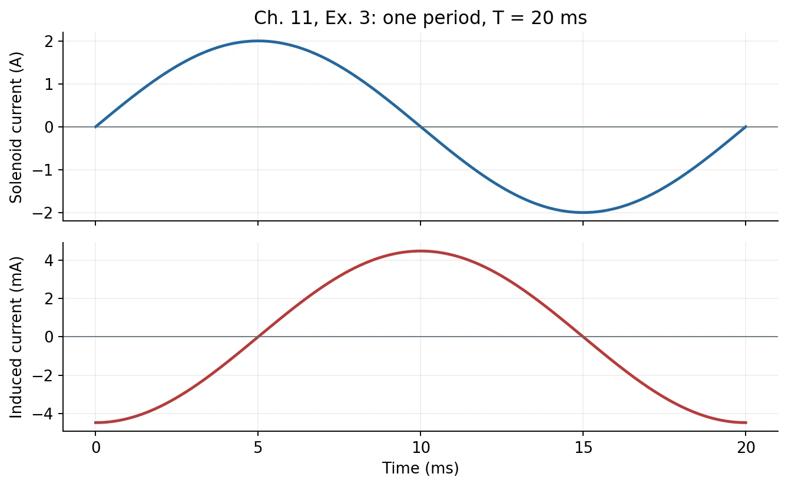
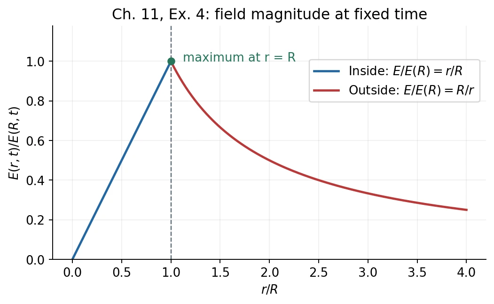

# Homework 5 · Magnetic Dipoles and Electromagnetic Induction

[All assignments](index.md) · [Previous](04-magnetic-force-and-fields.md) · [Next](06-inductance-and-ac-circuits.md).

## Ch. 10, Ex. 1 · Deriving the magnetic dipole field {#ch10-ex01}

**Problem.** A ring of radius $R$ lies in the $xy$ plane, centered at the origin, with current $I$ counterclockwise seen from $+z$. (a) Show that at $\mathbf r=(r\sin\theta,0,r\cos\theta)$, $r\gg R$,
$\mathbf B=\mu_0[3(\boldsymbol\mu\cdot\mathbf r)\mathbf r/r^5-\boldsymbol\mu/r^3]/(4\pi)$, where $\boldsymbol\mu=I\pi R^2\hat{\mathbf z}$.
(b) Find the potential energy of another dipole $\boldsymbol\mu'$ placed there.

**Method:** [Biot–Savart law](../09-fields-of-currents.md#1-biotsavart-law), [dipole field](../10-magnetic-dipoles-and-materials.md#2-circular-arc-coil-and-dipole-field), and [dipole energy](../08-magnetic-force-and-motion.md#6-torque-magnetic-moment-and-a-motor).

**Solution. (a)** Let $\mathbf r'$ be a point on the ring and $\mathbf A=\pi R^2\hat{\mathbf z}$ its oriented area. Expand the Biot–Savart kernel:

$$
\mathbf B=\frac{\mu_0I}{4\pi}\oint
\frac{d\boldsymbol\ell'\times(\mathbf r-\mathbf r')}{|\mathbf r-\mathbf r'|^3},
\qquad
\frac1{|\mathbf r-\mathbf r'|^3}
\simeq\frac1{r^3}\left(1+\frac{3\mathbf r\cdot\mathbf r'}{r^2}\right).
$$

With $\mathbf r'=R(\cos\phi,\sin\phi,0)$ and
$d\boldsymbol\ell'=R(-\sin\phi,\cos\phi,0)d\phi$, direct integration yields

$$
\oint d\boldsymbol\ell'=0,\qquad
\oint d\boldsymbol\ell'\times\mathbf r'=-2\mathbf A,\qquad
\oint(\mathbf r\cdot\mathbf r')d\boldsymbol\ell'=\mathbf A\times\mathbf r.
$$

Keeping the leading nonzero terms,

$$
\mathbf B\simeq\frac{\mu_0I}{4\pi}
\left[\frac{2\mathbf A}{r^3}
+\frac{3(\mathbf A\times\mathbf r)\times\mathbf r}{r^5}\right].
$$

Use $(\mathbf A\times\mathbf r)\times\mathbf r
=\mathbf r(\mathbf A\cdot\mathbf r)-r^2\mathbf A$ and $\boldsymbol\mu=I\mathbf A$:

$$
\boxed{\mathbf B\simeq\frac{\mu_0}{4\pi r^3}
[3(\boldsymbol\mu\cdot\hat{\mathbf r})\hat{\mathbf r}-\boldsymbol\mu].}
$$

In the specified plane, $B_x=3\mu_0\mu\sin\theta\cos\theta/(4\pi r^3)$, $B_y=0$, and $B_z=\mu_0\mu(3\cos^2\theta-1)/(4\pi r^3)$. This is a far-field approximation, not the exact near-ring field.

**(b)**

$$
\boxed{U=-\boldsymbol\mu'\cdot\mathbf B
=\frac{\mu_0}{4\pi r^3}
\left[\boldsymbol\mu\cdot\boldsymbol\mu'
-3(\boldsymbol\mu\cdot\hat{\mathbf r})(\boldsymbol\mu'\cdot\hat{\mathbf r})\right].}
$$

## Ch. 11, Ex. 1 · Rectangular loop moving away from a wire {#ch11-ex01}

**Problem.** An infinite straight wire carries current $I$ upward. A coplanar rectangular loop lies to its right and moves rightward at speed $v$. Its height parallel to the wire is $a$, width is $b$, and its near edge is at instantaneous distance $c$ from the wire (Fig. 11.6). Find the induced emf.

**Method:** [Straight-wire field](../09-fields-of-currents.md#2-straight-wire-and-parallel-current-force) and [Faraday/Lenz laws](../11-electromagnetic-induction.md#1-magnetic-flux-and-faradays-law).

**Solution.** Take the loop's normal out of the page and counterclockwise circulation as positive. The wire's field through the loop is into the page, so

$$
\Phi_B=-a\int_c^{c+b}\frac{\mu_0I}{2\pi x}\,dx
=-\frac{\mu_0Ia}{2\pi}\ln\frac{c+b}{c},\qquad\dot c=v.
$$

Then

$$
\mathcal E=-\frac{d\Phi_B}{dt}
=-\frac{\mu_0Iav}{2\pi}\left(\frac1c-\frac1{c+b}\right),
\qquad
\boxed{|\mathcal E|=\frac{\mu_0Iabv}{2\pi c(c+b)}.}
$$

The emf drives a **clockwise** current if the loop is conducting and closed: it maintains the decreasing into-page flux. The two moving vertical sides give the same result by motional emf; their unequal fields prevent cancellation.

## Ch. 11, Ex. 3 · Sinusoidal solenoid and pickup loop {#ch11-ex03}

**Problem.** A long solenoid along $z$ has radius $r_1=5\ \mathrm{cm}$, $n=1000\ \mathrm{m^{-1}}$, and $I(t)=I_0\sin\omega t$, with $I_0=2\ \mathrm A$ and $\omega=100\pi\ \mathrm{rad/s}$. A circular loop of radius $r_2=3\ \mathrm{cm}$ and resistance $R=0.5\ \Omega$ lies inside it, perpendicular to the axis. Counterclockwise seen from $+z$ is positive for both currents and the loop emf. Find (a) $B(t)$, (b) the induced emf, (c) maximum induced current, and (d) sketch both currents over one period.

**Method:** [Solenoid field](../09-fields-of-currents.md#4-solenoid-and-toroid) and [Faraday's law](../11-electromagnetic-induction.md#1-magnetic-flux-and-faradays-law). Use the chapter's resistive-loop approximation, neglecting its self-inductance and back-reaction.

**Solution. (a)**

$$
\boxed{\mathbf B(t)=\mu_0nI_0\sin\omega t\,\hat{\mathbf z}
=(2.513\times10^{-3}\ \mathrm T)\sin(100\pi t)\hat{\mathbf z}.}
$$

**(b)** The linked area is the **pickup loop's area** $\pi r_2^2$, since $r_2<r_1$:

$$
\boxed{\mathcal E(t)=-\pi r_2^2\frac{dB_z}{dt}
=-\mu_0n\pi r_2^2I_0\omega\cos\omega t
=-(2.232\ \mathrm{mV})\cos(100\pi t).}
$$

**(c)** $i(t)=\mathcal E/R$, so $\boxed{|i|_{\max}=4.465\ \mathrm{mA}}$.

**(d)** The period is $T=2\pi/\omega=20\ \mathrm{ms}$. The following plot uses separate vertical scales. At $t=0$, the source current is increasing through zero and the induced current is maximally negative; at $t=T/4$ the source is maximal and the induced current is zero.

*Original computed plot from the equations above; [figure record](assets/README.md).*

## Ch. 11, Ex. 4 · Electric field around a decaying magnetic field {#ch11-ex04}

**Problem.** A uniform magnetic field $B(t)=B_0e^{-t/\tau}$ points out of the page and is confined to a long cylindrical region of radius $R$, with $B_0,\tau>0$. No nearby charges contribute electric field. (a) Find the induced $E(r,t)$ inside and outside. (b) Sketch its radial dependence at fixed time and locate its maximum. (c) A particle of charge $q$ and mass $m$ starts at rest at $t=0$ in a frictionless insulating circular tube of radius $r_0$ about the axis. Find its final speed and direction, for $r_0<R$ and $r_0>R$.

**Method:** [Circular induced electric fields](../11-electromagnetic-induction.md#4-induced-electric-field-no-conductor-required).

**Solution. (a)** Choose counterclockwise $\hat{\boldsymbol\phi}$ as positive. Faraday's law gives

$$
2\pi rE_\phi=-\frac{d}{dt}\left[\pi\min(r^2,R^2)B(t)\right],
$$

$$
\boxed{\mathbf E(r,t)=\frac{B_0e^{-t/\tau}}{2\tau}
\begin{cases}
r\hat{\boldsymbol\phi},&r<R,\\
(R^2/r)\hat{\boldsymbol\phi},&r>R.
\end{cases}}
$$

The sense is counterclockwise, tending to maintain the decreasing outward magnetic flux. $\mathbf E$ remains nonzero outside the magnetic-field region.

**(b)** The field rises linearly inside, falls as $1/r$ outside, and is continuous at $R$. Its maximum is $\boxed{E(R,t)=B_0Re^{-t/\tau}/(2\tau)}$.

*Original computed plot, normalized at a fixed time; [figure record](assets/README.md).*

**(c)** The magnetic force and tube's constraint force have no tangential component. Thus $m\dot v_\phi=qE_\phi(r_0,t)$. Integrating from rest,

$$
v_\phi(t)=\frac{qB_0}{2m}(1-e^{-t/\tau})
\begin{cases}r_0,&r_0<R,\\ R^2/r_0,&r_0>R.\end{cases}
$$

Consequently,

$$
\boxed{v_\infty=\frac{|q|B_0}{2m}
\begin{cases}r_0,&r_0<R,\\R^2/r_0,&r_0>R.\end{cases}}
$$

Positive charges move counterclockwise; negative charges clockwise. The final speed is independent of $\tau$: a slower decay gives a weaker field acting for longer. 能量来自改变磁场的外部装置，磁力本身不做功。

## Ch. 11, Ex. 7 · Faraday disk and the correct flux path {#ch11-ex07}

**Problem.** A thin conducting disk of radius $a$ rotates counterclockwise about $+z$ at constant $\omega$ in $\mathbf B=B\hat{\mathbf z}$, $B>0$. Sliding contacts at its center and rim connect through a stationary resistor $R$. Neglect all other resistance, friction, and self-inductance. (a) Find the center–rim emf and polarity. (b) Find the current, magnetic and applied torques, and verify mechanical/electrical power equality. (c) Although disk flux is constant, use a path comprising the external circuit, a material radius initially at the rim contact, and the swept rim arc, for $0<t<2\pi/\omega$, to compute the flux change and compare with (a).

**Method:** [Motional emf and mechanical power](../11-electromagnetic-induction.md#3-motional-emf-and-mechanical-energy) and [moving contours](../11-electromagnetic-induction.md#5-moving-versus-fixed-contours).

**Solution. (a)** Disk material moves with $\mathbf u=\omega r\hat{\boldsymbol\phi}$, so $\mathbf u\times\mathbf B=\omega rB\hat{\mathbf r}$. The emf from center to rim is

$$
\boxed{\mathcal E=\int_0^a\omega rB\,dr=\frac12B\omega a^2.}
$$

The rim is the positive terminal; positive charges are driven outward. With the stated negligible internal resistance, $V_{\rm rim}-V_{\rm center}=\mathcal E$ also under load.

**(b)** Current is outward through the disk and from rim to center through the external resistor:

$$
I=\frac{B\omega a^2}{2R}.
$$

For radial current, $d\mathbf F=I\,dr\,\hat{\mathbf r}\times B\hat{\mathbf z}=-IB\,dr\,\hat{\boldsymbol\phi}$. Hence

$$
\boxed{\boldsymbol\tau_B=-\frac{IBa^2}{2}\hat{\mathbf z}
=-\frac{B^2\omega a^4}{4R}\hat{\mathbf z},\qquad
\boldsymbol\tau_{\rm applied}=-\boldsymbol\tau_B.}
$$

The applied power is

$$
P_{\rm mech}=\omega\tau_{\rm applied}
=\frac{B^2\omega^2a^4}{4R}=I\mathcal E=I^2R.
$$

**(c)** Orient the path outward along the rotating radius, back clockwise along the rim to the fixed contact, then through the external branch to the center. Relative to its initial surface, its signed flux changes by

$$
\Phi(t)-\Phi(0)=-B\left(\frac12a^2\omega t\right),\qquad
\boxed{-\frac{d\Phi}{dt}=\frac12B\omega a^2=\mathcal E.}
$$

The swept sector grows at rate $a^2\omega/2$. 磁盘整个面积的恒定磁通不对应滑动接触回路；必须追踪题目指定的闭合路径。
