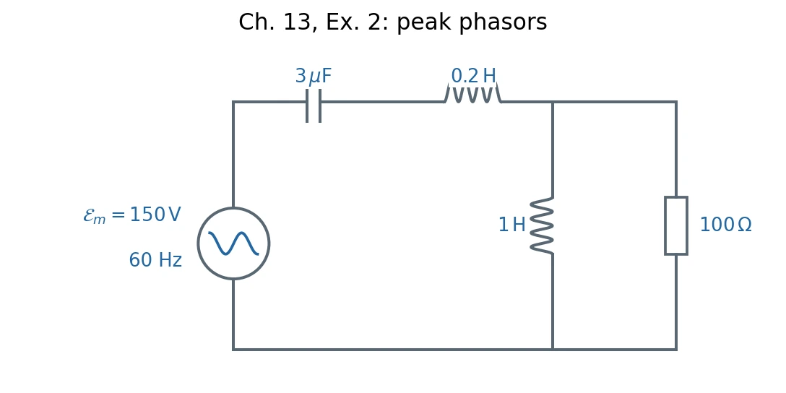

# Homework 6 · Inductance, LC Oscillations, and AC Networks

[All assignments](index.md) · [Previous](05-dipoles-and-induction.md) · [Next](07-maxwell-equations-and-energy.md).

## Ch. 12, Ex. 5 · Reversing a solenoid current {#ch12-ex05}

**Problem.** A long air-core solenoid has length $\ell$, area $S$, $n$ turns per unit length, axis $z$, and negligible resistance. Positive current enters terminal $A$, leaves $B$, and circulates counterclockwise seen from $+z$. A current source imposes $i(t)=I_0(1-2t/T)$, $0\leq t\leq T$, with $I_0,T>0$. (a) Find its self-induced emf (positive along the positive winding sense), $V_A-V_B$, and which terminal is higher, including when $i$ crosses zero. (b) Find stored energies at $0,T/2,T$ and source work in each half-interval.

**Method:** [Self-inductance](../12-inductance-and-rl-circuits.md#1-flux-linkage-and-self-inductance), [terminal voltage](../12-inductance-and-rl-circuits.md#2-self-induced-emf-and-terminal-voltage), and [magnetic energy](../12-inductance-and-rl-circuits.md#4-magnetic-energy-and-energy-density).

**Solution. (a)** The flux linkage is $\Lambda=(n\ell)(\mu_0ni)S$, hence

$$
L=\mu_0n^2\ell S,\qquad\dot i=-\frac{2I_0}{T},
\qquad
\boxed{\mathcal E_L=-L\dot i=\frac{2LI_0}{T},\quad
V_A-V_B=L\dot i=-\frac{2LI_0}{T}.}
$$

Terminal $B$ stays at the higher potential throughout the ramp. Its polarity does not reverse when $i=0$ at $T/2$: it depends on $\dot i$, not $i$.

**(b)** The energy and power delivered to the solenoid are

$$
U=\frac12Li^2,\qquad P_{\rm source}=i(V_A-V_B)=Li\dot i=\dot U.
$$

Thus

$$
\boxed{U(0)=U(T)=\frac12LI_0^2,\qquad U(T/2)=0,}
$$

$$
\boxed{W_{0\to T/2}=-\frac12LI_0^2,\qquad
W_{T/2\to T}=+\frac12LI_0^2.}
$$

The source first absorbs the old field energy and then supplies the reversed field's energy; its net work is zero. 电流反向不等于电压反向。

## Ch. 12, Ex. 7 · Coaxial cable: energy and flux linkage {#ch12-ex07}

**Problem.** A long coaxial cable has a solid inner conductor of radius $a$ carrying uniform current $I>0$ along $+z$, and a thin cylindrical shell at radius $b>a$ carrying $-I$. Both are nonmagnetic, so $u_B=B^2/(2\mu_0)$ holds inside the metal too. Ignore ends and consider length $\ell$. (a) Find $\mathbf B$ in all three regions and the magnetic energies inside the inner conductor and between conductors. (b) Find the self-inductance from energy. (c) Compute the naive flux through an axial rectangle extending from $r=0$ to $b$, divide by $I$, and explain why that is not the inductance.

**Method:** [Ampère's law](../09-fields-of-currents.md#3-amperes-circuital-law), [energy density](../12-inductance-and-rl-circuits.md#4-magnetic-energy-and-energy-density), and [flux linkage](../12-inductance-and-rl-circuits.md#1-flux-linkage-and-self-inductance).

**Solution. (a)** Circular symmetry gives $2\pi rB_\phi=\mu_0I_{\rm enc}$:

$$
\boxed{\mathbf B(r)=\begin{cases}
\dfrac{\mu_0Ir}{2\pi a^2}\hat{\boldsymbol\phi},&r<a,\\[3pt]
\dfrac{\mu_0I}{2\pi r}\hat{\boldsymbol\phi},&a<r<b,\\[3pt]
0,&r>b.
\end{cases}}
$$

Integrate over cylindrical volume elements $dV=2\pi r\ell\,dr$:

$$
\begin{aligned}
U_{\rm inner}&=\int_0^a\frac{B^2}{2\mu_0}2\pi r\ell\,dr
=\boxed{\frac{\mu_0I^2\ell}{16\pi}},\\
U_{\rm gap}&=\int_a^b\frac{B^2}{2\mu_0}2\pi r\ell\,dr
=\boxed{\frac{\mu_0I^2\ell}{4\pi}\ln\frac ba}.
\end{aligned}
$$

**(b)** From $U_{\rm inner}+U_{\rm gap}=LI^2/2$,

$$
\boxed{L=\frac{\mu_0\ell}{8\pi}+\frac{\mu_0\ell}{2\pi}\ln\frac ba.}
$$

The first term is the internal inductance for the stated **uniform** inner current; it would change if current were confined to the surface.

**(c)** The unweighted rectangle gives

$$
\frac{\Phi_{\rm naive}}I=\frac\ell I\int_0^bB(r)dr
=\frac{\mu_0\ell}{4\pi}+\frac{\mu_0\ell}{2\pi}\ln\frac ba.
$$

Its internal term is twice too large. The distributed inner current is not a single filament on the axis: flux at radius $r<a$ links only the fraction $I_{\rm enc}(r)/I=r^2/a^2$ of its current paths. The correct internal linkage is

$$
\frac{\Lambda_{\rm inner}}I
=\frac\ell I\int_0^a\frac{r^2}{a^2}B(r)dr
=\frac{\mu_0\ell}{8\pi}.
$$

电感取决于磁通链，而不是随意选一个矩形面的磁通。

## Ch. 12, Ex. 9 · Mutual inductance and source-work bookkeeping {#ch12-ex09}

**Problem.** Two fixed long coaxial vacuum solenoids have common length $\ell$, radii $a<b$, and turn densities $n_1,n_2$. Ignore ends and winding resistance. Positive currents produce fields along $+z$; ideal sources can vary either current slowly while holding the other fixed. (a) Find $L_1,L_2,M_{12},M_{21}$. (b) Bring the currents from zero to $I_1,I_2>0$ in either order and find each source's work, including the source holding a fixed current. (c) Independently integrate field energy in $r<a$ and $a<r<b$.

**Method:** [Mutual flux linkage](../12-inductance-and-rl-circuits.md#5-mutual-inductance) and [magnetic energy](../12-inductance-and-rl-circuits.md#4-magnetic-energy-and-energy-density).

**Solution. (a)** Only the inner cross-section links both fields:

$$
\boxed{L_1=\mu_0n_1^2\pi a^2\ell,\quad
L_2=\mu_0n_2^2\pi b^2\ell,\quad
M_{12}=M_{21}=M=\mu_0n_1n_2\pi a^2\ell.}
$$

**(b)** The source voltages and work increments are

$$
v_1=L_1\dot i_1+M\dot i_2,\qquad
v_2=L_2\dot i_2+M\dot i_1,\qquad dW_j=i_jv_jdt.
$$

| Charging order and stage | Source 1 work | Source 2 work |
| --- | --- | --- |
| First $i_1:0\to I_1$, hold $i_2=0$ | $L_1I_1^2/2$ | $0$ |
| Then $i_2:0\to I_2$, hold $i_1=I_1$ | $MI_1I_2$ | $L_2I_2^2/2$ |
| Alternatively first $i_2:0\to I_2$, hold $i_1=0$ | $0$ | $L_2I_2^2/2$ |
| Then $i_1:0\to I_1$, hold $i_2=I_2$ | $L_1I_1^2/2$ | $MI_1I_2$ |

Both routes give

$$
\boxed{W_{\rm total}=\frac12L_1I_1^2+\frac12L_2I_2^2+MI_1I_2.}
$$

A nonzero held current still requires source work against the other coil's induced emf. “电流不变”不等于“电源不做功”。

**(c)** The final field is $\mu_0(n_1I_1+n_2I_2)\hat{\mathbf z}$ inside $a$, $\mu_0n_2I_2\hat{\mathbf z}$ between $a,b$, and zero outside. Therefore

$$
U_B=\frac{\mu_0\pi\ell}{2}
\left[a^2(n_1I_1+n_2I_2)^2+(b^2-a^2)n_2^2I_2^2\right]
=W_{\rm total}.
$$

The cross term occurs once as $MI_1I_2$, consistent with the work table.

## Ch. 13, Ex. 2 · Series–parallel AC network {#ch13-ex02}

**Problem.** In Fig. 13.2 a sinusoidal source has **peak emf** $\mathcal E_m=150\ \mathrm V$ and frequency $60\ \mathrm{Hz}$. A $3\ \mu\mathrm F$ capacitor and $0.2\ \mathrm H$ inductor are in series with a parallel pair consisting of a $1\ \mathrm H$ inductor and $100\ \Omega$ resistor. Find the steady-state amplitude of current through the resistor.

*Redrawn from `chap13.pdf`, Fig. 13.2, PDF p. 8 (printed p. 122); [figure record](assets/README.md).*

**Method:** [Phasors](../13-lc-rlc-and-ac-circuits.md#3-driven-oscillations-and-phasors) and [complex impedance](../13-lc-rlc-and-ac-circuits.md#4-series-rlc-impedance-and-phase), with series/parallel combination.

**Solution.** Use peak phasors with $e^{j\omega t}$ and $\omega=120\pi\ \mathrm{rad/s}$. The series and parallel impedances are

$$
Z_s=j\omega(0.2)+\frac1{j\omega(3\times10^{-6})}
=-j808.796\ \Omega,
$$

$$
Z_p=\frac{100(j\omega\cdot1)}{100+j\omega\cdot1}
=(93.426+j24.782)\ \Omega.
$$

The parallel pair's voltage is $\widetilde V_p=150Z_p/(Z_s+Z_p)$, so the **resistor** current is

$$
\widetilde I_R=\frac{150}{100}\frac{Z_p}{Z_s+Z_p}
=(-0.025748+j0.181814)\ \mathrm A,
\qquad
\boxed{I_{R,m}=|\widetilde I_R|\simeq0.184\ \mathrm A.}
$$

The source's $150\ \mathrm V$ label is $\mathcal E_m$, not RMS, so no $\sqrt2$ conversion is needed. 电阻电流是并联支路电压除以 $100\ \Omega$，不是整个电路的总电流。

## Ch. 13, Ex. 4 · Two coupled RLC oscillators {#ch13-ex04}

**Problem.** Two identical RLC circuits have inductance $L$, capacitance $C$, resistance $R$, and mutual inductance $M$, with $|M|<L$. Choose charge/current senses making $M>0$. (a) Write the coupled charge equations for $q_1,q_2$. (b) Use $q_\pm=q_1\pm q_2$ to decouple them. (c) For $R=0$, find both normal frequencies and explain why the symmetric mode is slower.

**Method:** [Mutual-induced voltage](../12-inductance-and-rl-circuits.md#5-mutual-inductance) and [RLC equation](../13-lc-rlc-and-ac-circuits.md#2-free-damped-rlc-response).

**Solution. (a)** The loop equations, including the other circuit's induced voltage, are

$$
\boxed{L\ddot q_1+R\dot q_1+\frac{q_1}{C}+M\ddot q_2=0,\qquad
L\ddot q_2+R\dot q_2+\frac{q_2}{C}+M\ddot q_1=0.}
$$

**(b)** Add and subtract to obtain

$$
\boxed{(L+M)\ddot q_++R\dot q_++\frac{q_+}{C}=0,\qquad
(L-M)\ddot q_-+R\dot q_-+\frac{q_-}{C}=0.}
$$

These are independent damped oscillators with effective inductances $L\pm M>0$. Recover the original charges using $q_1=(q_++q_-)/2$, $q_2=(q_+-q_-)/2$.

**(c)** When $R=0$,

$$
\boxed{\omega_+=\frac1{\sqrt{(L+M)C}},\qquad
\omega_-=\frac1{\sqrt{(L-M)C}}.}
$$

For $M>0$, $\omega_+<\omega_-$. In the symmetric mode $q_1=q_2$ the linked fields reinforce, increasing effective inductance and slowing the oscillation. They oppose in the antisymmetric mode.

## Ch. 13, Ex. 5 · Disconnecting a battery from an LC pair {#ch13-ex05}

**Problem.** A battery of emf $\mathcal E>0$, resistor $r>0$, and switch form a series branch between $A,B$, with the battery's positive terminal toward $A$. An ideal inductor $L$ and capacitor $C$ are each connected across $A,B$. The switch has been closed for a long time and opens at $t=0$, leaving an isolated LC loop. Let $i_L$ be positive from $A$ to $B$, and $q$ be the charge on the capacitor plate at $A$.
(a) Find $i_L,q,V_A-V_B$ just before opening. (b) Find their subsequent evolution and express $q=Q\cos(\omega_0t+\phi)$, $Q>0$. (c) Find the largest $|V_A-V_B|$, its first occurrence, and which terminal is higher. Evaluate this voltage and its ratio to $\mathcal E$ for $\mathcal E=12\ \mathrm V$, $r=6.0\ \Omega$, $L=0.20\ \mathrm H$, $C=0.50\ \mu\mathrm F$; check energy conservation.

**Method:** [LC initial conditions and energy exchange](../13-lc-rlc-and-ac-circuits.md#1-ideal-lc-oscillations).

**Solution. (a)** In DC steady state the ideal inductor shorts the pair:

$$
\boxed{i_L(0^-)=I_0=\frac{\mathcal E}{r},\qquad q(0^-)=0,\qquad V_A-V_B=0.}
$$

Inductor current and capacitor voltage are continuous at opening, so these give the $0^+$ values as well.

**(b)** At node $A$, $\dot q=-i_L$; with the specified inductor current, $V_A-V_B=L\dot i_L=q/C$. Therefore $\ddot q+q/(LC)=0$, with $q(0)=0$ and $\dot q(0)=-I_0$. Thus

$$
\boxed{\begin{aligned}
q(t)&=-\frac{I_0}{\omega_0}\sin\omega_0t,\\
i_L(t)&=I_0\cos\omega_0t,\\
V_A-V_B&=-\frac{I_0}{\omega_0C}\sin\omega_0t,
\qquad\omega_0=\frac1{\sqrt{LC}}.
\end{aligned}}
$$

The requested amplitude/phase form has $\boxed{Q=I_0\sqrt{LC},\ \phi=\pi/2}$ modulo $2\pi$. 注意此处 $i_L=-\dot q$，由节点定义决定符号。

**(c)**

$$
\boxed{V_{\max}=\frac{\mathcal E}{r}\sqrt{\frac LC},\qquad
t_{\rm first}=\frac{\pi}{2\omega_0}=\frac\pi2\sqrt{LC}.}
$$

At that first maximum, $V_A-V_B=-V_{\max}$, so **$B$ is higher**. Numerically,

$$
I_0=2.0\ \mathrm A,\qquad
V_{\max}\simeq1.26\times10^3\ \mathrm V,\qquad
\frac{V_{\max}}{\mathcal E}\simeq105,\qquad
t_{\rm first}\simeq0.497\ \mathrm{ms}.
$$

The energy check is $\tfrac12LI_0^2=0.400\ \mathrm J=\tfrac12CV_{\max}^2$. The large voltage comes from the previously stored magnetic energy transferred to a small capacitance; the source is disconnected during the oscillation.
