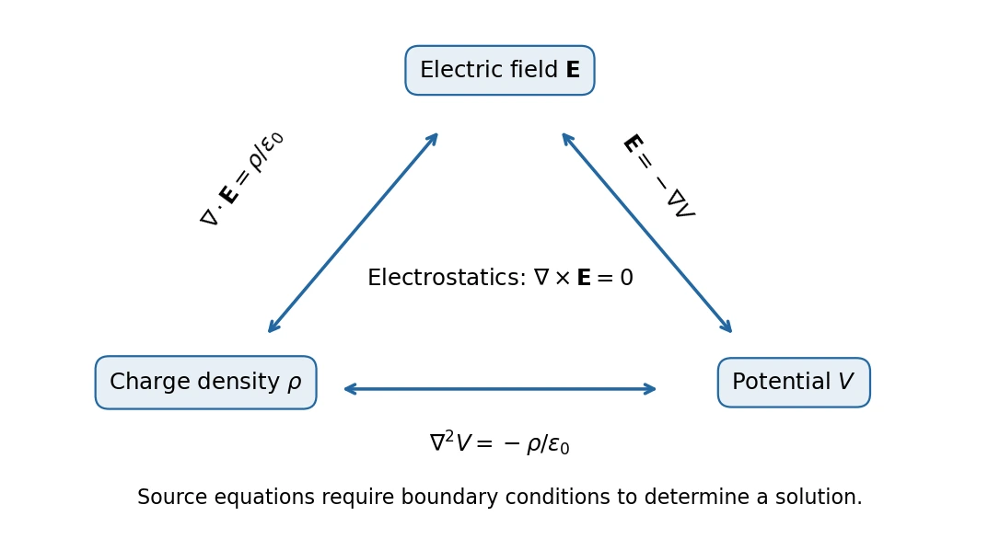

# General Physics II · 普通物理学 II

**Classes 1–15: electrostatics → circuits → magnetism → induction → electromagnetic waves → introductory optics.** English notes with Chinese terminology and conceptual hints, based on the supplied slides and classroom explanations. Instructor: Xin Lu; slide credits: Xin Lu / Gentaro Watanabe.

## Learning route（学习路线）

| Class | Notes | Core topics |
| --- | --- | --- |
| 1 | [Charge and electric fields](01-charge-and-electric-field.md) | Coulomb interaction, field lines, dipoles, torque. |
| 2 | [Continuous charge and Gauss's law](02-continuous-charge-and-gauss-law.md) | Ring/disk integrals, flux, symmetry. |
| 3 | [Electric potential](03-electric-potential.md) | Conservative work, energy, equipotentials, source potentials. |
| 4 | [The triangle of electrostatics](04-triangle-of-electrostatics.md) | Gradient, curl, divergence, Poisson equation. |
| 5 | [Conductors and image charges](05-conductors-and-image-charges.md) | Equilibrium, shielding, plane/sphere images. |
| 6 | [Current, resistance, capacitance](06-current-resistance-and-capacitance.md) | Drift, Drude model, continuity, capacitor geometry. |
| 7 | [DC circuits and dielectrics](07-dc-circuits-and-dielectrics.md) | Meters, emf, Kirchhoff rules, RC response, energy, polarization. |
| 8 | [Magnetic force and motion](08-magnetic-force-and-motion.md) | Lorentz force, helical motion, Hall effect, loop torque. |
| 9 | [Fields of currents](09-fields-of-currents.md) | Biot–Savart, Ampère law, wires, sheets, solenoids, toroids. |
| 10 | [Magnetic dipoles and materials](10-magnetic-dipoles-and-materials.md) | Coil fields, magnetization, Curie law, collective order, hysteresis. |
| 11 | [Electromagnetic induction](11-electromagnetic-induction.md) | Faraday/Lenz laws, motional emf, induced fields, frame transformations. |
| 12 | [Inductance and RL circuits](12-inductance-and-rl-circuits.md) | Flux linkage, self/mutual induction, magnetic energy. |
| 13 | [LC, RLC, and AC circuits](13-lc-rlc-and-ac-circuits.md) | Damping, phasors, impedance, resonance, quality factor. |
| 14 | [Maxwell equations and waves](14-maxwell-equations-and-waves.md) | Displacement current, wave equation, transverse fields, intensity. |
| 15 | [Light, reflection, refraction](15-light-reflection-and-refraction.md) | Radiation pressure, rays, Fermat, Huygens, phase matching. |

- [Mathematical toolkit](mathematical-toolkit.md): vectors, calculus, coordinate systems, distributions, and complex notation.
- [Homework and worked solutions](homework/index.md): seven assignments, all 40 assigned problems, with lecture links and sourced figures.
- [Formula sheet and conceptual checks](quick-reference.md): formulas with their conditions, units, and common mistakes.
- [Source map and scope](source-map.md): PDF page ranges, classroom timestamps, supplemental discussions, and editorial corrections.
- [Figure sources and reproduction](assets/README.md): 23 original diagrams and computed plots.

## Prerequisites and notation

Prerequisites: mechanics, work/energy, vector algebra, and elementary multivariable calculus. The [toolkit](mathematical-toolkit.md) supplies the conventions.

| Symbol | Meaning | SI unit |
| --- | --- | --- |
| $q,Q$ | Signed charge; total charge | C |
| $\lambda,\sigma_s,\rho_q$ | Line, surface, and volume charge density | C/m, C/m², C/m³ |
| $\mathbf E,V,U$ | Electric field, electric potential, potential energy | N/C = V/m, V, J |
| $\mathbf p$ | Electric dipole moment, from negative to positive charge | C·m |
| $i,\mathbf J$ | Signed current through an oriented surface; current density | A, A/m² |
| $\rho_{\mathrm{res}},\sigma_{\mathrm{cond}}$ | Resistivity; conductivity | Ω·m, S/m |
| $R,C$ | Resistance; capacitance | Ω, F |
| $\mathbf B,\Phi_B$ | Magnetic field; magnetic flux | T, Wb |
| $\boldsymbol\mu,\mathbf M,\mathbf H$ | Magnetic moment; magnetization; magnetic field strength | A·m², A/m, A/m |
| $\mathbf P,\mathbf D$ | Polarization; electric displacement | C/m² |
| $L,M,\Lambda$ | Self-inductance; mutual inductance; flux linkage | H, H, Wb |
| $\mathbf S,I$ | Poynting vector; average wave intensity | W/m² |

We distinguish $\rho_q$ from $\rho_{\mathrm{res}}$, and $\sigma_s$ from $\sigma_{\mathrm{cond}}$: the original slides reuse $\rho$ and $\sigma$ for different physical quantities. Position is $\mathbf r$, and $r=|\mathbf r|$. The constant $k=1/(4\pi\epsilon_0)\approx8.99\times10^9\ \mathrm{N\,m^2/C^2}$.

Distinguish magnetic moment $\boldsymbol\mu$ from permeability $\mu$, mutual inductance $M$ from magnetization $\mathbf M$, and intensity $I$ from current $i$. The phasor convention in class 13 is $e^{j\Omega t}$, with $j^2=-1$.

## Assumptions and scope

Specify the physical region, source model, boundary/initial conditions, signs, and approximation before using a formula. Infinite-source, long-coil, lumped-circuit, linear-material, and geometric-optics formulas each have limits stated in their chapters.

Coverage follows actual class progress, including cross-class continuations. Fresnel amplitudes, a full polarization theory, diffraction/interference, and quantum-mechanical derivations are not yet developed. Source records and transcription corrections are collected in the [source map](source-map.md).
