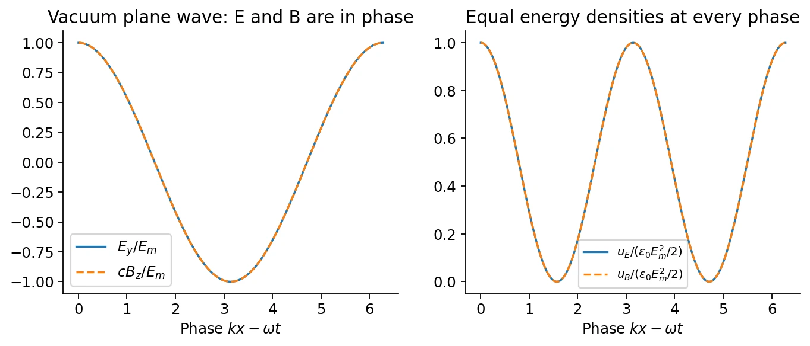

# 期中精要 · 概念与基础例题

[24 小时学习安排](revision-plan.md) · [公式速查](../quick-reference.md) · [真题解答](solutions-2023.md)

按 0–9 节顺序读，每节先跟例题，再做末尾的小改题。第一次学习可先完成标出的基本步骤；完整证明和复杂变式在链接的讲义里查。

## 0. 先读懂符号和运算 {#basics}

### 物理量：先分清“是什么”

| 符号 | 含义 | 单位 / 直觉 |
| --- | --- | --- |
| $q,Q$ | 电荷 charge | C；正负号影响方向 |
| $\mathbf F$ | 力 force | N；决定加速度，$\mathbf F=m\mathbf a$ |
| $\mathbf E$ | 电场 electric field | N/C；每单位正电荷受到的力 |
| $V$ | 电势 potential | V = J/C；每单位电荷的势能 |
| $U$ | 能量 energy | J；电势与能量关系为 $U=qV$ |
| $i$ | 电流 current | A = C/s；单位时间通过的电荷 |
| $\mathbf B$ | 磁场 magnetic field | T；通过 $q\mathbf v\times\mathbf B$ 作用于运动电荷 |
| $R,C,L$ | 电阻、电容、电感 | Ω、F、H；分别耗能、储存电场能、储存磁场能 |

粗体表示向量，包含大小和方向；$\hat{\mathbf x},\hat{\mathbf y},\hat{\mathbf z}$ 是三个坐标正方向的单位向量。$r$ 是距离，$\hat{\mathbf r}$ 是径向单位向量。$d$ 出现在 $dq,dr,d\theta$ 中表示小量；单独作为符号时也可能表示距离，需看定义。

### 方向运算：投影和右手规则

点乘 $\mathbf A\cdot\mathbf B=AB\cos\theta$ 得到一个数：垂直为零，同向最大。通量 $\Phi_E=\int\mathbf E\cdot d\mathbf A$ 就是把穿过小面积的法向分量加起来；面积向量垂直于该小面。

叉乘给出一个垂直于两个向量的方向。先用下表判断，再乘电荷的正负号：

$$
\hat{\mathbf x}\times\hat{\mathbf y}=\hat{\mathbf z},\qquad
\hat{\mathbf y}\times\hat{\mathbf z}=\hat{\mathbf x},\qquad
\hat{\mathbf z}\times\hat{\mathbf x}=\hat{\mathbf y}.
$$

交换顺序变号，同方向叉乘为零。例如 $\hat{\mathbf x}\times\hat{\mathbf z}=-\hat{\mathbf y}$；若运动电荷为负，磁力方向再反转。

### 本次计算够用的微积分

导数描述“变化有多快”；积分把小贡献相加。下面几条先照着算：

$$
\frac{d(r^n)}{dr}=nr^{n-1},\qquad
\int_a^b\frac{dr}{r^2}=\left[-\frac1r\right]_a^b=\frac1a-\frac1b,
\qquad\int_0^a r\,dr=\frac{a^2}{2}.
$$

$$
\frac d{dt}e^{-t/\tau}=-\frac1\tau e^{-t/\tau},\qquad
\frac d{dt}\sin\omega t=\omega\cos\omega t,\qquad
\frac d{dt}\cos\omega t=-\omega\sin\omega t.
$$

偏导数 $\partial/\partial x$ 就是只让 $x$ 变，把其余坐标当常数。三个场算符先记住用途：

| 算符 | 做什么 | 一个可直接跟算的例子 |
| --- | --- | --- |
| 梯度 $\nabla V$ | 给出电势在各坐标方向的变化率 | $V=Ax^2$，则 $\mathbf E=-\nabla V=-2Ax\hat{\mathbf x}$ |
| 散度 $\nabla\cdot\mathbf E$ | 局部净流出，联系电荷密度 | 上例为 $-2A$，故 $\rho_q=-2\epsilon_0A$ |
| 旋度 $\nabla\times\mathbf E$ | 局部环流；静电场必须为零 | 上例各交叉偏导为零，旋度为零 |

反复出现的一阶方程 $\dot X=-X/\tau$ 的解是 $X=X_0e^{-t/\tau}$：初始为 $X_0$，过一个 $\tau$ 剩约 $0.37X_0$，最终趋近零。先用求导验证这个解，暂时不必从头求解微分方程。

**小改题：**把 $V=Ax^2$ 改为 $V=Ay^2$，则 $\mathbf E=-2Ay\hat{\mathbf y}$，$\rho_q$ 仍为 $-2\epsilon_0A$。把 $\tau$ 加倍，同一时刻的衰减会更慢。

## 1. 电场、电势与高斯定律 · Ch. 1–4 {#electrostatics}

电荷产生电场，另一电荷在该场中受力：$\mathbf F=q\mathbf E$。固定的正点电荷 $Q$ 在真空中产生

$$
\mathbf E=\frac{kQ}{r^2}\hat{\mathbf r},\qquad V=\frac{kQ}{r},\qquad
k=\frac1{4\pi\epsilon_0},\quad V(\infty)=0.
$$

电势差决定能量变化 $\Delta U=q\Delta V$；电场做功为 $-\Delta U$。多个源的电势按数值相加，电场按向量相加。连续电荷用 $dq=\lambda\,dl$、$\sigma_s\,dA$ 或 $\rho_q\,dV$ 写出小贡献，再积分。

高斯定律始终成立，但只有足够对称时才能直接用它解场。例如均匀带电球面外，球形高斯面上场处处等大、径向：

$$
E(r)\,4\pi r^2=\frac Q{\epsilon_0}
\quad\Rightarrow\quad E(r)=\frac{Q}{4\pi\epsilon_0r^2}.
$$

**跟算例题：**球面总电荷加倍，外部场和势都加倍；场点距离加倍，场变为 $1/4$，势变为 $1/2$。壳内包围电荷为零，配合球对称得到 $E=0$；电势却仍等于表面常数 $kQ/R$。

常见几何先认形状，再从公式页找结果：

| 源 | 关键区别 |
| --- | --- |
| 均匀球壳 / 静电平衡的孤立球导体 | 内部 $E=0$，外部像中心点电荷 |
| 均匀体带电绝缘球 | 内部 $E_r=kQr/R^3$，随 $r$ 增大；外部仍为 $kQ/r^2$ |
| 无限长直线电荷 | 用圆柱高斯面，$E_r=\lambda/(2\pi\epsilon_0r)$ |
| 无限大规定面电荷 | 两侧各有 $E=\lvert\sigma_s\rvert/(2\epsilon_0)$，正面电荷向外 |
| 有限圆环、圆盘 | 一般需源积分；轴线上可利用对称性消去横向分量 |

电偶极子是近邻的 $+q,-q$，$\mathbf p=q\mathbf d$ 指向正电荷。在均匀外场中净力为零，但有力矩 $\boldsymbol\tau=\mathbf p\times\mathbf E$ 和能量 $U=-\mathbf p\cdot\mathbf E$；同向能量最低。远处偶极场按 $1/r^3$ 衰减。

**小改题：**把正球壳改成负球壳，场的箭头反向，电势变负。$Q_{\rm enc}=0$ 只说明闭面净通量为零；无对称性时仍可有非零场。详细算符公式查[第 4 章](../04-triangle-of-electrostatics.md)。

## 2. 导体、镜像与电容 · Ch. 5–6 {#conductors}

静电平衡时：**金属材料内部 $E=0$，整块连通导体电势相同**。接地固定 $V=0$，允许电荷交换；孤立固定总电荷，电势待求。电荷不在球心附近时，导体表面通常会重新分布电荷。

### 跟算：外点电荷与球

半径 $R$ 的球，外部正电荷 $q$ 距球心 $d>R$。

1. 球仍孤立且总电荷为 $Q$：中心场为零。每个表面电荷元到中心都等距，所以 $V(O)=kQ/R+kq/d$。
2. 球接地后，把上式中的总电荷改成未知 $Q_s$，令 $0=kQ_s/R+kq/d$，得到 $Q_s=-qR/d$。
3. 求外部势，用球内的虚拟电荷 $-qR/d$，位置距中心 $R^2/d$、朝向真实电荷。它与真实 $q$ 的势相加，在球面恰好为零。**镜像不是真实的内部电荷。**
4. 若球孤立且指定总电荷为 $Q$，还要在中心加一个镜像 $Q+qR/d$，使镜像总量为 $Q$。

第一次先跟第 1、2 步，能分清固定 $Q$ 与固定 $V$ 后，再看[真题 Q1(d)](solutions-2023.md#solution-1)的边界验证。空腔要区分“金属材料”和“腔内空间”：腔里有电荷时可有场。

### 跟算：球形电容器

电容 $C=Q/(V_a-V_b)$ 表示给定电压下能存多少电荷。内外半径 $a<b$，中间均匀介质介电常数 $\epsilon=\epsilon_0\epsilon_r$：

$$
E_r=\frac{Q}{4\pi\epsilon r^2},\qquad
V_a-V_b=\frac{Q}{4\pi\epsilon}\underbrace{\int_a^b\frac{dr}{r^2}}_{1/a-1/b},
\qquad C=\frac{4\pi\epsilon}{1/a-1/b}.
$$

**小改题：**在固定自由电荷下，把均匀介质的 $\epsilon$ 加倍，$C$ 加倍、$V$ 减半。若电池固定 $V$，则 $Q$ 加倍。电容器的电场能为 $U_C=Q^2/(2C)=CV^2/2$。

## 3. 电流、电阻与 RC · Ch. 6–7 {#circuits}

电流是电荷流动；电流密度 $\mathbf J$ 是单位横截面积上的电流，均匀时 $J=I/A$。普通静止欧姆材料满足 $\mathbf J=\sigma\mathbf E$。电导率 $\sigma$ 越大，同一电流所需电场越小；电阻率 $\rho_{\rm res}=1/\sigma$，与电荷密度 $\rho_q$ 区分。

- **节点：**流入电流总和等于流出总和；若有电荷积累，差值就是积累速率。
- **回路：**沿自定方向将电压升降相加为零；遇到感应电动势要单独计入。
- **串联：**电阻相加、电流相同。**并联：**电压相同，电导 $1/R$ 相加。
- 电阻耗电功率 $P=I^2R$。电池的电动势 $\mathcal E$ 是每单位电荷得到的能量，单位为 V。

### 跟算：一个电容通过一个电阻放电

取 $Q$ 为正极板的电荷，$I$ 为离开正极板的电流。于是

$$
I=\frac VR=\frac{Q}{RC},\qquad \dot Q=-I
\quad\Rightarrow\quad Q(t)=Q_0e^{-t/(RC)}.
$$

若 $R=2\ \mathrm{k\Omega}$、$C=100\ \mu\mathrm F$，先换单位再乘：$\tau=2000\times10^{-4}=0.20\ \mathrm s$。在 $0.20\ \mathrm s$ 时，电荷与电压都剩初值的约 37%；能量剩 $e^{-2}\approx14\%$。充电时同类电路从零趋近终值：$Q=C\mathcal E(1-e^{-t/RC})$。

开关题先写两个状态：电容电压不能在有限电流下突变；长期直流稳态时电容支路不通电流。电流假设方向算成负值，只需反转箭头。

### 接回真题 Q2：介质会漏电

沿球形面流动的面积是 $4\pi r^2$，所以 $J=I/(4\pi r^2)$。用 $E=J/\sigma$ 代入同一个径向电势积分：

$$
R=\frac1{4\pi\sigma}\left(\frac1a-\frac1b\right),\qquad
RC=\frac\epsilon\sigma,\qquad P(t)=\frac{Q(t)^2}{RC^2}.
$$

**小改题：**$\sigma$ 减半，漏电电阻和衰减时间都加倍。[真题 Q2](solutions-2023.md#solution-2)只是在基本 RC 放电前，增加了几何积分这一步。

## 4. 磁力与电流产生的磁场 · Ch. 8–9 {#magnetism}

先分清两种题：**已知 $\mathbf B$ 求力**用 Lorentz 力；**已知电流求 $\mathbf B$**用 Biot–Savart 或有对称性的 Ampère 环路。

$$
\mathbf F=q(\mathbf E+\mathbf v\times\mathbf B),\qquad
d\mathbf F=I\,d\boldsymbol\ell\times\mathbf B.
$$

**跟算方向：**正电荷沿 $+x$ 运动，磁场沿 $+z$，则 $\mathbf v\times\mathbf B$ 朝 $-y$；电子的磁力朝 $+y$。磁力垂直于速度，单独不改变速率；只有均匀磁场时，垂直分量做圆周运动，平行分量保持不变。

$$
r_L=\frac{mv_\perp}{|q|B},\qquad T=\frac{2\pi m}{|q|B}.
$$

速度加倍，回旋半径加倍，周期不变。交叉均匀电磁场中的平均漂移是 $\mathbf v_D=\mathbf E\times\mathbf B/B^2$，与电荷正负无关。Hall 效应则是运动载流子横向分离，达到 $\mathbf E_H+\mathbf v_d\times\mathbf B=0$；单载流子模型 $R_H=1/(nq_c)$ 可反映载流子符号。

| 电流源 | 用什么几何 / 常用结果 |
| --- | --- |
| 无限长直导线 | 环向场，$B=\mu_0I/(2\pi r)$ |
| 圆环轴线上、离环心 $z$ | $B_z=\mu_0Is^2/[2(s^2+z^2)^{3/2}]$，$s$ 是环半径 |
| 很长的螺线管内部 | $B\simeq\mu_0nI$，$n$ 为每米匝数 |
| 理想环形线圈内部 | $B=\mu_0NI/(2\pi r)$，$N$ 为总匝数 |

一般情况写 $d\mathbf B=\mu_0I\,d\boldsymbol\ell\times\hat{\mathbf R}/(4\pi R^2)$，把方向与分量算清再积分。场的大小不能直接按标量相加。

长直导线的 Ampère 圆形环路给出 $B\,2\pi r=\mu_0I$。把 $B$ 提出积分这一步依赖对称性；一般电流布局需回到源积分或场方程。

### 接回真题 Q3：带电球面为什么等价于许多电流环

球面密度 $\sigma_s=Q/(4\pi R^2)$。极角 $\theta$ 的细环，周长为 $2\pi R\sin\theta$，带宽为 $R\,d\theta$，所以

$$
dq=\frac Q2\sin\theta\,d\theta,\quad
T=\frac{2\pi}{\omega},\quad
dI=\frac{dq}{T}=\frac{Q\omega}{4\pi}\sin\theta\,d\theta.
$$

电流环的磁矩为 $d\mu=(dI)\pi s^2$，此处 $s=R\sin\theta$。球心离该环的轴向距离为 $z=R\cos\theta$，所以 $s^2+z^2=R^2$。代入上表的圆环轴线公式即可：

$$
\mu=\frac{Q\omega R^2}{4}\int_0^\pi\sin^3\theta\,d\theta
=\frac{Q\omega R^2}{3},\qquad
B(O)=\frac{\mu_0Q\omega}{8\pi R}\int_0^\pi\sin^3\theta\,d\theta
=\frac{\mu_0Q\omega}{6\pi R}.
$$

积分可令 $u=\cos\theta$，得到 $\int_{-1}^{1}(1-u^2)du=4/3$。第一次先独立写出 $dq$ 和 $dI$，再跟后两步。**小改题：**把 $\omega$ 加倍，$dI,\mu,B$ 都加倍；换成体带电球必须重新分层积分。

## 5. 感应与法拉第圆盘 · Ch. 11 {#induction}

磁通 $\Phi_B=\int\mathbf B\cdot d\mathbf A$ 衡量穿过所选面的磁场。均匀场与平面法向夹角为 $\theta$ 时，$\Phi_B=BA\cos\theta$。固定线圈磁通变化产生电动势：$\mathcal E=-N\,d\Phi_B/dt$，负号表示感应作用阻碍**通量变化**。

**跟算例题：**单匝面积 $A$，正法向朝纸外，$B(t)=\alpha t$ 朝纸外、$\alpha>0$。于是 $\mathcal E=-A\alpha$；感应电流为顺时针，产生朝纸内的场。若磁场正在减弱，方向反过来。

运动导体还要算 $\mathbf u\times\mathbf B$。盘以 $\boldsymbol\omega=\omega\hat{\mathbf z}$ 转动，外场 $\mathbf B=B\hat{\mathbf z}$：

1. 半径 $r$ 处 $\mathbf u=\omega r\hat{\boldsymbol\phi}$，故 $\mathbf u\times\mathbf B=B\omega r\hat{\mathbf r}$，正电荷被推向边缘。
2. 开路时电荷分离形成反向场 $\mathbf E=-B\omega r\hat{\mathbf r}$；边缘比中心高电势，$V_{\rm rim}-V_O=B\omega a^2/2$。
3. 接总电阻 $R$ 后，$I=B\omega a^2/(2R)$，磁力矩阻碍旋转；保持转速需要外加同向力矩。

$$
\mathcal E=\int_0^a B\omega r\,dr=\frac{B\omega a^2}{2},\qquad
\tau_{\rm ext}\omega=I^2R\quad\Rightarrow\quad
\tau_{\rm ext}=\frac{B^2a^4\omega}{4R}.
$$

转动惯量 $\mathcal I$ 表示改变转速有多困难，转动方程为 $\mathcal I\dot\omega=\tau$。撤掉外加力矩后，$\mathcal I\dot\omega=-B^2a^4\omega/(4R)$，与第 0 节的指数衰减相同：$\omega=\omega_0e^{-t/\tau_m}$，$\tau_m=4\mathcal I R/(B^2a^4)$。原题未给 $\mathcal I$ 的数值。

**小改题：**保持 $\omega$ 不变而把电阻加倍，电流和所需外加力矩都减半。完整步骤见[真题 Q4](solutions-2023.md#solution-4)。固定线圈与运动圆盘使用的电动势表达式要区分。

## 6. 电感、RL 与互感 · Ch. 12 {#inductance}

电感把电流与磁通链联系起来：$\Lambda=N\Phi_B=Li$。电流变化会产生反对这种变化的自感电动势。若电流从端子 $A$ 流入电感，约定为正：

$$
\mathcal E_L=-L\dot i,\qquad V_A-V_B=L\dot i,\qquad U_B=\frac12Li^2.
$$

电感电流在有限电压下不能突变；长期直流稳态时，理想电感的端电压为零。一个电感通过一个电阻衰减，时间常数为 $\tau=L/R$，$i=i_0e^{-tR/L}$。

**跟算例题：**$L=2\ \mathrm H$、$R=4\ \Omega$、$i_0=3\ \mathrm A$，则 $\tau=0.50\ \mathrm s$，过 $0.50\ \mathrm s$ 后电流为 $3/e\ \mathrm A$。初始磁场能为 $Li_0^2/2=9\ \mathrm J$，最终转化为电阻热。

互感 $M$ 表示一线圈的电流对另一线圈磁通链的贡献，$\mathcal E_2=-M\dot i_1$。选定绕向后，双线圈能量为

$$
U=\frac12L_1i_1^2+\frac12L_2i_2^2+Mi_1i_2.
$$

即使 $i_1$ 固定，改变 $i_2$ 时电源 1 也可能做功 $M i_1\Delta i_2$。第一遍理解这个交叉项；分阶段账目查[作业 Ch. 12, Ex. 9](../homework/06-inductance-and-ac-circuits.md#ch12-ex09)。

**小改题：**固定 $L$ 把 $R$ 加倍，RL 衰减更快；固定 $R$ 把 $L$ 加倍，衰减更慢。注意与 RC 电路中增大 $R$ 的效果不同。真空磁能密度为 $B^2/(2\mu_0)$，原卷公式页在此有误。

## 7. LC、RLC 与交流 · Ch. 13 {#oscillations}

电容储存电场能，电感储存磁场能；理想 LC 电路中两者交换、总和不变：

$$
U=\frac{q^2}{2C}+\frac12Li^2,\qquad
\omega_0=\frac1{\sqrt{LC}},\qquad q=q_m\cos(\omega_0t+\phi).
$$

若电流定义为流入所标极板，则 $i=\dot q$；若定义的是另一支路电流，先用节点规则判断正负。电荷最大时电流为零；电流最大时电荷为零。

**跟算初值：**若 $q(0)=q_0$、$i(0)=0$，取 $q=q_0\cos\omega_0t$，求导得到 $i=-\omega_0q_0\sin\omega_0t$。若已知电感有电流而电容未充电，不能仍把 $q(0)$ 设成振幅。

加入串联电阻后，$L\ddot q+R\dot q+q/C=0$。$0<R<2\sqrt{L/C}$ 时有衰减振荡，$R=2\sqrt{L/C}$ 为临界阻尼，更大时不再振荡。交流电源驱动的频率由电源规定，未必等于 $\omega_0$。

### 正弦稳态用阻抗代替电阻

令 $j^2=-1$，把电压、电流的幅度和相位一起计算：

$$
Z_R=R,\qquad Z_L=j\omega L,\qquad
Z_C=\frac1{j\omega C}=-\frac{j}{\omega C}.
$$

串联相加、并联先加倒数。串联 RLC 的 $Z=R+jX$，$X=\omega L-1/(\omega C)$，其模为 $|Z|=\sqrt{R^2+X^2}$，峰值电流 $I_m=\mathcal E_m/|Z|$。

**跟算例题：**若 $R=3\ \Omega$、$X=4\ \Omega$、源峰值为 $10\ \mathrm V$，则 $|Z|=5\ \Omega$，$I_m=2\ \mathrm A$，平均电阻功率为 $I_m^2R/2=6\ \mathrm W$。$X>0$ 时电流滞后电压，$X<0$ 时超前；$X=0$ 时共振且同相。

**小改题：**保持电源峰值不变，在串联共振点增大 $R$，电流减小。给的是 RMS 电压时，用 RMS 电流求功率 $I_{\rm rms}^2R$，不再除以 2。共振的半功率宽度为 $\Delta\omega=R/L$；此时电流幅度是最大值的 $1/\sqrt2$。

## 8. Maxwell 方程与电磁波 · Ch. 14 {#waves}

四个方程分别回答：电场从哪里来、磁场是否有单极源、变化磁场如何产生环流电场、电流与变化电场如何产生磁场。

| 方程（真空，总电荷与总电流） | 读法 |
| --- | --- |
| $\nabla\cdot\mathbf E=\rho_q/\epsilon_0$ | 电荷是电场散度的源 |
| $\nabla\cdot\mathbf B=0$ | 闭合面净磁通为零 |
| $\nabla\times\mathbf E=-\partial_t\mathbf B$ | 时变磁场产生有环流的电场 |
| $\nabla\times\mathbf B=\mu_0\mathbf J+\mu_0\epsilon_0\partial_t\mathbf E$ | 传导电流与位移电流都要计入 |

给电容充电时，真空间隙中虽无电荷穿越，但 $J_d=\epsilon_0\partial_tE$，总位移电流 $I_d=\dot Q$ 与导线电流相符。在无电荷、无电流的真空中，结合两个旋度方程可得到

$$
\nabla^2\mathbf E=\mu_0\epsilon_0\partial_t^2\mathbf E,
\qquad c=\frac1{\sqrt{\mu_0\epsilon_0}}.
$$

这里 $\nabla^2$ 是三个坐标二阶偏导之和；波速由上式的系数读出。单一真空平面行波中，$\mathbf E,\mathbf B$ 与传播方向相互垂直，且同相：

$$
\mathbf B=\frac1c\hat{\mathbf k}\times\mathbf E,\qquad
\lambda=\frac cf,\qquad \omega=2\pi f,\qquad
\mathbf S=\frac{\mathbf E\times\mathbf B}{\mu_0},\qquad
\langle S\rangle=\frac12\epsilon_0cE_m^2.
$$

*原课程自绘图，来源与复现见[图示说明](../assets/README.md)。*

**跟算例题：**$\mathbf E=3\cos(kx-\omega t)\hat{\mathbf y}\ \mathrm{V/m}$、$f=100\ \mathrm{MHz}=10^8\ \mathrm{Hz}$、$k>0$。相位 $kx-\omega t$ 表示向 $+x$ 传播；$\lambda=c/f=3\ \mathrm m$，$\mathbf B$ 朝 $z$ 方向、振幅为 $3/c=10^{-8}\ \mathrm T$，平均强度约 $1.19\times10^{-2}\ \mathrm{W/m^2}$。

能量还满足 $\partial_tu+\nabla\cdot\mathbf S=-\mathbf J\cdot\mathbf E$：场能的减少和流入，可以转化为物质获得的能量。单一行波中电、磁能密度相等；静电电容、近场等情形不能直接套 $E=cB$。

波也携带动量：正入射时，完全吸收的辐射压为 $p=I_{\rm wave}/c$，理想镜面反射为 $2I_{\rm wave}/c$，力为压强乘受光面积。这里 $I_{\rm wave}$ 是平均光强，不是电流；几何光学的反射折射规律另见第 15 章。

**小改题：**频率加倍，波长减半；电场振幅加倍，磁场振幅加倍、平均强度变为四倍。传播方向改为 $-x$ 而 $\mathbf E$ 仍沿 $y$，则 $\mathbf B$ 的方向改为 $-z$。

## 9. 理论题的材料与输运 · Ch. 6–7, 10 {#materials}

先掌握下列因果关系；公式的微观模型与局限查[第 6 章](../06-current-resistance-and-capacitance.md)、[第 7 章](../07-dc-circuits-and-dielectrics.md)及[第 10 章](../10-magnetic-dipoles-and-materials.md)。

| 概念 | 需要能解释的内容 |
| --- | --- |
| Drude 导电 | 场使载流子获得平均漂移，散射限制漂移；$\sigma=ne^2\tau/m_e$。漂移速度与随机微观速度、信号传播速度不同；静态杂质也可使动量弛豫，而不交换能量 |
| 半导体 / 超导体 | 半导体的载流子数受温度、掺杂等影响；超导是特定条件下的量子态，不能只解释成经典电子不碰撞 |
| 极化 $\mathbf P$ | 正负电荷中心相对位移产生束缚电荷；材料可以仍然整体中性。$\mathbf D=\epsilon_0\mathbf E+\mathbf P$ 的散度数自由电荷 |
| 线性介质 | 均匀各向同性模型中 $\mathbf D=\epsilon\mathbf E$；固定自由 $Q$ 与固定 $V$ 的后果不同，见第 2 节 |
| 磁化 $\mathbf M$ | 单位体积磁矩；$\mathbf B=\mu_0(\mathbf H+\mathbf M)$。线性关系 $\mathbf M=\chi_m\mathbf H$ 只适用于相应材料与场强范围 |
| 顺磁 | 固有磁矩受场偏向排列，热运动扰乱排列；独立磁矩的弱场模型中 $M\propto B/T$，温度加倍则磁化约减半 |
| 抗磁 | 诱导磁矩反向于外加场，不能套用顺磁的热排列解释 |
| 铁磁与磁滞 | 协同磁序和畴结构；撤去外场可有剩磁，反向场达到矫顽力才消除。一个常数磁化率不能表示完整磁滞环 |

**口头小测：**接地能否保证电中性？不能。介质极化是否要求净电荷非零？不要求。固定 $B$ 升温后弱场顺磁响应怎样变化？减弱。每个回答再加一句上表中的原因。
