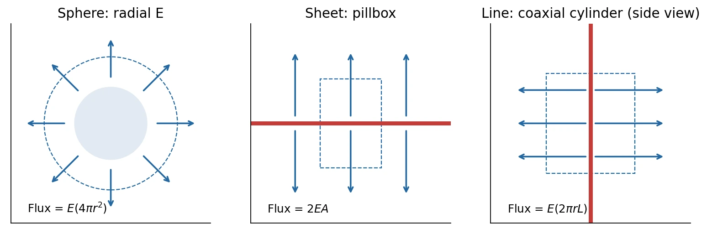
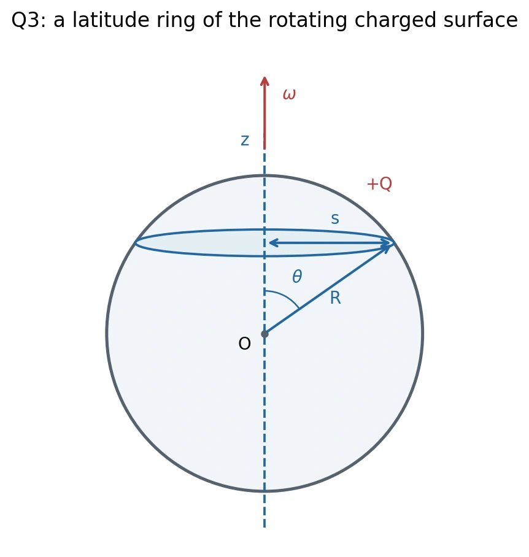

# 期中精要 · 物理概念与典型计算

[24 小时安排](revision-plan.md) · [公式速查](../quick-reference.md) · [2023 真题解答](solutions-2023.md)

按 0–9 节学习。数学使用已知的求导、偏导与积分；重点是每个物理量表示什么、规律适用于什么情况、积分在加总什么。

## 0. 读题的物理约定 {#basics}

### 电荷、力、功与电流

| 量 | 物理含义 | 单位 |
| --- | --- | --- |
| 电荷 $q,Q$ | 物质参与电相互作用的属性，有正负；同号相斥、异号相吸 | C，库仑 |
| 力 $\mathbf F$ | 改变速度的作用；质量 $m$（kg）、速度 $\mathbf v$（m/s）的物体满足 $\mathbf F=m\,d\mathbf v/dt$ | N，牛顿 |
| 功 $W$ | 力在位移中转移的能量，$dW=\mathbf F\cdot d\boldsymbol\ell$；$d\boldsymbol\ell$ 为位移 | J，焦耳；$1\ \mathrm J=1\ \mathrm{N\,m}$ |
| 势能 $U$ | 随位置或构型改变的储存能量；保守力（做功只由起终状态决定）做功 $W=-\Delta U$ | J |
| 电流 $I$ 或 $i$ | 每秒通过某截面的带符号电荷量，$I=dq_{\rm pass}/dt$ | A，安培；$1\ \mathrm A=1\ \mathrm{C/s}$ |

电子带电 $-e$，其中 $e\approx1.60\times10^{-19}\ \mathrm C$ 是电荷大小。电中性指正负电荷的**总和为零**；封闭系统总电荷守恒，充放电改变的是电荷所在位置。常规电流方向规定为正电荷移动方向，电子漂移方向与它相反。

粗体表示向量，去掉粗体常表示其大小，如 $F=\lvert\mathbf F\rvert$；$F_x$ 则是可正可负的 $x$ 分量。电荷 $q$、电势 $V$ 等标量也可有正负。$\hat{\mathbf x},\hat{\mathbf y},\hat{\mathbf z}$ 表示坐标正方向，$\hat{\mathbf r}$ 表示径向。$\nabla$ 是梯度、散度、旋度使用的微分算符，物理联系在第 1 节说明。$\dot q=dq/dt$，下标 $0$ 通常表示初值。

**单位前缀：**$\mathrm{n}=10^{-9}$、$\mu=10^{-6}$、$\mathrm{m}=10^{-3}$、$\mathrm{k}=10^3$、$\mathrm{M}=10^6$；例如 $1\ \mu\mathrm C=10^{-6}\ \mathrm C$。同一字母在不同题中可以复用，按定义和单位区分；如球半径 $R$ 用 m，电阻 $R$ 用 Ω。

## 1. 电场、电势与高斯定律 · Ch. 1–4 {#electrostatics}

### 电场：一个位置对电荷的作用 {#electric-field}

**源电荷**产生场；放在某处的**试探电荷**用来测量场，取足够小以免明显改变源的分布。若试探电荷 $q$ 受到电力 $\mathbf F$，该处电场为 $\mathbf E=\mathbf F/q$，单位 N/C。因此 $\mathbf F=q\mathbf E$：正电荷顺场受力，负电荷逆场受力。

真空介电常数 $\epsilon_0\approx8.85\times10^{-12}\ \mathrm{C^2/(N\,m^2)}$ 是电磁规律中的常量，决定电荷与电场的定量关系。令 $k=1/(4\pi\epsilon_0)\approx8.99\times10^9\ \mathrm{N\,m^2/C^2}$。**Coulomb 定律**给出真空中点电荷 $Q$ 的场；$r$ 是源到场点的距离，$\hat{\mathbf r}$ 从源指向场点：

$$
\mathbf E=\frac{kQ}{r^2}\hat{\mathbf r}.
$$

$Q$ 的正负决定场朝外还是朝内。多个源的电场按向量相加。例：$Q=1\ \mathrm{nC}$，距它 $0.10\ \mathrm m$ 处，$E=899\ \mathrm{N/C}$，正试探电荷 $q=2\ \mathrm{nC}$ 受力约 $1.80\ \mu\mathrm N$。

### 电势：每单位电荷的势能 {#potential}

电势 $V$ 是按单位电荷表示的电势能，单位 V（伏特），$1\ \mathrm V=1\ \mathrm{J/C}$。电压是两点的电势差。对于给定的外部静电场，

$$
U=qV,\qquad \Delta U=q\Delta V,\qquad
V_B-V_A=-\int_A^B\mathbf E\cdot d\boldsymbol\ell.
$$

最后一式把“沿途电场做的功”换成“电势差”。积分路径从 $A$ 到 $B$，$d\boldsymbol\ell$ 沿前进方向；也由此得 $1\ \mathrm{V/m}=1\ \mathrm{N/C}$，都是电场单位。电势零点可以选择；对有限孤立电荷，常令无穷远处 $V(\infty)=0$，于是点电荷的 $V=kQ/r$。电势是标量，多个源直接相加。

**例：**上面的 $1\ \mathrm{nC}$ 源在 $0.10\ \mathrm m$ 处产生 $V=89.9\ \mathrm V$。正电荷移向较低电势，电势能降低；负电荷的能量变化要再计入 $q<0$。电势为零不等于电场为零，电场取决于电势的空间变化。

### 连续电荷：密度乘以小长度、面积或体积 {#charge-density}

带电体切成小段、小面或小体，每份电荷记作 $dq$。三种密度描述不同的分布：

| 分布 | 密度的定义与单位 | 一份小电荷 |
| --- | --- | --- |
| 细线 | $\lambda$：每单位长度的电荷，C/m | $dq=\lambda\,dl$；$dl$ 是该小段长度 |
| 薄面 | $\sigma_s$：每单位面积的电荷，C/m² | $dq=\sigma_s\,dA$；$dA$ 是该小面面积 |
| 体内 | $\rho_q$：每单位体积的电荷，C/m³ | $dq=\rho_q\,d\mathcal V$；$d\mathcal V$ 是该小块体积 |

密度可正可负，也可随位置变化。这里用 $\mathcal V$ 表示体积，避免与电势 $V$ 混淆。例：$\lambda=1\ \mu\mathrm{C/m}$ 的线上，$2\ \mathrm{mm}$ 长的小段带电 $2\ \mathrm{nC}$。

总电荷 $Q=\int dq$。求场或势时，先把每份当点电荷，再把贡献积分：

$$
\mathbf E(P)=k\int\frac{\hat{\mathbf s}}{s^2}\,dq,\qquad
V(P)=k\int\frac{dq}{s}.
$$

$s$ 是每个源电荷元到场点 $P$ 的距离，$\hat{\mathbf s}$ 指向 $P$；它们通常随源位置变化，不能随意提出积分。

### 电通量与高斯定律 {#gauss-law}

取小面积 $dA$，单位法向 $\hat{\mathbf n}$ 垂直于该面，面积向量为 $d\mathbf A=\hat{\mathbf n}\,dA$。电通量
$\Phi_E=\int_S\mathbf E\cdot d\mathbf A$ 把穿过面的法向场分量相加：同法向为正、反向为负、沿面为零。均匀场穿过平面时 $\Phi_E=EA\cos\theta$，$\theta$ 是场与法向的夹角。通量不是实际流过的电荷。

**高斯面**是为计算而选的假想闭合曲面，不必有真实物体，法向取向外。**Gauss 定律**把整个闭面的电通量与其内部净电荷 $Q_{\rm enc}$ 联系起来，真空中为

$$
\boxed{\oint_S\mathbf E\cdot d\mathbf A=\frac{Q_{\rm enc}}{\epsilon_0}.}
$$

$\oint_S$ 表示在整个闭合曲面上积分。$\mathbf E$ 包含内外全部电荷的贡献，但外部电荷对该闭面的**净**通量贡献为零。$Q_{\rm enc}=0$ 只给出净通量为零，不能单独推出每处 $E=0$。

**例：均匀正球壳，总电荷 $Q$、半径 $R$。**在壳外取半径 $r>R$ 的同心高斯球面：

1. 球对称使场为径向，且同一球面上大小相同。
2. 场与向外法向同向，故 $\mathbf E\cdot d\mathbf A=E(r)\,dA$。
3. 球面总面积为 $4\pi r^2$，于是

$$
E(r)\,4\pi r^2=\frac Q{\epsilon_0}
\quad\Rightarrow\quad E(r)=\frac{Q}{4\pi\epsilon_0r^2}.
$$

球壳内同心面包围电荷为零，**结合球对称**才得 $E=0$；内部电势等于表面的常数 $kQ/R$。

| 常见源（真空） | 关键几何与结果 |
| --- | --- |
| 均匀球壳 / 无外部源的孤立球导体 | 内部 $E=0$；外部像中心点电荷 |
| 均匀体带电绝缘球 | 半径 $R$，内部 $E_r=kQr/R^3$；外部 $E_r=kQ/r^2$ |
| 无限长均匀线电荷 | 取同轴圆柱面，侧面积 $2\pi rl$，$E_r=\lambda/(2\pi\epsilon_0r)$；$r$ 为到轴距离，$l$ 为柱长 |
| 无限大均匀面电荷 | 用跨面的薄柱，两端面各贡献通量；两侧大小 $E=\lvert\sigma_s\rvert/(2\epsilon_0)$，正电荷向外、负电荷向内 |
| 均匀圆环轴线 | 半径 $R$，场点距环心 $z$：$E_z=kQz/(R^2+z^2)^{3/2}$；横向分量互相抵消 |

有限圆盘可分成细圆环积分。高斯定律本身始终成立；把未知场提出积分，还需要上述对称性。

*正电荷示意：虚线是假想高斯面，Flux 表示通量。中图 $A$ 是单个端面面积，右图 $L$ 是柱长。课程自绘；[图示来源](../assets/README.md)。*

### 场算符的物理联系 {#field-operators}

梯度 $\nabla V$ 收集电势沿三个方向的变化率；$\mathbf E=-\nabla V$ 表示场指向电势下降方向。散度表示单位体积的净向外通量；高斯定律的局部形式给出 $\nabla\cdot\mathbf E=\rho_q/\epsilon_0$。旋度表示局部环流；静电场满足 $\nabla\times\mathbf E=0$，对应闭路电场做功为零。

例：在某区域给定 $V=\alpha x^2$，$\alpha$ 是常量系数，单位 V/m²。先由势求场，再由场求电荷密度：

$$
\mathbf E=-2\alpha x\hat{\mathbf x},\qquad
\rho_q=\epsilon_0\frac{\partial E_x}{\partial x}=-2\epsilon_0\alpha,
\qquad \nabla\times\mathbf E=0.
$$

$\alpha>0$ 时局部净电荷密度为负；$E_x$ 只随 $x$ 变，所有构成旋度的交叉偏导都为零。求导负责运算，场与电荷的联系来自物理定律。

### 电偶极子与力矩

一对相隔 $\mathbf d$ 的 $-q,+q$ 构成电偶极子，$\mathbf d$ 从负指向正，电偶极矩 $\mathbf p=q\mathbf d$，单位 C·m。它整体可中性，但远处仍有按 $1/r^3$ 衰减的场。

力矩衡量力的转动作用：$\boldsymbol\tau=\mathbf r_b\times\mathbf F$，$\mathbf r_b$ 从转轴指向受力点，单位 N·m。均匀外电场中，偶极子两端力抵消而力矩可非零：$\boldsymbol\tau=\mathbf p\times\mathbf E$，势能 $U=-\mathbf p\cdot\mathbf E$；同向能量最低，反向平衡不稳定。

## 2. 导体、镜像与电容 · Ch. 5–6 {#conductors}

### 静电平衡：电荷已经停止重新分布

导体中的电荷能移动；内部若有持续电场，就会继续受力重排。因此静电平衡时，金属材料内部 $\mathbf E=0$，连通金属各处电势相同，多余电荷分布在表面。外部有电荷时，表面电荷通常不均匀。这里的“内部”指金属材料；含电荷的空腔仍可有场。

- **孤立：**与外界不交换电荷，总电荷 $Q$ 固定，电势待求。
- **接地：**与大电荷库相连，固定导体电势为参考值 $V=0$，净电荷可改变。
- 真空侧表面场垂直于金属，$\mathbf E_{\rm out}=\sigma_s\hat{\mathbf n}/\epsilon_0$；$\hat{\mathbf n}$ 从金属朝外。它不同于一个规定带电面的两侧各 $\sigma_s/(2\epsilon_0)$。

**外点电荷例题。**孤立球半径 $R$、总电荷 $Q$，外部电荷 $q$ 距中心 $d>R$。球心场为零；各表面元到球心等距，所以 $V(O)=kQ/R+kq/d$。接地后把总电荷改成未知 $Q_s$，令电势为零，得 $Q_s=-qR/d$。**接地不等于电中性。**

镜像法用物理求解区域之外的虚拟电荷代替感应电荷：让它们满足同一导体边界，就能得到该区域的场。接地球的镜像为 $-qR/d$，在球内朝向真实电荷、距中心 $R^2/d$ 处；只用于求球外场。孤立球还需中心镜像 $Q+qR/d$ 来满足总电荷约束。边界验证见[真题 Q1](solutions-2023.md#solution-1)。

### 电容与介质

两个彼此绝缘的导体带 $+Q,-Q$，电势差 $\Delta V=V_+-V_-$。**电容** $C=Q/\Delta V$ 表示建立单位电压所需的电荷，单位 F（法拉），$1\ \mathrm F=1\ \mathrm{C/V}$；由几何和材料决定。

**电介质**通常是可极化的绝缘材料：正负电荷中心在外场下稍微分离，产生束缚电荷并改变总电场。电极上可由外电路改变的电荷叫自由电荷。均匀线性各向同性模型用 $\epsilon=\epsilon_0\epsilon_r$ 表示材料响应；相对介电常数 $\epsilon_r$ 无单位，真空为 1。此模型中可写 $\oint_S\epsilon\mathbf E\cdot d\mathbf A=Q_{\rm free,enc}$；这已把束缚电荷的作用合并进 $\epsilon$。

**球形电容例题。**内半径 $a$、外半径 $b>a$，间隙为上述介质，内极带自由电荷 $Q$。在间隙 $a<r<b$ 内，球对称给出

$$
E_r=\frac{Q}{4\pi\epsilon r^2},\qquad
V_a-V_b=\int_a^b E_r\,dr
=\frac{Q}{4\pi\epsilon}\left(\frac1a-\frac1b\right),\qquad
C=\frac{4\pi\epsilon}{1/a-1/b}.
$$

平行板面积 $A$、间距 $h$，忽略边缘时 $C=\epsilon A/h$。固定自由 $Q$，$\epsilon$ 加倍使 $C$ 加倍、$V$ 减半；电池固定 $V$ 时，电荷改为两倍。逐步充电时，已有电压为 $q'/C$，再搬运 $dq'$ 需做功 $(q'/C)dq'$，故储能为 $U_C=\int_0^Q(q'/C)dq'=Q^2/(2C)=CV^2/2$。

## 3. 电流、电阻与 RC · Ch. 6–7 {#circuits}

### 电阻与电流密度

电流密度 $\mathbf J$ 描述单位面积上的电荷流，单位 A/m²，方向按正电荷流动方向。$I=\int_A\mathbf J\cdot d\mathbf A$；均匀且垂直截面时 $I=JA$。

电阻 $R=\Delta V/I$，单位 Ω（欧姆），$1\ \Omega=1\ \mathrm{V/A}$。静止欧姆材料的电导率 $\sigma$ 满足 $\mathbf J=\sigma\mathbf E$，单位 S/m，$1\ \mathrm S=1/\Omega$。电阻率 $\rho_{\rm res}=1/\sigma$，单位 Ω·m；与电荷密度 $\rho_q$ 区分。长度 $l$、截面 $A$ 均匀的直导线，$R=l/(\sigma A)$。

电阻中的场推动载流子持续运动，电能转化为热；有电流的电阻导线不满足静电平衡的 $E=0$。功率是每秒转移的能量，单位 W（瓦）= J/s：$P=I\Delta V=I^2R$。

### 电源与回路

电源用化学能或机械能输送电荷，每单位电荷得到的源能量叫**电动势** $\mathcal E=dW_{\rm source}/dq$，单位 V。理想电池端电压为 $\mathcal E$；电池有内阻 $r$、向外供电时，端电压为 $\mathcal E-Ir$。

Kirchhoff 规则分别来自电荷与能量守恒：节点不积累电荷时，流入电流总和等于流出；绕回路的电势升降和为零，感应电动势须计入电路模型。先假设正电流方向，结果为负就反向。沿电流过电阻降 $IR$，从电池负端到正端升 $\mathcal E$。

| 连接 | 电阻 | 电容 |
| --- | --- | --- |
| 串联 | 同电流，$R_{\rm eq}=\sum R_j$ | 中间节点中性时同电荷量，$1/C_{\rm eq}=\sum1/C_j$ |
| 并联 | 同电压，$1/R_{\rm eq}=\sum1/R_j$ | 同电压，$C_{\rm eq}=\sum C_j$ |

### RC 放电与漏电球形电容

把已充电的电容两极通过电阻连接。令 $Q$ 是正极板剩余电荷，$I_{\rm out}$ 是离开它的电流：

$$
I_{\rm out}=\frac VR=\frac Q{RC},\qquad
\dot Q=-I_{\rm out}
\quad\Rightarrow\quad Q(t)=Q_0e^{-t/\tau},\qquad \tau=RC.
$$

$\tau$ 是时间常数，单位 s；电荷流出使电压下降，因而后续放电越来越慢。过一个 $\tau$，电荷和电压剩约 37%，能量剩约 14%。例：$R=2\ \mathrm{k\Omega}$、$C=100\ \mu\mathrm F$，$\tau=0.20\ \mathrm s$。接恒定电池、从零充电时 $Q=C\mathcal E(1-e^{-t/RC})$。

开关瞬间，电容电压在有限电流下连续；长期直流稳态时电容支路电流为零。对照这两个条件可检查充放电答案。

真题 Q2 的介质有有限电导率，既储能又漏电。电流径向通过面积 $4\pi r^2$，于是 $J_r=I/(4\pi r^2)$；再用 $E=J/\sigma$ 积分：

$$
R=\frac1{4\pi\sigma}\left(\frac1a-\frac1b\right),\qquad
RC=\frac\epsilon\sigma,\qquad
P(t)=\frac{Q(t)^2}{RC^2}.
$$

几何在 $RC$ 中抵消。电荷按 $e^{-t/\tau}$ 衰减，场能按 $e^{-2t/\tau}$ 衰减，全部初始场能最终成为焦耳热。[真题 Q2](solutions-2023.md#solution-2)给出完整过程。

## 4. 磁力与电流产生的磁场 · Ch. 8–9 {#magnetism}

### 磁场怎样作用于电荷和电流

磁场 $\mathbf B$ 作用于运动电荷，其大小和方向由磁力关系定义；单位 T（特斯拉）= N/(A·m)。电场与磁场共同作用时，**Lorentz 力**是两项之和：

$$
\mathbf F=q\mathbf E+q\mathbf v\times\mathbf B.
$$

磁力与速度垂直，单独不改变速率；静止电荷没有磁力。正电荷沿 $+x$、磁场沿 $+z$，磁力朝 $-y$；电子反向。只有均匀磁场时，速度的平行分量保持不变，垂直分量 $v_\perp$ 做半径 $r_L$ 的圆周运动。圆周运动所需的向心力大小为 $mv_\perp^2/r_L$，由磁力提供：

$$
\frac{mv_\perp^2}{r_L}=|q|v_\perp B
\quad\Rightarrow\quad
r_L=\frac{mv_\perp}{|q|B},\qquad
T=\frac{2\pi m}{|q|B}.
$$

$T$ 为转一圈的周期，单位 s。均匀恒定交叉场中，回旋中心的平均漂移为 $\mathbf v_D=\mathbf E\times\mathbf B/B^2$，与电荷符号无关。

导线中的载流子所受磁力相加，得到 $d\mathbf F=I\,d\boldsymbol\ell\times\mathbf B$；$d\boldsymbol\ell$ 沿正电流。**Hall 效应**是载流子被磁力横向推开，积累电荷形成横向电场，直到 $\mathbf E_H+\mathbf v_d\times\mathbf B=0$；$\mathbf v_d$ 为平均漂移速度。

取电流密度沿 $+x$、磁场沿 $+z$，定义 Hall 系数 $R_H=E_{H,y}/(J_xB_z)$，表示单位电流密度、单位磁场引起的横向电场。单载流子模型 $R_H=1/(nq_c)$：$n$ 是载流子数密度（每 m³ 的个数），$q_c$ 是每个载流子的带符号电荷；测量横向电压的符号可判断载流子正负。

### 电流怎样产生磁场

真空磁导率 $\mu_0\approx4\pi\times10^{-7}\ \mathrm{N/A^2}$ 是电流与磁场关系中的常量。稳恒电流的小导线元产生

$$
d\mathbf B=\frac{\mu_0I}{4\pi}\frac{d\boldsymbol\ell\times\hat{\mathbf R}_{\rm sep}}{R_{\rm sep}^2}.
$$

这就是 **Biot–Savart 定律**。$\mathbf R_{\rm sep}$ 从电流元指向场点；沿导线把所有 $d\mathbf B$ 矢量相加。

**Ampère 定律**为 $\oint_C\mathbf B\cdot d\boldsymbol\ell=\mu_0I_{\rm enc}$：沿闭合路径 $C$ 的磁场环量，等于穿过它所围面的净电流乘 $\mu_0$。绕行正向与电流正向按右手规则配对。稳恒直线电流取同轴圆环，有 $B\,2\pi r=\mu_0I$；把 $B$ 提出积分依赖对称性。

| 电流源 | 常用场；各式均指理想几何 |
| --- | --- |
| 无限长直导线 | $B=\mu_0I/(2\pi r)$，$r$ 是到轴距离，方向绕轴 |
| 半径 $s$ 的圆环轴线上 | $B_z=\mu_0Is^2/[2(s^2+z^2)^{3/2}]$，$z$ 为场点到环心的轴向坐标 |
| 长螺线管内部 | $B\simeq\mu_0nI$；$n=N/l$ 为每米匝数，$N$ 为总匝数、$l$ 为长度 |
| 理想环形线圈内部 | $B=\mu_0NI/(2\pi r)$；$r$ 是到环形线圈总轴的距离 |

### 磁矩与旋转带电球面

电流环所围面积为 $A$，法向 $\hat{\mathbf n}$ 按右手规则确定：四指沿电流弯曲，拇指指向法向。单环的**磁矩** $\boldsymbol\mu=I A\hat{\mathbf n}$ 描述其磁作用强弱与朝向，单位 A·m²；$N$ 匝时再乘 $N$。均匀外场中的力矩与势能为 $\boldsymbol\tau=\boldsymbol\mu\times\mathbf B$、$U=-\boldsymbol\mu\cdot\mathbf B$；磁矩与外场同向时能量最低。

真题 Q3 把均匀带电球面分成纬线细环。球半径 $R$，总电荷 $Q>0$，绕 $+z$ 轴以角速度 $\omega>0$ 转动；$\omega$ 表示每秒转过的角度，单位 rad/s。极角 $\theta$ 从 $+z$ 测量。

*按 2023 真题重绘；[图示来源](assets/README.md)。*

细环半径 $s=R\sin\theta$，沿球面的带宽为 $R\,d\theta$，故带面积 $dA=2\pi R^2\sin\theta\,d\theta$。用第 1 节的面密度：

$$
\sigma_s=\frac{Q}{4\pi R^2},\qquad
dq=\sigma_s dA=\frac Q2\sin\theta\,d\theta,\qquad
dI=\frac{dq}{T}=\frac{Q\omega}{4\pi}\sin\theta\,d\theta,
\quad T=\frac{2\pi}{\omega}.
$$

每转一圈，细环电荷经过固定截面一次，所以电流为电荷除以周期。环的磁矩用**所围平面面积** $\pi s^2$，不是球面带面积。环面高度 $h=R\cos\theta$；在球心套轴线场公式时 $s^2+h^2=R^2$。于是

$$
\mu=\frac{Q\omega R^2}{4}\int_0^\pi\sin^3\theta\,d\theta
=\frac{Q\omega R^2}{3},\qquad
B(O)=\frac{\mu_0Q\omega}{8\pi R}\int_0^\pi\sin^3\theta\,d\theta
=\frac{\mu_0Q\omega}{6\pi R}.
$$

两者沿 $+z$。[真题 Q3](solutions-2023.md#solution-3)的 $\sigma(\theta)=dq/d\theta$、$J(\theta)=dI/d\theta$ 按极角计量，不是面密度 $\sigma_s$ 或电流密度 $\mathbf J$。

## 5. 感应与法拉第圆盘 · Ch. 11 {#induction}

**磁通** $\Phi_B=\int_A\mathbf B\cdot d\mathbf A$ 衡量穿过选定面的磁场，单位 Wb（韦伯）= T·m²。均匀场穿过平面时 $\Phi_B=BA\cos\theta$，$\theta$ 是场与法向夹角。$N$ 匝都链接同一磁通时，总磁通链为 $\Lambda=N\Phi_B$。

**Faraday 定律：**固定线圈的磁通链变化，产生绕线圈的感应电动势 $\mathcal E=-d\Lambda/dt$。线圈有闭合导电通路才会有相应电流；电动势本身不要求闭路。**Lenz 定律：**感应电流的磁作用反对原磁通的变化。

**例：**单匝面积 $A$，取纸外为正法向，外场 $B(t)=\beta t$ 朝纸外；$\beta>0$ 是增长率，单位 T/s。$\mathcal E=-A\beta$，故感应电流顺时针、产生朝纸内的场。原场若在减弱，感应场反而同向支持它。

运动导体中的电荷随材料一起运动，材料速度为 $\mathbf u$，磁力项 $q\mathbf u\times\mathbf B$ 可沿导体推动电荷；运动部分的电动势为 $\int(\mathbf u\times\mathbf B)\cdot d\boldsymbol\ell$。

**圆盘例题。**半径 $a$，$\boldsymbol\omega=\omega\hat{\mathbf z}$、$\mathbf B=B\hat{\mathbf z}$，$B,\omega>0$；忽略摩擦、盘内电阻与电路自感。盘上 $\mathbf u=\omega r\hat{\boldsymbol\phi}$，$\hat{\boldsymbol\phi}$ 为切向单位向量，从 $+z$ 看正向为逆时针，因此 $\mathbf u\times\mathbf B=B\omega r\hat{\mathbf r}$。

- **开路：**正电荷向边缘移动，直到分离电荷建立的电场抵消磁力，即 $\mathbf E=-B\omega r\hat{\mathbf r}$。边缘比中心电势高。
- **闭路：**中心和边缘通过刷子接总电阻 $R$，电荷可持续流动，电流在盘内径向向外，外电路返回中心。

$$
\mathcal E=V_{\rm rim}-V_O=\int_0^a B\omega r\,dr=\frac{B\omega a^2}{2},\qquad
I=\frac{\mathcal E}{R}.
$$

径向电流的磁力沿反转动方向，产生制动力矩 $\tau_B=-IBa^2/2$。保持转速要供给 $\tau_{\rm ext}=-\tau_B$；机械功率为力矩乘角速度，满足

$$
\tau_{\rm ext}\omega=I\mathcal E=I^2R,\qquad
\tau_{\rm ext}=\frac{B^2a^4\omega}{4R}.
$$

转动惯量 $\mathcal I$（kg·m²）衡量改变转速有多困难，满足转动方程 $\mathcal I\dot\omega=\tau_{\rm total}$。撤去外加力矩后

$$
\mathcal I\dot\omega=-\frac{B^2a^4}{4R}\omega,
\qquad \omega(t)=\omega_0e^{-t/\tau_m},\quad
\tau_m=\frac{4\mathcal I R}{B^2a^4}.
$$

$\tau_m$ 是机械衰减时间，原题未给 $\mathcal I$ 的数值。整个圆盘的磁通不变，并不能代替滑动接触回路的电动势计算；直接对径向路径积分运动电动势最清楚。[真题 Q4](solutions-2023.md#solution-4)。

## 6. 电感、RL 与互感 · Ch. 12 {#inductance}

**自感：**线圈自身电流产生链接它的磁通。固定几何、线性材料中，磁通链与电流成正比，$\Lambda=Li$；比例系数 $L$ 为自感，单位 H（亨利）= Wb/A。改变电流会改变磁通，因此产生反对变化的自感电动势。

若正电流从端子 $A$ 进入、从 $B$ 流出，端电压按“流入端减流出端”定义：

$$
\mathcal E_L=-\frac{d\Lambda}{dt}=-L\dot i,\qquad
V_A-V_B=L\dot i,\qquad U_B=\frac12Li^2.
$$

$U_B$ 是线圈磁场储能。电感电流在有限电压下连续；长期直流稳态时理想电感端电压为零。断开电源后，若 $L$ 与 $R$ 仍构成闭路，$L\dot i+Ri=0$，所以 $i=i_0e^{-t/\tau}$、$\tau=L/R$。

**例：**$L=2\ \mathrm H$、$R=4\ \Omega$、$i_0=3\ \mathrm A$：$\tau=0.50\ \mathrm s$，初始储能 $9\ \mathrm J$，最终全变为电阻热。真空中磁能密度（单位体积能量）为 $u_B=B^2/(2\mu_0)$；原卷把分母误印成了乘数。

**互感：**线圈 1 的电流也可给线圈 2 链接磁通，写成 $\Lambda_{21}=Mi_1$；$M$ 是互感，单位 H，其正负由绕向约定决定。$\mathcal E_2=-M\dot i_1$。以 $L_1,L_2$ 表示各自自感、$i_1,i_2$ 表示电流，总场叠加使储能含相互作用项：

$$
U=\frac12L_1i_1^2+\frac12L_2i_2^2+Mi_1i_2.
$$

固定 $i_1$ 而改变 $i_2$，电源 1 仍需对付感应电压，做功 $W_1=Mi_1\Delta i_2$。完整分阶段计算查[作业 Ch. 12, Ex. 9](../homework/06-inductance-and-ac-circuits.md#ch12-ex09)。

## 7. LC、RLC 与交流 · Ch. 13 {#oscillations}

### 自由振荡与阻尼

电容存电场能，电感存磁场能。连接成无源、无电阻闭路后，两种能量交替变化而总和不变。$q$ 为所标极板电荷、$q_m$ 为振幅；$\omega_0$ 为固有角频率，$\phi_0$ 为初相位（正弦振动起始处的角度）：

$$
U=\frac{q^2}{2C}+\frac12Li^2,\qquad
\omega_0=\frac1{\sqrt{LC}},\qquad
q(t)=q_m\cos(\omega_0t+\phi_0).
$$

振幅与初相位由初始电荷、电流确定，固有角频率由 $L,C$ 决定。正电流定义为流入所标极板时 $i=\dot q$；其他支路先按节点规则定正负。电荷最大时电流为零，电流最大时电荷为零。

**例：**$q(0)=q_0$、$i(0)=0$，则 $q=q_0\cos\omega_0t$，$i=-\omega_0q_0\sin\omega_0t$。如果一开始电容无电荷而电感有电流，要用这个电流确定后续充电，不能把初始电荷零误当成振幅零。

串联电阻把储能变成热，称为阻尼，方程 $L\ddot q+R\dot q+q/C=0$。临界电阻 $R_c=2\sqrt{L/C}$：$0<R<R_c$ 时衰减振荡，$R=R_c$ 为临界阻尼，$R>R_c$ 无振荡。交流电源持续驱动时，稳态频率由电源规定，未必等于 $\omega_0$。

### 正弦稳态：幅度、相位与有效值

电压 $\mathcal E(t)=\mathcal E_m\cos\omega t$ 中，$\mathcal E_m$ 为峰值，$\omega$ 为驱动角频率。电阻满足 $v=Ri$，电压、电流同相；电感满足 $v=L\dot i$，电容满足 $i=C\dot v$，变化率关系使正弦电压、电流出现相位差。用复阻抗 $Z$ 同时记录幅度和相位响应，单位 Ω。令 $j^2=-1$：

$$
Z_R=R,\qquad Z_L=j\omega L,\qquad
Z_C=\frac1{j\omega C}=-\frac{j}{\omega C}.
$$

串联相加，并联先加倒数。串联 RLC 有 $Z=R+jX$，其中 $X=\omega L-1/(\omega C)$ 是电抗；$|Z|=\sqrt{R^2+X^2}$。电流为 $i=I_m\cos(\omega t-\phi)$，$I_m=\mathcal E_m/|Z|$，$\phi$ 为阻抗相角。$X>0$ 是感性、电流滞后；$X<0$ 是容性、电流超前。

有效值 $I_{\rm rms}=\sqrt{\langle i^2\rangle}$ 是与交流产生相同平均电阻热的直流电流，尖括号表示一周期时间平均。正弦电流 $I_{\rm rms}=I_m/\sqrt2$，电压同理。因此

$$
\langle P\rangle=I_{\rm rms}^2R=\frac12I_m^2R.
$$

**例：**$Z=3+j4\ \Omega$，源峰值 $10\ \mathrm V$：$|Z|=5\ \Omega$、$I_m=2\ \mathrm A$，平均功率 $6\ \mathrm W$。共振指电感、电容的电抗抵消：$X=0$、$\omega=\omega_0$，此时电流最大且与源同相。半功率点的电流幅度为共振时振幅的 $1/\sqrt2$；串联电路半功率带宽 $\Delta\omega=R/L$。

## 8. Maxwell 方程与电磁波 · Ch. 14 {#waves}

### 时变电场也参与磁场环流

只用 $\oint\mathbf B\cdot d\boldsymbol\ell=\mu_0I$，给电容充电时会遇到矛盾：同一环路所围的面，一种切过有电流的导线，另一种穿过无载流子跨越的真空间隙。**位移电流密度** $\mathbf J_d=\epsilon_0\partial_t\mathbf E$ 表示电场变化对磁场的贡献，单位 A/m²；它不是真空中有电荷穿越。

平行板面积 $A$，忽略边缘时 $E=Q/(\epsilon_0A)$，故间隙的 $I_d=\epsilon_0A\dot E=\dot Q$，与导线电流一致。真空 Maxwell 四方程如下；$\rho_q,\mathbf J$ 计总电荷与总电流：

| 方程 | 物理含义 |
| --- | --- |
| $\nabla\cdot\mathbf E=\rho_q/\epsilon_0$ | 电场的局部净向外通量对应当地电荷密度 |
| $\nabla\cdot\mathbf B=0$ | 闭面净磁通为零，无磁单极源 |
| $\nabla\times\mathbf E=-\partial_t\mathbf B$ | 变化磁场对应有环流的电场 |
| $\nabla\times\mathbf B=\mu_0(\mathbf J+\epsilon_0\partial_t\mathbf E)$ | 传导与位移电流共同决定磁场环流 |

无电荷、无电流的真空中，两种场的变化相互耦合，可以传播；方程化为

$$
\nabla^2\mathbf E=\mu_0\epsilon_0\partial_t^2\mathbf E,\qquad
c=\frac1{\sqrt{\mu_0\epsilon_0}}\approx3.00\times10^8\ \mathrm{m/s}.
$$

$\nabla^2$ 是三个空间坐标二阶偏导之和；$c$ 是真空波速。

### 波长、方向与能流

波长 $\lambda_{\rm wave}$ 是相邻同相波峰的距离（m），周期 $T$ 是振动一次的时间（s），频率 $f=1/T$ 是每秒次数（Hz）。角频率 $\omega=2\pi f$；波数 $k_{\rm wave}=2\pi/\lambda_{\rm wave}$，单位 m⁻¹。单一真空平面行波满足

$$
\lambda_{\rm wave}=\frac cf,\qquad
\mathbf B=\frac1c\hat{\mathbf k}\times\mathbf E,\qquad B_m=\frac{E_m}{c}.
$$

$\hat{\mathbf k}$ 是传播方向；$E_m,B_m$ 是场的峰值。电、磁场彼此垂直、均垂直传播方向，并且同相。$\cos(k_{\rm wave}x-\omega t)$ 向 $+x$ 传播，正号则向 $-x$（取 $k_{\rm wave},\omega>0$）。曲线表示各处场值，不是粒子运动的轨迹。

**Poynting 矢量** $\mathbf S=\mathbf E\times\mathbf B/\mu_0$ 是单位面积、单位时间通过的能量，单位 W/m²，方向是能量传播方向。$S=\lvert\mathbf S\rvert$ 为其大小，平均强度 $I_{\rm wave}=\langle S\rangle=\epsilon_0cE_m^2/2$；它不是电流。

*课程自绘图；[图示来源](../assets/README.md)。*

**例：**$\mathbf E=3\cos(k_{\rm wave}x-\omega t)\hat{\mathbf y}\ \mathrm{V/m}$，$f=100\ \mathrm{MHz}=10^8\ \mathrm{Hz}$。波沿 $+x$；$\lambda_{\rm wave}=3\ \mathrm m$，$\mathbf B$ 沿 $z$ 振动、峰值 $10^{-8}\ \mathrm T$；平均强度约 $1.19\times10^{-2}\ \mathrm{W/m^2}$。

单位体积场能为 $u=\epsilon_0E^2/2+B^2/(2\mu_0)$（J/m³），其守恒式为 $\partial_tu+\nabla\cdot\mathbf S=-\mathbf J\cdot\mathbf E$：物质每秒每体积获得的电功率，与场能减少及流入相平衡。行波的电、磁能密度相等且同相；LC 中则交替变化。

波对表面的法向力除以受光面积称辐射压 $p$，单位 Pa = N/m²。正入射时完全吸收 $p=I_{\rm wave}/c$，理想镜面反射 $p=2I_{\rm wave}/c$；法向力 $F=pA$。几何光学的折射定律另见第 15 章。

## 9. 材料与载流子输运 · Ch. 6–7, 10 {#materials}

### 导电材料

载流子是能移动并输送电荷的粒子；散射指运动受到材料原子或杂质等扰乱。电子的 Drude 模型中，$n_e$ 为每 m³ 的自由电子数，$m_e$ 为电子质量，$\mathbf v_d$ 为平均漂移速度，$\tau_{\rm coll}$ 为运动被散射打乱的平均间隔。于是

$$
\mathbf v_d=-\frac{e\tau_{\rm coll}}{m_e}\mathbf E,\qquad
\sigma=\frac{n_e e^2\tau_{\rm coll}}{m_e}.
$$

$\tau_{\rm coll}$ 与 RC、RL 的时间常数含义不同。漂移、随机微观运动和信号传播是不同速度；杂质散射也可只改变速度方向而不改变能量。

半导体可通过温度、掺杂改变载流子数；超导体在特定温度、磁场与电流条件下直流电阻为零，并有迈斯纳排磁（在该状态下排出体内磁场）的性质。

### 极化与磁化：把微观偶极矩按体积相加

| 量 | 定义、单位与作用 |
| --- | --- |
| 极化 $\mathbf P$ | 单位体积电偶极矩，C/m²；束缚电荷密度 $\rho_b=-\nabla\cdot\mathbf P$，表面 $\sigma_b=\mathbf P\cdot\hat{\mathbf n}$，$\hat{\mathbf n}$ 朝介质外 |
| 电位移 $\mathbf D$ | $\mathbf D=\epsilon_0\mathbf E+\mathbf P$，单位 C/m²；$\oint\mathbf D\cdot d\mathbf A=Q_{\rm free,enc}$，通量只数自由电荷；均匀线性各向同性时 $\mathbf D=\epsilon\mathbf E$ |
| 磁化 $\mathbf M$ | 单位体积磁矩，单位 A/m；此处 $\mathbf M$ 不是互感 $M$ |
| 磁场强度 $\mathbf H$ | 辅助场 $\mathbf H=\mathbf B/\mu_0-\mathbf M$，单位 A/m；用来将磁化单独表示 |
| 磁化率 $\chi_m$ | 线性各向同性模型中 $\mathbf M=\chi_m\mathbf H$ 的无量纲系数；相对磁导率 $\mu_r=1+\chi_m$，故 $\mathbf B=\mu_0\mu_r\mathbf H$ |

铁电材料具有能被电场翻转的自发极化；压电材料受力形变可改变极化，施加电场也可引起形变。

课件的独立两态磁矩模型只允许原子磁矩顺场或逆场，$n_a$ 是每 m³ 的原子数，$\mu_a$ 是每个原子的磁矩大小。$k_B\approx1.38\times10^{-23}\ \mathrm{J/K}$ 为 Boltzmann 常数，把温度换成热运动能量尺度。此处 $T$ 为绝对温度（K），例如 $27\ ^\circ\mathrm C\approx300\ \mathrm K$；不能直接用摄氏数值代入。弱场条件 $\mu_a B\ll k_BT$ 表示取向能量远小于热运动能量。

| 磁响应 | 物理解释 |
| --- | --- |
| 顺磁 | 固有磁矩受场偏向排列，热运动扰乱排列；两态弱场模型 $M\simeq n_a\mu_a^2B/(k_BT)$，允许其他取向时系数不同 |
| 抗磁 | 外场诱导反向磁矩，响应抵消外场的一部分；不是顺磁的热排列机制 |
| 铁磁 | 磁矩可协同同向排列；内部近似同向的小区域叫磁畴，外场可改变畴的朝向与占比 |
| 磁滞 | 磁化依赖过去加场的过程；撤场后残留磁化叫剩磁，使磁化归零所需反向场大小叫矫顽力，不能用一个常数 $\chi_m$ 表示完整回线 |

此模型中固定弱场、温度加倍，$M$ 约减半。反铁磁相邻磁矩反向且大小抵消；亚铁磁反向但不完全抵消。
