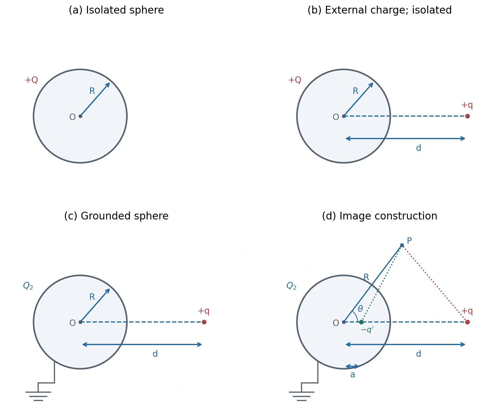
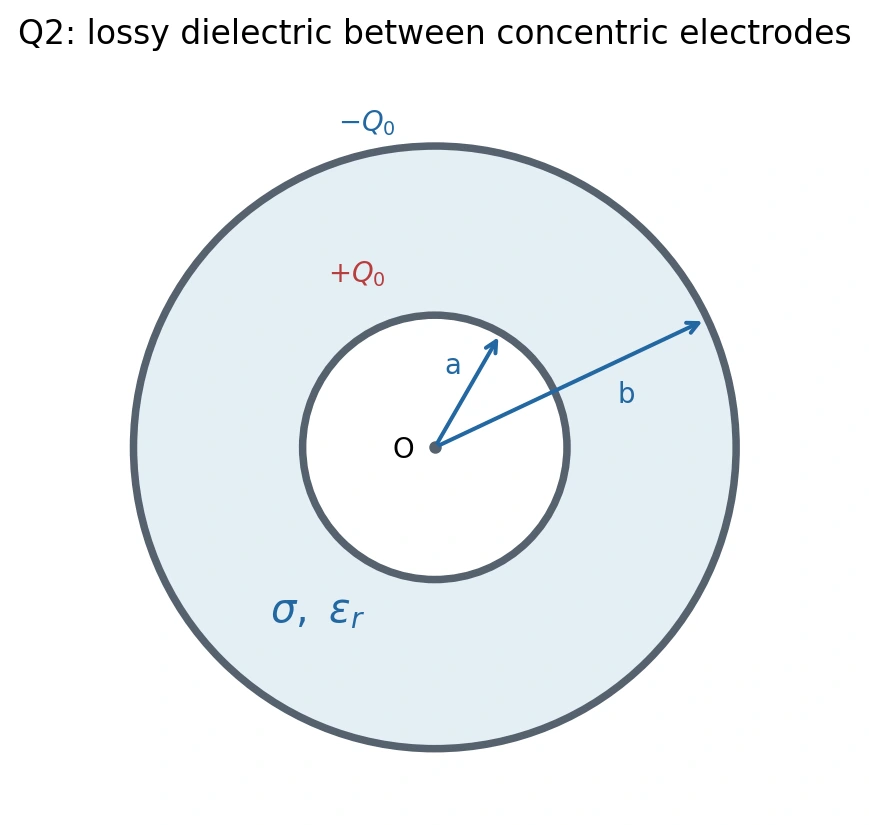
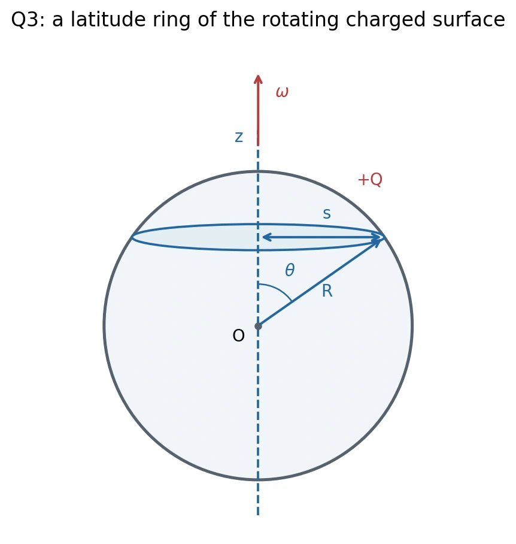
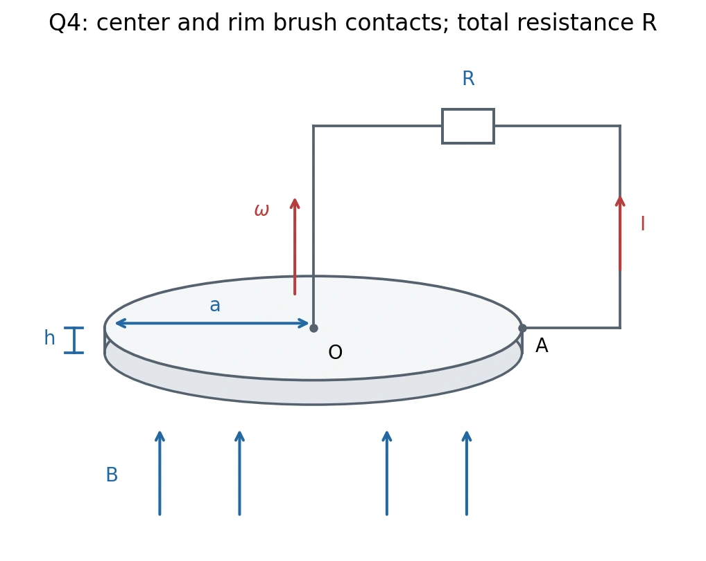

# 2023 Midterm · Question Paper

[Midterm index](index.md) · [Formula sheet](formula-sheet-2023.md) · [Worked solutions](solutions-2023.md)

**Four questions, 25 points each.** Text follows the supplied images, with mathematical notation typeset consistently. Figures are redrawn from the corresponding question pages. No exam duration was included in the supplied pages.

## 1. A point charge in front of a conducting sphere · 25 points {#question-1}

*Redrawn from the 2023 paper, Fig. 1, printed p. 3; [figure record](assets/README.md).*

**(a)** A conducting sphere has radius $R$ and charge $+Q$ uniformly distributed on its surface. Evaluate the electric field $\mathbf E_1$ and potential $V_1$ inside and outside the sphere.

**(b)** A point charge $+q$ is newly located at distance $d$ from the center of the conducting sphere, $d>R$. This redistributes the sphere's surface charge. Evaluate the electric field $\mathbf E_2$ and potential $V_2$ at the center of the sphere.

**(c)** The conducting sphere is now grounded, allowing charge to flow between it and the ground. Its residual charge is $Q_2$. Evaluate the total signed charge flowing from the sphere into the ground, $Q-Q_2$.

**(d)** With the sphere grounded, the original text states that “the charges $Q_2$ are uniformly distributed on the surface.” Apply the method of images to evaluate the exterior potential $V_3$ at point $P$.

*Hint:* Place a negative image charge $-q'$ on the line $Oq$, at distance $a$ from $O$. The combined potential due to $q$ and $-q'$ must vanish on the sphere. In the figure, $\theta$ is measured from the direction $Oq$.

The quoted distribution statement in (d) needs correction; see [solution 1(d)](solutions-2023.md#solution-1). The image construction in the hint determines the intended boundary-value problem.

## 2. Lossy spherical capacitor · 25 points {#question-2}

A spherical capacitor has inner radius $a$ and outer radius $b$. The space between its electrodes is filled with a lossy dielectric of relative permittivity $\epsilon_r$ and conductivity $\sigma$. At $t=0$ the capacitor charge is $Q_0$, with $+Q_0$ on the inner electrode and $-Q_0$ on the outer one.

*Redrawn from the 2023 paper, Fig. 2, printed p. 5; [figure record](assets/README.md).*

**(a)** Evaluate the capacitance $C$ and resistance $R$ between the two electrodes.

**(b)** Evaluate the time-dependent plate charge $Q(t)$.

**(c)** Evaluate the power dissipated by Joule heating inside the capacitor.

## 3. Magnetic field of a rotating conducting sphere with charge $Q$ · 25 points {#question-3}

A conducting sphere has radius $R$ and total charge $+Q$ uniformly distributed over its surface. It rotates about its central $z$ axis at angular velocity $\omega$. Assume the charge distribution does not change; its circulation produces a magnetic field.

*Redrawn from the 2023 paper, Fig. 3, printed p. 7; [figure record](assets/README.md).*

**(a)** Calculate $\sigma(\theta)=dq(\theta)/d\theta$, the charge per unit polar angle of the ring between $\theta$ and $\theta+d\theta$, and $J(\theta)=\sigma(\theta)/\Delta T$, where $\theta$ is measured from the north pole and $\Delta T=2\pi/\omega$.

**(b)** Calculate the magnetic dipole moment $\boldsymbol\mu$. For a ring of area $A(\theta)$, its contribution is $d\mu=J(\theta)A(\theta)d\theta$.

**(c)** Apply the Biot–Savart law to evaluate $\mathbf B$ at the sphere's center $O$.

Here the symbols $\sigma(\theta)$ and $J(\theta)$ follow the paper. Their meanings differ from the usual surface charge density and volume current density.

## 4. Faraday disk · 25 points {#question-4}

A perfectly conducting disk of radius $a$ and thickness $h\ll a$ rotates at constant angular velocity $\boldsymbol\omega$ in a uniform, constant magnetic field $\mathbf B$ parallel to $\boldsymbol\omega$.

*Redrawn from the 2023 paper, Fig. 4, printed p. 9; [figure record](assets/README.md).*

**(a)** With the external circuit disconnected, evaluate the steady electric field $\mathbf E$ in the disk and the potential difference between its center and rim.

**(b)** Connect its center to a point on the circumference through brush contacts, as shown. Let $R$ be the total circuit resistance. Calculate the external torque required to maintain constant angular speed.

**(c)** Remove the applied torque at $t=0$, when the disk rotates at $\omega_0$. Evaluate $\omega(t)$.
