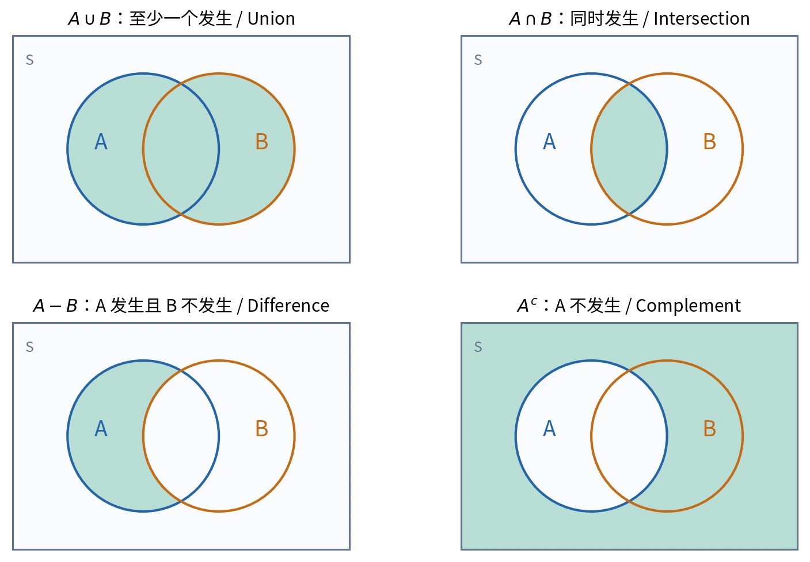

# §1.1 样本空间与随机事件（Sample Space and Events）

## 随机现象与随机试验

**确定性现象（deterministic phenomenon）**：给定条件后结果确定，如理想条件下上抛物体会下落。

**随机现象（random phenomenon）**：单次结果不确定，大量重复试验呈统计规律（statistical regularity），如抛硬币、掷骰子和观察产品寿命。

观察随机现象的过程称为**随机试验（random experiment）**，记为 $E$，具有三个特征：

1. 可以在相同条件下重复进行。
2. 结果不唯一，但事先知道可能结果的范围。
3. 事前不能确定具体结果。

无限多个结果可用集合条件描述。

## 样本空间与样本点

**样本空间（sample space）**是随机试验所有可能结果构成的集合，记作 $S$ 或 $\Omega$。其中一个元素称为**样本点（sample point / outcome）**，记作 $\omega$。

| 试验及观察目标 | 样本空间 | 类型 |
| --- | --- | --- |
| 抛一枚硬币一次，记录正反面 | $S=\{H,T\}$，$H$ 为 heads，$T$ 为 tails | 有限 |
| 掷一枚骰子一次，记录点数 | $S=\{1,2,3,4,5,6\}$ | 有限 |
| 记录某城市一日交通事故次数 | $S=\{0,1,2,\ldots\}$ | 可列无限 |
| 记录产品寿命，以时间连续取值建模 | $S=[0,\infty)$，或按假定界限取 $[a,b]$ | 不可列 |
| 记录一昼夜最高温度 $x$、最低温度 $y$ | $S=\{(x,y):T_0\le y\le x\le T_1\}$ | 不可列，二维区域 |

边界依题意确定：允许立即失效时寿命可为 $0$，也不能默认寿命有有限上界。

### 有限、可列与不可列

- **有限集（finite set）**：只有有限个元素。
- **可列无限集（countably infinite set）**：能按 $1,2,3,\ldots$ 编号，如整数集、有理数集。
- **不可列集（uncountable set）**：不能如此编号，如非退化实数区间。
- **至多可数（at most countable）**：有限或可列无限；部分教材统称为 countable。

$S=\{s_1,\ldots,s_n\}$ 只表示有限情形，样本空间也可以是无限集。

### 样本空间与观察目标有关

掷骰子可记录点数 $\{1,\ldots,6\}$，也可只记录奇偶 $\{\text{odd},\text{even}\}$；后者不能区分点数 1 和 3。

样本点应**不重不漏、能表达所求事件**；合并结果后须重新判断等可能性。

## 事件与“发生”的含义

**事件（event）**用样本空间中的子集 $A$ 表示。若本次结果是 $\omega$，则

$$
A\text{ 发生}\quad\Longleftrightarrow\quad\omega\in A.
$$

一次试验产生一个样本点，它可同时属于多个事件；事件内任一结果出现即算发生。

如掷骰子时，$A=\{2,4,6\}$ 表示出现偶数（even number）。

再如抛硬币三次，以结果的先后顺序为样本点：

$$
S=\{HHH,HHT,HTH,THH,HTT,THT,TTH,TTT\}.
$$

“至少出现两次正面（at least two heads）”对应

$$
A=\{HHH,HHT,HTH,THH\}.
$$

对连续空间，事件还需满足可测性要求；这里使用的区间和几何区域均为可测集合。

### 三类特殊事件

| 名称 | 集合表示 | 含义 |
| --- | --- | --- |
| 基本事件（elementary event） | $\{\omega\}$ | 只含一个样本点的单点集 |
| 必然事件（sure / certain event） | $S$ | 每次试验都发生 |
| 不可能事件（impossible event） | $\varnothing$ | 没有任何结果使其发生 |

区分元素 $\omega$ 与单点集 $\{\omega\}$。基本事件两两互斥，但不一定等可能。

## 事件的关系与运算

以下事件均属于**同一个样本空间**。

### 包含与相等

$A\subseteq B$ 表示 $A$ 发生一定推出 $B$ 发生。例如“至少 10 人候车”推出“至少 5 人候车”。特别地，

$$
\varnothing\subseteq A\subseteq S.
$$

$A=B$ 表示两个事件含有完全相同的结果，等价于 $A\subseteq B$ 且 $B\subseteq A$。

例如点数 $x,y$ 满足“$x+y$ 为奇数”等价于“$x,y$ 奇偶不同”。相等须双向推出，单向只能说明包含。

### 和、积、补与差

| 运算 | 记号 | 发生条件 | 英文 |
| --- | --- | --- | --- |
| 和事件 | $A\cup B$ | $A,B$ 至少一个发生，允许同时发生 | union; $A$ or $B$ or both |
| 积事件 | $A\cap B=AB$ | $A,B$ 同时发生 | intersection; both $A$ and $B$ |
| 补事件／逆事件 | $A^c=\overline A=S\setminus A$ | $A$ 不发生 | complement; $A$ does not occur |
| 差事件 | $A\setminus B=A-B=A\cap B^c$ | $A$ 发生且 $B$ 不发生 | difference; $A$ but not $B$ |

自绘。阴影表示集合归属，**面积不代表概率**。[来源与许可](../assets/README.md)。

不要把 $A\cup B$ 写成 $A+B$；$AB$ 是集合交，不是数值乘法。一般 $A-B\ne B-A$，差运算有方向。

### 互斥与互逆

**互斥／互不相容（mutually exclusive / disjoint）**的定义是

$$
A\cap B=\varnothing.
$$

即不能同时发生。**两两互斥**要求 $A_i\cap A_j=\varnothing$（$i\ne j$），仅全体交集为空不够。

**互逆／互为对立事件（complementary events）**同时要求

$$
A\cup B=S,\qquad A\cap B=\varnothing.
$$

此时恰有一个发生，$B=A^c$。互逆必互斥，反之不成立：骰子的 $\{1\}$ 与 $\{2\}$ 互斥，却未覆盖 $S$。

### 多个事件的并与交

$$
\bigcup_{i=1}^n A_i=\{\omega:\text{至少一个 }A_i\text{ 包含 }\omega\},
\qquad
\bigcap_{i=1}^n A_i=\{\omega:\text{每个 }A_i\text{ 都包含 }\omega\}.
$$

可列并 $\bigcup_{i=1}^{\infty}A_i$、可列交 $\bigcap_{i=1}^{\infty}A_i$ 仍分别表示至少一个发生、全部发生，不预设概率关系。

## 运算律（Laws of Set Operations）

交换律（commutative laws）：

$$
A\cup B=B\cup A,\qquad A\cap B=B\cap A.
$$

结合律（associative laws）：

$$
(A\cup B)\cup C=A\cup(B\cup C),\qquad
(A\cap B)\cap C=A\cap(B\cap C).
$$

分配律（distributive laws）：

$$
A\cap(B\cup C)=(A\cap B)\cup(A\cap C),
\qquad
A\cup(B\cap C)=(A\cup B)\cap(A\cup C).
$$

德摩根律（De Morgan's laws）：**对整体取补，逐项取补，同时交换并与交。**

$$
(A\cup B)^c=A^c\cap B^c,\qquad
(A\cap B)^c=A^c\cup B^c.
$$

$$
\left(\bigcup_i A_i\right)^c=\bigcap_i A_i^c,
\qquad
\left(\bigcap_i A_i\right)^c=\bigcup_i A_i^c.
$$

这两个推广适用于当前讨论的有限或可列事件族。

## 把文字翻译成事件

设 $A$ 为“甲来听课”，$B$ 为“乙来听课”。

| 文字描述 | 事件表达式 |
| --- | --- |
| 至少一人来（at least one） | $A\cup B$ |
| 两人都来（both） | $AB$ |
| 两人都不来（neither） | $A^cB^c=(A\cup B)^c$ |
| 至少一人不来（not both） | $A^c\cup B^c=(AB)^c$ |
| 恰有一人来（exactly one） | $AB^c\cup A^cB$，两部分互斥 |
| 至多一人来（at most one） | $(AB)^c$ |

否定“全都”得“至少一个不”；否定“至少一个”得“全都不”。

### 作业｜习题一 A4：至少、最多与恰好

**题目。**用 $A,B,C$ 表示三个随机事件，写出：（1）至少两个发生；（2）最多一个发生；（3）恰有一个不发生；（4）至少一个不发生。

**解析。**直接把数量条件转换为集合运算：

| 小问 | 所求事件 | 理由 |
| --- | --- | --- |
| (1) | $(AB)\cup(AC)\cup(BC)$ | 至少有一对同时发生，也包含三者都发生 |
| (2) | $\bigl[(AB)\cup(AC)\cup(BC)\bigr]^c$ | “至少两个”的补事件 |
| (3) | $(ABC^c)\cup(AB^cC)\cup(A^cBC)$ | 恰有两个发生 |
| (4) | $(ABC)^c=A^c\cup B^c\cup C^c$ | “三个都发生”的补事件 |

第 (1) 问的三项可重叠；求概率时须用容斥，不能直接相加。

### 串联系统与并联系统

设 $A_i=\{\text{第 }i\text{ 个元件正常}\}$，$A=\{\text{系统正常}\}$。

- **串联系统（series system）**：所有元件正常才正常，$A=\bigcap_{i=1}^nA_i$。
- **并联系统（parallel system）**：至少一个元件正常就正常，$A=\bigcup_{i=1}^nA_i$。

交事件概率可直接相乘的前提是元件独立。

## 易错点

- $A\cup B$ 允许同时发生；恰好一个才排除交集。
- 互逆要求互斥且穷尽，互斥不保证互逆。
- 维恩图辅助判断，证明须写集合等式或包含式。

## 参考资料

主课件第 6–33 页；原始第一章课件第 3–25 页。
