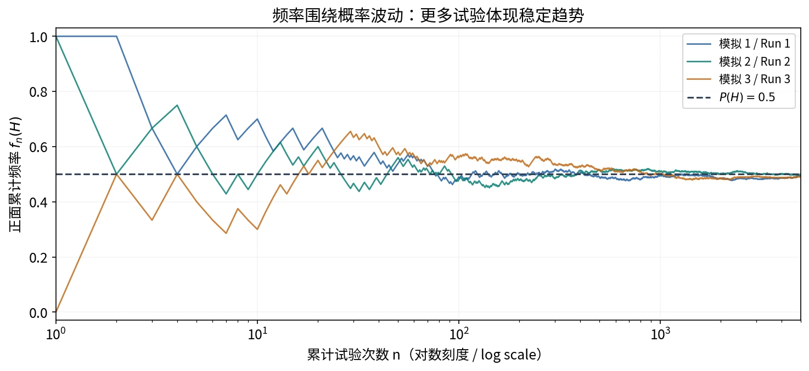

# §1.2 频率与概率（Frequency and Probability）

## 从试验记录到概率模型

前置知识：[样本空间、互斥与事件运算](01-sample-space-and-events.md)。

**频率（frequency）**是观测比例；**概率（probability）**是模型赋予事件的可能性数值。用频率估计概率，用公理推导概率公式。

## 频率及其性质

在相同条件下重复进行 $n$ 次试验，事件 $A$ 出现 $n_A$ 次，则

$$
f_n(A)=\frac{n_A}{n}.
$$

$n_A$ 是次数（count）；$f_n(A)$ 是比例，同样次数的不同试验批次可有不同频率。

对于同一批试验记录：

$$
0\le f_n(A)\le1,\qquad f_n(S)=1.
$$

若 $A_1,\ldots,A_k$ 两两互斥，计数不重叠，故

$$
f_n\left(\bigcup_{i=1}^{k}A_i\right)=\sum_{i=1}^{k}f_n(A_i).
$$

### 频率的稳定性（Stability of Relative Frequency）

公平硬币的正面频率随试验次数增加趋于在 $0.5$ 附近稳定，但不必逐步靠近。

自绘。三组固定种子的模拟数据；横轴为对数刻度，不是课堂观测记录。[来源与许可](../assets/README.md)。

用频率稳定值解释 $P(A)$ 或 $\Pr(A)$，称为概率的**统计性解释（statistical interpretation）**：

- 有限次试验的频率通常不精确等于概率。
- 频率可以持续波动，不必单调逼近或最终固定。
- 一次观察到 $f_n(A)=0$，不能推出 $P(A)=0$。
- 稳定性需要合适的重复试验模型。

## 概率的公理化定义（Axiomatic Definition）

在给定样本空间上，概率 $P$ 为事件赋予实数，并满足三条公理。

### 非负性（Non-negativity）

$$
P(A)\ge0\qquad\text{对任意事件 }A.
$$

### 规范性（Normalization）

$$
P(S)=1.
$$

### 可列可加性（Countable Additivity）

若 $A_1,A_2,\ldots$ **两两互斥**，即 $A_i\cap A_j=\varnothing$（$i\ne j$），则

$$
P\left(\bigcup_{i=1}^{\infty}A_i\right)
=\sum_{i=1}^{\infty}P(A_i).
$$

仅适用于**可列、两两互斥**的事件；重叠事件不能直接相加，不可列个单点不能照此求和。

公理不指定具体概率值；命中率等数值由题意、模型或观测确定。

## 由公理推出的基本性质

### 不可能事件的概率为零

$$
P(\varnothing)=0.
$$

证明：可列可加性中取 $A_1=S$、其余 $A_i=\varnothing$，得 $1=1+\sum_{i=2}^{\infty}P(\varnothing)$，再用非负性。

### 有限可加性（Finite Additivity）

若 $A_1,\ldots,A_n$ 两两互斥，则

$$
P\left(\bigcup_{i=1}^{n}A_i\right)=\sum_{i=1}^{n}P(A_i).
$$

证明：在这些事件后补上可列个空集，再应用第三条公理。

### 补事件公式（Complement Rule）

由于 $A\cup A^c=S$ 且 $A\cap A^c=\varnothing$，

$$
P(A^c)=1-P(A).
$$

这常用于“至少一个”的题目：先求“一个都没有”，再用 $1$ 减去。

### 单调性（Monotonicity）与差事件

若 $A\subseteq B$，可以把 $B$ 分成互斥的两部分 $A$ 与 $B-A$，于是

$$
P(B)=P(A)+P(B-A),\qquad P(B-A)=P(B)-P(A)\ge0.
$$

因此 $P(A)\le P(B)$。再由 $\varnothing\subseteq A\subseteq S$ 得到

$$
0\le P(A)\le1.
$$

对**任意**两个事件，正确的差事件公式是

$$
P(B-A)=P(B)-P(AB),\qquad P(A-B)=P(A)-P(AB).
$$

因为 $B=(AB)\cup(B-A)$，两部分互斥。只有在 $A\subseteq B$ 时，才可以把 $P(AB)$ 换成 $P(A)$。

## 加法公式与容斥原理

### 两个事件（Addition Rule）

$$
P(A\cup B)=P(A)+P(B)-P(AB).
$$

证明：将 $A\cup B=A\cup(B-A)$ 互斥分解，再用差事件公式；减去一次重复计入的交集。

若 $A,B$ 互斥，才简化为 $P(A\cup B)=P(A)+P(B)$。

### 三个事件

$$
\begin{aligned}
P(A\cup B\cup C)
&=P(A)+P(B)+P(C)\\
&\quad-P(AB)-P(AC)-P(BC)+P(ABC).
\end{aligned}
$$

三重交集先加三次、再减三次，需补回一次。

### 有限个事件：容斥原理（Inclusion–Exclusion Principle）

$$
P\left(\bigcup_{i=1}^{n}A_i\right)
=\sum_{k=1}^{n}(-1)^{k-1}
\sum_{1\le i_1<\cdots<i_k\le n}
P(A_{i_1}\cap\cdots\cap A_{i_k}).
$$

各重交集交替加减，无需互斥；应用见[配对问题](03-classical-probability.md)。

## 概率为零不等于不可能

总有 $P(\varnothing)=0$、$P(S)=1$，但反向推断一般不成立：

$$
P(A)=0\ \not\Rightarrow\ A=\varnothing,
\qquad
P(B)=1\ \not\Rightarrow\ B=S.
$$

反例：在 $[0,1]$ 上均匀取一个数。取

$$
A=\{0.3\},\qquad B=[0,1]\setminus\{0.3\}.
$$

$P(A)=0$ 但 $A$ 非空；$P(B)=1$ 但 $B\ne S$。概率为 1 称**几乎必然（almost surely）**，允许零概率例外。

均匀取点时，若单点概率同为 $c>0$，任取 $m>1/c$ 个点，由有限可加性其概率为 $mc>1$，矛盾；故单点概率为零，无需不可列求和。

具体长度比计算见[几何概型](04-geometric-probability.md)。

### 作业｜习题一 B1：包含关系与互斥

**题目。**$P(A)=P(B)=0.3,P(C)=0.4$；$A$ 发生则 $C$ 必然发生，$B,C$ 互斥。求：（1）$C$ 发生而 $A$ 不发生；（2）$A,B$ 至少一个发生；（3）三个都不发生的概率。

**解析。**由题意 $A\subseteq C$，$BC=\varnothing$，所以 $AB=\varnothing$，且 $A\cup B\cup C=B\cup C$。于是

$$
P(CA^c)=P(C)-P(A)=0.1,
$$

$$
P(A\cup B)=P(A)+P(B)=0.6,
$$

$$
P(A^cB^cC^c)=1-P(B\cup C)=1-0.3-0.4=0.3.
$$

只用包含与互斥，无需独立性。

## 例题：射击与事件分解

设 $A=\{\text{甲击中}\}$，$B=\{\text{乙击中}\}$，已知

$$
P(A)=0.7,\qquad P(B)=0.6,\qquad P(AB)=0.4.
$$

目标不被击中即两人都没有击中：

$$
P(A^cB^c)=1-P(A\cup B)
=1-[0.7+0.6-0.4]=0.1.
$$

甲击中而乙没有击中：

$$
P(AB^c)=P(A)-P(AB)=0.7-0.4=0.3.
$$

四类概率依次为：都击中 $0.4$、仅甲 $0.3$、仅乙 $0.2$、都未中 $0.1$，和为 $1$。交集概率已知，无需假设独立。

## 例题：至少两人参加与容斥

设 $A,B,C$ 分别表示三人参加，且

$$
P(A)=P(B)=P(C)=0.4,
\quad P(AB\cup AC\cup BC)=0.3,
\quad P(ABC)=0.05.
$$

“至少两人”含三人全参加。记两两交集概率和为 $T$；$AB,AC,BC$ 的各重交集均为 $ABC$，容斥得

$$
0.3=T-3P(ABC)+P(ABC)=T-2\times0.05,
\qquad T=0.4.
$$

故至少一人参加的概率为

$$
P(A\cup B\cup C)=1.2-0.4+0.05=0.85.
$$

## 思考题

**题 1：**$P(A\cup B)=0.6$、$P(A)=0.3$，求 $P(A^cB)$。由互斥分解 $A\cup B=A\cup(A^cB)$，答案为 $0.6-0.3=0.3$。

**题 2：**$P(AB)=P(A^cB^c)$，$P(A)=p$，求 $P(B)$。设共同值为 $c$，由德摩根律和加法公式，

$$
c=1-P(A\cup B)=1-p-P(B)+c,
\qquad P(B)=1-p.
$$

这只是两块区域的概率相等，不意味着 $A$ 与 $B$ 互逆。

**题 3：**若“$A,B$ 至少一个发生时 $C$ 必发生”，则 $A\cup B\subseteq C$，所以一定有

$$
P(A\cup B)\le P(C).
$$

包含关系只保证不等式，等号可能成立但不必成立。

## 易错点

- 相加前检查两两互斥；有重叠用容斥。
- 包含关系给概率不等式，不自动给等号。
- 概率为 0／1 不等于事件为空集／全集。

## 参考资料

主课件第 34–51 页；原始第一章课件第 26–44 页。
