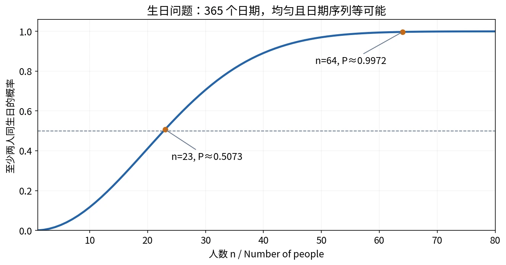

# §1.3 古典概型（Classical Probability）

## 定义与建模条件

**古典概型／等可能概型（classical probability model）**要求同时满足：

1. **有限性（finiteness）**：样本空间只有有限个样本点。
2. **等可能性（equally likely outcomes）**：每个样本点出现的概率相同。

若 $|S|=N$，规范性与有限可加性给出单点概率 $1/N$，故

$$
P(A)=\frac{|A|}{|S|}
=\frac{\text{有利结果数（favorable outcomes）}}{\text{全部可能结果数（total outcomes）}}.
$$

有限等可能空间也称 **simple sample space**。使用个数比前，须明确哪些结果等可能；仅“有限”或“随机”不够。

## 排列组合与计数模型

### 排列（Permutation）

从 $n$ 个不同元素中不放回地取 $k$ 个，并记录顺序：

$$
A_n^k=P_{n,k}=\frac{n!}{(n-k)!}
=n(n-1)\cdots(n-k+1),\qquad 0\le k\le n.
$$

若取全部元素，全排列数为 $n!$；规定 $0!=1$。

### 组合（Combination）

从 $n$ 个不同元素中不放回取 $k$ 个，不计顺序：

$$
C_n^k=\binom nk=\frac{n!}{k!(n-k)!}
=\frac{A_n^k}{k!}.
$$

一个 $k$ 元子集可排成 $k!$ 种顺序，所以组合数比排列数少一个 $k!$ 因子。约定 $k<0$ 或 $k>n$ 时 $\binom nk=0$。

### 先判断“放回”和“顺序”

| 取法 | 样本点 | 总数 |
| --- | --- | --- |
| 不放回，记录顺序（without replacement, ordered） | 互不相同的 $k$ 元序列 | $A_n^k$ |
| 不放回，不记录顺序（without replacement, unordered） | $k$ 元子集 | $\binom nk$ |
| 放回，每次均匀选择且允许任意选择序列（with replacement, ordered） | 可重复的 $k$ 元序列 | $n^k$ |

分子、分母须统一计数：都计顺序或都不计。放回抽样的无序结果通常不等可能，宜用有序样本点。

**计数乘法原理（multiplication principle of counting）**：分步选择的可选数相乘；区别于概率乘法公式。

### 作业｜习题一 B2：随机猜两张脸谱

**题目。**50 张不同脸谱中随机选两张合成一张，挑战者靠猜找出原来的两张。求猜中的概率。

**解析。**无有效线索时，$\binom{50}{2}$ 个无序对等可能，仅一对正确：

$$
P(\text{猜中})=\frac1{\binom{50}{2}}=\frac1{1225}.
$$

若用有序对计数，分母是 $50\cdot49$，但正确顺序有两个，结果仍相同。

### 作业｜习题一 A10：两颗骰子与条件样本空间

**题目。**同时掷两颗均匀、独立的骰子，求：（1）点数不同的概率；（2）一颗点数为另一颗三倍的概率；（3）已知点数不同，再求三倍关系的概率。

**解析。**将两颗骰子区分，36 个有序点数对等可能。设 $D$ 为点数不同，$T$ 为三倍关系：

$$
P(D)=1-\frac6{36}=\frac56,\qquad
T=\{(3,1),(6,2),(1,3),(2,6)\}.
$$

因此 $P(T)=4/36=1/9$。又因 $T\subseteq D$，

$$
P(T\mid D)=\frac{P(T)}{P(D)}
=\frac{1/9}{5/6}=\frac2{15}.
$$

最后一问也可在剩余 30 个点数不同的等可能结果中计数，得到 $4/30$；参见[条件概率](05-conditional-probability.md)。

## 例 1：放回与不放回摸球

袋中 3 红、5 黄，各球等可能。给同色球也编号，以球号定义等可能样本点。

一次摸球取到红球：

$$
P(\text{红球})=\frac38.
$$

不放回摸两球，颜色不同。以无序二元子集为样本点：

$$
P(\text{不同色})=\frac{\binom31\binom51}{\binom82}
=\frac{15}{28}.
$$

有序计数同样得 $2\times3\times5/[8\times7]=15/28$；因子 $2$ 对应红黄、黄红。

**放回抽样：**每次放回后重新均匀抽取，$8^2$ 个有序球号对等可能：

$$
P(\text{不同色})=\frac{3\times5+5\times3}{8^2}=\frac{15}{32}.
$$

### 作业｜习题一 A12：两次抽球的三种事件

**题目。**10 个球中有 8 红、2 非红，每次摸一个，共两次。分别在放回和无放回情形求：两次均红、恰有一个红、第 2 次为红的概率。

**解析。**设 $R_i$ 为第 $i$ 次取红。恰一红是两个互斥顺序 $R_1R_2^c$ 与 $R_1^cR_2$ 的并：

| 事件 | 有放回 | 无放回 |
| --- | --- | --- |
| $R_1R_2$ | $\frac8{10}\frac8{10}=\frac{16}{25}$ | $\frac8{10}\frac79=\frac{28}{45}$ |
| 恰一红 | $\frac8{10}\frac2{10}+\frac2{10}\frac8{10}=\frac8{25}$ | $\frac8{10}\frac29+\frac2{10}\frac89=\frac{16}{45}$ |
| $R_2$ | $8/10=4/5$ | $\frac8{10}\frac79+\frac2{10}\frac89=4/5$ |

无放回时，第 2 次的无条件红球概率仍为 $4/5$，但给定第 1 次颜色后的条件概率会改变。

### 作业｜习题一 A14：无序颜色组合与固定顺序

**题目。**7 球中 2 红、3 黑、2 白，无放回取三次。求：（1）恰一红一黑一白；（2）三个全黑；（3）依次为红、黑、白的概率。

**解析。**分别采用无序组合与顺序乘法：

$$
P(\text{一红一黑一白})
=\frac{\binom21\binom31\binom21}{\binom73}=\frac{12}{35},
$$

$$
P(\text{三个全黑})=\frac{\binom33}{\binom73}=\frac1{35},
$$

$$
P(\text{依次红黑白})=\frac27\frac36\frac25=\frac2{35}.
$$

三种不同颜色有 $3!=6$ 个顺序，因此第 (1) 问恰为第 (3) 问的六倍。

## 例 2：产品抽样中恰有指定数量的次品

$N$ 件产品中有 $D$ 件次品，不放回地均匀抽取 $n$ 件。记 $A_k=\{\text{恰有 }k\text{ 件次品}\}$，则

$$
P(A_k)=\frac{\binom Dk\binom{N-D}{n-k}}{\binom Nn}.
$$

分子分别选次品、正品，分母选全部样本。整数 $k$ 的范围为

$$
\max\{0,n-(N-D)\}\le k\le\min\{n,D\}.
$$

范围以外的概率为 $0$，也可由组合数的零值约定统一处理。这是**不放回抽样（sampling without replacement）**的计数概率。

## 例 3：球盒模型与生日问题

### 球盒模型（Occupancy Model）

$n$ 个不同的球投入 $N$ 个不同的盒子，$n\le N$；每个球均匀选择盒子，整个盒号序列按 $N^n$ 个等可能结果建模。

设 $A=\{\text{恰有 }n\text{ 个盒子各有一个球}\}$，即无碰撞。全部结果 $N^n$ 种；无碰撞需选盒并排列球，有 $\binom Nn n!=A_N^n$ 种，故

$$
P(A)=\frac{A_N^n}{N^n}
=\prod_{j=0}^{n-1}\left(1-\frac jN\right).
$$

**条件：各球独立且均匀选盒**，才能使全部序列等可能；仅各球的边际均匀不够。

### 生日问题（Birthday Problem）

人对应球、365 个日期对应盒。假设忽略闰日，各人生日独立均匀；现实生日未必满足该模型。

对 $n\le365$，先求没有人生日相同，再取补：

$$
P(\text{至少两人同生日})
=1-\frac{A_{365}^n}{365^n}
=1-\prod_{j=0}^{n-1}\left(1-\frac j{365}\right).
$$

$n=64$ 时，结果约为 $0.997$。$n=23$ 时已经约为 $0.507$；$n>365$ 时，由抽屉原理（pigeonhole principle）概率为 $1$。

自绘。按上述理想生日模型计算。[来源与许可](../assets/README.md)。

“至少一对同生日”与“有人和指定者同生日”不同；前者比较所有人对，人数增加时人对数迅速增加。

## 例 4：抽签问题与样本空间的选择

袋中 $a$ 个红球、$b$ 个白球，$n=a+b$。$n$ 人依次不放回摸球，每一步对剩余球均匀选择。记 $A_k=\{\text{第 }k\text{ 人摸到红球}\}$。

### 方法一：给全部球编号，观察整个排列

全部 $n!$ 种排列等可能。第 $k$ 位有 $a$ 种红球选择，其余 $(n-1)!$ 种排列，故

$$
P(A_k)=\frac{a(n-1)!}{n!}=\frac an.
$$

### 方法二：只记录红球分配给哪几个人

红球接收者构成 $a$ 人子集，共 $\binom na$ 个；各对应 $a!b!$ 个球号排列，故等可能。

若第 $k$ 人得到红球，则其余 $a-1$ 个红球位置从其他 $n-1$ 人中选择：

$$
P(A_k)=\frac{\binom{n-1}{a-1}}{\binom na}=\frac an.
$$

此写法用于 $a\ge1$；$a=0$ 时答案直接为 $0$。分子不再乘 $a$，因为此模型不区分红球编号。

例如：$n=3,a=2$，样本空间为 $\{\{1,2\},\{1,3\},\{2,3\}\}$，其中含人员 1 的样本点有两个，概率 $2/3$。

### 方法三：只记录第 $k$ 人取得的球号

由球号排列的对称性，每个球号出现在第 $k$ 位的概率均为 $1/n$。取 $S=\{1,\ldots,n\}$，其中有 $a$ 个红球号，答案仍为 $a/n$。

三种等可能模型均保留所求事件，答案一致：**未利用前面结果时，抽签顺序不影响无条件概率。**

### 错误方法：按颜色分两类，直接得到一半

取 $S=\{\text{红},\text{白}\}$ 后不能直接写 $P(\text{红})=1/2$：两类概率为 $a/n,b/n$，仅 $a=b$ 时相等。合并结果应累加概率，不能重新均分。

### 已知前一人的结果后，概率会变化

设 $0<a<n$，则

$$
P(A_2\mid A_1)=\frac{a-1}{n-1},\qquad
P(A_2\mid A_1^c)=\frac a{n-1}.
$$

这与 $P(A_2)=a/n$ 不矛盾：前两式加入了已知信息。由全概率公式，

$$
P(A_2)=\frac an\frac{a-1}{n-1}
+\frac bn\frac a{n-1}=\frac an.
$$

正式定义与公式见 [§1.4 条件概率](05-conditional-probability.md)。

## 例 5：配对问题与错排（Matching Problem / Derangement）

$n$ 人各准备一件带自己编号的礼物，随后按均匀随机排列分发。求无人拿到自己礼物的概率。

设 $A_i=\{\text{第 }i\text{ 人取得自己的礼物}\}$。对任意指定的 $k$ 个不同人员，固定其礼物不动，其他礼物可任意排列，所以

$$
P(A_{i_1}\cap\cdots\cap A_{i_k})=\frac{(n-k)!}{n!}.
$$

共有 $\binom nk$ 组这样的人员，由容斥原理，

$$
\begin{aligned}
P(\text{无人取得自己的礼物})
&=1-P\left(\bigcup_{i=1}^n A_i\right)\\
&=1-\sum_{k=1}^{n}(-1)^{k-1}\binom nk\frac{(n-k)!}{n!}\\
&=\sum_{k=0}^{n}\frac{(-1)^k}{k!}.
\end{aligned}
$$

关键化简为 $\binom nk(n-k)!/n!=1/k!$。以 $n=3$ 核对：$1-1+1/2!-1/3!=1/3$，对应六种排列中的两种错排。

由指数函数级数可得，

$$
\lim_{n\to\infty}P(\text{无人配对成功})=e^{-1}\approx0.367879.
$$

有限 $n$ 时应使用有限和，而不是直接写 $1/e$。各 $A_i$ 重叠且不独立，不能直接相加或把补事件概率相乘。

### 作业｜习题一 A15：指定车辆的配对

**题目。**1–9 号车随机停入 1–9 号车位，每车占一个车位；车号与车位号相同时称配对。求 1 号车配对的概率；1 号车配对而 9 号车不配对的概率。

**解析。**设 $M_i$ 为 $i$ 号车配对。全部 $9!$ 个停车排列等可能，固定一辆或两辆后分别剩下 $8!$、$7!$ 种排列：

$$
P(M_1)=\frac{8!}{9!}=\frac19,
$$

$$
P(M_1M_9^c)=P(M_1)-P(M_1M_9)
=\frac{8!-7!}{9!}=\frac7{72}.
$$

仅限制 1、9 号车，其余不受限，不能套无人配对的错排公式。

## 易错点

- 使用个数比前确认等可能，分子、分母采用同一种计数。
- 放回的无序结果通常不等可能。
- 恰有 $k$（exactly $k$）与至少 $k$（at least $k$）不同。

## 参考资料

主课件第 52–67 页；原始第一章课件第 45–59 页。
