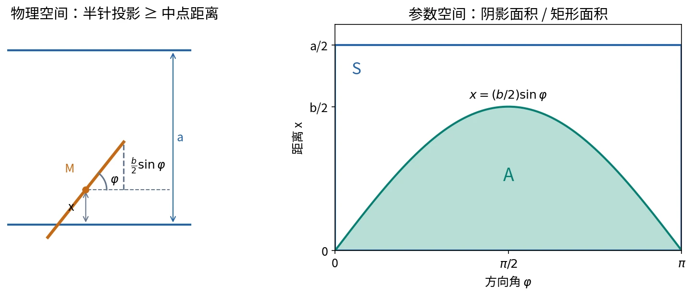

# 几何概型与蒲丰投针（Geometric Probability）

## 从个数比到几何度量比

有限等可能结果用个数比；几何区域 $S$ 内**均匀取点（uniform sampling）**用**几何概型（geometric probability model）**。

设 $m$ 是相应的几何度量（geometric measure），要求

$$
0<m(S)<\infty.
$$

均匀指各可测子区域的概率与度量成正比，即等度量区域等可能：

$$
P(A)=\frac{m(A)}{m(S)},\qquad A\subseteq S.
$$

| 空间 | 使用的度量 | 英文 |
| --- | --- | --- |
| 线段／区间 | 长度 | length |
| 平面区域 | 面积 | area |
| 空间区域 | 体积 | volume |

分子、分母使用同种度量；零度量边界不影响概率。

单点概率都为零不代表均匀；须比较区域概率。无限直线、无限平面不满足有限总度量条件，不能直接套公式。

## 简单例子与零概率事件

在 $S=[0,1]$ 上均匀取一个数：

$$
P([u,v])=v-u\qquad(0\le u\le v\le1).
$$

单点 $\{0.3\}$ 非空但概率为零；$[u,v]$、$(u,v)$ 等只差零概率端点。

在 $S=[0,2]\times[0,1]$ 上均匀投点。对其中面积为 $q$ 的区域 $A$，

$$
P(A)=\frac q2.
$$

面积比成立的依据是**均匀投点的模型**，不能把所有维恩图的面积都当作概率。

## 蒲丰投针问题（Buffon's Needle Problem）

### 试验与条件

平面上画有一组平行直线，相邻直线的间距为 $a>0$。随机投下一根长度为 $b$ 的针，设 $0<b<a$。求针与任意一条直线相交的概率。

**假设：中点垂直位置与方向角独立、均匀**，使联合参数空间均匀；“随手投针”本身不足以保证。

### 用两个参数表示位置关系

定义

- $x$：针的中点到最近一条平行线的距离，$0\le x\le a/2$。
- $\varphi$：针与平行线的方向夹角，取 $0\le\varphi<\pi$。

是否相交只依赖 $x,\varphi$，省略沿平行线的坐标，取参数空间

$$
S=\{(x,\varphi):0\le x\le a/2,\ 0\le\varphi<\pi\}.
$$

参数矩形面积为 $a\pi/2$，区别于无限物理平面。

自绘。左：相交条件；右：参数空间中的相交区域。[来源与许可](../assets/README.md)。

### 相交条件

半根针在垂直于平行线方向上的投影长度为 $(b/2)\sin\varphi$。针能触及最近直线，当且仅当

$$
x\le\frac b2\sin\varphi.
$$

因此相交事件为

$$
A=\left\{(x,\varphi):0\le\varphi<\pi,\
0\le x\le\frac b2\sin\varphi\right\}.
$$

$b<a$ 保证曲线不超出矩形高度 $a/2$；接触是否算相交不影响概率。

### 用面积比计算概率

$$
m(A)=\int_0^{\pi}\frac b2\sin\varphi\,\mathrm d\varphi=b.
$$

所以

$$
\boxed{P(A)=\frac{m(A)}{m(S)}=\frac{b}{a\pi/2}=\frac{2b}{a\pi}.}
$$

短针公式要求 $b<a$；概率随针长增加、线距减小而增大，仅依赖长度比。

## 投针与随机模拟（Random Simulation / Monte Carlo Method）

若投针 $n$ 次，其中 $m$ 次相交，则用频率 $m/n$ 近似概率，

$$
\frac mn\approx\frac{2b}{a\pi}
\quad\Longrightarrow\quad
\pi\approx\frac{2bn}{am}\qquad(m>0).
$$

这是**蒙特卡洛方法（Monte Carlo method）**的早期实例。估计要求 $m>0$，有限次结果仅为近似。

模拟：在参数矩形均匀生成 $(x,\varphi)$，按 $x\le(b/2)\sin\varphi$ 计数。不能改成均匀生成两个端点，否则针长、方向分布均改变。

物理投针只需已知 $b/a$；计算机可由均匀 $u\in[0,1)$ 生成 $\varphi=\pi u$，但这已使用 $\pi$，只能演示原理。

## 易错点

- 先验证均匀性与有限正总度量，再取度量比。
- 投针距离上限是 $a/2$，垂直投影用半针长 $b/2$。
- 积分区域是参数矩形，不是无限物理平面。

## 参考资料

第二节课课堂识别约 34:39–52:59；同目录补充截图 `ppt_030`–`ppt_043`。
