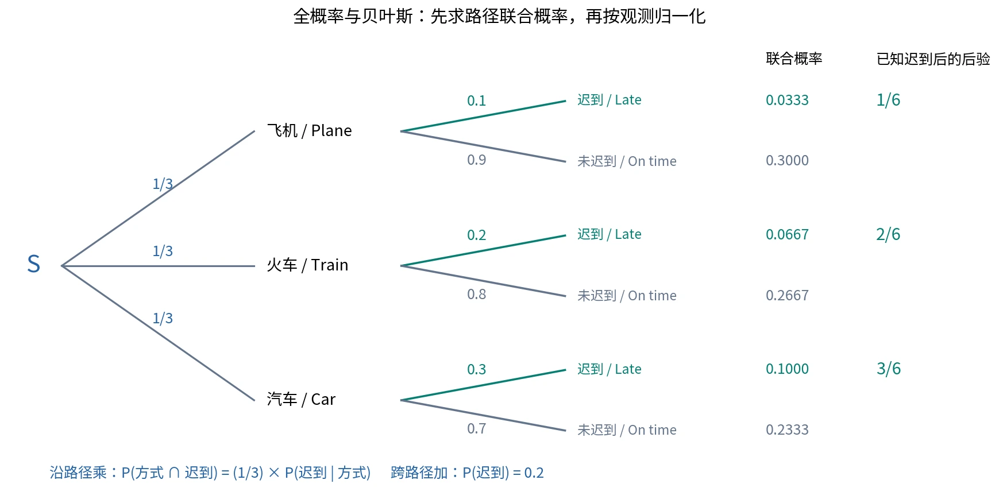
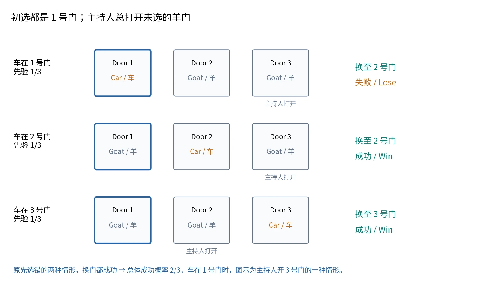

# §1.4 条件概率、全概率与贝叶斯公式（Conditional Probability）

## 一个定义与三个公式

前置知识：[事件的交、并与补](01-sample-space-and-events.md)、[有限可加性与加法公式](02-frequency-and-probability.md)、[古典概型](03-classical-probability.md)。

**先判断所求类型，再选公式；条件概率从定义入手。**

| 工具 | 求什么 | 典型用途 |
| --- | --- | --- |
| 条件概率定义（conditional probability） | 已知 $B$ 发生时的 $P(A\mid B)$ | 限制结果范围并重新归一化 |
| 乘法公式（multiplication rule / chain rule） | 交事件 $P(AB)$ 或多个事件共同发生的概率 | 沿一条路径逐步计算 |
| 全概率公式（law of total probability） | 结果 $A$ 的总概率 | 按互斥且穷尽的情况加权求和 |
| 贝叶斯公式（Bayes' formula / Bayes' theorem） | 观察到 $A$ 后的 $P(B_i\mid A)$ | 从结果反推来源，更新概率 |

## 条件概率：限制范围并重新归一化

若 $P(B)>0$，定义

$$
\boxed{P(A\mid B)=\frac{P(A\cap B)}{P(B)}.}
$$

读作 **the probability of $A$ given $B$**。右侧 $B$ 是条件：限制在 $B$ 内，再用 $P(B)$ 归一化交集 $A\cap B$。

$P(B\mid B)=1$，不表示原模型的 $P(B)$ 变成了 $1$。

### 掷骰子例

均匀骰子，$A=\{1,2,3\}$ 表示小点数，$B=\{1,3,5\}$ 表示奇数。无条件时

$$
P(A)=\frac36=\frac12.
$$

已知是奇数，只剩三个等可能结果 $1,3,5$，其中 $1,3$ 符合 $A$，故

$$
P(A\mid B)=\frac{2/6}{3/6}=\frac23.
$$

此时 $P(AB)=1/3$、$P(A\mid B)=2/3$、$P(B\mid A)=2/3$；后两者在这个例子中碰巧相等，不能推广为一般规律。

### 必须区分的三个量

| 记号 | 所研究的量 |
| --- | --- |
| $P(AB)$ | 在原模型下，$A,B$ 同时发生的概率 |
| $P(A\mid B)$ | 在已知 $B$ 的条件下，$A$ 发生的概率 |
| $P(B\mid A)$ | 在已知 $A$ 的条件下，$B$ 发生的概率 |

两种条件概率分子相同、分母通常不同。“已知”指信息，不必按时间先后：也可已知第四次结果，反推第一次。

$P(A\mid B)$ 是概率记号；$A\mid B$ 不是另一个集合事件。先定义 $A,B$，再写所求概率。

$P(B)=0$ 时不能用此定义，即使 $B$ 非空。

## 固定条件后，仍满足概率的公理与性质

固定 $P(B)>0$ 的事件，令 $Q(A)=P(A\mid B)$。

- 非负性：$Q(A)\ge0$。
- 规范性：$Q(S)=P(S\cap B)/P(B)=1$，且 $Q(B)=1$。
- 可列可加性：若 $A_i$ 两两互斥，则 $A_i\cap B$ 也两两互斥，故 $Q(\bigcup_iA_i)=\sum_iQ(A_i)$。

因此在**同一个条件**下，基本公式仍然成立：

$$
P(A^c\mid B)=1-P(A\mid B),
$$

$$
P(A\cup C\mid B)=P(A\mid B)+P(C\mid B)-P(AC\mid B).
$$

若 $A\subseteq C$，则 $P(A\mid B)\le P(C\mid B)$；也有 $P(A)=P(A\mid S)$。

补事件、加法公式须在同一条件下使用；$P(A\mid B)+P(C\mid D)$ 一般不表示某个并事件概率。跨条件求和需按全概率公式加权。

## 乘法公式（Multiplication Rule）

条件概率定义直接给出：在有关条件概率有定义时，

$$
\boxed{P(AB)=P(A)P(B\mid A)=P(B)P(A\mid B).}
$$

按已知条件选择展开方向。三个事件时：

$$
P(ABC)=P(A)P(B\mid A)P(C\mid AB).
$$

一般形式为

$$
P\left(\bigcap_{i=1}^{n}A_i\right)
=P(A_1)\prod_{i=2}^{n}
P\left(A_i\mid\bigcap_{j=1}^{i-1}A_j\right).
$$

每一步须保留此前的**全部条件**。前缀交事件概率为零时，整个交集概率为零，停止展开以免除以零。

### 例：合格品中的优质品

设 $A=\{\text{合格品}\}$，$B=\{\text{优质品}\}$。已知 $P(A)=0.90$，$P(B\mid A)=0.95$。因为优质品必为合格品，$B\subseteq A$，故

$$
P(B)=P(AB)=0.90\times0.95=0.855.
$$

“合格品中有 95% 是优质品”描述的是条件比例，不是全体产品的优质率。

### 例：调试与报废

设 $B=\{\text{产品需要调试}\}$，$A=\{\text{产品报废}\}$。题意为

$$
P(B^c)=0.7,\quad P(B)=0.3,\quad
P(A^c\mid B)=0.8,\quad P(A\mid B)=0.2.
$$

只有需要调试的产品才可能报废，$A\subseteq B$，所以

$$
P(A)=P(AB)=P(B)P(A\mid B)=0.3\times0.2=0.06.
$$

注意 $0.8$ 对应“不报废”的条件概率 $P(A^c\mid B)$。

### 例：最多参加三次考核

第一轮通过率为 $0.6$；第一轮未通过后，第二轮通过的条件概率为 $0.8$；前两轮均未通过后，第三轮通过的条件概率为 $0.9$。通过后停止参加。

记 $F_i$ 为“前 $i$ 轮均未通过”，则

$$
P(F_1)=0.4,\qquad
P(F_2\mid F_1)=0.2,\qquad
P(F_3\mid F_2)=0.1.
$$

三次都未通过的概率为 $0.4\times0.2\times0.1$，于是

$$
P(\text{最终通过})=1-0.4\times0.2\times0.1=0.992.
$$

也可按“首次通过的轮次”作互斥分解：

$$
P(\text{最终通过})=0.6+0.4\times0.8+0.4\times0.2\times0.9=0.992.
$$

三项对应首次通过的三条路径。$0.8,0.9$ 是实际进入后续轮次的条件通过率，不是无条件通过率。

### 例：由两个条件概率还原交集

已知

$$
P(A)=\frac14,\quad P(B\mid A)=\frac13,\quad
P(A\mid B)=\frac12.
$$

先求交集，再求 $B$：

$$
P(AB)=\frac14\times\frac13=\frac1{12},
\qquad P(B)=\frac{P(AB)}{P(A\mid B)}=\frac16.
$$

所以

$$
P(A\cup B)=\frac14+\frac16-\frac1{12}=\frac13.
$$

再求 $P(A^c\mid A\cup B)$：

$$
P(A^c\mid A\cup B)
=\frac{P(A^cB)}{P(A\cup B)}
=\frac{1/6-1/12}{1/3}=\frac14.
$$

若求没有补集标记的 $P(A\mid A\cup B)$，答案才是 $3/4$。

## 划分／完备事件组（Partition）

$B_1,\ldots,B_n$ 构成样本空间的一个**划分（partition）**，要求：

$$
\bigcup_{i=1}^{n}B_i=S,\qquad B_i\cap B_j=\varnothing\quad(i\ne j).
$$

即**穷尽（collectively exhaustive）且两两互斥（pairwise disjoint）**，每次恰有一项发生；最简单的划分是 $B,B^c$。

exhaustive 只表示覆盖 $S$，不含互斥。划分通常取非空项；使用条件概率时另需正概率。

## 全概率公式（Law of Total Probability）

设 $B_1,\ldots,B_n$ 是划分，且各 $P(B_i)>0$。则

$$
\boxed{P(A)=\sum_{i=1}^{n}P(B_i)P(A\mid B_i).}
$$

**推导：**把 $A$ 按来源分成互斥部分：

$$
A=A\cap S=\bigcup_{i=1}^{n}(A\cap B_i).
$$

用有限可加性，再用乘法公式：

$$
P(A)=\sum_iP(AB_i)=\sum_iP(B_i)P(A\mid B_i).
$$

常按来源、箱号、交通方式或事件是否发生作划分。零概率项直接略去，其条件概率可能无定义。

### 作业｜习题一 A20：选盒与转球

**题目。**甲盒 3 红、2 白，乙盒 2 红、4 白。（1）等可能选一盒，无放回取两球，求一红一白概率；（2）甲盒随机转一球至乙盒，再从乙盒取一球，求红球概率；（3）同样转球后从乙盒无放回取两球，求一红一白概率。

**解析。**设 $H$ 为取到一红一白，$T$ 为甲转入乙的是红球。

第一问按所选盒分类：

$$
P(H)=\frac12\frac{\binom31\binom21}{\binom52}
+\frac12\frac{\binom21\binom41}{\binom62}
=\frac{17}{30}.
$$

第二、三问按转入颜色分类，$P(T)=3/5$。转红后乙盒为 3 红、4 白；转白后为 2 红、5 白。故

$$
P(\text{乙取出红球})=\frac35\frac37+\frac25\frac27=\frac{13}{35},
$$

$$
P(H)=\frac35\frac{\binom31\binom41}{\binom72}
+\frac25\frac{\binom21\binom51}{\binom72}
=\frac8{15}.
$$

如果选盒概率并非各 $1/2$，第一问应使用实际先验加权；“等可能选盒”和“从所有球中等可能选球”是不同试验。

### 条件概率下的全概率公式

若已知事件 $C$，$P(C)>0$，且各 $P(B_iC)>0$，则所有概率换到同一个条件体系：

$$
\boxed{P(A\mid C)
=\sum_{i=1}^{n}P(B_i\mid C)P(A\mid B_iC).}
$$

$B_iC=B_i\cap C$。权重改为 $P(B_i\mid C)$，内部条件同时保留 $B_i,C$。

## 贝叶斯公式（Bayes' Formula）

在相同划分条件下，再要求 $P(A)>0$，则

$$
\boxed{P(B_i\mid A)
=\frac{P(B_i)P(A\mid B_i)}
{\sum_{j=1}^{n}P(B_j)P(A\mid B_j)}.}
$$

推导：$P(B_i\mid A)=P(AB_i)/P(A)$，分子用乘法，分母用全概率。

| 概念 | 记号 | 解释 |
| --- | --- | --- |
| 先验概率（prior probability） | $P(B_i)$ | 未利用这次观测 $A$ 前，对 $B_i$ 的概率判断 |
| 似然项（likelihood） | $P(A\mid B_i)$ | 若处在情况 $B_i$，观测到 $A$ 的可能性 |
| 证据概率／归一化项（evidence / normalizing constant） | $P(A)$ | 对所有情况加权后的观测概率 |
| 后验概率（posterior probability） | $P(B_i\mid A)$ | 利用观测 $A$ 后更新的概率 |

贝叶斯由观测更新来源或分类概率，本身不证明因果。

### 作业｜习题一 A22：优质品的来源

**题目。**甲、乙、丙厂供货数量比为 $6:5:4$，优质品率分别为 $85\%,90\%,80\%$。随机取一件发现是优质品，求来自各厂的概率及最可能来源。

**解析。**设 $F_i$ 为来源厂，$Q$ 为优质品：

$$
P(Q)=\frac6{15}(0.85)+\frac5{15}(0.90)+\frac4{15}(0.80)=\frac{64}{75}.
$$

贝叶斯更新为

$$
P(F_1\mid Q)=\frac{(6/15)(0.85)}{64/75}=\frac{51}{128},
$$

$$
P(F_2\mid Q)=\frac{45}{128},\qquad
P(F_3\mid Q)=\frac{32}{128}=\frac14.
$$

三项和为 1，甲厂最可能；其供货更多，后验判断须同时考虑先验与优质品率。

### 作业｜习题一 B6：第一次观察后更新组别

**题目。**第一组 30 件中 10 件优质，第二组 20 件中 15 件优质。等可能选一组，在同组内无放回取两次。求第一次为优质品的概率；给定第一次为优质品，求第二次为非优质品的概率。

**解析。**设 $F_i$ 为选第 $i$ 组，$Q_i$ 为第 $i$ 次取优质：

$$
P(Q_1)=\frac12\frac{10}{30}+\frac12\frac{15}{20}=\frac{13}{24}.
$$

第一件为优质品后，组别概率改变：

$$
P(F_1\mid Q_1)=\frac{(1/2)(10/30)}{13/24}=\frac4{13},\qquad
P(F_2\mid Q_1)=\frac9{13}.
$$

第一组剩 29 件，其中 20 非优质；第二组剩 19 件，其中 5 非优质。使用条件体系内的全概率公式：

$$
P(Q_2^c\mid Q_1)
=\frac4{13}\frac{20}{29}+\frac9{13}\frac5{19}
=\frac{2825}{7163}\approx0.3944.
$$

观察后须用更新的组别权重，不能仍用 $1/2,1/2$。

### 作业｜习题一 B10：搜索失败也是信息

**题目。**飞机坠落 A、B、C 区域的概率为 $0.7,0.2,0.1$。残骸在相应区域时，搜索发现率分别为 $0.3,0.4,0.5$。已搜索 A、B 均未发现，尚未搜 C，求在 C 区的后验概率。

**解析。**设 $L_A,L_B,L_C$ 为坠落区域，$N$ 为 A、B 搜索均未发现。因飞机只在一个区域，且 C 尚未搜索：

$$
P(N\mid L_A)=0.7,\quad
P(N\mid L_B)=0.6,\quad
P(N\mid L_C)=1.
$$

$$
P(N)=0.7(0.7)+0.2(0.6)+0.1=0.71,
$$

$$
P(L_C\mid N)=\frac{0.1}{0.71}=\frac{10}{71}\approx0.1408.
$$

尚未搜索 C，所以 C 区的发现率 0.5 不应乘入本次证据概率。

## 概率树：沿路径乘，跨互斥路径加

自绘。沿路径乘，互斥路径间加。[来源与许可](../assets/README.md)。

树中每个节点出边之和为 $1$；反推来源时，用路径联合概率除以观测概率，不能直接反转分支概率。

## 例题：甲乙出差

设 $A=\{\text{甲出差}\}$，$B=\{\text{乙出差}\}$。已知

$$
P(A)=0.7,\quad P(B\mid A)=0.1,\quad P(B\mid A^c)=0.6.
$$

用划分 $A,A^c$：

$$
P(B)=0.7\times0.1+0.3\times0.6=0.25.
$$

已知乙出差，甲出差的后验概率为

$$
P(A\mid B)=\frac{P(AB)}{P(B)}
=\frac{0.7\times0.1}{0.25}=0.28.
$$

$P(B\mid A)=0.1$ 与 $P(A\mid B)=0.28$ 不相等，不能调换条件。

## 综合例题：三个箱子中不放回摸球

三个箱子等可能选一个，再在选定箱子中不放回摸两球。定义 $H_i=\{\text{选中第 }i\text{ 箱}\}$，$W_j=\{\text{第 }j\text{ 次摸到白球}\}$。

| 箱子 | 白球 | 红球 | 总数 | $P(H_i)$ | $P(W_1\mid H_i)$ |
| --- | --- | --- | --- | --- | --- |
| 1 | 3 | 5 | 8 | $1/3$ | $3/8$ |
| 2 | 2 | 2 | 4 | $1/3$ | $1/2$ |
| 3 | 5 | 2 | 7 | $1/3$ | $5/7$ |

**第一问：第一次白球的概率。**按箱子编号作划分：

$$
P(W_1)=\frac13\left(\frac38+\frac12+\frac57\right)=\frac{89}{168}.
$$

不能用总白球数占比 $10/19$：均匀选箱不等于均匀选全部球。

**第二问：已知第一次白球，选中一号箱的概率。**

$$
P(H_1\mid W_1)=\frac{(1/3)(3/8)}{89/168}=\frac{21}{89}.
$$

类似得到二、三号箱的后验概率为 $28/89$、$40/89$，三者之和为 $1$。

**第三问：已知第一次白球，第二次仍白球的概率。**先算两次白球的联合概率：

$$
\begin{aligned}
P(W_1W_2)
&=\sum_{i=1}^{3}P(H_i)P(W_1W_2\mid H_i)\\
&=\frac13\left(
\frac{\binom32}{\binom82}
+\frac{\binom22}{\binom42}
+\frac{\binom52}{\binom72}\right)=\frac14.
\end{aligned}
$$

因此

$$
P(W_2\mid W_1)=\frac{P(W_1W_2)}{P(W_1)}
=\frac{1/4}{89/168}=\frac{42}{89}.
$$

也可在 $W_1$ 条件下用全概率公式核对：

$$
P(W_2\mid W_1)
=\frac{21}{89}\frac27+\frac{28}{89}\frac13+\frac{40}{89}\frac46
=\frac{42}{89}.
$$

第一次白球既改变箱内数量，也更新箱号概率；不能仍用 $1/3$ 权重。

不利用第一次结果时，由抽样位置的对称性，$P(W_2\mid H_i)=P(W_1\mid H_i)$，所以 $P(W_2)=89/168$；这并不等于已经知道第一次白球后的 $42/89$。

## 例题：迟到后的交通方式

飞机、火车、汽车等可能选择，各自迟到的条件概率为 $0.1,0.2,0.3$。设 $L=\{\text{迟到}\}$，$H_1,H_2,H_3$ 分别为三种交通方式，则

$$
P(L)=\frac13(0.1+0.2+0.3)=0.2.
$$

贝叶斯公式给出

$$
P(H_1\mid L)=\frac16,\qquad
P(H_2\mid L)=\frac26,\qquad
P(H_3\mid L)=\frac36.
$$

先验相同，但更容易迟到的方式，在已知迟到后获得更高的后验权重。

## 三门问题（Monty Hall Problem）

### 游戏规则与信息

三扇门后，一扇藏车（car）、两扇藏羊（goats）；车的位置先验均为 $1/3$。你先选 1 号门。主持人知道车的位置，在未选的门中打开一扇有羊的门，并提供换门机会。

假设当两个未选门都有羊时，主持人以相同概率选择其中一扇。这一规则用于计算“具体观察到开 3 号门”后的条件概率。

定义 $H_i=\{\text{车在 }i\text{ 号门}\}$，$O=\{\text{主持人打开 3 号门并展示羊}\}$。

| 车的位置 | 先验 $P(H_i)$ | $P(O\mid H_i)$ | 联合概率 $P(H_iO)$ |
| --- | --- | --- | --- |
| 1 号门 | $1/3$ | $1/2$，2、3 号门都可打开 | $1/6$ |
| 2 号门 | $1/3$ | $1$，只能打开 3 号门 | $1/3$ |
| 3 号门 | $1/3$ | $0$，不能展示车 | $0$ |

所以

$$
P(O)=\frac16+\frac13=\frac12,
$$

$$
P(H_1\mid O)=\frac{1/6}{1/2}=\frac13,
\qquad
P(H_2\mid O)=\frac{1/3}{1/2}=\frac23.
$$

**应换到 2 号门：换门的获胜概率为 $2/3$，坚持原门为 $1/3$。**

自绘。始终换门在初选错误的两种情况下成功。[来源与许可](../assets/README.md)。

### 为什么不是一半？

剩两门不代表等可能：主持人知情避开车门，$P(O\mid H_i)$ 不同，须作贝叶斯更新。

总体策略：最初选车（$1/3$）则换门失败；最初选羊（$2/3$）则换门成功。

推广到一万扇门：在主持人知情且总打开所有其他羊门、只留下一个未选门的规则下，坚持最初门的成功率是 $1/10000$，始终换门是 $9999/10000$。

### 主持人的选择规则不能省略

“具体开 3 号门后”的 $1/3,2/3$ 使用了等概率选羊门的规则。如果车在 1 号门时，主持人以概率 $q$ 开 3 号门，则同样推导得到

$$
P(H_1\mid O)=\frac q{q+1},\qquad
P(H_2\mid O)=\frac1{q+1}.
$$

$q=1/2$ 给出 $1/3,2/3$。只要主持人总展示未选羊门并提供换门，**不限定开哪扇门**时，始终换门的总体成功率仍为 $2/3$；勿混淆总体概率与特定观测后的条件概率。

## 解题步骤

1. 定义事件，把“其中、已知、若”等条件写成概率。
2. 写清所求：交集、总概率还是条件概率。
3. 需分类时，选互斥且穷尽的划分；已观测后更新权重。
4. 展开乘法式保留全部历史条件；补事件、加法公式使用同一条件。
5. 检查分母为正、概率在 $[0,1]$ 内，后验对整个划分之和为 $1$。

## 参考资料

主课件第 67–92 页；原始第一章课件第 68–77、80–92 页；第二节课识别文本补充三门问题的黑板推导与主持人规则。

返回[课程目录](../index.md)。
