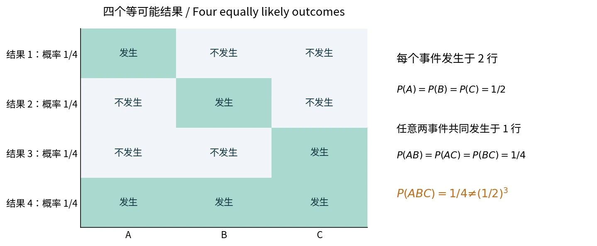

# §1.5 事件的独立性（Independence）

## 两个事件相互独立

若

$$
P(A\cap B)=P(A)P(B),
$$

则称 $A,B$ **相互独立（independent）**。定义不需要 $P(A),P(B)$ 为正。

$P(B)>0$ 时等价于 $P(A\mid B)=P(A)$；$P(A)>0$ 时等价于 $P(B\mid A)=P(B)$：另一事件发生不改变其概率。

例如，袋中有 8 件正品、2 件次品，$A_i$ 表示第 $i$ 次取到正品：

- 放回并充分混合后抽取：$P(A_2\mid A_1)=8/10=P(A_2)$，两次结果独立。
- 不放回抽取：$P(A_2\mid A_1)=7/9\ne8/10$，不独立。

### 取补不改变独立性

以下四个命题等价：

$$
A\perp B,\qquad A^c\perp B,\qquad A\perp B^c,\qquad A^c\perp B^c.
$$

其中 $\perp$ 表示独立。证明例如

$$
P(A^cB)=P(B)-P(AB)
=P(B)[1-P(A)]=P(A^c)P(B).
$$

### 独立与互斥（Mutually Exclusive）

| 概念 | 数学条件 | 含义 |
| --- | --- | --- |
| 独立 | $P(AB)=P(A)P(B)$ | 概率不因另一个事件发生而改变 |
| 互斥 | $AB=\varnothing$ | 两者不能同时发生 |

如果 $P(A)P(B)>0$，互斥与独立不能同时成立；零概率事件是例外。概率为 0 或 1 的事件与任意事件独立。特别地，$A$ 与自身独立当且仅当

$$
P(A)=P(A)^2
\iff P(A)\in\{0,1\}.
$$

## 多个事件：两两独立与相互独立

**两两独立（pairwise independence）**只要求任意两个事件独立。

**相互独立（mutual independence）**要求每个至少包含两个事件的子组都满足概率乘法：

$$
P\left(\bigcap_{j=1}^k A_{i_j}\right)
=\prod_{j=1}^kP(A_{i_j}),
\qquad 2\le k\le n.
$$

三个事件相互独立需要三条两两乘法式及一条三重乘法式，共四个条件；只验证三重乘法式也不够。

### 反例：两两独立不能推出相互独立

四个等可能结果为 $S=\{1,2,3,4\}$，设

$$
A=\{1,4\},\quad B=\{2,4\},\quad C=\{3,4\}.
$$

三者概率均为 $1/2$，任意两者交集概率均为 $1/4$，所以两两独立。但是

$$
P(ABC)=\frac14\ne\frac18=P(A)P(B)P(C).
$$

自绘。每行是概率为 $1/4$ 的结果。[来源与许可](../assets/README.md)。

相互独立事件中，任取若干项换为补事件仍独立；对不重叠的事件组分别作并、交、补，结果也独立。两两独立不足以保证这些性质。

## 独立重复试验与“至少一次”

独立试验（independent trials）指结果独立，重复试验指条件与成功率相同；合称独立同分布试验（independent and identically distributed trials）。成功率为 $p$，重复 $n$ 次时：

$$
P(\text{一次也不发生})=(1-p)^n,\qquad
P(\text{至少发生一次})=1-(1-p)^n.
$$

固定 $p>0$ 时，后者随 $n\to\infty$ 趋于 1。单次概率小，不代表反复尝试的累计概率仍小。

### 例：三局两胜与五局三胜

每局甲胜的概率为 $p$，各局独立。按“最后一局必须获胜”分类：

$$
P_3=p^2+2p^2(1-p),
$$

$$
P_5=p^3+3p^3(1-p)+6p^3(1-p)^2.
$$

也可补足未赛局，按固定局数中的多数胜场计数，结果相同。

$$
P_5-P_3=3p^2(1-p)^2(2p-1).
$$

因此 $1/2<p<1$ 时较长赛制有利；$0<p<1/2$ 时较短赛制有利；$p=0,1/2,1$ 时两者相同。

### 例：等待两个指定结果中谁先出现

各轮独立地从编号 1–4 的球中放回取两次。和为 3、5 的概率为 $a=2/16,b=4/16$，其他结果重试。设和为 3 先出现的概率为 $r$：

$$
r=a+(1-a-b)r
\implies r=\frac{a}{a+b}=\frac13.
$$

也可对“第一次出现这两种结果之一的轮数”求和：
$r=\sum_{k\ge1}(1-a-b)^{k-1}a$。公式要求 $a+b>0$。

## 系统可靠性（System Reliability）

元件正常工作的事件独立，正常概率为 $p_i$：

$$
P(\text{串联系统正常})=\prod_i p_i,\qquad
P(\text{并联系统正常})=1-\prod_i(1-p_i).
$$

桥式网络的成功路径有重叠，宜按关键元件 $E$ 是否正常作划分：

$$
P(S)=P(E)P(S\mid E)+P(E^c)P(S\mid E^c).
$$

主课件五元件桥式网络中，按中间桥接元件是否正常分类，得到

$$
P(S)=p(2p-p^2)^2+(1-p)(2p^2-p^4)
=2p^2+2p^3-5p^4+2p^5.
$$

### 作业｜习题一 B7：四元件系统

**题目。**四个独立元件正常工作的概率为 $p_1,\ldots,p_4$。至少三个正常时系统正常。求系统正常概率 $\alpha$；给定系统正常，四个均正常的概率 $\beta$；独立观察三次，恰有两次正常的概率 $\gamma$。

**解析。**设 $E_i$ 为第 $i$ 个元件正常，$S$ 为系统正常。按“四个正常”和“恰有一个故障”分为互斥事件：

$$
\alpha=P(S)=\prod_{i=1}^4p_i+
\sum_{i=1}^4(1-p_i)\prod_{j\ne i}p_j.
$$

因为 $\bigcap_iE_i\subseteq S$，当 $\alpha>0$ 时

$$
\beta=P\left(\bigcap_iE_i\mid S\right)
=\frac{\prod_ip_i}{\alpha}.
$$

三次观察既独立又具有相同的正常概率，故

$$
\gamma=\binom32\alpha^2(1-\alpha)=3\alpha^2(1-\alpha).
$$

## 条件独立（Conditional Independence）

给定 $H$，若

$$
P(AB\mid H)=P(A\mid H)P(B\mid H),
$$

则称 $A,B$ 在 $H$ 下条件独立；不保证无条件独立。先给定共同环境（conditional on the common environment），再计算。

### 例：同一把枪连续射击

随机取枪，已校正的概率为 0.7；已校正枪命中率 0.8，未校正枪命中率 0.4。**给定枪的类型**，两次射击独立。设 $H$ 为已校正，$B_i$ 为第 $i$ 枪命中：

$$
P(B_1)=0.7(0.8)+0.3(0.4)=0.68,
$$

$$
P(B_1B_2)=0.7(0.8)^2+0.3(0.4)^2=0.496
\ne(0.68)^2.
$$

同一把枪是共同条件，不能将平均命中率平方。第一枪命中后：

$$
P(H\mid B_1)=\frac{0.7(0.8)}{0.68}=\frac{14}{17}.
$$

### 作业｜习题一 B8：雾霾与戴口罩

**题目。**出现雾霾的概率为 0.4；雾霾天每位居民戴口罩概率为 0.2，非雾霾天为 0.01。同一天、给定天气后，居民的选择独立。求随机一位居民戴口罩及同时选三位居民至少一位戴口罩的概率。

**解析。**设 $H$ 为雾霾，$M_i$ 为第 $i$ 人戴口罩：

$$
P(M_1)=0.4(0.2)+0.6(0.01)=0.086.
$$

共同天气下先条件计算，再加权：

$$
\begin{aligned}
P(M_1\cup M_2\cup M_3)
&=0.4[1-0.8^3]+0.6[1-0.99^3]\\
&=0.2130206.
\end{aligned}
$$

$1-(1-0.086)^3$ 错把三人的无条件选择当成独立。

### 例：诊断试验与连续两次阳性

设 $D$ 为患病，$+$ 为阳性。患病率 0.01、假阳性率 0.05、假阴性率 0.04，意味着

$$
P(+\mid D^c)=0.05,\qquad P(+\mid D)=0.96.
$$

一次阳性后的患病概率为

$$
P(D\mid+)=\frac{0.01(0.96)}
{0.01(0.96)+0.99(0.05)}
\approx0.1624.
$$

若给定患病状态后两次检测条件独立，则

$$
P(D\mid+,+)=\frac{0.01(0.96)^2}
{0.01(0.96)^2+0.99(0.05)^2}
\approx0.7883.
$$

平方依据是给定患病状态后的独立性，不是无条件独立。

## 参考资料

主课件第 93–113 页；课堂识别 lecture-record-21；教材习题一 B7、B8。
