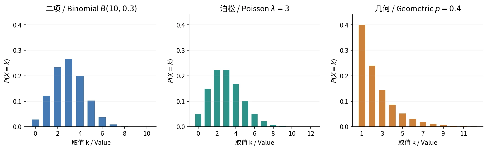

# §2.1–2.2 随机变量与离散分布（Random Variables and Discrete Distributions）

## 随机变量：把试验结果映射为实数

**随机变量（random variable, r.v.）**是定义在样本空间上的实值函数

$$
X:S\to\mathbb R,\qquad \omega\mapsto X(\omega).
$$

映射规则确定，输入结果随机；大写 $X$ 表示变量，小写 $x$ 表示取值。

例如抛三次硬币，$S$ 的结果为 HHH、HHT 等，$X$ 定义为正面数，则

$$
\{X=1\}=\{\mathrm{HTT},\mathrm{THT},\mathrm{TTH}\}.
$$

$X$ 是函数，$\{X=x\}$、$\{X\in I\}$ 是事件，$P(X=x)$、$P(X\in I)$ 是概率数值。

**分布（distribution）**描述取值及其概率。

## 离散型随机变量与分布律（PMF）

若全部可能取值有限或可列无限，称为**离散型随机变量（discrete random variable）**。其**概率质量函数／分布律（probability mass function, PMF）**为

$$
p_k=P(X=x_k),\qquad k=1,2,\ldots.
$$

PMF 直接给出每个取值的概率。分布律须包含取值和概率，满足

$$
p_k\ge0,\qquad\sum_kp_k=1.
$$

不同取值对应的事件互斥，因此

$$
P(X\in I)=\sum_{x_k\in I}p_k.
$$

列 PMF：列全取值 → 求对应事件概率 → 检查非负、和为 1。

### 作业｜习题二 A2：归一化与区间概率

**题目。**$P(X=i)=c(5-i)$，$i=1,2,3,4$。求 $c$ 和 $P(1.5<X\le3)$。

**解析。**

$$
1=c(4+3+2+1)\implies c=\frac1{10}.
$$

区间内只有取值 2、3，故

$$
P(1.5<X\le3)=P(X=2)+P(X=3)=\frac3{10}+\frac2{10}=\frac12.
$$

## 常见离散分布与模型选择

| 分布 | 计数对象／试验条件 | 取值 | 分布律 |
| --- | --- | --- | --- |
| 伯努利（Bernoulli） | 一次试验是否成功 | $0,1$ | $p^k(1-p)^{1-k}$ |
| 二项（Binomial） | 固定 $n$ 次独立、同成功率试验的成功数 | $0,\ldots,n$ | $\binom nkp^k(1-p)^{n-k}$ |
| 泊松（Poisson） | 固定时空范围内的事件次数 | $0,1,\ldots$ | $e^{-\lambda}\lambda^k/k!$ |
| 几何（Geometric） | 首次成功所需试验数 | $1,2,\ldots$ | $(1-p)^{k-1}p$ |
| 巴斯卡／负二项（Pascal / Negative binomial） | 第 $r$ 次成功所需试验数 | $r,r+1,\ldots$ | $\binom{k-1}{r-1}p^r(1-p)^{k-r}$ |
| 超几何（Hypergeometric） | 有限总体中无放回抽样的成功数 | $\max(0,n-b)\le k\le\min(a,n)$ | $\binom ak\binom b{n-k}/\binom{a+b}n$ |

自绘。依次为固定试验数的成功数、事件计数、首次成功的等待次数。[来源与许可](../assets/README.md)。

### 伯努利分布与二项分布

**伯努利试验（Bernoulli trial）**只有成功／失败两种结果。成功记 1、失败记 0，则 $X\sim\operatorname{Bernoulli}(p)=B(1,p)$。

**$n$ 重伯努利试验（Bernoulli scheme）**要求各次独立、成功率同为 $p$。成功数（number of successes）$X\sim B(n,p)$：指定顺序概率为 $p^k(1-p)^{n-k}$，成功位置有 $\binom nk$ 种。

$$
P(X=k)=\binom nkp^k(1-p)^{n-k}.
$$

由二项式定理得归一性。二项分布固定试验数、数成功次数；几何和负二项分布数等待次数。

### 泊松分布（Poisson Distribution）

泊松分布描述**固定时间段或空间区域内，某类事件发生的次数**，如一小时收到的来电数、一米布料上的疵点数。次数没有预设上限，可为 0；这与固定 $n$ 次试验中数成功次数的二项分布不同。

常用建模条件是：事件以稳定速率随机发生，不相交范围内的计数独立，足够小的范围内发生两次及以上的概率可忽略。若计数 $X$ 服从泊松分布，记为 $X\sim\operatorname{Pois}(\lambda)$，则

$$
P(X=k)=e^{-\lambda}\frac{\lambda^k}{k!},\qquad k=0,1,\ldots.
$$

$\lambda>0$ 是**整个观察窗口内的平均次数**。每单位时间平均发生 $\nu$ 次，观察时长为 $t$，则 $\lambda=\nu t$，单位须一致。例如平均每分钟 2 次，观察 3 分钟，计数服从 $\operatorname{Pois}(6)$。归一性由 $\sum_{k\ge0}\lambda^k/k!=e^\lambda$ 得到。

“至少三次”适合用取补：

$$
P(X\ge3)=1-e^{-\lambda}\left(1+\lambda+\frac{\lambda^2}{2}\right).
$$

若某个单位时间内的计数服从 $\operatorname{Pois}(4.8)$，至少三人的概率

$$
q=1-e^{-4.8}\left(1+4.8+\frac{4.8^2}{2}\right)\approx0.8575.
$$

独立观察五个这样的时间段，恰有四段满足“至少三人”的概率为

$$
\binom54q^4(1-q)\approx0.3853.
$$

第二层数“满足条件的时间段数”，用二项分布。

### 作业｜习题二 B12：短信计数与条件概率

**题目。**短信按每分钟 $\nu=0.05$ 的速率满足泊松计数模型。考察 10:00–12:00，求恰收六条的概率；给定至少五条，求恰为六条的概率。

**解析。**窗口长 120 分钟，故 $N\sim\operatorname{Pois}(6)$：

$$
P(N=6)=e^{-6}\frac{6^6}{6!}=\frac{324}{5}e^{-6}\approx0.1606.
$$

利用 $\{N=6\}\subseteq\{N\ge5\}$：

$$
P(N=6\mid N\ge5)
=\frac{e^{-6}6^6/6!}{1-e^{-6}\sum_{k=0}^4 6^k/k!}
=\frac{(324/5)e^{-6}}{1-115e^{-6}}
\approx0.2247.
$$

### 泊松近似二项分布（Poisson Approximation）

若 $n$ 很大、$p$ 很小，且 $np=\lambda$ 适中，可以近似

$$
B(n,p)\approx\operatorname{Pois}(np).
$$

极限条件为 $n\to\infty,p\to0,np\to\lambda$；$n>10,p<0.1$ 仅为经验判断，不保证尾概率精度。

如 $X\sim B(1000,1/200)$，$P(X\ge3)\approx0.8760$；泊松近似取 $\lambda=np=5$，得 0.8753。解答须列模型与概率式。

## 首次成功与第 r 次成功

### 几何分布（Geometric Distribution）

各次独立、成功率 $p$，$X$ 记录首次成功所需试验数（number of trials until the first success）。$X=k$ 要求前 $k-1$ 次失败、第 $k$ 次成功：

$$
P(X=k)=(1-p)^{k-1}p,\qquad k=1,2,\ldots.
$$

$$
P(X>m)=(1-p)^m,\qquad
P(X>m+n\mid X>m)=(1-p)^n.
$$

这是**无记忆性（memorylessness）**。若按“首次成功前的失败数”定义，取值从 0 开始；先确认计数约定。

### 巴斯卡／负二项分布

$X$ 表示达到 $r$ 次成功所需的总试验次数。$X=k$ 要求第 $k$ 次成功，前 $k-1$ 次中恰有 $r-1$ 次成功：

$$
P(X=k)=\binom{k-1}{r-1}p^{r-1}(1-p)^{k-r}p,
\qquad k=r,r+1,\ldots.
$$

$r=1$ 时退化为几何分布。若记录第 $r$ 次成功前的失败数 $Z=X-r$，则

$$
P(Z=j)=\binom{j+r-1}{r-1}p^r(1-p)^j,\qquad j=0,1,\ldots.
$$

### 作业｜习题二 A1：四种随机变量

**题目。**分别求下列分布律：（1）从编号 1–4 的球中无放回取两个，$X$ 为较小编号；（2）掷均匀骰子三次，$X$ 为点数大于 4 的次数；（3）从 2 红、3 白中无放回取两球，$X$ 为红球数；（4）从该袋放回抽球，首次取红即停止，最多抽三次，$X$ 为抽取次数。

**解析。**

1. 无序球对共 $\binom42=6$ 个。最小编号为 $k$ 时另一编号可从 $k+1,\ldots,4$ 选，故 $P(X=k)=(4-k)/6$。
2. $X\sim B(3,1/3)$。
3. $X$ 为超几何计数，$P(X=k)=\binom2k\binom3{2-k}/\binom52$。
4. 前两次均为白球就一定抽到第三次，不论第三次颜色；所以 $P(X=3)=(3/5)^2$。

| 小问 | 取值 | 对应概率 |
| --- | --- | --- |
| (1) | $1,2,3$ | $1/2,\ 1/3,\ 1/6$ |
| (2) | $0,1,2,3$ | $8/27,\ 4/9,\ 2/9,\ 1/27$ |
| (3) | $0,1,2$ | $3/10,\ 3/5,\ 1/10$ |
| (4) | $1,2,3$ | $2/5,\ 6/25,\ 9/25$ |

第 (4) 问的第三项含第三次首次成功、三次均失败两种情形。

### 作业｜习题二 B2：连续闯关的得分

**题目。**三关各自通过概率为 $1/5$，结果独立；第一、二关各得 1 分，第三关得 2 分。一旦某关失败，后续仍可进行，但无论通过与否均不得分。求总得分 $X$ 的分布、$P(X>2)$、$P(X=4\mid X\ge2)$。

**解析。**设 $A_i$ 为第 $i$ 关通过，$p=1/5,q=4/5$：

| 得分 | 等价事件 | 概率 |
| --- | --- | --- |
| $0$ | $A_1^c$ | $q=4/5$ |
| $1$ | $A_1A_2^c$ | $pq=4/25$ |
| $2$ | $A_1A_2A_3^c$ | $p^2q=4/125$ |
| $4$ | $A_1A_2A_3$ | $p^3=1/125$ |

不存在得 3 分的情形。因此

$$
P(X>2)=\frac1{125},\qquad
P(X=4\mid X\ge2)=\frac{1/125}{4/125+1/125}=\frac15.
$$

### 作业｜习题二 B7：不同故障率与截断等待

**题目。**车辆经过三个特殊地段，第 $i$ 段故障概率为 $p_i$，三个概率不必相同。求故障地段数 $X$ 的分布，以及首次故障前已通过的地段数 $Y$ 的分布；全程无故障时 $Y=3$。

**解析。**假设**各段故障相互独立**；仅给 $p_i$ 不足以确定分布。记 $q_i=1-p_i$。

$$
\begin{aligned}
P(X=0)&=q_1q_2q_3,\\
P(X=1)&=p_1q_2q_3+q_1p_2q_3+q_1q_2p_3,\\
P(X=2)&=p_1p_2q_3+p_1q_2p_3+q_1p_2p_3,\\
P(X=3)&=p_1p_2p_3.
\end{aligned}
$$

当 $p_i$ 不同，$X$ 一般不是普通二项分布。$Y$ 不计入发生首次故障的地段：

| $Y$ | $0$ | $1$ | $2$ | $3$ |
| --- | --- | --- | --- | --- |
| 概率 | $p_1$ | $q_1p_2$ | $q_1q_2p_3$ | $q_1q_2q_3$ |

检验最后三项：$q_1p_2+q_1q_2p_3+q_1q_2q_3=q_1$，加上 $p_1$ 为 1。

## 超几何分布与不放回抽样

总体有 $a$ 个成功对象、$b$ 个失败对象，$N=a+b$；无放回取 $n$ 个，成功数 $X$ 满足

$$
P(X=k)=\frac{\binom ak\binom b{n-k}}{\binom Nn},
\qquad \max(0,n-b)\le k\le\min(a,n).
$$

下界由失败对象数量约束，上界由样本量和成功对象数量约束。不放回各次结果通常不独立，不能套二项分布。

## 易错点

- 泊松取值含 0；不同成功率不能套普通二项分布。
- 边际成功率相同不保证各次独立。

## 参考资料

主课件第 4–36 页；课堂识别 course_87789_sub_1976430；教材习题二 A1、A2、B2、B7、B12。
