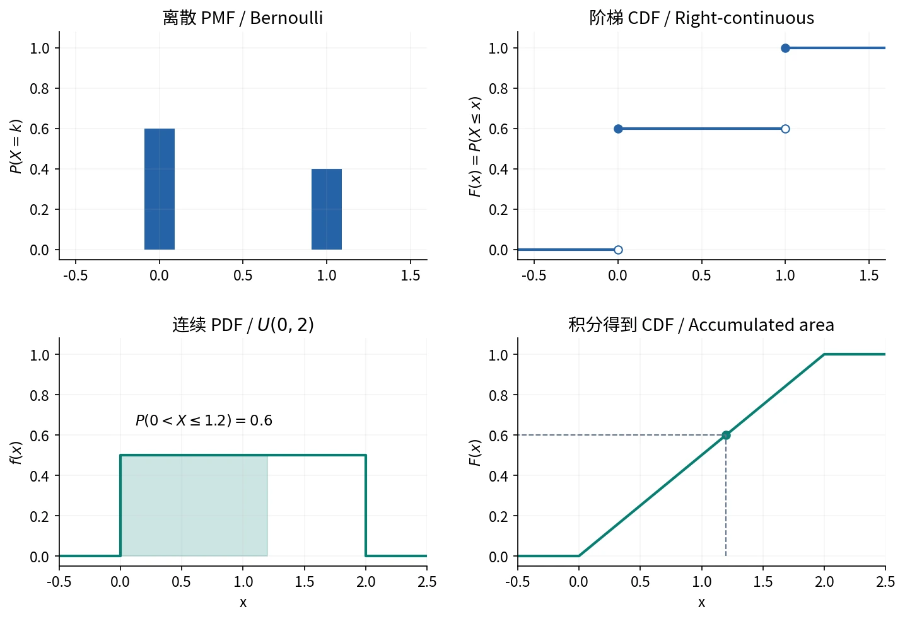

# §2.3 分布函数（Cumulative Distribution Function）

## 定义与直观含义

任意随机变量 $X$ 的**分布函数（cumulative distribution function, CDF）**定义为

$$
F_X(x)=P(X\le x),\qquad x\in\mathbb R.
$$

CDF 在**整个实数轴**上记录左侧累积概率，适用于离散、连续及混合型；即使 $X$ 取值范围有限，$F_X$ 仍处处有定义。

## 三条基本性质

1. **单调不减（nondecreasing）**：$x_1<x_2\implies F(x_1)\le F(x_2)$。
2. **两端极限（limits at infinity）**：$F(-\infty)=0,F(+\infty)=1$。
3. **右连续（right-continuous）**：$\lim_{h\downarrow0}F(x+h)=F(x)$。

$0\le F(x)\le1$；允许平台与跳跃，无需严格递增或处处连续。

单调性由 $\{X\le x_1\}\subseteq\{X\le x_2\}$ 得到；从右逼近仍包含 $\{X=x\}$，故右连续。

## 跳跃与端点

记左极限

$$
F(a-)=\lim_{x\uparrow a}F(x)=P(X<a).
$$

则

$$
P(X=a)=F(a)-F(a-).
$$

跳跃高度（jump size）就是点概率。区间端点按下表处理：

| 事件 | 概率 |
| --- | --- |
| $a<X\le b$ | $F(b)-F(a)$ |
| $a<X<b$ | $F(b-)-F(a)$ |
| $a\le X\le b$ | $F(b)-F(a-)$ |
| $a\le X<b$ | $F(b-)-F(a-)$ |
| $X>a$ | $1-F(a)$ |
| $X\ge a$ | $1-F(a-)$ |

只有在相关端点点概率为零时，才可自由更换开闭端点。

## 离散分布律与 CDF 的互推

已知 $P(X=x_k)=p_k$：

$$
F(x)=\sum_{x_k\le x}p_k.
$$

PMF → CDF：按取值累加为右连续阶梯函数（right-continuous step function）。CDF → PMF：取各跳点的跳跃量。

例如 $P(X=-1)=0.2,P(X=3)=0.4,P(X=4)=0.4$，则

$$
F(x)=
\begin{cases}
0,&x<-1,\\
0.2,&-1\le x<3,\\
0.6,&3\le x<4,\\
1,&x\ge4.
\end{cases}
$$

自绘。实心点表示跳点取值；连续密度的累积面积为 CDF。[来源与许可](../assets/README.md)。

### 作业｜习题二 A8：阶梯函数及半开区间

**题目。**$P(X=0)=0.4,P(X=2)=0.5,P(X=3)=0.1$。求 $F(x)$ 和 $P(1\le X<3)$。

**解析。**在每个取值点把该点概率加入累积和：

$$
F(x)=
\begin{cases}
0,&x<0,\\
0.4,&0\le x<2,\\
0.9,&2\le x<3,\\
1,&x\ge3.
\end{cases}
$$

$$
P(1\le X<3)=F(3-)-F(1-)=0.9-0.4=0.5.
$$

事件即 $\{X=2\}$；用 $F(3)-F(1)$ 会误计 $X=3$。

## 连续累积与“无概率空档”

CDF 平台表示区间内部无概率质量，对应密度为零，而非均匀取值。

### 作业｜习题二 B16：两个不相连区间

**题目。**已知在 $0\le x\le1$ 时 $P(0\le X\le x)=x/2$，在 $2\le x\le3$ 时 $P(2\le X\le x)=(x-2)/2$。求 $F(x)$ 和 $P(X\le2.5)$。

**解析。**令 $x=1,3$，两区间各有概率 $1/2$，已覆盖全部概率。

$$
F(x)=
\begin{cases}
0,&x<0,\\
x/2,&0\le x<1,\\
1/2,&1\le x<2,\\
(x-1)/2,&2\le x<3,\\
1,&x\ge3.
\end{cases}
$$

第二段上升前必须加上左侧已累计的 $1/2$。因此

$$
P(X\le2.5)=F(2.5)=\frac34.
$$

## 均匀分布的 CDF

若 $X$ 在 $(a,b)$ 上按长度比例取值，则

$$
F(x)=
\begin{cases}
0,&x<a,\\
\dfrac{x-a}{b-a},&a\le x<b,\\
1,&x\ge b.
\end{cases}
$$

[连续分布](03-continuous-distributions.md)中，CDF 也可由密度积分得到：

$$
F(x)=\int_{-\infty}^x f(t)\,dt.
$$

## 易错点

CDF 连续是存在密度的必要条件，并非充分条件；常见分段光滑连续 CDF 可求导得到密度。

## 参考资料

主课件第 37–46 页；课堂识别 course_87789_sub_1980975；教材习题二 A8、B16。
