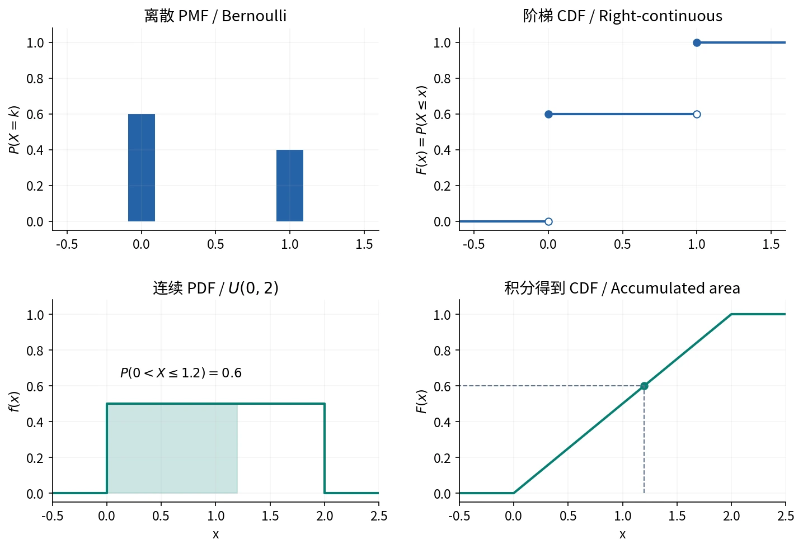
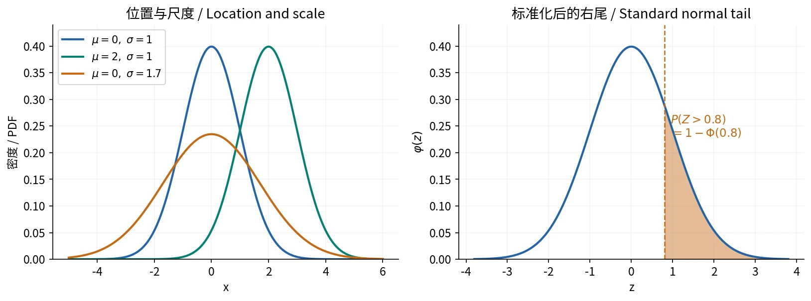

# §2.4 连续型随机变量与常用分布（Continuous Distributions）

## 密度的定义与两条本质性质

若存在非负函数 $f_X$，使得对所有 $x\in\mathbb R$，

$$
F_X(x)=\int_{-\infty}^x f_X(t)\,dt,
$$

则 $X$ 为**连续型随机变量（continuous random variable）**，$f_X$ 为**概率密度函数（probability density function, PDF）**；这里的连续型指绝对连续（absolutely continuous）。

一个函数可以作为 PDF 的充要条件是

$$
f_X(x)\ge0,\qquad \int_{-\infty}^{+\infty}f_X(x)\,dx=1.
$$

密度定义在全实轴；沿用课件，将 $D=\{x:f_X(x)>0\}$ 称为**支撑区域（support）**。分段端点取值不影响分布。

## 概率、CDF 与密度

$$
P(X\in A)=\int_Af_X(x)\,dx,\qquad
P(a<X\le b)=F_X(b)-F_X(a).
$$

单点概率为零，区间端点开闭不影响概率。在 $f_X$ 的连续点处：

$$
F_X'(x)=f_X(x).
$$

**密度值不是点概率，也不必小于等于 1。**例如 $X\sim U(0,0.1)$，密度为 10；区间概率仍是高度乘长度。小区间上

$$
P(x<X\le x+\Delta x)\approx f_X(x)\Delta x.
$$

有限个点上改密度值不改变分布；CDF 在分段端点不可导不妨碍存在密度。CDF 连续是存在密度的必要条件，并非充分条件；常见分段光滑连续 CDF 可逐段求导得到密度。

自绘。实心点表示跳点取值；连续密度的累积面积为 CDF。[来源与许可](../assets/README.md)。

### 例：不相连的支撑区域

设密度在 $(0,1)$ 为 $c$，在 $(3,6)$ 为 $2/9$，其余为零。由归一性 $c+3(2/9)=1$，得 $c=1/3$，进而

$$
F(x)=
\begin{cases}
0,&x<0,\\
x/3,&0\le x<1,\\
1/3,&1\le x<3,\\
(2x-3)/9,&3\le x<6,\\
1,&x\ge6.
\end{cases}
$$

密度空档对应 CDF 平台，后续仍须保留此前累积值。$P(X<k)=2/3$ 得 $k=4.5$。

### 作业｜习题二 B17：归一化、积分与重复观察

**题目。**$f(x)=c(4-x^2)$，$0<x<2$，其余为零。求 $c$、CDF、$P(-1<X<1)$；独立观察五次，求该事件恰好发生两次的概率。

**解析。**

$$
1=c\int_0^2(4-x^2)\,dx=\frac{16c}{3}
\implies c=\frac3{16}.
$$

$$
F(x)=
\begin{cases}
0,&x<0,\\
\dfrac{3x}{4}-\dfrac{x^3}{16},&0\le x<2,\\
1,&x\ge2.
\end{cases}
$$

$$
q=P(-1<X<1)=\int_0^1\frac3{16}(4-x^2)\,dx=\frac{11}{16}.
$$

令 $N$ 为五次中该事件发生的次数，$N\sim B(5,11/16)$，故

$$
P(N=2)=\binom52\left(\frac{11}{16}\right)^2
\left(\frac5{16}\right)^3\approx0.1442.
$$

### 作业｜习题二 B18：由连续性确定参数

**题目。**连续型 $X$ 的 CDF 为

$$
F(x)=
\begin{cases}
0,&x<0,\\
ax^2,&0\le x<1,\\
bx,&1\le x<2,\\
1,&x\ge2.
\end{cases}
$$

求 $a,b$、密度，以及 $P(0.5<X<1.5)$。

**解析。**CDF 在 1、2 连续，得 $a=b,2b=1$，所以 $a=b=1/2$。逐段求导：

$$
f(x)=
\begin{cases}
x,&0<x<1,\\
1/2,&1<x<2,\\
0,&\text{其他}.
\end{cases}
$$

$$
P(0.5<X<1.5)=F(1.5)-F(0.5)
=\frac34-\frac18=\frac58.
$$

连续只是必要条件，还须检查 CDF 单调、密度非负。

## 均匀分布（Uniform Distribution）

$X\sim U(a,b)$，$a<b$，表示区间内按长度均匀取值：

$$
f_X(x)=
\begin{cases}
1/(b-a),&a<x<b,\\
0,&\text{其他},
\end{cases}
\qquad
F_X(x)=
\begin{cases}
0,&x<a,\\
(x-a)/(b-a),&a\le x<b,\\
1,&x\ge b.
\end{cases}
$$

求 $P(X\in A)$：先取 $A\cap(a,b)$，再用其长度除以 $b-a$。

### 作业｜习题二 A12：先解不等式

**题目。**$X\sim U(0,4)$，求 $P(X^2-2X-3<0)$。

**解析。**因 $(X+1)(X-3)<0\iff-1<X<3$，与 $(0,4)$ 相交得到 $(0,3)$：

$$
P(X^2-2X-3<0)=\frac{3}{4}.
$$

### 例：到站时间不等于等待时间

汽车从 6:00 起每隔 30 分钟发车。到达时间在 6:20–7:10 均匀分布，令 $U$ 为从 6:20 起的到达分钟数，$W$ 为候车时间。除去零概率端点：

$$
W=
\begin{cases}
10-U,&0<U<10,\\
40-U,&10<U<40,\\
70-U,&40<U<50.
\end{cases}
$$

于是 $P(W\le15)=25/50=0.5$，$P(W>10)=30/50=0.6$，$P(10<W\le15)=5/50=0.1$。

两次独立候车，“一次不超过 15 分钟、另一次大于 10 分钟”的两种安排有重叠，容斥得

$$
2(0.5)(0.6)-(0.1)^2=0.59.
$$

不能把到达时间变量的阈值直接当成等待时间的阈值。

## 指数分布（Exponential Distribution）

指数分布描述**事件发生前的连续等待时间（waiting time）**，如稳定来电速率下等待下一通电话的时间；也用于故障速率恒定的寿命模型。等待时间非负，可以取任意长的值。

本文用**速率参数（rate parameter）** $\lambda>0$，单位为时间的倒数。$\lambda$ 越大，等待通常越短，平均等待时间为 $1/\lambda$。记为

$$
X\sim\operatorname{Exp}(\lambda),\qquad
f_X(x)=
\begin{cases}
\lambda e^{-\lambda x},&x>0,\\
0,&x\le0.
\end{cases}
$$

$$
F_X(x)=
\begin{cases}
1-e^{-\lambda x},&x>0,\\
0,&x\le0,
\end{cases}
\qquad
P(X>t)=e^{-\lambda t}\quad(t\ge0).
$$

**生存函数（survival function）**为 $S(t)=P(X>t)$。若用尺度参数 $\theta=1/\lambda$，密度为 $\theta^{-1}e^{-x/\theta}$；须区分速率与尺度。

### 泊松计数与首次等待时间

**泊松过程（Poisson process）**描述事件以恒定速率 $\lambda$ 随机发生：不相交时间段的计数独立，长度为 $t$ 的时间段内计数服从 $\operatorname{Pois}(\lambda t)$。记 $N(t)$ 为从时刻 0 到 $t$ 的事件数，$T$ 为首次事件的等待时间，则“等待超过 $t$”等价于“此前一次也没发生”：

$$
\{T>t\}=\{N(t)=0\}
\implies P(T>t)=P(N(t)=0)=e^{-\lambda t},\qquad t\ge0.
$$

因此 $T\sim\operatorname{Exp}(\lambda)$。泊松过程中，各相邻事件之间的等待时间也相互独立，且都服从此指数分布；仅知道某一个时间段的计数服从泊松分布，不足以推出这些性质。

例如每分钟平均接到 2 通电话的泊松过程中，3 分钟内来电数 $N(3)\sim\operatorname{Pois}(6)$；等待下一通电话的时间 $T\sim\operatorname{Exp}(2)$（单位：分钟），平均等待半分钟，$P(T>1)=e^{-2}$。计数参数 $\lambda t$ 是平均次数，等待时间参数 $\lambda$ 是发生速率。

### 与几何分布的联系

两者都描述首次发生前的等待，计算依据都是“尚未发生等价于此前次数为零”。

| 事件模型 | 固定范围内的次数 | 首次发生的等待 |
| --- | --- | --- |
| 独立伯努利试验，成功率 $p$ | $n$ 次中的成功数服从 $B(n,p)$ | 试验次数 $G$ 服从几何分布，$P(G>n)=(1-p)^n$ |
| 速率 $\lambda$ 的泊松过程 | $t$ 时间内计数服从 $\operatorname{Pois}(\lambda t)$ | 时间 $T\sim\operatorname{Exp}(\lambda)$，$P(T>t)=e^{-\lambda t}$ |

指数分布是几何分布在连续时间中的对应形式。将泊松过程按长度 $\Delta t$ 分段，每段至少发生一次事件的概率为 $p=1-e^{-\lambda\Delta t}$，各段独立。首次有事件的段号 $G$ 服从几何分布，故

$$
P(G\Delta t>n\Delta t)=(1-p)^n=e^{-\lambda n\Delta t}.
$$

$G\Delta t$ 是将首次等待时间向上取整到段末的结果，误差小于 $\Delta t$；当 $\Delta t\to0$，便趋于指数等待时间 $T$。

### 无记忆性（Memorylessness）

$$
P(X>s+t\mid X>s)
=\frac{e^{-\lambda(s+t)}}{e^{-\lambda s}}
=e^{-\lambda t}=P(X>t).
$$

这里 $s,t\ge0$。已存活 $s$ 后，剩余寿命 $X-s$ 仍条件服从原指数分布；$s+t$ 是总寿命，$t$ 是额外等待。几何分布具有同样的无记忆性，只是等待按整数次试验计算。

### 作业｜习题二 B29：指数寿命的混合

**题目。**甲、乙厂产品寿命的指数速率分别为 $1/3,1/6$（单位：年），混合产品中甲厂占 40%。随机取一件，求寿命大于六年的概率；给定来自甲厂且已经使用四个月仍未坏，求能用到一年仍未坏的概率；不知道厂别时再求同一条件概率。

**解析。**设 $A$ 为甲厂，$B$ 为乙厂：

$$
S(t)=P(T>t)=0.4e^{-t/3}+0.6e^{-t/6}.
$$

1. $P(T>6)=0.4e^{-2}+0.6e^{-1}\approx0.2749$。
2. 四个月为 $1/3$ 年；“用到一年”指总寿命超过一年，故

    $$
    P(T>1\mid T>1/3,A)
    =\frac{e^{-1/3}}{e^{-1/9}}=e^{-2/9}\approx0.8007.
    $$

3. 未知厂别时，应对混合生存函数取比值：

$$
P(T>1\mid T>1/3)
=\frac{0.4e^{-1/3}+0.6e^{-1/6}}
{0.4e^{-1/9}+0.6e^{-1/18}}
\approx0.8584.
$$

混合指数寿命一般不再无记忆：已存活的信息会更新厂别权重。

## 正态分布（Normal / Gaussian Distribution）

$$
X\sim N(\mu,\sigma^2),\qquad
f_X(x)=\frac1{\sqrt{2\pi}\sigma}
\exp\left[-\frac{(x-\mu)^2}{2\sigma^2}\right],
\quad x\in\mathbb R,\quad\sigma>0.
$$

$\mu$ 是位置参数（location），$\sigma$ 是尺度参数（scale）；记号的第二项是 $\sigma^2$。

- 曲线关于 $x=\mu$ 对称，峰值为 $1/(\sqrt{2\pi}\sigma)$。
- $\mu$ 改变使曲线平移；$\sigma$ 增大使曲线变宽、变低。
- 拐点在 $\mu\pm\sigma$，两端趋于零。

归一化可用高斯积分证明。令 $I=\int_{\mathbb R}e^{-x^2/2}\,dx$，由二重积分的极坐标变换，

$$
I^2=\int_0^{2\pi}\int_0^\infty e^{-r^2/2}r\,dr\,d\theta=2\pi,
$$

所以 $I=\sqrt{2\pi}$。再作 $z=(x-\mu)/\sigma$ 即得正态密度积分为 1。

### 标准化（Standardization）

$$
Z=\frac{X-\mu}{\sigma}\sim N(0,1),\qquad
\varphi(z)=\frac1{\sqrt{2\pi}}e^{-z^2/2},\quad
\Phi(z)=\int_{-\infty}^z\varphi(t)\,dt.
$$

$$
\Phi(-z)=1-\Phi(z),\qquad
P(a<X<b)=\Phi\left(\frac{b-\mu}{\sigma}\right)
-\Phi\left(\frac{a-\mu}{\sigma}\right).
$$

标准化除以 $\sigma$，不是 $\sigma^2$；查表先确认是左尾 $\Phi(z)$ 还是从 0 起算的面积。

自绘。面积表示概率，峰高不是点概率。[来源与许可](../assets/README.md)。

$$
P(|X-\mu|<k\sigma)=2\Phi(k)-1.
$$

当 $k=1,2,3$ 时分别约为 $0.6827,0.9545,0.9973$。

### 从概率反推参数

若要求 $P(|X-\mu|<d)\ge q$，则

$$
2\Phi(d/\sigma)-1\ge q
\implies \sigma\le\frac{d}{\Phi^{-1}((1+q)/2)}.
$$

例如 $d=3,q=0.9$，得到 $\sigma\le3/1.64485\approx1.8239$。若同时未知 $\mu,\sigma$，可由两个分位点构造两个方程。

### 作业｜习题二 B27：识别正态密度

**题目。**$f_X(x)=ae^{-x^2}$，$x\in\mathbb R$。求 $a$ 与 $P(X>1/2)$。

**解析。**由 $\int_{\mathbb R}e^{-x^2}\,dx=\sqrt\pi$，得 $a=1/\sqrt\pi$。比较指数中的 $-x^2/(2\sigma^2)$，得 $\sigma^2=1/2$，所以

$$
X\sim N(0,1/2),\qquad
P(X>1/2)=1-\Phi(1/\sqrt2)\approx0.2398.
$$

### 作业｜习题二 B24：电压、故障与共享环境

**题目。**电压 $X\sim N(220,25^2)$。电压小于 200、位于 $[200,240]$、大于 240 时，单个元件故障概率分别为 $0.1,0.001,0.2$。求故障率 $\alpha$；已故障时电压大于 240 的概率 $\beta$；由三个该类元件组成、至少两个正常才工作的系统可靠性 $\theta$。

**解析。**设 $L,M,H$ 为上述三个电压区间，$D$ 为单个元件故障。由正态对称性，

$$
q=P(L)=P(H)=1-\Phi(0.8)\approx0.2118554,\qquad P(M)=1-2q.
$$

全概率与贝叶斯公式给出

$$
\alpha=P(D)=0.1q+0.001(1-2q)+0.2q
=0.001+0.298q\approx0.06413,
$$

$$
\beta=P(H\mid D)=\frac{0.2q}{\alpha}\approx0.6607.
$$

第三问须补充元件依赖关系，单个故障率不足以确定系统可靠性：

- 若三个故障事件无条件相互独立，

$$
\theta=(1-\alpha)^3+3\alpha(1-\alpha)^2
=1-3\alpha^2+2\alpha^3\approx0.9882.
$$

- 若三个元件共用同一电压，且给定电压区间后条件独立，令 $g(p)=(1-p)^3+3p(1-p)^2$，应先在各区间内算系统可靠性，再平均：

$$
\theta=qg(0.1)+(1-2q)g(0.001)+qg(0.2)
\approx0.9720.
$$

共用电压时，不能未经独立性说明就把平均故障率代入二项模型。

## 混合型随机变量（Mixed Distribution）

变量也可兼具点质量和连续部分。例如原等待时间 $X\sim\operatorname{Exp}(1/10)$，满 15 分钟离开，实际等待 $Y=\min(X,15)$：

$$
F_Y(y)=
\begin{cases}
0,&y<0,\\
1-e^{-y/10},&0\le y<15,\\
1,&y\ge15.
\end{cases}
$$

$(0,15)$ 上有连续部分，且

$$
P(Y=15)=1-F_Y(15-)=e^{-1.5}>0.
$$

$Y$ 为混合型；光滑部分求导后积分仅为 $1-e^{-1.5}$，还须计入 15 处的点概率。

## 参考资料

主课件第 47–85 页；课堂识别 course_87789_sub_1980975、course_87789_sub_1984386；教材习题二 A12、B17、B18、B24、B27、B29。
