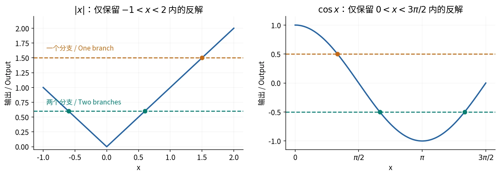

# §2.5 随机变量函数的分布（Functions of a Random Variable）

## 等价事件法（Equivalent Events）

已知 $X$ 的分布与 $Y=g(X)$，求 $Y$ 的分布：

1. 根据 $X$ 的取值区域，确定 $Y$ 的可能取值。
2. 将关于 $Y$ 的事件改写为关于 $X$ 的等价事件。
3. 离散型按原像求和；连续情形先求 CDF，再求密度。

变换可合并取值、改变类型：连续 $X$ 取整可变为离散型，截断等待可变为混合型。

## 离散型：合并相同输出

$$
P(Y=y)=\sum_{\{x:g(x)=y\}}P(X=x).
$$

例如 $P(X=-1)=0.2,P(X=0)=0.5,P(X=1)=0.3$，$Y=X^2$：

$$
P(Y=0)=0.5,\qquad
P(Y=1)=P(X=-1)+P(X=1)=0.5.
$$

### 作业｜习题二 B32：由投球次数映射为得分

**题目。**每次独立投球，命中率 0.7；最多投五次，累计命中两次后提前结束。投球次数为 $X$，$X=2$ 时得 $Y=10$ 分，$X=3$ 时得 8 分，$X\ge4$ 时得 2 分。求 $Y$ 的分布。

**解析。**令 $p=0.7$。$X=2$ 要求前两次均中；$X=3$ 要求前两次恰中一次且第三次命中：

$$
P(Y=10)=p^2=0.49,\qquad
P(Y=8)=\binom21p(1-p)p=0.294.
$$

其余均得 2 分：

| $Y$ | $2$ | $8$ | $10$ |
| --- | --- | --- | --- |
| 概率 | $0.216$ | $0.294$ | $0.49$ |

最多五次的限制不影响前两项，第三项取补即可。

## 分布函数法（CDF Method）

任意变换均可从 CDF 入手：

$$
F_Y(y)=P(g(X)\le y)
$$

例如 $f_X(x)=x/8$，$0<x<4$，$Y=X^2$。先有 $0<Y<16$（概率为 1）；对 $0<y<16$，

$$
F_Y(y)=P(0<X\le\sqrt y)
=\int_0^{\sqrt y}\frac x8\,dx=\frac y{16}.
$$

故 $Y\sim U(0,16)$。范围以外要分别补上 CDF 的 0、1，以及 PDF 的 0。

## 单调变换（Monotone / One-to-One Transformation）

若 $g$ 在 $X$ 的支撑区间连续可微、$g'$ 恒正或恒负，记反函数（inverse function）$h=g^{-1}$：

$$
f_Y(y)=f_X(h(y))\,|h'(y)|
$$

有效范围为原支撑经 $g$ 映出的区间，其他处为零。

- $g$ 递增时，$F_Y(y)=F_X(h(y))$。
- $g$ 递减时，连续型下 $F_Y(y)=1-F_X(h(y))$。
- 递减变换也必须取导数绝对值；只需在支撑区间单调。

其中 $\lvert h'(y)\rvert$ 是一维的尺度修正因子（Jacobian factor）。线性变换 $Y=aX+b$，$a\ne0$，给出

$$
f_Y(y)=\frac1{|a|}f_X\left(\frac{y-b}{a}\right).
$$

特别地，

$$
X\sim N(\mu,\sigma^2)
\implies aX+b\sim N(a\mu+b,a^2\sigma^2).
$$

## 多对一变换（Many-to-One Transformation）

若 $X$ 有密度，$Y=|X|$，则对 $y>0$，

$$
F_Y(y)=F_X(y)-F_X(-y),\qquad
f_Y(y)=f_X(y)+f_X(-y).
$$

对于 $Z=X^2$，$z>0$ 时

$$
F_Z(z)=F_X(\sqrt z)-F_X(-\sqrt z),\qquad
f_Z(z)=\frac{f_X(\sqrt z)+f_X(-\sqrt z)}{2\sqrt z}.
$$

仅适用于有密度的 $X$；若有点概率，CDF 须按端点开闭使用左极限。

对分段单调、每个有效反解均满足 $g'(x)\ne0$ 的变换，还可以逐分支相加：

$$
f_Y(y)=\sum_{\{x:g(x)=y\}}\frac{f_X(x)}{|g'(x)|}.
$$

只计原支撑内的反解；反解数改变处需分段。

自绘。只计原支撑内的有效反解。[来源与许可](../assets/README.md)。

### 作业｜习题二 B33：非对称支撑下的绝对值

**题目。**$f_X(x)=c(4-x^2)$，$-1<x<2$，其余为零。求 $c$；$Y=3X$ 的密度；$Z=|X|$ 的 CDF 和密度。

**解析。**先归一化：

$$
1=c\int_{-1}^2(4-x^2)\,dx=9c
\implies c=\frac19.
$$

线性变换给出

$$
f_Y(y)=
\begin{cases}
\dfrac{36-y^2}{243},&-3<y<6,\\
0,&\text{其他}.
\end{cases}
$$

$|X|$ 的密度在 $(0,2)$ 非零：$0<z<1$ 有 $z,-z$ 两个有效反解；$1<z<2$ 只有 $z$。故

$$
f_Z(z)=
\begin{cases}
(8-2z^2)/9,&0<z<1,\\
(4-z^2)/9,&1<z<2,\\
0,&\text{其他}.
\end{cases}
$$

由 $P(|X|\le z)=P(-z\le X\le z)$，得到

$$
F_Z(z)=
\begin{cases}
0,&z<0,\\
(24z-2z^3)/27,&0\le z<1,\\
(12z-z^3+11)/27,&1\le z<2,\\
1,&z\ge2.
\end{cases}
$$

在 $z=1$ 两段均为 $22/27$，可检验 CDF 连续；在 2 处累计为 1。

### 作业｜习题二 B36：余弦变换

**题目。**$X\sim U(0,3\pi/2)$，$Y=\cos X$，求 CDF。

**解析。**$Y\in[-1,1]$。令 $\alpha=\arccos y$：

- $-1<y<0$ 时，$\alpha\in(\pi/2,\pi)$，等价事件为 $\alpha\le X\le2\pi-\alpha$。
- $0\le y<1$ 时，右侧反解已超出原始范围，事件变为 $\alpha\le X<3\pi/2$。

按长度比例，

$$
F_Y(y)=
\begin{cases}
0,&y\le-1,\\
\dfrac43-\dfrac4{3\pi}\arccos y,&-1<y<0,\\
1-\dfrac2{3\pi}\arccos y,&0\le y<1,\\
1,&y\ge1.
\end{cases}
$$

$F_Y(0)=2/3$，对应 $\cos x\le0$ 的输入长度 $\pi$；零点两侧反解数不同，密度也不同。

### 作业｜习题二 B39：指数与对数变换

**题目。**$X\sim N(0,1)$，求 $Y=e^X$ 和 $Z=\ln|X|$ 的密度。

**解析。**令 $\varphi,\Phi$ 为标准正态密度及 CDF。$y>0$ 时

$$
F_Y(y)=\Phi(\ln y)
\implies f_Y(y)=\frac{\varphi(\ln y)}y
=\frac1{\sqrt{2\pi}y}e^{-(\ln y)^2/2}.
$$

$y\le0$ 时密度为零；这称为**对数正态分布（lognormal distribution）**。

对任意 $z\in\mathbb R$，

$$
F_Z(z)=P(-e^z\le X\le e^z)=2\Phi(e^z)-1,
$$

$$
f_Z(z)=2e^z\varphi(e^z)
=\sqrt{\frac2\pi}\,e^z e^{-e^{2z}/2}.
$$

$P(X=0)=0$，在该点任意补定义 $Z$ 不影响分布。

### 例：标准正态的平方

若 $X\sim N(0,1)$，则

$$
f_{X^2}(z)=
\begin{cases}
\dfrac1{\sqrt{2\pi z}}e^{-z/2},&z>0,\\
0,&z\le0.
\end{cases}
$$

即自由度为 1 的**卡方分布（chi-square distribution）**。

## 概率积分变换（Probability Integral Transform）

若 $X$ 的 CDF $F_X$ 连续，则

$$
F_X(X)\sim U(0,1).
$$

当 $F_X$ 在有效范围上严格递增时，可直接写

$$
P(F_X(X)\le u)=P(X\le F_X^{-1}(u))=u,\quad0<u<1.
$$

连续 CDF 有平台时结论仍成立，证明改用广义分位数。

例如 $X\sim\operatorname{Exp}(\lambda)$，

$$
Y=1-e^{-\lambda X}
\implies P(Y\le u)
=P\left(X\le-\frac{\ln(1-u)}{\lambda}\right)=u.
$$

离散型的 CDF 有跳跃，$F_X(X)$ 一般不服从连续均匀分布。

## 参考资料

主课件第 86–108 页；课堂识别 lecture-record-23；教材习题二 B32、B33、B36、B39。
