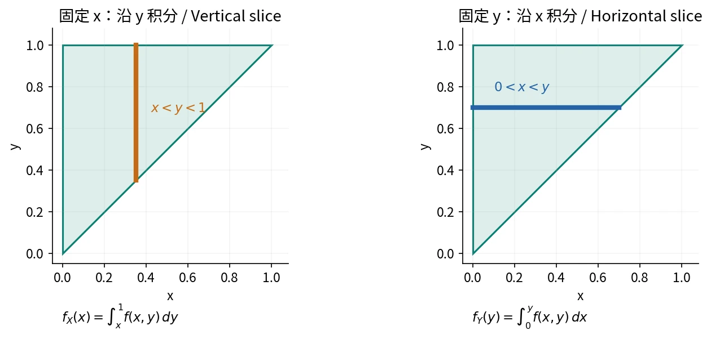
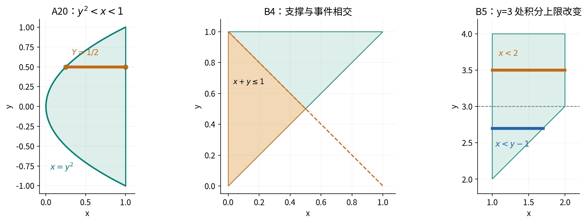

# §3.3 二维连续分布与条件密度（Continuous Joint Distributions）

## 联合密度（Joint PDF）

若存在非负函数 $f(x,y)$，使联合 CDF 可写为

$$
F(x,y)=\int_{-\infty}^x\int_{-\infty}^y f(u,v)\,dv\,du,
$$

则 $(X,Y)$ 为二维连续型，$f$ 为**联合概率密度（joint probability density function）**，满足

$$
f(x,y)\ge0,\qquad
\iint_{\mathbb R^2}f(x,y)\,dx\,dy=1.
$$

对平面区域 $A$，

$$
P((X,Y)\in A)=\iint_Af(x,y)\,dx\,dy.
$$

可微性适当时 $f(x,y)=\partial^2F(x,y)/(\partial x\,\partial y)$。积分区域须与支撑相交；支撑外 PDF 为零，CDF 未必为零。

### 例：第一象限上的指数乘积

设 $f(x,y)=ce^{-(2x+3y)}$，$x,y>0$，其他为零。归一化：

$$
1=c\int_0^\infty e^{-2x}\,dx\int_0^\infty e^{-3y}\,dy
=\frac c6\implies c=6.
$$

故

$$
F(x,y)=
\begin{cases}
(1-e^{-2x})(1-e^{-3y}),&x>0,y>0,\\
0,&x\le0\ \text{或}\ y\le0.
\end{cases}
$$

## 先画支撑区域，再确定积分限

画出 $D=\{(x,y):f(x,y)>0\}$，沿水平／竖直截线（horizontal / vertical slice）确定积分限：

- 求 $f_X(x)$：固定 $x$，沿竖直线扫描有效 $y$ 区间。
- 求 $f_Y(y)$：固定 $y$，沿水平线扫描有效 $x$ 区间。
- 求事件概率：对 $A\cap D$ 积分；必要时把交集拆成几块。
- 求 CDF：对 $D\cap((-\infty,x]\times(-\infty,y])$ 积分，积分变量最好换成 $u,v$，避免与上限混淆。

非负联合密度允许换序，但积分限须描述同一区域。

自绘。求边际时，沿另一坐标的有效截线积分。[来源与许可](../assets/README.md)。

## 边际密度（Marginal PDF）

$$
f_X(x)=\int_{-\infty}^{+\infty}f(x,y)\,dy,\qquad
f_Y(y)=\int_{-\infty}^{+\infty}f(x,y)\,dx.
$$

积分消去另一坐标，结果是一元密度，须注明非零范围。有联合密度则边际均有密度；反之不成立，如 $X$ 连续、$Y=X$ 时随机点落在直线上，无平面密度。

### 例：两条曲线之间的支撑区域

设 $f(x,y)=15y$，$0<x<1,\ x^2<y<x$，其他为零。

竖截线：$x\in(0,1)$，$x^2<y<x$；水平截线：$y\in(0,1)$，$y<x<\sqrt y$。故

$$
f_X(x)=\int_{x^2}^x15y\,dy
=\frac{15}{2}(x^2-x^4),\quad0<x<1,
$$

$$
f_Y(y)=\int_y^{\sqrt y}15y\,dx
=15(y^{3/2}-y^2),\quad0<y<1,
$$

其余处为零；任一边际积分为 1，可核验联合归一性。

### 作业｜习题三 B4：三角区域上的归一化与概率

**题目。**$f(x,y)=c(y-x)$，$0<x<y<1$，其余为零。求 $c$、$P(X+Y\le1)$、$P(X<0.5)$。

**解析。**先对三角形积分：

$$
1=c\int_0^1\int_0^y(y-x)\,dx\,dy
=\frac c6\implies c=6.
$$

事件 $x+y\le1$ 与支撑相交后为 $0<x<1/2,\ x<y\le1-x$：

$$
P(X+Y\le1)
=\int_0^{1/2}\int_x^{1-x}6(y-x)\,dy\,dx
=\int_0^{1/2}3(1-2x)^2\,dx=\frac12.
$$

先求边际：

$$
f_X(x)=\int_x^16(y-x)\,dy=3(1-x)^2,\quad0<x<1.
$$

因此

$$
P(X<0.5)=\int_0^{1/2}3(1-x)^2\,dx=\frac78.
$$

## 条件密度（Conditional PDF）

对满足 $f_Y(y)>0$ 的给定值 $y$，

$$
f_{X\mid Y}(x\mid y)=\frac{f(x,y)}{f_Y(y)}.
$$

类似地，$f_X(x)>0$ 时

$$
f_{Y\mid X}(y\mid x)=\frac{f(x,y)}{f_X(x)}.
$$

固定条件后，以该截线的边际密度归一化：

$$
\int_{-\infty}^{+\infty}f_{X\mid Y}(x\mid y)\,dx=1,
$$

$$
P(a<X<b\mid Y=y)=\int_a^bf_{X\mid Y}(x\mid y)\,dx.
$$

分母是密度 $f_Y(y)$，不是零概率 $P(Y=y)$；原理见[邻域极限](02-joint-distribution-functions.md)。

### 作业｜习题三 A18：矩形支撑上的条件密度

**题目。**

$$
f(x,y)=
\begin{cases}
(2x+y)/4,&0<x<1,\ 0<y<2,\\
0,&\text{其他}.
\end{cases}
$$

求两个边际、两个条件密度，以及 $P(X\le0.5\mid Y=0.5)$、$P(Y\le0.5\mid X=0.5)$。

**解析。**直接积分：

$$
f_X(x)=x+\frac12\quad(0<x<1),\qquad
f_Y(y)=\frac{1+y}{4}\quad(0<y<2),
$$

对应区间以外为零。固定 $0<y<2$ 与 $0<x<1$ 后分别有

$$
f_{X\mid Y}(x\mid y)=
\begin{cases}
(2x+y)/(1+y),&0<x<1,\\
0,&\text{其他},
\end{cases}
$$

$$
f_{Y\mid X}(y\mid x)=
\begin{cases}
(2x+y)/(4x+2),&0<y<2,\\
0,&\text{其他}.
\end{cases}
$$

于是

$$
P(X\le1/2\mid Y=1/2)
=\int_0^{1/2}\frac{2x+1/2}{3/2}\,dx=\frac13,
$$

$$
P(Y\le1/2\mid X=1/2)
=\int_0^{1/2}\frac{1+y}{4}\,dy=\frac5{32}.
$$

互换条件会改变研究对象与归一化分母。

### 作业｜习题三 A20：抛物线支撑与水平切片

**题目。**$f(x,y)=5x/4$，$y^2<x<1$，其余为零。求 $f_Y(y)$、$f_{X\mid Y}(x\mid y)$，以及 $P(X>1/2\mid Y=1/2)$。

**解析。**$y^2<x<1$ 意味着 $-1<y<1$；固定 $y$ 后，$x$ 从 $y^2$ 到 1。

$$
f_Y(y)=
\begin{cases}
\displaystyle\int_{y^2}^1\frac54x\,dx=\frac58(1-y^4),&-1<y<1,\\
0,&\text{其他}.
\end{cases}
$$

因此对 $-1<y<1$，

$$
f_{X\mid Y}(x\mid y)=
\begin{cases}
2x/(1-y^4),&y^2<x<1,\\
0,&\text{其他}.
\end{cases}
$$

给定 $Y=1/2$ 后，$X$ 的有效范围为 $(1/4,1)$，所以

$$
P(X>1/2\mid Y=1/2)
=\int_{1/2}^1\frac{2x}{1-1/16}\,dx
=\frac45.
$$

自绘。阴影为积分区域，线段为固定条件后的截线。[来源与许可](../assets/README.md)。

## 从边际与条件密度构造联合密度

$$
f(x,y)=f_X(x)f_{Y\mid X}(y\mid x)
=f_Y(y)f_{X\mid Y}(x\mid y)
$$

在条件密度有定义处使用；先交取值范围确定联合支撑，再积分求另一边际。

### 例：先均匀选点，再在剩余区间均匀选点

$$
X\sim U(0,1),\qquad
Y\mid X=x\sim U(x,1).
$$

所以

$$
f(x,y)=\frac1{1-x},\quad0<x<y<1,
$$

其他为零；$0<y<1$ 时

$$
f_Y(y)=\int_0^y\frac1{1-x}\,dx=-\ln(1-y).
$$

条件均匀不保证边际均匀。

将区间上限换为 30 分钟，接力总时间模型为

$$
f(x,y)=\frac1{30(30-x)},\quad0<x<y<30.
$$

对 $0<y<30$，

$$
f_Y(y)=\frac1{30}\ln\frac{30}{30-y},\qquad
f_{X\mid Y}(x\mid y)=
\frac1{(30-x)\ln[30/(30-y)]},\quad0<x<y.
$$

故 $P(X\le10\mid Y=25)=\ln(3/2)/\ln6\approx0.2263$。

### 作业｜习题三 B5：已知接力工作总时间的条件密度

**题目。**甲先工作 $X$ 小时，再由乙完成，总时间 $Y$ 不超过 4 小时；$X\sim U(1,2)$，且给定 $X=x$，

$$
f_{Y\mid X}(y\mid x)=
\begin{cases}
\dfrac{2(4-y)}{(3-x)^2},&x+1<y<4,\\
0,&\text{其他}.
\end{cases}
$$

求联合密度、$P(Y<3)$、$Y$ 的边际密度，以及 $P(X\le1.5\mid Y=3)$。

**解析。**由于 $f_X(x)=1$，联合密度为

$$
f(x,y)=
\begin{cases}
\dfrac{2(4-y)}{(3-x)^2},&1<x<2,\ x+1<y<4,\\
0,&\text{其他}.
\end{cases}
$$

对事件 $Y<3$ 先按 $x$ 固定：

$$
\begin{aligned}
P(Y<3)
&=\int_1^2\int_{x+1}^3\frac{2(4-y)}{(3-x)^2}\,dy\,dx\\
&=\int_1^2\left[1-\frac1{(3-x)^2}\right]dx=\frac12.
\end{aligned}
$$

求 $f_Y$ 水平扫描：$1<x<\min(2,y-1)$，在 $y=3$ 分段。

$$
f_Y(y)=
\begin{cases}
\displaystyle\int_1^{y-1}\frac{2(4-y)}{(3-x)^2}\,dx=y-2,&2<y\le3,\\
\displaystyle\int_1^2\frac{2(4-y)}{(3-x)^2}\,dx=4-y,&3<y<4,\\
0,&\text{其他}.
\end{cases}
$$

取上述连续版本 $f_Y(3)=1$，则

$$
P(X\le1.5\mid Y=3)
=\int_1^{3/2}\frac{f(x,3)}{f_Y(3)}\,dx
=\int_1^{3/2}\frac2{(3-x)^2}\,dx=\frac13.
$$

## 二维均匀分布（Bivariate Uniform Distribution）

在有限正面积区域 $D$ 上均匀取点：

$$
f(x,y)=\frac1{\operatorname{Area}(D)}\mathbf1_D(x,y),
$$

$$
P((X,Y)\in A)=
\frac{\operatorname{Area}(A\cap D)}{\operatorname{Area}(D)}.
$$

边际密度与该坐标处的截线长度成正比，一般不均匀。

### 例：三角形内的单值条件与范围条件

$D=\{(x,y):|y|<x<1\}$ 的面积为 1，联合密度为 1。对 $-1<y<1$，

$$
f_Y(y)=1-|y|,\qquad
X\mid Y=y\sim U(|y|,1).
$$

因此

$$
P(X>2/3\mid Y=1/2)=\frac{1-2/3}{1-1/2}=\frac23.
$$

条件改为 $Y>1/2$ 时，对正面积区域求条件概率：

$$
P(Y>1/2)=\int_{1/2}^1(1-y)\,dy=\frac18,
$$

$$
P(X>2/3,Y>1/2)=\int_{2/3}^1\int_{1/2}^x1\,dy\,dx=\frac19,
$$

$$
P(X>2/3\mid Y>1/2)=\frac{1/9}{1/8}=\frac89.
$$

**单值条件取截线，范围条件取区域。**

## 参考资料

主课件第 38–62、70–71 页；课堂识别 lecture-record-24；教材习题三 A18、A20、B4、B5。
