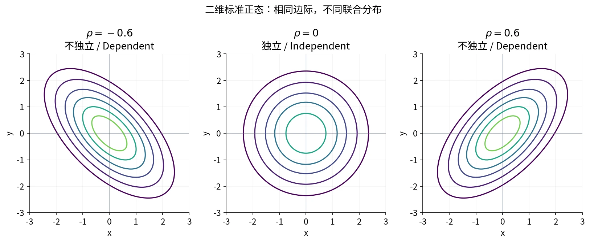

# §3.3–3.4 二维正态与随机变量独立性（Bivariate Normal and Independence）

## 随机变量独立的统一定义

设 $F(x,y)$ 为联合 CDF，$F_X,F_Y$ 为边际 CDF。若对任意 $x,y\in\mathbb R$，

$$
F(x,y)=F_X(x)F_Y(y),
$$

则称 $X,Y$ **相互独立（independent random variables）**。

等价地，对于任意适当的实数集合 $A,B$，

$$
P(X\in A,Y\in B)=P(X\in A)P(Y\in B).
$$

须对所有阈值成立，只验证一对事件不够。

## 离散与连续情形的判别

| 类型 | 充要条件 |
| --- | --- |
| 离散型 | $p_{ij}=p_{i\cdot}p_{\cdot j}$ 对所有 $i,j$ 成立 |
| 有联合密度 | $f(x,y)=f_X(x)f_Y(y)$ 几乎处处成立 |

证明独立须验证全部；否定独立只需一个反例取值对或正概率区域。密度在某连续点不等，则其邻域即可作反例；单个不连续点的差异不够。

例如联合表为

| $X\backslash Y$ | $0$ | $1$ | $P_X$ |
| --- | --- | --- | --- |
| $1$ | $1/6$ | $2/6$ | $1/2$ |
| $2$ | $1/6$ | $2/6$ | $1/2$ |
| $P_Y$ | $1/3$ | $2/3$ | 1 |

每格均等于行和乘列和，所以独立。如果把第二行改为 $2/6,1/6$，边际变为 $P_Y(0)=P_Y(1)=1/2$；第一格 $1/6\ne(1/2)(1/2)$，所以不独立。

### 因式分解判据（Factorization Criterion）

若联合密度在全平面上几乎处处（almost everywhere）可分解为两个非负单变量函数的乘积

$$
f(x,y)=m(x)n(y)
$$

则分离积分并归一化得 $f_Xf_Y=f$，故独立。

**函数与支撑指示因子都须可分离**：

- $6e^{-2x-3y}\mathbf1_{\{x>0\}}\mathbf1_{\{y>0\}}$ 可分离，独立。
- $\frac12xy\mathbf1_{\{0<x<y<2\}}$ 的代数部分可分离，但三角支撑不能分成两个单变量范围，不独立。
- $(x+y)\mathbf1_{\{0<x<1,0<y<1\}}$ 的范围是矩形，但函数本身不能分离，仍不独立。

矩形支撑不是充分条件；排除独立时，结合支撑形状和密度正值区域判断。

### 用已做作业检验独立性

- [习题三 A12](02-joint-distribution-functions.md)：$P(X=1,Y=0)=0.1$，而 $P(X=1)P(Y=0)=0.12$，不独立。
- [习题三 A18](03-continuous-joint-distributions.md)：联合密度 $(2x+y)/4$ 不等于 $(x+1/2)(1+y)/4$，不独立。
- [习题三 A9](01-discrete-joint-distributions.md)：$Y\ge X$，例如 $P(X=6,Y=1)=0$，但两个边际在对应点均为正，不独立。

仅给边际不能默认联合为边际乘积。

## 二维正态分布（Bivariate Normal Distribution）

记

$$
(X,Y)\sim N(\mu_1,\mu_2;\sigma_1^2,\sigma_2^2;\rho).
$$

非退化（nondegenerate）时，$\sigma_1,\sigma_2>0$、**$|\rho|<1$**。记标准化坐标

$$
z_1=\frac{x-\mu_1}{\sigma_1},\qquad
z_2=\frac{y-\mu_2}{\sigma_2}.
$$

联合密度为

$$
f(x,y)=\frac1{2\pi\sigma_1\sigma_2\sqrt{1-\rho^2}}
\exp\left[-\frac{z_1^2-2\rho z_1z_2+z_2^2}{2(1-\rho^2)}\right].
$$

$\rho$ 为相关参数（correlation parameter）；$|\rho|=1$ 时退化（degenerate）到直线，上式不再适用。

自绘。边际不变，$\rho$ 改变联合等密度线的方向与形状。[来源与许可](../assets/README.md)。

### 边际分布仍为正态

$$
X\sim N(\mu_1,\sigma_1^2),\qquad
Y\sim N(\mu_2,\sigma_2^2).
$$

边际不含 $\rho$，不能单凭边际还原联合。

证明可把指数配方为

$$
\begin{aligned}
f(x,y)&=
\frac{e^{-(x-\mu_1)^2/(2\sigma_1^2)}}{\sqrt{2\pi}\sigma_1}
\\
&\quad\cdot
\frac{\exp\left[
-\dfrac{\{y-\mu_2-\rho(\sigma_2/\sigma_1)(x-\mu_1)\}^2}
{2\sigma_2^2(1-\rho^2)}
\right]}
{\sqrt{2\pi}\sigma_2\sqrt{1-\rho^2}}.
\end{aligned}
$$

固定 $x$，第二因子对 $y$ 积分为 1，余下第一因子即 $f_X(x)$。

### 条件分布仍为正态

由上面的配方或密度比，

$$
Y\mid X=x\sim
N\left(
\mu_2+\rho\frac{\sigma_2}{\sigma_1}(x-\mu_1),
\ \sigma_2^2(1-\rho^2)
\right),
$$

$$
X\mid Y=y\sim
N\left(
\mu_1+\rho\frac{\sigma_1}{\sigma_2}(y-\mu_2),
\ \sigma_1^2(1-\rho^2)
\right).
$$

条件中心随给定值变化，尺度乘 $\sqrt{1-\rho^2}$；求概率时按条件正态参数标准化。

例如二维标准正态且 $\rho=1/2$，则

$$
Y\mid X=1\sim N(1/2,3/4),
$$

$$
P(Y\le1\mid X=1)
=\Phi\left(\frac{1-1/2}{\sqrt{3/4}}\right)
=\Phi(1/\sqrt3).
$$

## 二维正态中：零相关与独立

**充分性：**若 $\rho=0$，交叉项消失，联合密度分成两个边际正态密度的乘积。

**必要性：**独立给出密度几乎处处相等，连续性使其处处相等。在 $(\mu_1,\mu_2)$ 比较峰值：

$$
\frac1{2\pi\sigma_1\sigma_2\sqrt{1-\rho^2}}
=\frac1{2\pi\sigma_1\sigma_2}
\implies\rho=0.
$$

前提是**联合二维正态**；边际各自正态不够。

## 例：独立指数寿命的比较

甲、乙寿命 $X,Y$ 独立，且均有密度 $\frac12e^{-x/2}$，$x>0$。所以

$$
f(x,y)=\frac14e^{-(x+y)/2},\qquad x,y>0.
$$

比较事件 $X\le2Y$，固定 $x>0$ 后，$y$ 从 $x/2$ 到无穷：

$$
\begin{aligned}
P(X\le2Y)
&=\int_0^\infty\int_{x/2}^\infty
\frac14e^{-(x+y)/2}\,dy\,dx\\
&=\int_0^\infty\frac12e^{-3x/4}\,dx=\frac23.
\end{aligned}
$$

独立性用于构造联合密度，事件区域仍须单独确定。

## 参考资料

主课件第 63–69、72–82 页；课堂识别 lecture-record-24。
