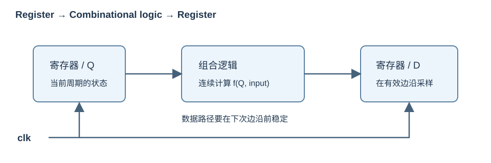

# 硬件描述与模块（HDL and Modules）

## 代码描述电路结构

Verilog 是硬件描述语言（Hardware Description Language, HDL），SystemVerilog 是其扩展。可综合的寄存器传输级代码（Register-Transfer Level, RTL）描述寄存器、寄存器之间的组合逻辑和连接关系。

| 写法 | 通常对应的硬件 |
| --- | --- |
| `assign y = a & b;` | 与门 |
| `assign y = sel ? b : a;` | 二选一多路选择器（multiplexer / mux） |
| 完整赋值的 `always_comb` | 组合逻辑（combinational logic） |
| `always_ff @(posedge clk)` | 边沿触发寄存器及其输入逻辑 |
| `generate for` | 展开后的多个并行实例 |

各实例和各过程并行存在，文件中的先后位置不代表运行先后。过程块内部有语句执行顺序，但最终硬件仍由赋值与依赖关系决定。RTL 仿真（simulation）验证逻辑；综合（synthesis）将 RTL 转换为门级网表（netlist），实现（implementation）完成布局布线。



*自绘：组合逻辑连续计算，寄存器在有效边沿采样；图中只有一条数据通路，实际电路可以并行存在多条。*

## 模块与端口

```systemverilog
module Mux2 #(
    parameter int unsigned W = 32
) (
    input  logic [W-1:0] a,
    input  logic [W-1:0] b,
    input  logic         sel,
    output logic [W-1:0] y
);
    assign y = sel ? b : a;
endmodule
```

- `module ... endmodule` 定义模块类型；一个实例（instance）就是一份硬件。
- `#(...)` 是编译展开时的参数（parameter），端口 `(...)` 是运行时信号。
- `input` 由外部驱动，`output` 由模块内部驱动；`inout` 用于双向连接，常见于片外三态引脚。
- `[W-1:0]` 表示 W 位，索引两端都包含；`[7+3:0]` 是 11 位。
- 名称区分大小写，每条声明/赋值通常以分号结束；`begin/end` 包围多条过程语句。
- 注释使用 `//` 或 `/* ... */`。模块端口较多时使用现代 ANSI 声明，旧代码可能在括号中只列名称、随后逐个声明方向。

在父模块内实例化：

```systemverilog
// 片段：a32、b32、sel、y32 已由父模块声明。
Mux2 #(.W(32)) u_mux (
    .a(a32),
    .b(b32),
    .sel(sel),
    .y(y32)
);
```

`.端口名(连接信号)` 是具名连接（named connection），参数也可具名覆盖。位置连接（positional connection）如 `Mux2 u_mux(a, b, sel, y);` 必须严格匹配定义顺序，同一端口列表不要混用两种方式。无须使用的输出可写 `.co()`，输入一般应连接明确值，避免悬空。层级路径如 `dut.u_mux.y` 可用于波形观察。

实例之间通过信号相连，不能在 `always` 内“调用模块”；模块不是函数。八选一选择器中两个四选一实例一直同时工作，再由最高选择位选择两者的输出。

## 线网与变量：wire、reg、logic

| 声明 | 语言含义 | 使用习惯 |
| --- | --- | --- |
| `wire` | 线网（net），取值由驱动源决定 | 模块连接、连续赋值；Verilog 中不能作为普通过程赋值目标 |
| `reg` | Verilog 四态变量（variable） | `always` / `initial` 的赋值目标，未必形成物理寄存器 |
| `logic` | SystemVerilog 四态数据类型，通常声明变量 | 单一驱动的 RTL 信号；可用于组合或时序逻辑 |

**是否产生存储器件，看赋值过程，而不是看是否写了 `reg` / `logic`。** `always_comb` 中的 `logic` 可以是纯组合输出；`always_ff` 中的 `logic` 通常是触发器输出。

普通 RTL 中，一个信号应由一个连续赋值、一个实例输出或一个过程驱动。不要同时从两个 `always` 写同一寄存器，也不要把 `assign` 与过程赋值混在同一变量上。线网在语言上可以有多个驱动源，用于三态/解析逻辑；这不等于 FPGA 内部普通数据通路可以随意多驱动。需要解析多个驱动时使用合适的 net 类型，不能把 `logic` 当作所有 `wire` 的机械替代。

### 两种“声明时赋值”并不相同

```systemverilog
wire  a = input_pin;  // net declaration assignment：持续跟随输入
logic b = 1'b0;       // 变量初始化：初始赋值，不是持续连接
// logic b = input_pin; 也不能用来替代 assign b = input_pin。
```

`lab0-3/main.v`、CPU 控制器中的 `wire ... = ...` 属于第一种。FPGA 工具可能支持寄存器/存储器初值，ASIC 和不同器件的支持不同；需要可控复位行为时应明确写复位逻辑。

## 文件、顶层与依赖

| 内容 | 常用扩展名 | 工程作用 |
| --- | --- | --- |
| Verilog 模块 | `.v` | 较早语法、门电路导出文件 |
| SystemVerilog 模块/接口/包 | `.sv` | enum、struct、interface、always_comb 等 |
| 文本头文件 | `.vh` / `.svh` | 宏和共用声明，经 `` `include `` 展开 |
| FPGA 约束 | `.xdc` | 引脚、电平、时钟和时序要求 |
| C/C++ 仿真辅助 | `.cpp` | DPI 或软件参考模型 |

文件扩展名是工程约定，实际语言模式由工具参数决定；课程的部分 `.v` testbench 也用了 SystemVerilog。顶层模块（top module）决定从哪里展开电路，综合顶层和仿真顶层通常不同：综合使用板级 `top`，仿真使用 `Testbench`。

实际流程是 **预处理（preprocessing）→ 编译/展开（elaboration）→ 仿真或综合**。参数计算、generate 展开和实例连接在 elaboration 阶段完成；因此参数不能由运行时输入决定。包应先于使用它的模块编译，头文件通过 include 搜索路径定位。

建议在自己的 RTL 文件中显式声明所有信号：

```systemverilog
`default_nettype none
// module ... endmodule
`default_nettype wire
```

这会把拼错名称导致的隐式单比特线网（implicit net）暴露为错误。框架 `syn/top.sv` 的 `cosim_valid` 就应核对显式声明；恢复默认设置有利于与旧第三方代码衔接。

## 对照源码

- `AND_GATE_3_INPUTS.v` / `OR_GATE_4_INPUTS.v`：Logisim 导出的结构化模块，`BubblesMask` 参数逐位决定输入是否反相。
- `Mux8T1_1.v`：实例级联与位置连接；移植时优先改成具名连接。
- `lab0-3/syn/top.v`：将板级开关连接到功能模块，功能 RTL 不需要知道物理引脚号。
- 组合与寄存器写法见[下一组模板](03-combinational-and-sequential.md)，编译和运行见[仿真与调试](08-simulation-and-debugging.md)。
