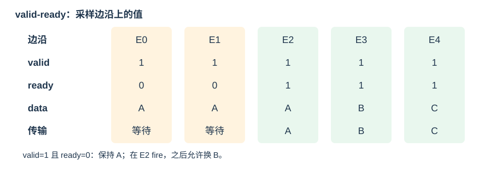

# 接口与握手（Interfaces and Handshakes）

## interface 与 modport

接口（interface）将一组关联信号和类型组织为一个对象；modport 从某种角色规定信号方向，降低接反和漏连的概率。

```systemverilog
interface Stream #(
    parameter int unsigned W = 32
);
    logic [W-1:0] data;
    logic valid, ready;
    modport Master (output data, valid, input ready);
    modport Slave  (input data, valid, output ready);
endinterface

module StreamLink(Stream.Slave src, Stream.Master dst);
    assign dst.data = src.data;
    assign dst.valid = src.valid;
    assign src.ready = dst.ready;
endmodule
```

在顶层实例化 `Stream #(.W(64)) stream();`，再将 stream 传给模块端口；接口实例本身有参数。课程 `Decoupled_ift` 同样使用 data/valid/ready，UART 数据类型为 8 位。模块端口的 Master/Slave 方向以模块视角解释；接口包装不自动产生握手逻辑或缓冲寄存器。

接口也可组成数组，例如 `Mem_ift #(.ADDR_WIDTH(64), .DATA_WIDTH(64)) links[0:2]();`。框架互联用 generate 的常量索引连接每个接口实例，再对普通数据/控制信号做运行时选择；接口层级引用不能默认像数据数组一样用任意动态索引。接口内的参数可通过实例名引用，例如 `out_data.DATA_WIDTH` 用于配置所连接 FIFO 的位宽。

## valid-ready：边沿决定一次传输

- **valid** 由发送方（source）驱动，表示当前载荷（payload）有效。
- **ready** 由接收方（sink）驱动，表示能够在本次有效边沿接收。
- **fire = valid && ready**。在有效时钟边沿观察到 fire=1，发生一项传输。



*自绘：表格每列表示对应采样边沿处的信号值。A 在背压期间保持，到 E2 才被接收；B、C 可连续传输。*

| valid | ready | 当次边沿的含义 |
| --- | --- | --- |
| 0 | 0 / 1 | 没有有效数据，data 不被接收 |
| 1 | 0 | 背压（backpressure），等待 |
| 1 | 1 | 传输一次，下一周期可以换成新数据 |

必须遵守：

1. 发送方有待发送数据即可置 valid，**不能等待 ready 才决定是否有 valid**，否则可能与等待 valid 的接收方死锁。
2. 当 valid=1、ready=0 时，发送方保持 valid=1，并保持 data 不变，直到一次 fire。
3. 接收方只在 fire 时消费数据；发送方也只在 fire 后移除当前数据。
4. valid 连续为 1 不代表只传一次：每个 ready 同时为 1 的边沿都会传一项。相同载荷持续两个 fire 会被视为两项相同数据。

“valid 与 ready 相遇”不是异步采样事件；真正的动作发生在约定时钟边沿。复位通常清除输出 valid，防止接收未初始化数据。

## 一项缓冲器：可以同时消费与替换

```systemverilog
module StreamBuffer #(
    parameter int unsigned W = 32
) (
    input logic clk, rst_n,
    input logic [W-1:0] in_data,
    input logic in_valid,
    output logic in_ready,
    output logic [W-1:0] out_data,
    output logic out_valid,
    input logic out_ready
);
    // 空闲时可接收；旧数据本周期会被取走时也可接收。
    assign in_ready = !out_valid || out_ready;
    always_ff @(posedge clk or negedge rst_n) begin
        if (!rst_n) begin
            out_valid <= 1'b0;
            out_data <= '0;
        end else if (in_ready) begin
            out_valid <= in_valid;
            if (in_valid) out_data <= in_data;
        end
    end
endmodule
```

这个弹性缓冲（elastic buffer）有一周期寄存器延迟，连续运行时每周期可传一项；背压时自动保持输出。若多级直接串接，ready 会形成组合反向路径，需结合时序考虑增加缓冲或注册 ready；任意跨模块循环连接也可能形成组合环路。

延迟（latency）是从输入接收到对应结果可用的时间；吞吐率（throughput）是单位时间处理项数。两者不能混同：多级流水可有高延迟但每周期一项，而迭代乘法器可能几十周期才完成一项。

## Shift 与 ConvOperator 的组合

课程 Shift 分为 RDATA（接受一个新样本并移动窗口）和 TDATA（等待窗口被接受）两态。只有 `in_valid && in_ready` 时移位；TDATA 中保持窗口不变。该实现把接收与发送分成不同状态，不能同时发生，理论上输入间隔至少两个周期。

ConvOperator 分为接收窗口、计算、发送结果等阶段：

- 输入 fire 时保存本次数据，忙碌期间不能改用随时变化的输入。
- 启动乘法器并等待完成，把乘积及 valid 保存到下一阶段。
- 结果 ready=0 时，输出 valid 和结果保持不变。
- 输出 fire 后返回接收态；若希望重叠多组运算，应增加阶段缓冲和独立占用状态。

连接时沿数据前进方向传播 data/valid，沿反向传播 ready。是否能持续接收，由最下游的可用空间决定，而不是上游单独决定。

## 内存接口：四个独立握手通道

课程 Mem_ift 是教学总线，包含四条 decoupled 通道。整体的 Master 是 CPU，Slave 是内存/外设，但**响应通道的发送方是 Slave**。

| 通道 | 发送方 → 接收方 | 主要载荷 |
| --- | --- | --- |
| `r_request` | CPU → 内存 | raddr |
| `r_reply` | 内存 → CPU | rdata、rresp |
| `w_request` | CPU → 内存 | waddr、wdata、wmask |
| `w_reply` | 内存 → CPU | bresp |

CPU 先提交请求，再等待对应响应；写请求被接受不代表写事务已经成功完成，要看响应。地址、掩码和数据在请求背压期间均需稳定；响应在 CPU 尚未 ready 时也需稳定。

BusPack 定义 `OKAY`、`EXOKAY`、`SLVERR`、`DECERR` 响应编码；框架用 DECERR 报告未映射地址。不能据此把教学接口当作完整 AXI：通道字段、事务数与排序规则仍应以该框架为准。

### busy 与待响应状态

对于单个在途事务（one outstanding transaction）的从设备：

```text
空闲 → 请求 fire → 处理/保存响应 → 等待响应 fire → 空闲
```

请求 fire 时保存需要的地址和数据；响应生成后，valid 维持到响应 fire。框架宏用 busy 寄存器实现这些阶段。请求接受后，输入端口可被发送方换成下一项，因此之后的响应不能继续依赖“当前请求地址”。

协议本身没有规定所有从设备必然至少延迟一周期；教学 MEM_Dram 注册响应，而 MEM_Single_Dram 使用即时组合响应。调用方应通过握手判断完成，避免用固定延迟猜测。

## 互联与内存映射 I/O

Mem_InterConnect 根据地址区间把请求路由到 RAM、UART 等设备。请求接受后需锁存本次目标选择，直到对应响应被接收，避免后续地址变化把响应路由错。

内存映射 I/O（memory-mapped I/O, MMIO）把外设寄存器映射到地址空间。例如框架 UartPack 定义数据/状态偏移，读数据可能消费一个接收字节，写数据可能触发发送。因此 MMIO 具有副作用，CPU 停顿时不能重复提交同一个请求。

读/写握手通道在结构上分开，不意味着所有设备都能无限并行接受请求；busy、响应缓冲和 UART FIFO 空间决定实际能力。

## 串口回环的优先级与事件保存

课程 UartLoop 把接收到的数据连到发送接口，并让 debug_send 优先。接收 ready 必须与“发送方是否真的接受这项回环数据”一致，否则会丢字节或重复发送。

debug_send 如果只是一个周期的脉冲，而发送接口 ready=0，这个事件会丢失。实际设计应先把事件及数据保存为 pending 状态，再保持 tx_valid 直到 fire；多个事件可能到来时使用 FIFO。优先级 mux 解决“选哪项”，缓冲才解决“等到能发送”。

存储和跨时钟域缓冲见[下一章](07-memory-fifo-and-io.md)，握手激励与检查见[仿真章](08-simulation-and-debugging.md)。
