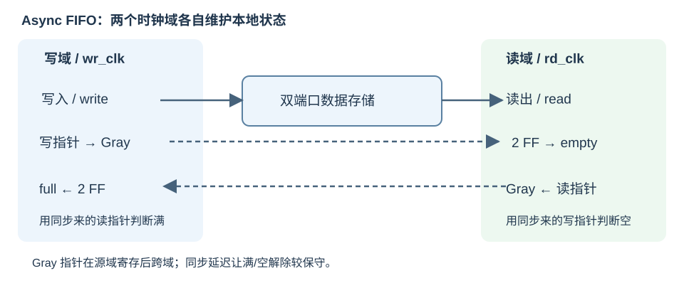

# 存储、FIFO 与外设（Memory, FIFO and I/O）

## 寄存器组与 RAM：端口时序是规格的一部分

```systemverilog
module SmallRam (
    input  logic clk, we,
    input  logic [3:0] waddr, raddr,
    input  logic [31:0] wdata,
    output logic [31:0] rdata
);
    logic [31:0] mem [0:15];
    always_ff @(posedge clk) begin
        if (we) mem[waddr] <= wdata;
    end
    assign rdata = mem[raddr]; // 组合读
endmodule
```

数组不自动等于 Block RAM。组合读（asynchronous/combinational read）、同步读（synchronous read）、读端口数量、复位方式会影响推断出的资源。上例同步写、组合读；若改为 `always_ff @(posedge clk) rdata <= mem[raddr];`，读地址在边沿采样，结果带一个寄存器周期。

课程 RegFile 有两个组合读端口和一个同步写端口，寄存器数组只存 x1…x31；读 x0 返回 0，写 x0 被抑制。读写同址（read-during-write）时要明确 old data / new data / no-change 语义；需要立即得到写入值时可显式写前递 mux，不能只凭“同步写、异步读”断言所有器件行为一致。

把大数组全部复位为零可能使其变成大量触发器并阻碍 RAM 推断。流水数据通常只需清有效位；存储初值可通过初始化文件提供，但仍应核对器件和综合器支持。

## 初始化文件与 ROM

```systemverilog
// 片段：mem 已声明为存储器数组。
initial begin
    $readmemh("program.hex", mem);
end
```

`$readmemh` 读取十六进制元素，`$readmemb` 读取二进制元素，可指定起止索引。元素宽度对应数组一个 word 的位宽，**不必等于文件每行恰好一个字节**。相对路径以仿真可执行程序的工作目录解析；课程 Makefile 把 hex 复制到构建目录后在那里运行。

FPGA 通常能支持部分存储初始化，具体映射取决于工具/器件。`initial` 中的延时和任意测试动作不应因此被当作可综合电路。

框架 `Font_Table.v` 通过 8192 个常量位赋值描述字符 ROM，本质是 `rom[address]` 查表，不需要逐条记忆；`VRAM.v` 用字符地址数组保存屏幕内容，同步写、组合读。ROM 内容描述的是字形，读取逻辑描述的是硬件接口。

## 字节地址、字节使能与加载扩展

宽 W 位存储每个 word 有 W/8 个字节。以 64 位为例：

| 量 | 计算 |
| --- | --- |
| word 索引 | 字节地址右移 3 位，即去掉低 3 位 |
| word 内字节偏移 | `addr[2:0]` |
| 数据位偏移 | `{addr[2:0],3'b000}` |
| byte mask | 每一位控制对应 8 位是否写入 |

```systemverilog
// 片段：mem 是 64 位数组，wmask 为 8 位。
always_ff @(posedge clk) begin
    if (we) begin
        for (int i = 0; i < 8; i++) begin
            if (wmask[i])
                mem[waddr][i*8 +: 8] <= wdata[i*8 +: 8];
        end
    end
end
```

DataPkg 将 store 数据左移到相应字节位置，MaskGen 同步移动掩码；DataTrunc 将读 word 右移，再按 LB/LH/LW 或无符号形式进行扩展。这些模块假定访问落在一个 word 内，跨 word 的非对齐访问需要拆成两个事务或异常处理，不能靠一次移位自动解决。

框架名为 DRAM 的模块实质是 HDL 存储数组模型，不是外部 DDR 控制器。MEM_Dram 将总线响应寄存器化并管理 busy；MEM_Single_Dram 给出组合响应以支持教学单周期核心。CPU 与内存的时序模型必须匹配。

## 同步 FIFO：数据、指针和占用

先进先出队列（First-In, First-Out, FIFO）用存储数组和读/写指针保存多项数据：

- 写入只在 `wen && !full` 时发生，写指针前进。
- 读取只在 `ren && !empty` 时消费，读指针前进。
- decoupled 包装使 `in_ready = !full`、`out_valid = !empty`。
- 深度为 $2^A$ 时，A 位索引用于地址，额外一位记录绕回（wrap）。

对于无额外缓存的常见二进制指针模型：完整读写指针相同表示空；低 A 位相同而最高绕回位不同表示满。非二次幂深度需要显式终值回绕，不能简单截掉高位。

### 框架 FIFO 的输出预取

`SyncFifo` / `AsyncFifo` 另有 `out_data_buffer` 和 `out_data_valid`：

1. 输出缓冲为空，或本周期消费者会取走旧数据时，可从 RAM 预取下一项。
2. RAM 读指针在预取时前进，未必在消费者 fire 时才前进。
3. 对外 empty 由输出 valid 决定，RAM 本体为空不等于没有可输出数据。

因此不能把该实现简化为“对外 empty 就是两个 RAM 指针相等”。输出缓冲多保存一项，整体容量可能是 RAM 深度再加 1；临界满空、预取和同时读写都要在仿真中验证。

## 跨时钟域（Clock Domain Crossing, CDC）

异步输入在采样边沿附近变化，可能造成亚稳态（metastability）。两级同步器降低单比特稳定电平跨域的风险：

```systemverilog
// 片段：用于单比特电平，源端保持时间应足够。
logic sync1, sync2;
always_ff @(posedge dst_clk or negedge dst_rst_n) begin
    if (!dst_rst_n) begin
        sync1 <= 1'b0;
        sync2 <= 1'b0;
    end else begin
        sync1 <= async_level;
        sync2 <= sync1;
    end
end
```

两级同步不保证任意短脉冲一定被捕获，也不能将任意多位总线逐位同步后视为完整数据。跨域事件可用 toggle/握手，连续多位数据常用异步 FIFO。多位 CDC 的选择见 [AMD UG949](https://docs.amd.com/r/en-US/ug949-vivado-design-methodology/Multi-Bit-CDC)。

## 异步 FIFO：跨域同步指针

写端只用写时钟更新写指针，读端只用读时钟更新读指针。数据保存在双端口存储中，通过同步远端指针确定可访问范围，而不是逐位同步整个数据。



*自绘：写端在本地判断 full，读端在本地判断 empty；虚线路径只传指针状态。*

Gray code（二进制格雷码）将相邻指针变化限制为一个 bit：

```systemverilog
// 片段：bin、gray 位宽相同，含绕回位。
assign gray = bin ^ (bin >> 1);
```

二进制计数从 011→100 会变三位，Gray 相邻计数只变一位。Gray 指针先在源域寄存，再经两个目标域寄存器同步，避免组合转换毛刺直接跨域。Gray 编码要求源端每次只前进/后退一个计数；任意跳变的数据应使用握手等方案，见 [XPM_CDC_GRAY](https://docs.amd.com/r/2022.2-English/ug953-vivado-7series-libraries/XPM_CDC_GRAY)。

对于二次幂深度、带额外绕回位的 reflected Gray 指针：

- 空：本地读 Gray 指针与同步来的写 Gray 指针相同。
- 满：本地写 Gray 指针与同步来的读 Gray 指针 **最高两位取反、其余不变** 后相同。
- 判“当前满”用当前指针，判“下一次更新后满”用 next 指针，两种代码写法需与 flag 更新时机一致。

同步远端状态有延迟，满/空解除可能较保守，这是正常行为。框架把 Gray 指针及其同步分开寄存，阅读时应逐级追踪旧值，不要把所有阶段合并为立即更新。

CDC 可靠性还取决于物理实现：同步寄存器的属性/布局、Gray 总线路由偏斜、时钟约束和复位释放都要处理。只写两级触发器或设置 false path 不能证明整个跨域通路正确；上板需运行 CDC 分析。框架现有 AsyncFifo 要求深度为二次幂且至少 4，深度 2 会涉及负范围切片。

## UART：波特率、移位与缓冲

通用异步收发器（Universal Asynchronous Receiver/Transmitter, UART）以共同约定的位时间传输，不传共享时钟。课程采用常见的 **8N1**：

```text
空闲 1 → 起始位 0 → d0 d1 ... d7（低位先传）→ 停止位 1
```

波特率（baud rate）在该二进制编码下对应位速率；一个 8N1 字节需 10 个 bit 时间，9600 baud 理想情况下每秒约 960 个数据字节。

- TX 在接受字节后，FSM 按 bit tick 输出起始位、8 位数据、停止位；busy 时不能再次覆盖发送寄存器。
- RX 先同步异步 rxd，再检测起始位，使用过采样（oversampling）在位中心采样，最后组合一个字节。
- 框架使用 8 倍过采样，含两级同步、滤波和位计时；它不是简单地在每个系统时钟采样一个串口 bit。
- BaudTickGen 使用相位累加器（phase accumulator）的溢出产生 tick，可逼近不能整除时钟频率的波特率。tick 作为同一时钟域的使能，不应随意当作新时钟。
- UART 内部串行“异步”与 CPU/system 两个时钟域是两层问题：前者是采样协议，后者由 UartUnit 的异步 FIFO 隔离。

框架 RX 保存有效字节直到下游 fire；TX ready 反映是否能接收。外部数据持续到来而 FIFO 满仍可能溢出。代码中的 CTS 未用于完整发送门控、RTS 被固定赋值，不能以端口存在就认为硬件流控制已实现。仿真条件编译提高波特率只是缩短模拟时间。

## 按键、分频与显示

| 源码模块 | 原理 | 使用时注意 |
| --- | --- | --- |
| Divider | 计数器某一位每 $2^{k+1}$ 个输入周期完成一周期 | 总线名含 clk50 不代表所有位都是 50 MHz；优先用 clock enable |
| Debouncer | 移位保存采样，归约与判断连续高电平 | 框架需连续 8 次高才认按下，但一次低就释放；消抖不代替 CDC 同步 |
| SevSegment_Display | 一个译码器轮流显示多个十六进制数位 | an/段选为低有效；旋转选择位与数据选择必须一致 |
| VGA_Controller | 行/帧计数、同步脉冲、有效区域 | 框架 800×525 时序包围 640×480 显示区，边界含消隐 |
| VGA_Debugger / VRAM / Font_Table | 将调试数值映射为字符，再读取字形位 | 区分字符地址、字形地址、像素坐标；对齐读延迟与同步信号 |

按键通常先同步再消抖，再用 `pressed && !pressed_d` 等边沿检测生成一个周期的事件。计数器位生成的派生时钟和调试时钟 mux 可能带来时钟约束、布线和毛刺问题，真正切换时钟应使用合适的时钟资源。

七段译码可写布尔式或查表 case，均为组合逻辑。动态扫描利用视觉暂留共享一组段线，扫描频率和低有效选择由板级设计决定。VGA 的计数器、同步输出与像素数据若分级寄存，要统一延迟；仿真中图案逻辑正确不意味着同步与像素必然对齐。

约束与上板检查见[仿真与调试](08-simulation-and-debugging.md)。
