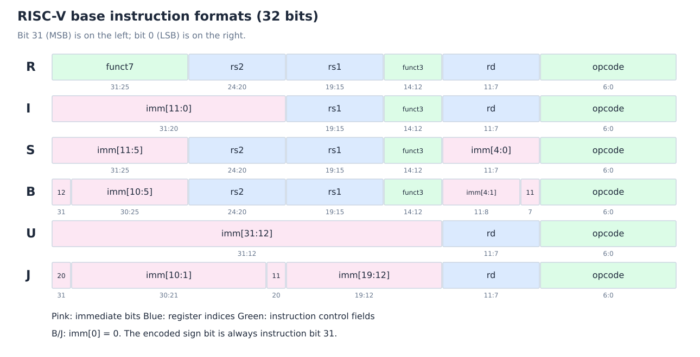

# 前置复习：指令、编码与汇编翻译

[前置复习目录](index.md) · [下一章：常量与调用](02-constants-and-calls.md)

## 1. 字节序、位宽与六种格式

本课程采用小端字节序（little-endian）：**低地址存最低有效字节**。例如从地址 A 保存 `0x12345678`：

| 地址 | A | A+1 | A+2 | A+3 |
| --- | --- | --- | --- | --- |
| 字节 | 78 | 56 | 34 | 12 |

字节序决定多字节数据在内存中的排列，不改变指令格式图中 bit 31…0 的位号。下文普通指令均为 32 位、顺序 PC 加 4；RV64 的整数寄存器宽度 XLEN=64。



*复用课程笔记的自绘编码图。imm 的下标是重建后立即数的位号。*

| 格式 | inst[31:25] | inst[24:20] | inst[19:15] | inst[14:12] | inst[11:7] | inst[6:0] |
| --- | --- | --- | --- | --- | --- | --- |
| R | funct7 | rs2 | rs1 | funct3 | rd | opcode |
| I | imm[11:5] | imm[4:0] | rs1 | funct3 | rd | opcode |
| S | imm[11:5] | rs2 | rs1 | funct3 | imm[4:0] | opcode |
| B | imm[12], imm[10:5] | rs2 | rs1 | funct3 | imm[4:1], imm[11] | opcode |
| U | imm[31:25] | imm[24:20] | imm[19:15] | imm[14:12] | rd | opcode |
| J | imm[20], imm[10:5] | imm[4:1], imm[11] | imm[19:15] | imm[14:12] | rd | opcode |

U 型的 inst[31:12] 合起来是一个 20 位立即数字段；J 型整体顺序为 `imm[20|10:1|11|19:12]`。S/B 没有 rd，I 型的 inst[24:20] 也不一定是源寄存器；做译码和冒险检测时先判断格式与功能。

## 2. 立即数与移位的规则

`sext` 表示符号扩展（sign extension），`zext` 表示零扩展（zero extension）：

```text
I = sext(inst[31:20])
S = sext({inst[31:25], inst[11:7]})
B = sext({inst[31], inst[7], inst[30:25], inst[11:8], 0})
U = sext_to_XLEN({inst[31:12], 12'b0})
J = sext({inst[31], inst[19:12], inst[20], inst[30:21], 0})
```

- 普通 I/S 型立即数范围为 −2048…2047。符号扩展总是复制符号位；符号位为 0 时补 0，为 1 时补 1。
- B/J 重建时已在最低位补 0，得到字节偏移，计算目标地址时不要再乘 2 或 4。
- `sltiu` 是先将立即数符号扩展至 XLEN，再按 unsigned 比较；unsigned 不等于立即数零扩展。
- RV32 的立即数移位量（shift amount, shamt）为 5 位，RV64 为 6 位。RV64 的 `slli/srli/srai` 使用 inst[25:20]，inst[31:26] 区分移位操作；不能一律套用“funct7 + 5 位 shamt”。
- 寄存器移位 `sll/srl/sra` 只使用 rs2 的低 5 位（RV32）或低 6 位（RV64）；RV64 的 W 类运算只使用低 5 位。

## 3. 关键 opcode 与 funct 速查

以下编码均为二进制。opcode 决定大类，funct3 / funct7 再区分具体操作，不能仅凭格式判断指令。[编码核对：RISC-V 官方指令列表](https://docs.riscv.org/reference/isa/v20260120/unpriv/rv-32-64g.html)。

| 指令类 | opcode | 关键功能码 |
| --- | --- | --- |
| R 型整数运算 | `0110011` | add/sub：funct3=`000`，funct7 分别为 `0000000` / `0100000` |
| I 型整数运算 | `0010011` | addi：`000`；slti：`010`；sltiu：`011` |
| Load | `0000011` | lb/lh/lw/ld：`000/001/010/011`；lbu/lhu/lwu：`100/101/110` |
| Store | `0100011` | sb/sh/sw/sd：`000/001/010/011` |
| Branch | `1100011` | beq/bne：`000/001`；blt/bge：`100/101`；bltu/bgeu：`110/111` |
| LUI | `0110111` | U 型，无 funct3 |
| AUIPC | `0010111` | U 型，无 funct3 |
| JAL | `1101111` | J 型，无 funct3 |
| JALR | `1100111` | I 型，funct3=`000` |

R 型中，sll/slt/sltu/xor/srl/or/and 的 funct3 依次为 `001/010/011/100/101/110/111`，这些基础操作的 funct7 为 `0000000`；sra 使用 `101` 和 `0100000`。对应立即数逻辑运算沿用 funct3，移位立即数的高位按上一节区分。ld/sd/lwu 属于 RV64。

### 编码例：add x5, x6, x7

```text
funct7   rs2    rs1    funct3  rd     opcode
0000000  00111  00110  000     00101  0110011
```

等价于：

```text
(7 << 20) | (6 << 15) | (5 << 7) | 0x33 = 0x007302b3
```

在小端内存中这条指令的四字节为 `b3 02 73 00`。反汇编时先取 opcode，再抽取寄存器和功能码，最后重建立即数；不要直接把内存字节顺序抄成字段顺序。

## 4. 算术、逻辑与比较

`R[rd]` 表示寄存器值。寄存器型通常写 `op rd,rs1,rs2`，立即数型写 `op rd,rs1,imm`。

| 操作 | 寄存器型 / 立即数型 | 语义 |
| --- | --- | --- |
| 加减 | add / addi，sub | rd=rs1+操作数，或 rs1−rs2；无基础 subi，用 addi 的负立即数 |
| 逐位逻辑 | and/andi、or/ori、xor/xori | 对每一 bit 运算 |
| 左移 | sll / slli | 左移，低位补 0 |
| 逻辑右移 | srl / srli | 高位补 0 |
| 算术右移 | sra / srai | 高位复制符号位 |
| 有符号小于 | slt / slti | 条件成立写 1，否则写 0 |
| 无符号小于 | sltu / sltiu | 比较相同位串的 unsigned 值 |

寄存器不自带 signed / unsigned 标签，由指令决定解释方式。add/sub 只保留低 XLEN 位，不因整数溢出自动陷入异常；`slt` 写的是比较结果，不是直接跳转。

## 5. Load 与 store

有效地址（effective address）为 `EA = R[rs1] + sext(offset12)`，offset 单位是字节：

```asm
lw  t0, 12(s0)     # 读取地址 s0+12 开始的 32 位，再符号扩展
sw  t0, 16(s0)     # 把 t0 的低 32 位写到地址 s0+16
```

| 指令 | 内存访问宽度 | RV64 加载后的处理 |
| --- | --- | --- |
| lb / lbu | byte，8 位 | 符号扩展 / 零扩展 |
| lh / lhu | halfword，16 位 | 符号扩展 / 零扩展 |
| lw / lwu | word，32 位 | 符号扩展 / 零扩展 |
| ld | doubleword，64 位 | 完整 64 位 |
| sb / sh / sw / sd | 8 / 16 / 32 / 64 位 | store 取 rs2 对应的低位，无“扩展后写入” |

load 的目标是 rd；store 的数据源是 rs2，基址是 rs1。`A[i]` 的偏移等于 i×元素字节数，与 CPU 寄存器宽度分别判断。大小端和对齐也不同：小端描述字节排列，自然对齐要求地址是访问字节数的倍数。

## 6. 分支、跳转与高位立即数

| 写法 | PC / 寄存器效果 |
| --- | --- |
| `beq/bne rs1,rs2,label` | 相等/不等时跳转 |
| `blt/bge rs1,rs2,label` | signed 小于/大于等于时跳转 |
| `bltu/bgeu rs1,rs2,label` | unsigned 小于/大于等于时跳转 |
| `jal rd,label` | rd=旧 PC+4；PC=旧 PC+J 偏移 |
| `jalr rd,offset(rs1)` | rd=旧 PC+4；PC=(旧 R[rs1]+sext(offset)) & ~1 |
| `lui rd,imm20` | rd=sext(imm20<<12)；先形成 32 位结果 |
| `auipc rd,imm20` | rd=旧 PC+sext(imm20<<12) |

条件分支 taken 时目标为**分支指令自身的 PC** 加 B 型偏移，不 taken 则 PC+4。B/J 范围分别为 −4096…4094、−1048576…1048574 字节；无压缩指令的模型仍要求执行目标按 4 字节对齐。

jalr 的立即数不按 2 字节缩放，求和后清最低位；若 rd 与 rs1 相同，目标仍由更新前的 rs1 计算。链接地址写入 x0 时被丢弃，因此 `jal x0,label` 只跳转，不保存返回位置。[指令语义：官方 RV32I 规范](https://docs.riscv.org/reference/isa/v20260120/unpriv/rv32.html)。

## 7. 常见伪指令（Pseudoinstructions）

| 汇编写法 | 常见基础指令展开 |
| --- | --- |
| `mv rd,rs` | `addi rd,rs,0` |
| `nop` | `addi x0,x0,0` |
| `j label` | `jal x0,label` |
| `ret` | `jalr x0,0(ra)`，ra=x1 |
| `li rd,imm` | 根据常量大小选择 addi、lui、移位等序列 |

伪指令不是新的机器编码。具体展开条数影响动态指令数（IC），分析题如果要求基础指令，应先展开。64 位常量与嵌套调用见[下一章](02-constants-and-calls.md)，控制结构与数组翻译详见[后续 RISC-V 章节](../10-architecture-and-isa/03-risc-v-instructions.md)。
