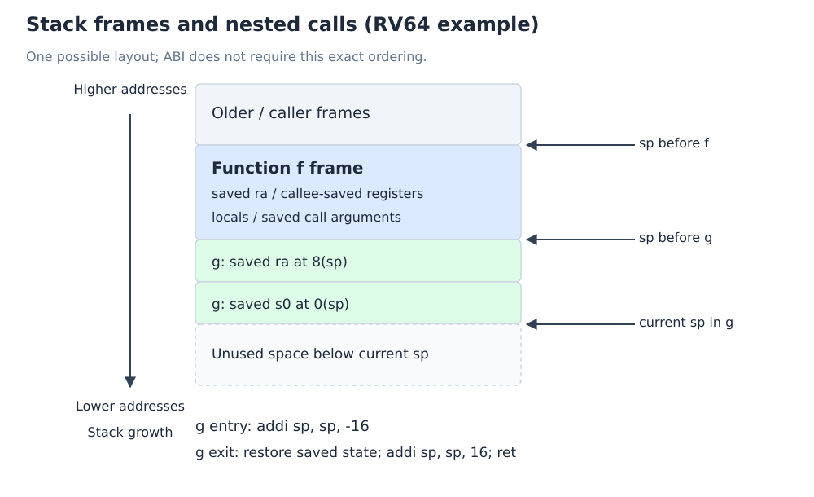

# 前置复习：常量构造、函数调用与栈

[前置复习目录](index.md) · [上一章](01-instructions-and-encoding.md) · [下一章：数据通路与性能](03-datapath-and-performance.md)

## 1. 为什么低 12 位会影响高 20 位

`lui` 填充高 20 位，`addi` 加的是 **signed 12 位数**。若低 12 位 bit 11=1，addi 使用负值，必须先给高位加一补偿。

将 32 位常量 C 按位串分成两部分：

$$
L=C\bmod 2^{12},\qquad
\ell=
\begin{cases}
L,&L<2^{11},\\
L-2^{12},&L\ge 2^{11},
\end{cases}
\qquad
H=\frac{C-\ell}{2^{12}}.
$$

将 H 的低 20 位放入 lui，$\ell$ 放入 addi，RV32 下得到 C。例：

```asm
# 低 12 位 0x678 < 0x800，直接相加
lui  x5, 0x12345
addi x5, x5, 0x678        # 0x12345678

# 低 12 位 0xABC 按 signed 12 位解释为 -1348 = -0x544
lui  x5, 0x87655          # 高位 0x87654 加一
addi x5, x5, -1348        # 低 32 位为 0x87654ABC
```

`addi ...,0xABC` 把立即数写成正数 2748，会超出 signed 12 位范围，不能靠汇编器自动理解成 −1348。

**RV64 的边界：**lui 会把形成的 32 位结果符号扩展至 64 位。要通用地构造“任意 32 位常量再符号扩展”，可用 `lui + addiw`，保证加法后先截成 32 位再扩展。例如 `0x7FFFFFFF` 应用 `lui rd,0x80000; addiw rd,rd,-1`；若在 RV64 只用 addi，会错误地得到 `0xFFFFFFFF7FFFFFFF`。下节手稿给定常量不跨这一边界，其 addi 序列仍然正确。[RV64 的 LUI / ADDIW 规则](https://docs.riscv.org/reference/isa/v20240411/unpriv/rv64.html)。

## 2. 手稿例题：构造 0x1234567887654ABC

目标是将任意位串 `0x12345678_87654ABC` 放入 x5。先构造高低两个 32 位部分，再合并：

```asm
lui  x5, 0x12345
addi x5, x5, 0x678        # x5 = 0x0000000012345678
slli x5, x5, 32           # x5 = 0x1234567800000000

lui  x6, 0x87655
addi x6, x6, -1348        # x6 = 0xFFFFFFFF87654ABC
slli x6, x6, 32
srli x6, x6, 32           # x6 = 0x0000000087654ABC

add  x5, x5, x6           # x5 = 0x1234567887654ABC
```

`slli + srli` 保留低 32 位并清除高 32 位，即零扩展（zero extension）；这里必须使用逻辑右移 srli，不能用 srai。若未清除 x6 的符号扩展位，就会干扰目标的高 32 位。

最后两部分的有效位互不重叠，所以用 `or x5,x5,x6` 也能合并；加法在这里不会产生跨半部进位。工程中可直接用 `li x5,0x1234567887654ABC`，考试要求展开时再给出基础指令。

## 3. 寄存器保存约定

ISA 规定 jal/jalr 怎样改变寄存器和 PC；调用约定（calling convention）规定软件如何传参、返回和保存状态。

| ABI 名称 | 编号 | 用途 | 跨调用是否保留 |
| --- | --- | --- | --- |
| zero | x0 | 常量零 | 恒为 0 |
| ra | x1 | return address，返回地址 | 否；仍需使用旧返回地址时自行保存 |
| sp | x2 | stack pointer，栈指针 | 是，返回时恢复 |
| gp / tp | x3 / x4 | 全局指针 / 线程指针 | 普通过程不要任意改作临时量 |
| t0–t2 | x5–x7 | temporary，临时值 | 否，caller-saved |
| s0–s1 | x8–x9 | saved registers；s0 也可作 fp | 是，callee-saved |
| a0–a7 | x10–x17 | arguments；a0/a1 也用于常见返回值 | 否，caller-saved |
| s2–s11 | x18–x27 | saved registers | 是，callee-saved |
| t3–t6 | x28–x31 | temporary，临时值 | 否，caller-saved |

调用者保存（caller-saved）意味着被调用函数可改写：**调用结束后仍需使用的值**才要由 caller 保护。被调用者保存（callee-saved）意味着 callee 若使用并修改该寄存器，就必须恢复原值。无需每次机械地保存全部寄存器。

手稿中临时寄存器范围应完整记为 **t0–t6**；不是全部 a 寄存器都用作普通返回值。标准整数规则见 [RISC-V psABI](https://riscv-non-isa.github.io/riscv-elf-psabi-doc/#_integer_register_convention)。

## 4. 栈、序言与尾声

栈（stack）向低地址增长，分配空间用 `addi sp,sp,-N`，释放用 `addi sp,sp,N`。标准 RV32I/RV64I 整数 ABI 要求 sp 在过程执行期间维持 **16 字节对齐**，N 通常取 16 的倍数。以下采用 RV64：

```asm
# Prologue：分配 32 字节，保存将被改写的状态
addi sp, sp, -32
sd   ra, 24(sp)
sd   s0, 16(sp)

# Body：函数体，可修改 s0、调用其他函数
# ...

# Epilogue：恢复状态、释放栈帧、返回
ld   s0, 16(sp)
ld   ra, 24(sp)
addi sp, sp, 32
ret
```

保存与恢复地址必须配对；不同函数可采用不同帧布局。修改 sp 只分配地址范围，不会自动保存寄存器。RV64 的完整寄存器用 sd/ld 保存；sw/lw 只能保存/恢复 32 位。



*复用课程笔记的自绘栈帧图，实际偏移以函数的分配为准。*

叶子函数（leaf function）不再调用其他函数，不一定需要保存 ra；非叶子函数（non-leaf function）若要在调用后返回，需在下一次 jal 覆盖 ra 前保留旧值。尾调用（tail call）等特殊形式另行分析，不必机械套用“所有函数都保存 ra”。

## 5. 手稿例题：嵌套调用 g(g(a,b),c+d)

设 C 函数为：

```c
int g(int x, int y);
int f(int a, int b, int c, int d) {
    return g(g(a, b), c + d);
}
```

采用 RV64 LP64、C 的 int 为 32 位，假定 c+d 不发生 C 的有符号溢出。参数 a/b/c/d 在 a0/a1/a2/a3，返回值在 a0：

```asm
f:
    addi sp, sp, -16
    sd   ra, 8(sp)          # 返回 f 的调用者所需的位置
    addw t0, a2, a3         # 32 位 c+d，结果符号扩展到 64 位
    sd   t0, 0(sp)          # t0 是 caller-saved，不能直接跨 g 保留

    jal  ra, g             # a0 = g(a,b)
    ld   a1, 0(sp)          # 第二次调用参数：(a0, c+d)
    jal  ra, g             # a0 = g(g(a,b), c+d)

    ld   ra, 8(sp)
    addi sp, sp, 16
    ret
```

第一个 g 可以破坏 t0 和 a2/a3，所以先把 c+d 存入栈；两次 jal 都会改写 ra，所以在整个函数外层保存一次旧 ra。第二次 g 的返回值已在 a0，无需额外搬移。

若处理的是 64 位 long，c+d 可改用 add；RV64 并不意味着 C 的 int 加法应一律写成 64 位 add。更详细的叶子函数、callee-saved 与帧指针讨论见[过程调用章节](../10-architecture-and-isa/04-procedure-calls.md)。
