# Lecture 1: AVL Trees, Splay Trees, and Amortized Analysis

**AVL:** logarithmic worst-case operations. **Splay:** logarithmic amortized operations; individual accesses may be linear.

[Course overview（课程信息）](index.md) · [HW1 C implementation（编程题实现）](hw1-avl-root.md)

## 1. Dynamic searching（动态查找）

### 1.1 BST and tree shape（二叉搜索树与树形）

**BST（二叉搜索树）：** every left key < root < every right key, recursively. Assume distinct keys or define duplicate handling.

- Find / Insert / Delete: $O(h+1)$, following a root-to-node path.
- Complete BST（完全二叉搜索树）: $h=\Theta(\log N)$.
- Sorted insertion（有序插入）into an ordinary BST: a chain with $h=N-1$, hence $O(N)$ operations.
- Dynamic data（动态数据）changes online: future keys are unknown. Sorting once + binary search（排序后二分查找）does not solve updates; ordered-array insertion/deletion may require $O(N)$ shifts.

| Response | Idea | Guarantee / limitation |
| --- | --- | --- |
| Arrange input order（调整输入顺序） | Insert medians first. | Good initial tree, but cannot control unknown future arrivals. |
| Treap（树堆，Tree + Heap） | BST order on keys + heap order on independent random priorities（随机优先级）. | Expected（期望）height $O(\log N)$ under sufficiently random priorities; extra storage/maintenance. |
| AVL: detect and repair（检测并修复） | Maintain a cheap invariant（不变量）; fix violations locally. | Deterministic（确定性）$O(\log N)$ worst-case operations. |

Balance must have a measurable invariant and a proof. Height, black-height and weight balance differ; enforcing a complete shape can require extensive rearrangement. AVL relaxes shape to permit cheap local repair.

### 1.2 ASL（平均查找长度）· MOOC Definition checkpoints

For equally likely **successful searches（成功查找）**, one comparison per visited node:

$$
\operatorname{ASL}=\frac{1}{N}\sum_v(\operatorname{depth}(v)+1).
$$

Depth counts root-to-node edges. ASL averages successful searches in one fixed tree, not costs over an operation sequence.

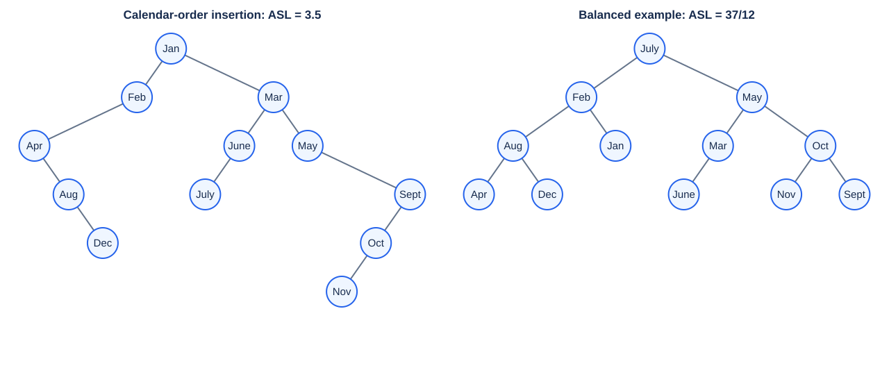

| Example / checkpoint | Calculation | Answer |
| --- | --- | --- |
| Calendar-order insertion, Jan → Dec | Total comparisons / 12 | $42/12=3.5$ |
| Q1: pictured balanced tree, root July | $(1+2\cdot2+4\cdot3+5\cdot4)/12$ | $37/12\approx3.1$ |
| Q2: skewed（退化）12-node tree | $(1+2+\cdots+12)/12$ | $6.5$ |

Month keys use **alphabetic order**. Balanced need not mean complete or uniquely determine ASL.

## 2. AVL trees（AVL 高度平衡树）

### 2.1 Definition and metadata（定义与辅助信息）

**AVL = BST + recursive height balance** (Adelson-Velskii–Landis, 1962): empty trees are balanced; every node has balanced subtrees whose heights differ by at most 1.

$$
h(\varnothing)=-1,\qquad
h(v)=1+\max(h(v_L),h(v_R)),\qquad
BF(v)=h(v_L)-h(v_R)\in\{-1,0,1\}.
$$

**BF（平衡因子）= left height − right height.** Leaf height 0; test every node, not just the root.

Cache BF/height and update in $O(1)$ per ancestor on return; traversing subtrees to recompute heights loses the logarithmic bound.

### 2.2 Insertion and rotations（插入与旋转）

BST insert → update upward → repair **lowest unbalanced ancestor** (trouble finder). The inserted key is the troublemaker; classify its first two directions from that ancestor, even if deeper.

| Case（失衡路径） | Repair（修复动作） |
| --- | --- |
| LL | Right rotation（右单旋）at the trouble finder. |
| RR | Left rotation（左单旋）at the trouble finder. |
| LR | Left rotation at its left child, then right rotation at the trouble finder. |
| RL | Right rotation at its right child, then left rotation at the trouble finder. |

**易混点：**RR 描述“右—右”的失衡路径，修复动作却是左旋；LL/RR 不是旋转方向。

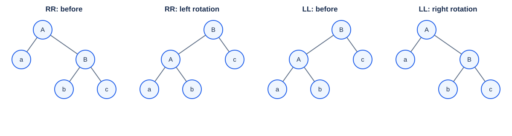

**RR preserves inorder order:** $a<A<b<B<c$; promote B and move its old left subtree b to A.right. LL is symmetric.

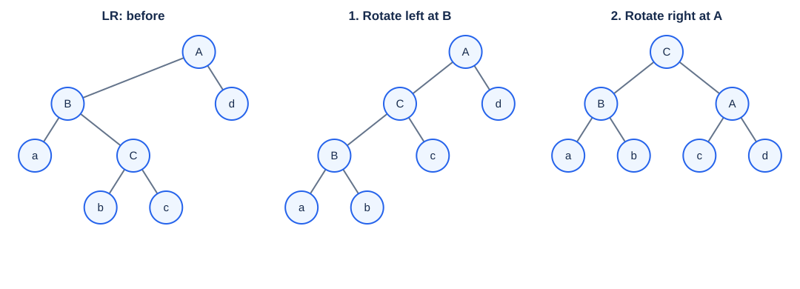

**LR:** promote middle key C; preserve $a<B<b<C<c<A<d$. C.left moves to B.right and C.right to A.left. RL is symmetric; either insertion branch below C uses the same pattern.

Each rotation changes $O(1)$ pointers/metadata; reconnect the new subtree root. **Insertion** restores pre-insertion height: one repair site, ≤2 rotations. Update metadata even without rotation.

**Deletion:** ordinary BST deletion (two children → predecessor/successor), then update/rebalance upward. Height may keep decreasing: $O(\log N)$ repair sites. Heavy-child BF=0 uses a single rotation; the one-site guarantee is insertion-only.

### 2.3 Month-name trace（月名插入）· rotation checkpoints

```text
Mar, May, Nov, Aug, Apr, Jan, Dec, July, Feb, June, Oct, Sept
```

| Insert | Trouble finder | Case | Promoted root |
| --- | --- | --- | --- |
| Nov | Mar | RR | May |
| Apr | Mar | LL | Aug |
| Jan | May | LR | Mar |
| Feb | Aug | RL | Dec |
| June | Mar | LR | Jan |
| Oct | May | RR | Nov |

Other insertions, including Dec, July and Sept, need metadata updates but no rotations.

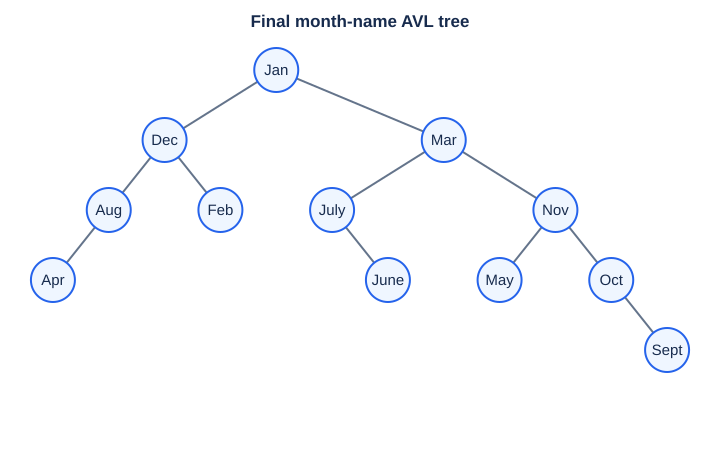

**Single rotations Q1:** B’s old left subtree becomes A.right (keys between A and B). **Q2:** inserting Apr involves **Mar,Aug,Apr**; repair LL at Mar first.

**Double rotations Q1:** after inserting **June**, which statement is false?

- **A.** July is the parent of Jan.
- **B.** Jan is the root.
- **C.** Mar is the parent of May.
- **D.** Aug and Feb are siblings.

**A.** LR promotes Jan above Dec and Mar; Jan is above July. Dec has children Aug/Feb; Mar.right=May. Use this intermediate tree, before Oct/Sept.

### 2.4 Height bound（高度界）· Quiz 1.1 Q2 / HW1 MC1

Let $n_h$ be the **minimum node count（最少节点数）** of a height-$h$ AVL tree. Minimal subtrees have heights $h-1,h-2$:

$$
n_{-1}=0,\qquad n_0=1,\qquad
n_h=1+n_{h-1}+n_{h-2}=F_{h+3}-1,
$$

$F_0=0,F_1=1$; apply the Fibonacci recurrence to $n_h+1$. Let $\varphi=(1+\sqrt5)/2$.

$$
F_k=\frac{\varphi^k-(-\varphi)^{-k}}{\sqrt5},\qquad
n_h=\Theta(\varphi^h),\qquad
N\ge n_h\Longrightarrow h=O(\log N).
$$

Leading height coefficient $1/\log_2\varphi\approx1.44$; Find/Insert/Delete are worst-case $O(\log N)$.

**Question:** minimum nodes at tree depth 6, with empty depth −1? A. 13; B. 17; C. 20; D. 33.

| $h$ | −1 | 0 | 1 | 2 | 3 | 4 | 5 | 6 |
| --- | --- | --- | --- | --- | --- | --- | --- | --- |
| $n_h$ | 0 | 1 | 2 | 4 | 7 | 12 | 20 | 33 |

**Answer: D**, $n_6=1+20+12=33$. Here tree depth means height（最大节点深度）.

**下标警告：**empty height −1 / leaf height 0 → $F_{h+3}-1$; empty height 0 / leaf height 1 → $F_{h+2}-1$. 视频和课件的下标不完全一致，先核对高度约定。

## 3. Splay trees（伸展树）

### 3.1 Target（目标）

**Self-adjusting BST（自调整二叉搜索树）：** splay the accessed node to the root; no BF/height field is needed for balance maintenance. The tree need not remain height-balanced.

For $M$ operations starting **empty**, with at most $N$ keys present:

$$
T(M)=O(M\log(N+1)),\qquad
T_{\mathrm{amortized}}=O(\log(N+1)).
$$

One operation may cost $\Theta(N)$; immediately reaccessing its root costs $O(1)$.

**MOOC Target: “AVL is a splay tree.”** Accepted **True** means AVL meets the same sequence-cost target; as a data-structure identity it is **False**.

### 3.2 Move-to-root fails（朴素移至根策略的反例）

**Naive move-to-root fails:** insert $1,\ldots,N$ in $O(N)$ total to form a left chain rooted at N. Each sweep accessing $1,\ldots,N$ costs $\Theta(N^2)$ and restores that chain.

Comparison count: Find(1) costs $N$; Find($i\ge2$) costs $N-i+2$:

$$
N+\sum_{i=2}^{N}(N-i+2)=\frac{N^2+3N-2}{2}=\Theta(N^2).
$$

**MOOC Single rotations: C, $\Theta(N^2)$.** Rotation order must control damage to other nodes, not merely move the current key upward.

### 3.3 Splaying steps（伸展步骤）

Let $x$ be accessed, $p$ its parent（父节点）, $g$ its grandparent（祖父节点）. Repeat **bottom-up（自底向上）** until $x$ is root:

| Case | Condition | Rotation order |
| --- | --- | --- |
| Zig（单旋） | $p$ is root | Rotate $x$ with $p$; terminal step（最后一步）. |
| Zig-zag（异向双旋） | $x,p$ on opposite sides | Rotate $x$ with $p$, then $x$ with $g$. |
| Zig-zig（同向双旋） | $x,p$ on the same side | Rotate **$p$ with $g$ first**, then **$x$ with $p$**. |

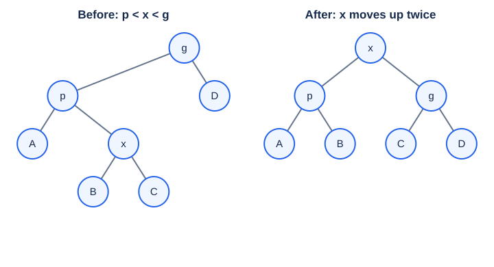

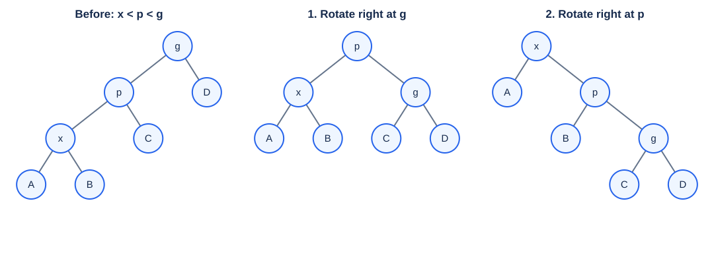

**Zig-zig rotates p/g first.** Both double cases use two primitive rotations, regardless of the slide’s “single rotation” label.

Reconnect hanging subtrees, parent links and the root; bottom-up splaying needs parent pointers or a saved path stack.

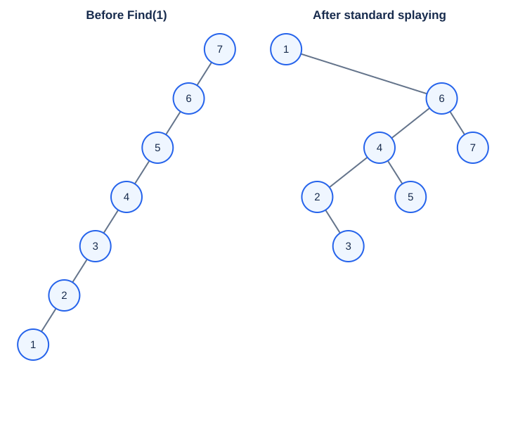

The 7-node/32-node examples shorten access paths; neither every node depth nor total height must halve. The guarantee is amortized.

### 3.4 Operations（操作）

| Operation | Procedure |
| --- | --- |
| Find | BST search, then splay the found node; on failure, splay the **last visited node** if nonempty. |
| FindMin / FindMax | Find and splay the extreme key（最小／最大键）. |
| Insert | BST leaf insertion, then splay the new node; under set semantics, splay an existing duplicate without adding a copy. |
| Delete | Find/splay target → remove root → join remaining subtrees（合并子树）. |

**Join:** if either side is empty, return the other. Otherwise splay $\max(L)$ (no right child) and attach R there; symmetrically splay $\min(R)$ and attach L. BST order holds because all L keys < all R keys. Reset parent links.

**Quiz 1.2 Q2:** “Finding the maximum leaves the root with no right subtree.” **True** when FindMax includes splaying: any right child would contradict maximality（最大性）.

### 3.5 AVL vs. Splay（比较）

| Property | AVL | Splay |
| --- | --- | --- |
| Shape invariant（树形约束） | Recursive height balance | BST order only |
| Balance metadata（平衡辅助信息） | BF / height | None; still needs parent/path machinery |
| Successful find | No restructuring | Splays unless already root |
| Worst case per operation（单次最坏情况） | $O(\log N)$ | $O(N)$ |
| Amortized standard operations（摊还界） | $O(\log N)$ | $O(\log N)$ |
| Tradeoff（取舍） | Predictable latency（延迟） | Access locality（访问局部性）, but more writes/rotations |

Compare random/sorted inputs, hot keys, failed searches and mixed updates using comparisons, rotations, total time and maximum latency. Splay favors locality but has no per-request real-time bound; neither structure is universally faster.

## 4. Amortized analysis（摊还分析）

### 4.1 What is bounded?（保证的对象）

| Bound | Meaning | Probability assumptions（概率假设） |
| --- | --- | --- |
| Worst-case（最坏情况） | Every individual operation | None |
| Amortized（摊还） | Total cost of every valid sequence, divided by its length | None |
| Average-case（平均情况） | Expected cost under a specified distribution（分布） | Required |

For one cost model, worst-case per-operation guarantee ⇒ amortized sequence guarantee ⇒ expected sequence bound under any distribution. This compares **guarantees**, not numerical complexity values.

Example: deterministic quicksort averages $O(N\log N)$ over random permutations but can take $O(N^2)$; amortization requires no input distribution.

**Quiz 1.3 Q2:** amortized $O(\log N)$ implies worst-case $O(\log N)$? **False**; a splay access can be linear.

### 4.2 Stack + MultiPop（栈与批量弹出）: three methods

```text
MULTIPOP(S, k):
    while k > 0 and S is not empty:
        POP(S)
        k = k - 1
```

For $k\ge0$, let $k'=\min(k,|S|)$. Count each elementary push/pop as 1: MultiPop removes $k'$ objects. With call/loop overhead, runtime is $\Theta(1+k')$.

**Aggregate（聚合）：** from empty, each object is pushed/popped once. For P≤m pushes, total element work ≤2P≤2m; $m-1$ pushes + one MultiPop attain $2m-2$. Empty pops cannot repeat removal work. With $s_0$ initial objects, total is $O(m+s_0)$, including call overhead.

**Accounting（记账）：** charge $\widehat c_i$, pay $c_i$, retain the difference as credit. Credit must be nonnegative after **every prefix**:

$$
\sum_{i=1}^{j}(\widehat c_i-c_i)\ge0
\Longrightarrow\sum_{i=1}^{j}c_i\le\sum_{i=1}^{j}\widehat c_i.
$$

| Operation | $c_i$ | $\widehat c_i$ | Credit change |
| --- | --- | --- | --- |
| Push | 1 | 2 | +1 |
| Successful Pop | 1 | 0 | −1 |
| MultiPop | $k'$ | 0 | $-k'$ |

One credit per object gives nonnegative credit = stack size and total charge $2P=O(m)$. Zero charge means prepaid, not zero work; add call overhead. Charges 3/1/1 also work. Accounting charges may differ by operation; aggregate uses a uniform average.

**Potential（势能）：** $D_i$ is the state after operation i; $\Phi(D_i)$ stores state-wide credit:

$$
\widehat c_i=c_i+\Phi(D_i)-\Phi(D_{i-1}),\qquad
\sum_{i=1}^{m}c_i=\sum_{i=1}^{m}\widehat c_i+\Phi(D_0)-\Phi(D_m).
$$

Telescoping cancels intermediate potentials. Charges bound every prefix if $\Phi(D_j)\ge\Phi(D_0)$; usually set $\Phi(D_0)=0$, $\Phi\ge0$. Adding a constant changes no charge. Otherwise retain the initial/final boundary term.

For the stack, $\Phi(D)=|S|$: changes $+1,-1,-k'$ reproduce charges $2,0,0$.

**HW1 MC4: which statement is false?**

- **A.** Aggregate analysis yields $T(m)/m$ from a worst-case sequence total $T(m)$.
- **B.** A good potential should always attain its **maximum** initially.
- **C.** Accounting saves excess charges for later expensive operations.
- **D.** Accounting allows operation charges to differ, unlike the uniform aggregate average.

**Answer: B.** An initial **minimum（最小值）** provides the usual upper-bound condition; the actual requirement is the boundary-term inequality.

## 5. Splay amortized proof（伸展树的摊还证明）

### 5.1 Rank and potential（秩与势能）

For a fixed node set, subtree size includes the node itself:

$$
s(v)=|\text{subtree}(v)|,\qquad
r(v)=\log_2 s(v),\qquad
\Phi(T)=\sum_{v\in T}r(v).
$$

**Rank（秩）≠ height**; leaf rank=0. Sizes/ranks are proof tools, not stored fields. Rotations change only the main nodes’ ranks; hanging-subtree and ancestor sizes stay fixed.

**Log lemma:** for positive $a,b,c$, $a+b\le c$ gives $ab\le c^2/4$ by AM–GM:

$$
\log_2a+\log_2b\le2\log_2c-2.
$$

The −2 uses base-2 logs. **Subtree sizes are additive; heights are not.** Replacing rank by height breaks this argument.

### 5.2 Local costs（局部成本）

Use $r$ before, $r'$ after; one primitive rotation costs 1. Let $\Delta=r'(x)-r(x)\ge0$.

**Zig:** $r'(p)\le r(p)$, so

$$
\widehat c=1+r'(x)+r'(p)-r(x)-r(p)\le1+\Delta.
$$

For either two-rotation case, $r'(x)=r(g)$ and $r(p)\ge r(x)$:

$$
\widehat c=2+r'(p)+r'(g)-r(x)-r(p).
$$

| Case | Key size/rank relation | Amortized bound |
| --- | --- | --- |
| Zig-zag | $s'(p)+s'(g)\le s'(x)$ → $r'(p)+r'(g)\le2r'(x)-2$ | $\widehat c\le2+2r'(x)-2-2r(x)=2\Delta$ |
| Zig-zig | Old $x$ subtree and new $g$ subtree are disjoint: $s(x)+s'(g)\le s'(x)$ → $r(x)+r'(g)\le2r'(x)-2$; also $r'(p)\le r'(x)$ | $\widehat c\le2+r'(x)+r'(g)-2r(x)\le3\Delta$ |

Mirror cases are symmetric; rank changes pay for rotations.

### 5.3 Access lemma（访问引理）and boundary terms（边界项）

All nonterminal steps cost at most $3\Delta$; only a final zig contributes +1. Consecutive rank differences of $x$ telescope. With original root $t$,

$$
\widehat c_{\mathrm{splay}(x)}
\le1+3\bigl(r(t)-r(x)\bigr)\le1+3\log_2N.
$$

This bounds rotations + potential change, not one actual access. Search depth is proportional to rotation work. [Sleator–Tarjan, §2](https://www.cs.cmu.edu/~sleator/papers/self-adjusting.pdf).

**Initial state:** $0\le\Phi(T)\le N\log_2N$; an arbitrary initial tree need not minimize it. For M accesses:

$$
\sum c_i\le O(M\log(N+1))+\Phi(T_0)-\Phi(T_M)
\le O((M+N)\log(N+1)).
$$

From empty, initial potential vanishes. **Insert:** splay the last search node, split, add a new root; its rank increases potential by at most $\log(N+1)$. **Delete:** splay/remove target, splay $\max(L)$, attach R; one root rank increases by at most $\log(N+1)$. Thus updates are amortized logarithmic; leaf-insert-then-splay also works.

势能可达 $\Theta(N\log N)$；需控制 $c_i+\Delta\Phi_i$ 及边界项，而非要求总势能只增长 $O(\log N)$。

## 6. Integrated exercises（综合题）

### 6.1 AVL insertion（AVL 插入）· Quiz 1.1 Q1 / HW1 MC2

**Insert $2,1,4,5,9,3,6,7$ into an empty AVL tree. Which is false?**

- **A.** 4 is the root.
- **B.** 3 and 7 are siblings（兄弟节点）.
- **C.** 2 and 6 are siblings.
- **D.** 9 is the parent of 7.

Only three repairs: insert 9 → RR at 4; insert 3 → RL at 2; insert 6 → RL at 5. Root sequence: $2,2,2,2,2,4,4,4$.

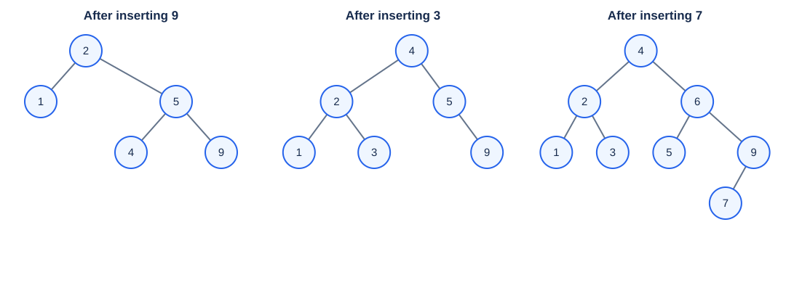

**B.** Final: `4(2(1,3),6(5,9(7,∅)))`; 3/7 have different parents.

### 6.2 Splay accesses（伸展树访问）· Quiz 1.2 Q1 / HW1 MC3

**Access $3,9,1,5$ in order in the following tree. Which final statement is false?**

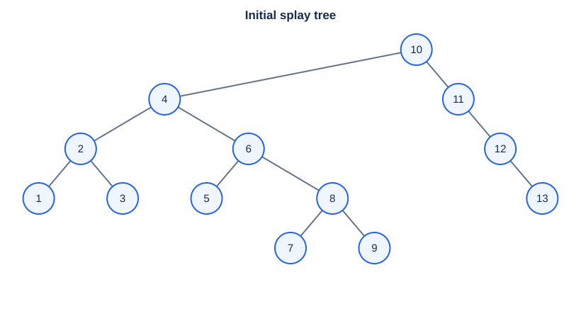

- **A.** 5 is the root.
- **B.** 1 and 9 are siblings.
- **C.** 6 and 10 are siblings.
- **D.** 3 is the parent of 4.

| Access | Steps, from bottom upward |
| --- | --- |
| 3 | Zig-zag (3,2,4); zig (3,10). |
| 9 | Zig-zig (9,8,6); zig-zag (9,4,10); zig (9,3). |
| 1 | Zig-zig (1,2,3); zig (1,9). |
| 5 | Zig-zig (5,6,8); zig-zig (5,4,3); zig-zag (5,2,9); zig (5,1). |

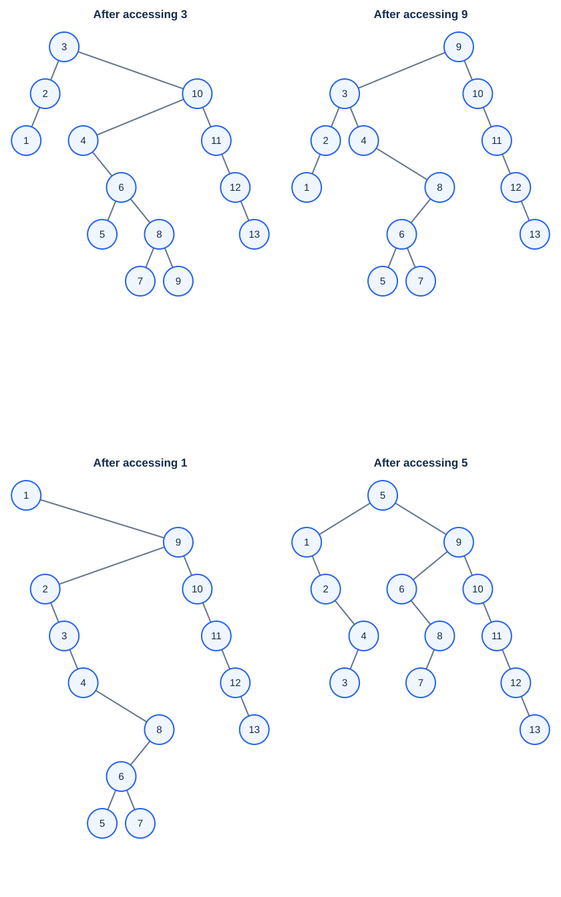

**D.** Final: 5→(1,9), 9→(6,10), **4.left=3**. The chain 10→11→12→13 remains unbalanced.

### 6.3 Buffer doubling（缓冲区倍增）· Quiz 1.3 Q1 / HW1 MC5

**Problem:** initially empty, capacity 1. Insertion costs 1 if space exists; otherwise copy $k$ old items into a doubled buffer and insert, costing $k+1$. A single insertion can cost $\Omega(N)$. Assume the buffer is **full after $N$ insertions**. Which potential works?

- **A.** Number of items.
- **B.** Negative number of items.
- **C.** Number of available blocks.
- **D.** Negative number of available blocks.

**Answer: D.** With occupancy（已用数量）$n$ and capacity（容量）$C$, use $\Phi=n-C$:

| Case | State change | $c_i$ | $\Delta\Phi$ | $\widehat c_i$ |
| --- | --- | --- | --- | --- |
| Space available | $(n,C)\to(n+1,C)$ | 1 | 1 | 2 |
| Resize（扩容） | $(k,k)\to(k+1,2k)$ | $k+1$ | $1-k$ | 2 |

Initially $\Phi=-1$; at the full endpoint $\Phi=0$, giving

$$
\sum c_i=2N-(0-(-1))=2N-1.
$$

Check by aggregate analysis: for power-of-two $N$, copied items $1+2+\cdots+N/2=N-1$, plus $N$ writes. A/B/C give resizing charges $k+2,k,2k$, respectively, so none cancels copying to a constant.

**D depends on the full endpoint:** intermediate potentials may fall below the initial value, so charge 2 need not cover every prefix. For all prefixes use $\Psi=2n-C+1\ge0$ (initially 0), giving charge 3 and total ≤3N; summing copied capacities also gives total <3N.

### 6.4 HW1 programming（编程题）: Root of AVL Tree

[HW1: Root of AVL Tree—题目、样例、完整 C 实现与测试](hw1-avl-root.md)。Cache heights; update demoted node before promoted node.

### 6.5 Week 2 review questions（第二周复习题）

第二周题按知识点归类。

**WK2 MC1: delete 3 from the following splay tree; which statement is impossible?** Input: `7(5(2(1,3(∅,4)),6),9(8,∅))`.

- **A.** 2 is root.
- **B.** 4 is root.
- **C.** 6 and 9 are siblings.
- **D.** 4 is the grandparent of 5.

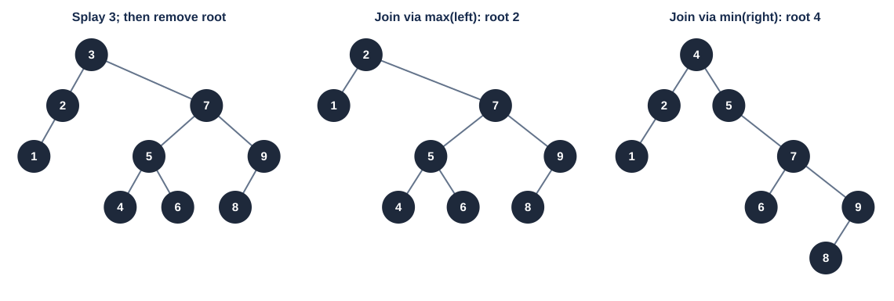

**Answer: D.** Splay 3 by zig-zag `(3,2,5)`, then zig `(3,7)`; remove root 3. Two joins（拼接）are valid:

| Join choice | Result | Options |
| --- | --- | --- |
| Splay max(left) = 2; attach right subtree | `2(1,7(5(4,6),9(8,∅)))` | A possible; 4 is a child of 5. |
| Splay min(right) = 4; attach left subtree | `4(2(1,∅),5(∅,7(6,9(8,∅))))` | B and C possible; 4 is the **parent**, not grandparent, of 5. |

Splay before deleting, then splay the chosen side’s extreme for join. “Impossible” must exclude **both** predecessor/successor joins.

**WK2 MC2: in an AVL tree of height 4, what is the maximum difference between left/right subtree sizes?** Choices **A 1 / B 2 / C 3 / D 5**.

**D: 5**, using **level-count height** (leaf 1, empty 0): subtrees can have heights 3/2 with max/min sizes 7/2. Equal heights 3 give only 7−4=3.

In the note’s edge convention the tree height is 3; true edge-height 4 gives 15−4=11, outside the options. AVL constrains height difference, not size difference.

**WK2 MC3: which amortized-analysis statement is false?**

- **A.** A good potential should always assume its maximum at the start.
- **B.** Accounting saves excess amortized charges as credit for later operations.
- **C.** Aggregate analysis bounds total $T(n)$ for every sequence length $n$, giving $T(n)/n$ per operation.
- **D.** Accounting can assign different amortized costs to different operations, unlike the uniform aggregate average.

**A**, the same potential condition as HW1 MC4, with reordered options: require $\Phi(D_j)\ge\Phi(D_0)$, usually an initial minimum.

**WK2 programming fill-in: RR rotation（右右失衡修复）.** Fill the pointer reassignment and new-root height in the given AVL function. The archive mixes `Tree L`, variable `R`, and `return L`: **变量名笔误**; use `R` consistently.

```c
Tree RR_Rotation(Tree T)
{
    Tree R = T->right;
    T->right = R->left;
    R->left = T;  /* blank 1 */
    T->h = maxh(Height(T->left), Height(T->right)) + 1;
    R->h = maxh(Height(R->left), Height(R->right)) + 1; /* blank 2 */
    return R;
}
```

The blanks are **`R->left = T`** and **`maxh(Height(R->left), Height(R->right))`**; the latter can use `T->h` for `Height(R->left)` after updating T. RR needs a **left rotation（左旋）**; update the demoted node before the promoted node. Time and extra space: $O(1)$; requires `T != NULL` and `T->right != NULL`.

## 7. Review and references（复习与来源）

资料：慕课、线下记录及小测／作业；配图沿用课程／PTA 图或重绘。

Weiss C 2nd ed.: Ch.4 pp.106–128, Ch.11 pp.447–451; code Figs.4.42–4.48, splay Figs.4.52–4.60. CLRS 3rd ed.: pp.451–478. [Sleator–Tarjan (1985), §2](https://www.cs.cmu.edu/~sleator/papers/self-adjusting.pdf).
