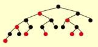
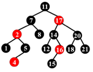
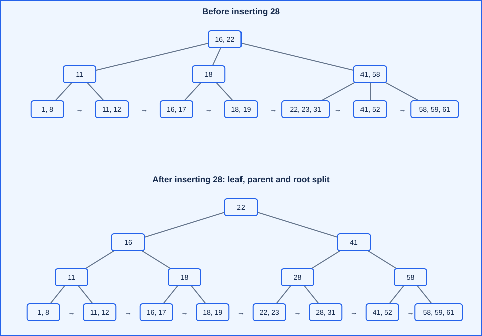
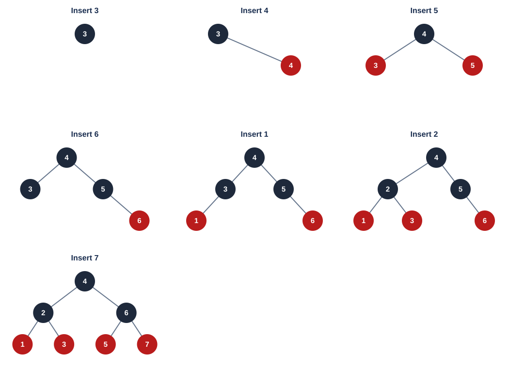
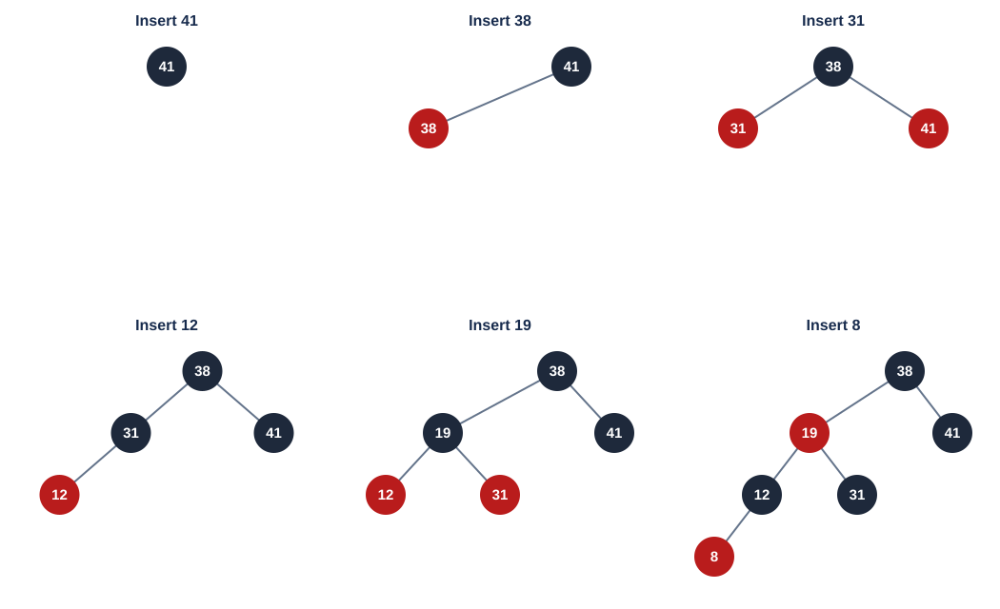
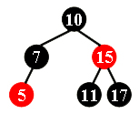
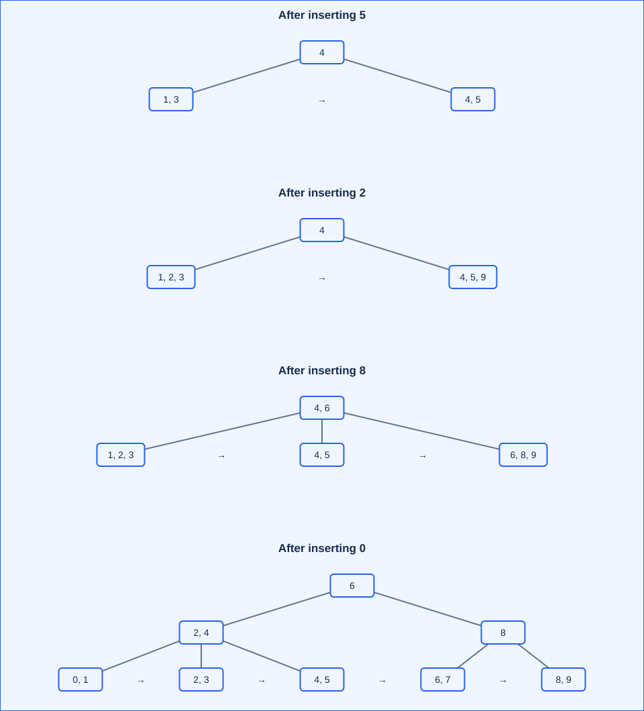
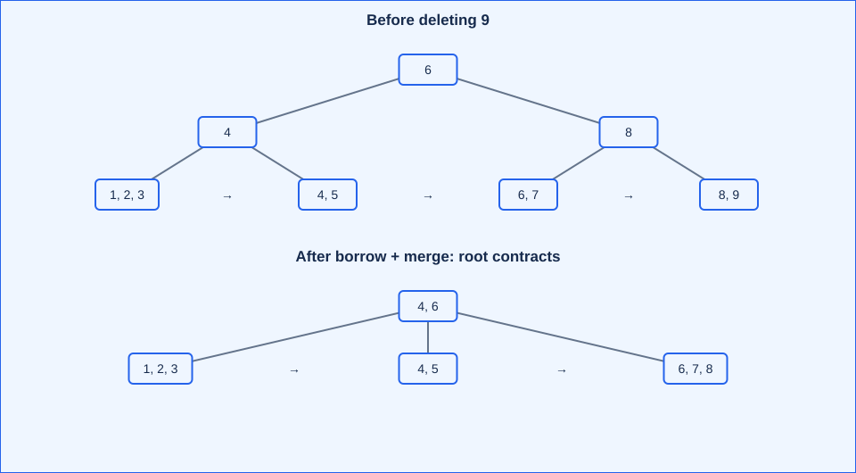

# Lecture 2: Red-Black Trees and B+ Trees

**RBT:** black-height balance（黑高平衡）. **B+:** multiway branching（多路分支）to reduce page accesses.

[Course overview（课程信息）](index.md) · [Lecture 1（上一课时）](lecture-01-avl-splay-amortized-analysis.md)

## 1. Red-black trees（红黑树）

### 1.1 Definition and NIL（定义与外部叶子）

A **red-black tree, RBT** is a BST satisfying five properties:

1. Every node is **red or black（红或黑）**.
2. The **root is black（根为黑）**.
3. Every **NIL leaf is black（空叶子为黑）**.
4. A red node has two black children: **no adjacent red nodes（无相邻红节点）**.
5. From **each node**, all simple paths（简单路径）to descendant NIL leaves contain the **same number of black nodes（黑节点数相同）**.

**Internal node（内部节点）:** any real key-bearing node. **NIL/external leaf（空叶子）:** missing child, not a terminal real node; include every NIL when checking black-height.

Fields: `key,left,right,parent,color`. Color needs one logical bit; parent links support upward repair. Actual memory depends on alignment.

$N$ real nodes have $2N-(N-1)=N+1$ missing child pointers. One shared black **sentinel（哨兵）** suffices; deletion must track the relevant missing position’s parent.

### 1.2 Black-height and height bound（黑高与高度界）

**Black-height, $bh(x)$（黑高）：** number of black nodes from $x$ to a NIL leaf, **excluding $x$, including NIL**. Set $bh(\mathrm{NIL})=0$; $bh(T)=bh(\mathrm{root})$.

$h(x)$ counts edges to the farthest NIL: $h(\mathrm{NIL})=0$, singleton h=1, one greater than Lecture 1’s real-leaf height for a nonempty tree.

For a real node $x$ and its child $y$:

$$
bh(y)=\begin{cases}
bh(x)-1,&y\text{ is black},\\
bh(x),&y\text{ is red}.
\end{cases}
$$

**MOOC 2.1.2 Q1: A and B.** Child black-height is $bh(x)-1$ or $bh(x)$, decided by the **child’s color**, not by $h(x)=k+1$.

**Size lemma（规模引理）：** the subtree rooted at $x$ has at least $2^{bh(x)}-1$ real nodes. Induction on height（按高度归纳）:

- NIL: $0=2^0-1$.
- Both children have smaller height and black-height at least $bh(x)-1$. Hence

$$
\operatorname{size}(x)=1+\operatorname{size}(x_L)+\operatorname{size}(x_R)
\ge1+2\bigl(2^{bh(x)-1}-1\bigr)=2^{bh(x)}-1.
$$

**WK3 T/F10:** “The subtree has no more than $2^{bh(x)}-1$ internal nodes.” **False**: the lemma is a **lower bound（下界）**. A black root with two red terminal children has $bh=1$, but 3 real nodes rather than at most 1.

**MOOC 2.1.2 Q2: prove $bh(T)\ge h(T)/2$.** On a longest root-to-NIL path, exclude the root. Every red node is followed by a black node, and NIL is black; thus at least half the remaining nodes are black. Therefore

$$
N\ge2^{bh(T)}-1\ge2^{h(T)/2}-1
\quad\Longrightarrow\quad
h(T)\le2\log_2(N+1)=O(\log N).
$$

Use **base 2**; in natural logs the bound is $(2/\ln2)\ln(N+1)$, correcting the slide. [Reference](https://www.cs.wm.edu/~tadavis/cs303/ch12sf.pdf), pp.3,31.

Every root-to-NIL path has b black nodes and length b..2b: longest ≤2×shortest. This need not hold for paths ending at ordinary real leaves.

### 1.3 Definition checkpoints（定义题）

| Source | Statement / question | Answer and reason |
| --- | --- | --- |
| MOOC Quiz 2.1 Q1; WK2 T/F9 | Farthest-leaf path ≤ twice nearest-leaf path. | **True**, by the path-ratio argument above. |
| MOOC Quiz 2.1 Q2 | If a red node has two children, their colors must agree. | **True**: both are black, including NIL children. |
| WK2 T/F6 | Every two-real-node RBT contains a red node. | **True**: black root + red child. A black child would give unequal black counts against the missing branch. |
| WK3 T/F6 | A black node with two children may have differently colored children. | **True**: root `10B`, left `5R` with children `3B,7B`, right `15B` is valid; black-height balance does not require sibling colors to match. |
| WK2 T/F3 | Every three-real-node RBT contains a red node. | **False**: a black root with two black children is valid. |

**WK3 MC1:** 3 internal nodes, count distinct structures/colors: A1/B2/C3/D>3 → **B: 2** for fixed ordered keys. Only root+two children, both red or both black; a chain violates black-height or red-red.

**MOOC 2.1.1 Q1: True.** No red-red edge; all missing-child black counts agree. AVL balance is unnecessary.



**WK2 T/F4: is the following BST a valid red-black tree? — False.**



At red 16: `16→NIL` has one black node, `16→15→NIL` has two. A red node cannot have exactly one real child; a black one-child node can have only a red terminal child.

### 1.4 Offline discussion: can we omit NIL?（去掉 NIL 的等价定义）

**Question:** remove “every NIL leaf is black”; how should the remaining definition change?

Keep the black root/no-red-red rules. From **each x**, require equal black counts to every descendant real node of **degree 0 or 1**, including that endpoint; if x has degree <2, include its zero-edge path. Count x consistently.

Each such endpoint represents a missing-child path; adding black NIL increases every count by one. Checking only ordinary leaves fails for a black root with one black child. NIL/sentinel handling is simpler.

## 2. RBT operations（红黑树操作）

### 2.1 Bottom-up insertion（自底向上插入）

BST insert **red** → repair red-red → root black. Red insertion preserves black counts. **WK2 TF1** (“insert black”): **False**, except final root blackening.

z=current red node, p=parent, g=grandparent, u=uncle（叔）. Stop at black p. Below assumes p=g.left; mirror otherwise.

| Case | Condition | Action | Next |
| --- | --- | --- | --- |
| 1: red uncle（红叔） | $p,u$ red | Make $p,u$ black and $g$ red. | Set $z=g$; conflict may propagate upward. |
| 2: triangle（折线） | $u$ black, $z=p_R$ | Left-rotate at $p$. | Convert to Case 3; update node roles. |
| 3: line（直线） | $u$ black, $z=p_L$ | Make $p$ black, $g$ red; right-rotate at $g$. | Local conflict resolved. |

NIL is a black uncle. Case 1 can recolor upward $O(\log N)$ times; Cases 2–3 need ≤2 rotations total. BST order and path black counts are preserved, except a uniform increase when the root becomes black. Total $O(\log N)$.

**Example:** 5 below black 7 needs no repair. Insert 4 below red 5: recolor 5/8 black, 7 red; conflict 7–2 under 11 with black uncle 14 → rotate left at 2, recolor, rotate right at 11. New root 7B.

### 2.2 Top-down insertion（自顶向下插入）· offline discussion

**Question:** can repairs happen while descending, before insertion at the bottom?

A standard approach splits “black parent + two red children” configurations on the search path:

1. At such a node $x$, **color flip（翻色）**: $x$ red, both children black. Paths through this configuration keep the same black count; if $x$ is root, make it black again.
2. If this produces a red-red edge with $x$'s parent, immediately use a line/triangle rotation and recoloring. Earlier splits ensure that the uncle is black in the standard scheme.
3. Continue on the correct search branch in the **updated tree**, maintaining parent/grandparent links. Insert the final red node and perform the local conflict repair if needed; keep root black.

Repair actual red-red conflicts caused by flips. [Top-down scheme](https://www.cs.wm.edu/~tadavis/cs303/ch12sf.pdf), pp.5–8.

Both schemes take $O(\log N)$; top-down may do unnecessary flips, bottom-up may stop at a black parent. The ≤2 rotation bound applies to **bottom-up** insertion; iteration alone implies no speed advantage.

### 2.3 Deletion: where the deficit comes from（删除与黑色亏缺）

**BST deletion:** no child→remove; one child→splice; two children→copy predecessor/successor key and remove that node (≤1 child).

Copy the replacement key but **retain the original position’s color**. Repair depends on the **original color of the physically removed node**; pointer transplants must preserve this distinction.

- Remove a red node → black counts unchanged.
- Remove a black node with a red replacement child → color that child black; deficit absorbed.
- Remove a black node with a black/NIL replacement → its branch lacks one black node. Track the replacement position $x$ with an **extra black / double black（额外黑色／双黑）** marker for analysis, not an additional stored color.

Repair one missing black node, or propagate the deficit to the root and discard it. Repairing before cutting a black leaf is equivalent to the post-removal cases below.

### 2.4 Four deletion cases（四种删除修复情况）

Assume deficit x=p.left, sibling w=p.right; w.left=near nephew（近侄）, w.right=far nephew（远侄）. Mirror for a right deficit.

| Case | Condition | Repair | Result |
| --- | --- | --- | --- |
| 1 | $w$ red; $p$ necessarily black | $w$ black, $p$ red; left-rotate $p$; recompute $w$. | New sibling black; deficit remains. |
| 2 | $w$ black; both children black | Make $w$ red; move extra black to $p$. | Red $p$ becomes black and stops; black $p$ propagates upward. |
| 3 | $w$ black; near red, far black | Near child black, $w$ red; right-rotate $w$; recompute sibling. | Converts to Case 4. |
| 4 | $w$ black; far red, near arbitrary | $w$ takes $p$'s color; $p$ and far child become black; left-rotate $p$. | Deficit resolved; stop. |

**MOOC 2.2.3 Q1:** after Case 1, the new red parent’s right child was red sibling w’s left child; the no-red-red rule already forced it black.

**Why at most three rotations?（为何最多三旋？）** Case 2 may repeat up to the root but uses **no rotations**. Once Case 1 occurs, its red parent either absorbs Case 2 or leads to terminating Cases 3–4. Thus at most one each of Cases 1, 3, 4. Recoloring/upward traversal can still take $O(\log N)$ time.

At root, discard the extra-black marker: all surviving paths are balanced with one lower black-height. **WK2 T/F7: DELETE requires $\Omega(\log n)$ rotations in the worst case — False.** Rotation count is $O(1)$ for this algorithm; total time is $O(\log n)$.

**MOOC sequential example:** initial tree is `10B(5B(3B,7R(6B,8B)),15B(11B,17B))`; omitted children are NIL.

| Delete | Case trace | Result summary |
| --- | --- | --- |
| 3 | Red sibling 7: Case 1; then red parent 5 + black sibling 6: Case 2. | Left subtree becomes `7B(5B(∅,6R),8B)`. |
| 17 | Mirrored Case 2 at 15; Case 2 again at 10; deficit reaches root. | 11 red, 7 red; global black-height decreases by 1. |
| 8 | Mirrored Case 3 at sibling 5, then mirrored Case 4 at 7. | Left subtree `6R(5B,7B)`; root remains 10 black. |

Notation: `keyColor(left,right)`; terminal entries have two NIL children.

### 2.5 RBT versus AVL（红黑树与 AVL）

| Property | AVL | RBT, bottom-up algorithm |
| --- | --- | --- |
| Invariant（不变量） | Local height difference ≤1 | Equal black counts + no red-red edges |
| Worst-case Find / Insert / Delete | $O(\log N)$ each | $O(\log N)$ each |
| Single rotations per insertion | ≤2 | ≤2 |
| Single rotations per deletion | $O(\log N)$; can cascade | ≤3; recoloring can cascade |
| Typical tradeoff（取舍） | Tighter height bound benefits search-heavy workloads | Bounded deletion rotations benefit update-heavy workloads |

RBTs implement ordered maps/sets. Runtime constants depend on workload/layout; fixed speed ratios, “AVL half the height”, and “iteration always faster” are not complexity guarantees.

Hash tables give expected $O(1)$ point operations under suitable hashing/load control, but lose key order/range access and can suffer worst-case collisions.

## 3. B+ trees（B+ 树）

### 3.1 Block storage and the course convention（块存储与本课约定）

**Block-oriented storage（块存储）：** pack sorted keys into pages; higher **fanout（扇出）** reduces page visits. Used in database/file-system indexes; pointer trees may scatter nodes. Track/sector details are disk-specific.

For order（阶）$M\ge3$, let $q=\lceil M/2\rceil$:

1. The root is a leaf, or has **2 to $M$ children**.
2. Every nonroot internal node has **$q$ to $M$ children**.
3. **All leaves have the same depth（所有叶子同深）**.
4. In the course's simplified model, every nonroot leaf stores **$q$ to $M$ data keys**. Leaf entries are data, not child subtrees.

With d children, store **d−1 separators（分隔键）**: each is the minimum of its right child subtree; omit the first child’s minimum. Leaves alone hold sorted data or `(key,record pointer)` entries; internal keys duplicate leaf keys. **WK3 TF11: True** for k children/k−1 minima.

**Course terms:** order-3/4 B+ trees are called “2-3/2-3-4 trees” by internal child count. Classical B/2-3 trees may store internal records; their split rule cannot replace B+ leaf splitting, which **retains all records and copies a separator**.

**Root exception:** a root-leaf may be empty or below q; an internal root has ≥2 children. Real designs may separate leaf capacity L from order M; **L=M is this course’s model**. [Separate capacities example](https://www.cs.cornell.edu/courses/cs433/2006fa/Assignments/Assignment3.htm).

### 3.2 Find, range scan, insert（查找、范围扫描与插入）

**Find:** binary-search separators, follow a child (equality goes right), then binary-search the leaf; a separator match is not a record.

MOOC example: root `[22]`, next node `[41,58]`; Find 52 follows the right root child, then the middle block `[41,52]`.

**Range scan（范围扫描）:** descend to the first leaf, follow leaf links to the upper bound. Leaf pages need not be physically adjacent.

**Insertion with splitting（分裂插入）：**

```text
Find the target leaf and insert the key in sorted order.
While the current node overflows:
    If leaf: split its M+1 data entries into ceil/floor halves;
             copy the minimum of the right half into the parent.
    If internal: split its M+1 child pointers into ceil/floor halves;
                 rebuild separators from subtree minima.
    Add the right node to the parent; update affected separators.
    If the old root split: create a root with two children; stop.
    Otherwise continue at the parent.
```

Overflow = **M+1 data keys in a leaf**, **M+1 children/M separators internally**. Only a root split increases height; all leaves stay at equal depth.

### 3.3 Split cascade and redistribution（连锁分裂与重分配）

MOOC initial leaves: `[8,11,12] [16,17] | [22,23,31] [41,52] [58,59,61]`; root `[22]`, first-level nodes `[16]`, `[41,58]`.

| Insert | Change |
| --- | --- |
| 18 | `[16,17] → [16,17,18]`; no split. |
| 1 | Full `[8,11,12] → [1,8] [11,12]`; parent becomes `[11,16]`. |
| 19 | `[16,17,18] → [16,17] [18,19]`; parent has four children and splits; root becomes `[16,22]`. |
| 28 | `[22,23,31] → [22,23] [28,31]`; parent and root also overflow; new root `[22]`. |



**MOOC 2.3.2 Q1: after inserting 28, which is false?**

- **A.** A new root is generated — true.
- **B.** No node is full — **false**: leaf `[58,59,61]` still has three keys.
- **C.** 28 also occurs in an interior node — true.
- **D.** 22 also occurs in the root — true.

Insert 70: instead of splitting, redistribute `[41,52]` and `[58,59,61,70]` → `[41,52,58]`, `[59,61,70]`; separator 58→59. Bounded sibling redistribution improves occupancy; scanning many siblings adds work. Simple splitting is easier to implement.

### 3.4 Deletion and root contraction（删除与根收缩）

Find and remove the leaf entry; update separators if a subtree minimum changes.

- If occupancy remains ≥ $q$, stop.
- **Borrow / redistribute（借用／重分配）** from an adjacent sibling with > $q$ entries/children; adjust separators.
- Otherwise **merge（合并）** with a sibling and remove one parent child-pointer; an underfull parent propagates repair upward.
- If an internal root has **one surviving child**, promote that child and reduce height. If the root-leaf becomes empty, represent the empty tree.

Remove a root only when it has one surviving child. Internal repair moves child pointers/rebuilds separators; leaf data stay in leaves.

### 3.5 Complexity and choice of order（复杂度与阶数选择）

Bounds below assume L=M, sorted arrays, binary search and $3\le M\le N$. A root-only tree has Find $O(\log(N+1))$.

$$
\operatorname{Depth}(M,N)=O\!\left(\left\lceil\log_q N\right\rceil\right)
=O\!\left(\frac{\log N}{\log M}\right),\qquad q=\lceil M/2\rceil.
$$

Worst-case height depends on minimum fanout q. Order 2 permits unary nonroot nodes here, so $\log_1N$ and this height proof do not apply.

| Cost model（成本模型） | Find | Insert / Delete, worst case |
| --- | --- | --- |
| CPU comparisons / array movement | $O(\log M)$ per level → **$O(\log N)$** | $O(M)$ shifts/split/merge per level → **$O((M/\log M)\log N)$** |
| Page accesses（页访问次数）, each node fits one page | $O(\log_M N)$ | $O(\log_M N)$ pages along the repair path |

**WK2 TF10 / WK3 TF8: True** for binary-search Find $O(\log N)$ under valid degree assumptions. Linear separator scans instead cost O(M) per level.

Fixed M gives logarithmic operations. Larger M trades fewer levels for more array movement; $M/\ln M$ is minimized at $M=e$, motivating CPU order 3/4. Disk capacities instead depend on page/key/record sizes and I/O cost.

### 3.6 B-tree versus B+ tree（B 树与 B+ 树）· offline discussion

| Aspect | Classical B-tree（经典 B 树） | B+ tree |
| --- | --- | --- |
| Real records | Internal nodes and leaves | Leaves only; internal keys are an index |
| Point lookup | May finish at an internal node | Always descends to a leaf; more uniform path depth |
| Internal-page space | Also stores record payload/references | More space for separators/pointers; often higher fanout |
| Sorted traversal / range scan | Traversal across internal and leaf records | One descent + sequential leaf-chain scan |
| Maintenance | Internal records participate in deletion/replacement | Separators and leaf records have distinct roles |

Compact internal indexes and linked dense leaves suit large records/range scans. Higher fanout may reduce height; neither universally lower height nor physical leaf adjacency follows. Workload/layout matter more than coding convenience.

### 3.7 Structural checkpoints（结构题）

| Source | Statement / question | Answer / explanation |
| --- | --- | --- |
| MOOC Quiz 2.3 Q2; WK2 T/F2 | Leaves and nonleaf nodes share some key values. | **True**: separators are copied subtree minima. |
| WK2 T/F5 | An order-$m$ root has at most $m$ subtrees. | **True**: a root-leaf has none; otherwise ≤$m$. |
| HW2 MC5 | Which statement about order-$M$ B+ trees is true? | **C**, shared leaf/internal key values. A: root *always* has 2–$M$ children fails for root-leaf. B: leaves at unequal depths is false. D: *all* nonleaf nodes satisfy $q$–$M$ omits the root exception (e.g. $M=5$, root may have 2 children). |

**MOOC Quiz 2.3 Q1:** an order-3 tree with 21 data keys has at most how many **degree-3 internal nodes**? Choices **A 1 / B 2 / C 3 / D 4**. **Answer: D, 4.**

Let L=leaves, a/b=degree-2/3 internal counts. Each leaf holds ≥2 keys, so $L\le\lfloor21/2\rfloor=10$. Edge counting gives:

$$
2a+3b=a+b+L-1\quad\Longrightarrow\quad L=1+a+2b,
\qquad b\le\left\lfloor\frac{L-1}{2}\right\rfloor\le4.
$$

Attain 4: one degree-3 root plus three degree-3 children → 9 leaves, six holding 2 keys/three holding 3. Degree counts **children**, not leaf records.

**HW2 TF1:** 3 nonleaf nodes in a 2-3 tree hold at most 18 distinct keys → **True**. Equal leaf depth forces root+two internal children → ≤6 leaves ×3 keys. Copied separators add no records.

**WK3 TF7:** 12 leaves, maximum 11 nonleaf nodes? **Course: False; exact max=10.** $I=a+b=L-1-b=11-b$. b=0 would be a full equal-depth binary tree (2ʰ leaves), impossible for 12. Attain b=1 with root degree 3, then levels of 3 and 6 binary internal nodes. **Literal “at most 11” is a valid loose upper bound**; False interprets 11 as attainable maximum.

**WK2 TF8:** after the first of three insertions raises a nonempty 2-3 tree’s height, can the next two raise it again? **False.** The new root starts with two half-full children. Each needs ≥2 insertions to split again; two insertions cannot create the two additional root children required for another overflow.

## 4. Integrated exercises（综合题）

### 4.1 RBT insertion（红黑树插入）· MOOC Quiz 2.2

**Insert `3, 4, 5, 6, 1, 2, 7` into an empty RBT; which statement is false?**

- **A.** The resulting tree is full（每个实节点有 0 或 2 个实孩子）.
- **B.** Root 4 has black-height 2.
- **C.** 3 is the red right child of 2.
- **D.** 5 is the black left child of 6.



**D.** Final `4B(2B(1R,3R),6B(5R,7R))`. Repairs: insert 5→line at 3; 6→recolor; 2→triangle+line at 3; 7→line at 5. Root bh=2 (black child+NIL). Full=0/2 real children; perfect=all levels filled; this tree is both.

### 4.2 RBT insertion（红黑树插入）· HW2 MC1

**Insert `41, 38, 31, 12, 19, 8` into an empty RBT; which statement is false?**

- **A.** 38 is root.
- **B.** 19 and 41 are siblings, both red.
- **C.** 12 and 31 are siblings, both black.
- **D.** 8 is red.



**B.** Final `38B(19R(12B(8R,∅),31B),41B)`; **41 is black**. Repairs: 31→line at 41; 12→recolor; 19→triangle+line at 31; 8→recolor at 19.

### 4.3 RBT deletion（红黑树删除）· HW2 MC2

**Delete 15; which statement must be false?**



- **A.** 11 is the parent of 17, and 11 is black.
- **B.** 17 is the parent of 11, and 11 is red.
- **C.** 11 is the parent of 17, and 11 is red.
- **D.** 17 is the parent of 11, and 17 is black.

**Answer: C.** Two permitted replacement choices:

| Replacement | Repair | Resulting right subtree of 10 |
| --- | --- | --- |
| Predecessor 11 | Keep 15's original red color at the replaced position; physically remove black 11. Case 2 swaps the red parent / black sibling colors. | `11B(∅,17R)` → A possible. |
| Successor 17 | Physically remove black 17; mirrored Case 2. | `17B(11R,∅)` → B and D possible. |

C gives red 11 one real child, violating black-height. “Must be false” excludes both replacement choices.

### 4.4 Order-3 B+ insertion（3 阶 B+ 树插入）· HW2 MC3 / WK3 MC3

**Insert `3, 1, 4, 5, 9, 2, 6, 8, 7, 0` into an empty “2-3 tree” with splitting; which statement is false?**

- **A.** 7 and 8 are in the same node.
- **B.** The parent of the node containing 5 has three children.
- **C.** The first root key is 6.
- **D.** There are five leaves.



**Answer: A.** Final root `[6]`; internal children `[2,4]`, `[8]`; leaves **`[0,1] [2,3] [4,5] | [6,7] [8,9]`**. 7/8 are in different leaves; 5's parent has three children. Splits occur at insertions **5, 6, 7, 0**; insertion 7 also splits the old root.

### 4.5 Order-3 B+ deletion（3 阶 B+ 树删除）· HW2 MC4

**Delete 9 from the pictured tree; which statement is false?**



- **A.** The root is full.
- **B.** The second root key is 6.
- **C.** 6 and 8 are in the same node.
- **D.** 6 and 5 are in the same node.

**D.** `[8,9]→[8]` underflows; minimum sibling `[6,7]` cannot lend → merge `[6,7,8]`. Parent then has one child; merge internal siblings and promote the old root’s sole child. Final root **`[4,6]`**, leaves **`[1,2,3] [4,5] [6,7,8]`**. Full root = 3 children/2 separators.

### 4.6 B+ FindKey（查找代码填空）· WK3 programming

**Fill `while (______)` and `if (______) i++;` to test membership.** Internal nodes have `numKeys+1` children; `order` is irrelevant to this routine.

**Answers: `!node->isLeaf` and `key >= node->keys[i]`.** Complete code, with `ElementType = int`:

```c
#include <stdbool.h>
#include <stddef.h>

typedef int ElementType;
typedef struct BpTreeNode BpTreeNode;
struct BpTreeNode {
    BpTreeNode **childrens;
    ElementType *keys;
    BpTreeNode *parent;
    bool isLeaf;
    int numKeys;
};

bool FindKey(BpTreeNode *const root, ElementType key)
{
    if (root == NULL) return false;
    BpTreeNode *node = root;
    while (!node->isLeaf) {
        int i = 0;
        while (i < node->numKeys) {
            if (key >= node->keys[i]) i++;
            else break;
        }
        node = node->childrens[i];
    }
    for (int i = 0; i < node->numKeys; i++)
        if (node->keys[i] == key) return true;
    return false;
}
```

Equality follows the right child; only leaves confirm membership. Empty root → false; above all separators → last child. Linear scans cost $O(M(h+1))$ for h internal levels; binary-searching nodes gives $O(\log N)$.

## 5. Review and references（复习与来源）

资料：慕课、线下记录及小测／作业；配图沿用课程／PTA 图或重绘。

CLRS 3rd ed.: Ch.13 pp.308–338 (RBT), Ch.18 pp.484–504 (B-trees; distinguish B+). [RBT reference](https://www.cs.wm.edu/~tadavis/cs303/ch12sf.pdf); [B+ implementation](https://www.cs.cornell.edu/courses/cs433/2006fa/Assignments/Assignment3.htm).
