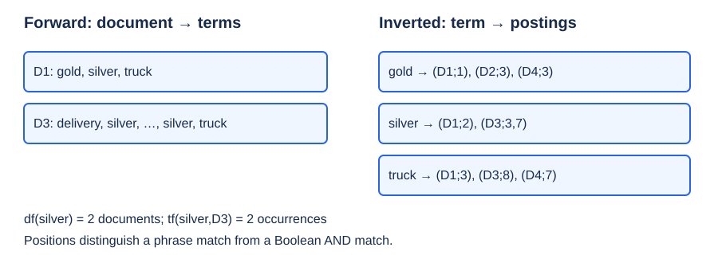
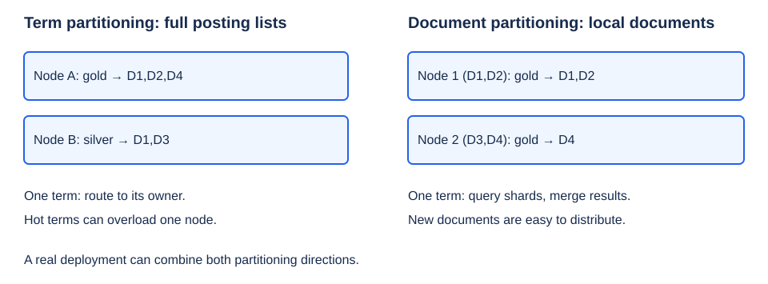
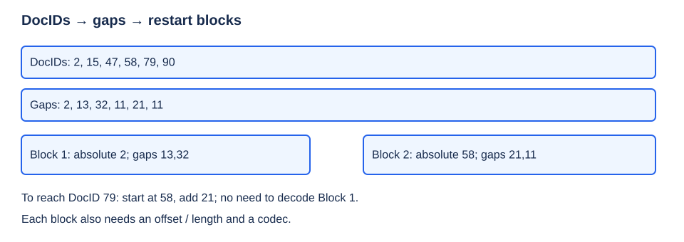
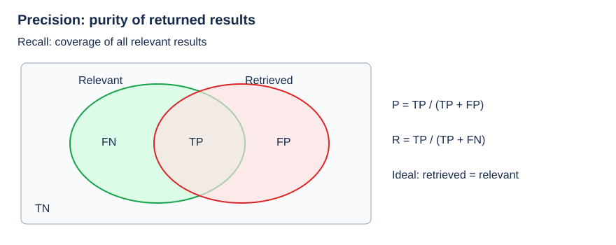

# Lecture 3: Inverted File Index（倒排索引）

**Term → postings → scalable indexing → relevance evaluation.** Search structures locate terms; postings locate documents.

[Course overview（课程信息）](index.md) · [HW3: Document Distance（文档距离）](hw3-document-distance.md)

## 1. Structure and Boolean retrieval（结构与布尔检索）

### 1.1 From scanning to an inverted index（从扫描到倒排）

**Crawl（爬取）→ index（建索引）→ query（检索）.** A crawler/spider collects pages; the index supports repeated queries.

| Approach | Representation | Cost / limitation |
| --- | --- | --- |
| Scan every page（逐页扫描） | Search raw text for each query. | Query work scales with the whole collection's text size. |
| Term-document incidence matrix（词项—文档关联矩阵） | $A[t,d]=1$ iff document $d$ contains term $t$. | Boolean operations are easy, but a dense $V\times N$ matrix wastes space on zeros. |
| Inverted file index（倒排文件索引） | Dictionary entry → list of documents containing the term. | Store nonzero associations; process relevant postings rather than every page. |

$V$=vocabulary size, $N$=document count. Incidence rows may be bitsets; sparse terms favor postings, frequent terms may favor bitmaps.

**Index（索引）:** locates terms. **Forward（正排）:** document→terms; **inverted（倒排）:** term→documents/occurrences. A **posting list（倒排列表）** holds docIDs, offsets or positions—not necessarily pointers or linked nodes.

**WK3 T/F4:** “Inverted file contains a list of pointers to all occurrences of a term in the text.” **True**, by the definition; a document-only index stores document references, and a positional index adds exact occurrence locations.

### 1.2 Course example, positions and frequencies（课件例子、位置与频率）

| Document | Original text |
| --- | --- |
| D1 | Gold silver truck |
| D2 | Shipment of gold damaged in a fire |
| D3 | Delivery of silver arrived in a silver truck |
| D4 | Shipment of gold arrived in a truck |

For this example only: case folding（大小写归一化）, **no stemming or stop filtering**; positions start at 1 in the original token sequence.

| Term（词项） | Incidence D1–D4 | $df$ | Positional postings: `docID: positions` |
| --- | --- | --- | --- |
| a | 0111 | 3 | `2:6; 3:6; 4:6` |
| arrived | 0011 | 2 | `3:4; 4:4` |
| damaged | 0100 | 1 | `2:4` |
| delivery | 0010 | 1 | `3:1` |
| fire | 0100 | 1 | `2:7` |
| gold | 1101 | 3 | `1:1; 2:3; 4:3` |
| of | 0111 | 3 | `2:2; 3:2; 4:2` |
| in | 0111 | 3 | `2:5; 3:5; 4:5` |
| shipment | 0101 | 2 | `2:1; 4:1` |
| silver | 1010 | 2 | `1:2; 3:3,7` |
| truck | 1011 | 3 | `1:3; 3:8; 4:7` |



- **Document frequency, $df(t)$（文档频率）：** number of documents containing $t$; posting-list length when one record is stored per document.
- **Term frequency, $tf(t,d)$（词频）：** occurrence count of $t$ **within document $d$**. For silver, $df=2$, but $tf(\text{silver},D3)=2$ and total occurrences = 3.
- The slide's “Times” uses **$df$**, not total occurrence count. **“低频更重要”和“先处理短列表”中的频率主要指 $df$。**

**Snippets/highlights（摘要／高亮）:** keep original text and token positions; character offsets/sentence boundaries help reconstruct sentences. DocIDs alone cannot. Preserve original positions through filtering for phrase/proximity queries.

### 1.3 Query operations and processing order（查询运算与处理顺序）

- **AND（与）：** intersect document sets. `silver AND truck`: `1010 & 1011 = 1010` → **D1, D3**.
- **OR（或）：** union document sets; **NOT（非）** / exclusion: difference against a specified collection or candidate set.
- **Phrase query（短语查询）:** after finding common documents, require compatible positions. “silver truck” needs a truck at position $p+1$ after silver; D3 matches at positions **7,8**, not 3,8. Boolean AND alone does not enforce adjacency.
- Sorted lists of lengths $a,b$ can be intersected by two pointers in **$O(a+b)$** time: advance the smaller docID, emit equal IDs, stop when either list ends. Skip pointers（跳跃指针）can bypass ranges that cannot match. [Intersection reference](https://nlp.stanford.edu/IR-book/html/htmledition/faster-postings-list-intersection-via-skip-pointers-1.html).

**AND query order:** smallest $df$ first reduces intermediate candidates. `truck AND silver AND delivery`: list lengths 3,2,1 → start `[D3]`, then check silver/truck → **D3**. df guides candidate filtering; within-document tf can guide ranking.

## 2. Index construction and modules（构建与模块）

### 2.1 Generator pipeline（索引生成流程）

```text
For each document D:
    parse tokens; normalize them into terms
    apply the selected stop filter
    for each retained term T and original position p:
        find T in the dictionary; insert it if absent
        get T's posting list
        create/update D's posting: frequency + positions
write the inverted index to disk
```

Repeated occurrences update one document posting, not $df$. Construction and query scoring are separate.

| Module | Responsibility（职责） |
| --- | --- |
| Token analyzer（分词／词元分析器） + stop filter（停用词过滤器） | Parse text, normalize forms, decide retained terms. |
| Vocabulary scanner（词汇表查找器） | Find the dictionary entry for a term. |
| Vocabulary inserter（词汇表插入器） | Create an entry/posting list for a new term. |
| Memory management（内存管理） | Buffer index data, flush to disk, merge partial indexes. |

**Quiz 3.1 / WK3 MC2: which is NOT an index-building step?**

- **A.** Read strings and parse words.
- **B.** Use stemming and stop filtering to obtain terms.
- **C.** Check the dictionary and insert missing terms.
- **D.** Get each term's posting list and calculate precision.

**D:** postings belong to construction; precision needs query results and relevance judgments（相关性标注）.

### 2.2 Tokenization, stemming and stop words（分词、词干提取与停用词）

**Tokenization（分词）：** English whitespace/punctuation help locate boundaries; Chinese needs segmentation. A character match for “陈越” inside an unrelated phrase does not identify a person.

**Stemming（词干提取）：** `process/processing/processes/processed → process`. Index and query must use the same normalization.

A stem need not be a dictionary word. `say/says/said/saying → say` expresses desired grouping; suffix stripping need not handle irregular **said**. **Lemmatization（词形还原）** uses vocabulary/morphology; Porter is a suffix heuristic. [Reference](https://nlp.stanford.edu/IR-book/html/htmledition/stemming-and-lemmatization-1.html).

**Stop words（停用词）：** common terms (`a,the,it`) have huge postings/low discrimination. Optional filtering saves work but must respect context and phrase support: an article explaining “a” needs that term indexed. Exclude from the index, not from source text.

**Quiz 3.2 Q3 / WK3 T/F1:** “Word stemming eliminates commonly used words.” **False**: that describes stop filtering. **HW3 explicitly retains stop words**; do not reuse the lecture's optional filter blindly.

### 2.3 Dictionary access（词典访问）

| Method | Strength | Limitation / qualification |
| --- | --- | --- |
| B/B+ trees（多路搜索树） | Ordered traversal and efficient term ranges; page-oriented layout. | Exact lookup traverses the tree; constants depend on layout. |
| Tries（字典树／前缀树） | Branch on characters; natural prefix access. | Memory/layout and alphabet size matter. |
| Hashing（哈希） | Expected fast exact-word access with suitable hashing/load control. | No lexical order; range scan generally needs examining many entries or an extra ordered index. |

B/B+ pages suit large disk dictionaries. The cited RBT-vs-AVL 10–20% timing is workload-specific; scale, layout and caching determine actual speed.

**MOOC 3.2.2:** hashing favors expected exact lookup but lacks ordered range access; processing key bytes/collisions still costs work.

| Source | Statement | Answer |
| --- | --- | --- |
| Quiz 3.2 Q1 / WK3 T/F2 | B+ dictionary range searches are expensive. | **False**: ordered keys/leaf links support efficient range access. |
| Quiz 3.2 Q2 | Hashing is faster than search trees for term access. | **True in the course's ideal/expected exact-lookup model**, with the qualifications above. |
| HW3 T/F4 | Hash-based dictionary range searches are expensive. | **True** without an additional ordered structure. |

**Spelling correction（拼写纠错）：** generate candidates, then compare similarity. Ordered/prefix indexes help, but lexical proximity ≠ minimum edit distance. Hashing can use a separate correction index; small-domain vocabularies may favor specialized hashes.

### 2.4 Memory-limited construction（内存受限构建）

Build a memory-bounded block; sort/flush near capacity, free buffers, and **flush the final partial block**. Merge by term/docID, combining duplicate postings, counts and positions.

```text
blocks = []
for each parsed occurrence:
    if the next update would exceed memory: flush current block
    update the in-memory dictionary/postings
flush the remaining block
merge all sorted blocks into the final index
```

Sorted blocks allow sequential merge. Reconcile block-local term IDs into one global dictionary.

## 3. Scaling, updates and compression（扩展、更新与压缩）

### 3.1 Distributed indexing（分布式索引）

A cluster node（集群节点）stores an index of part of the collection. Two partition directions:

| Strategy | Local contents | Query / scaling tradeoff |
| --- | --- | --- |
| Term-partitioned（按词项划分） | A subset of dictionary terms, each with its **complete** postings. | Route a single term to its owner; multi-term queries may span nodes. Hot terms/list sizes cause skew（负载倾斜）and difficult rebalancing. |
| Document-partitioned（按文档划分） | A subset of documents and postings restricted to those docIDs. The lecture models a full term dictionary at every node. | Broadcast to document shards（文档分片）, then merge/rank results; add shards for new documents. |



Term/document partitioning can be combined. A document shard may physically omit absent terms; a cluster node is a machine/service, not a tree node.

**Quiz 3.3 Q1 / WK3 T/F13 / WK4 T/F8:** each document-partitioned node contains a subset of documents within a specified index range. **True**: “index” means **document ID range（文档编号区间）** here.

**HW3 T/F1:** document partitioning stores all documents containing terms in a certain **term range** at each node. **False**: this describes term partitioning's allocation by vocabulary, not by docID.

### 3.2 Dynamic indexing（动态索引）

Arrivals add terms/postings; edits/deletions modify old ones. Rewriting a large sorted index for each change is expensive.

Write updates to a small **auxiliary index（增量索引）**; queries merge it with the **main index（主索引）** and filter deletions. Periodically merge/publish a consistent new main index.

**Merge timing:** balance auxiliary size/query overhead against merge cost/freshness. A deletion bitmap/tombstone hides old docIDs immediately; merging later removes them physically.

**Auxiliary index ≠ query cache:** it holds new index data, not cached results. Querying only it sacrifices completeness. Distributed arrivals/edits may insert inside lists even with monotone new docIDs.

### 3.3 Dictionary and posting compression（词典与倒排列表压缩）

**Dictionary compression:** concatenate variable-length terms and store offsets + lengths/boundaries. Stop filtering is separate from lossless encoding（无损编码）.

**Gap / delta encoding（差分编码）：** for sorted docIDs $d_1<\cdots<d_p$, store

$$
g_1=d_1,\qquad g_i=d_i-d_{i-1}\ (i>1),\qquad d_i=\sum_{j=1}^{i}g_j.
$$

`2,15,47,…,58879,58890,… → 2,13,32,…,11,…`. Gaps save bytes only with **variable-length coding（变长编码）**, e.g. variable-byte/gamma; fixed-width gaps alone do not. Rare gaps/restart IDs may be large; “<20 bits” is an observation, not a bound. [Reference](https://nlp.stanford.edu/IR-book/html/htmledition/postings-file-compression-1.html).



### 3.4 Offline discussion: compression tradeoffs（压缩的代价与方案）

**Question:** what serious problems does gap encoding introduce, and how can we mitigate them?

| Problem | Idea / limitation |
| --- | --- |
| Random access（随机访问）needs prefix decoding/accumulation | Store absolute **restart points（重启点）** every block; an offset directory locates the compressed block. With $B$ entries/block, decode at most $O(B)$ entries after choosing the block. |
| A wrong gap shifts later decoded IDs; corrupted variable-length boundaries can desynchronize decoding | Independent blocks/checksums limit error spread. |
| Mid-list insertion/deletion plus packed variable-length storage causes movement | Buffer updates in the auxiliary index; rebuild compressed blocks during merging. |
| Dense skip metadata can erase space savings | Tune block/skip density to query and update patterns. |

Insert $x$ between $a<b$: replace $b-a$ by $x-a,b-x$; delete x by merging those gaps. Stable IDs leave later gaps unchanged, **but packed bytes can shift and fixed-position skips need repair**. Renumbering IDs is a separate global change.

Other class proposals:

- **Block offsets（块偏移）：** absolute base + per-entry offsets; fixed-width entries support direct decode, but may exceed adjacent-gap sizes.
- **Multilevel skips（多级跳跃）：** log p fields per posting cost **O(p log p) fields**, plus bit widths. Sparse/randomized levels reduce space; fixed-position and probabilistic skips have different updates/guarantees.
- **Hot terms（热词）：** smaller blocks, more restarts, bitmap/uncompressed representations; compare byte cost and operation count.
- Rounded **log IDs** lose information: preserve exact identifying bits in a reversible codec.

Keep three orders distinct: **docID** for gap/intersection, **term** for dictionary, **score** for display. Score-sorting postings can create negative docID gaps and invalidate the positive-gap codec.

### 3.5 Thresholding（阈值截断）

| Type | Course strategy | Consequence |
| --- | --- | --- |
| Document thresholding（文档截断） | Rank documents by weight; retain only top $k$. | Can lose relevant results. Truncating individual term lists **before** AND does not preserve exact Boolean results. |
| Query thresholding（查询截断） | Sort query terms by increasing $df$; use only an initial fraction. | Saves work by retaining discriminative terms, but changes the original query. |

Ten query terms: try **20%,40%,80%**. Candidate counts might change **10000→5000→little change**, suggesting a heuristic stop, not completeness/relevance. Dropping AND terms broadens candidates; reordering all terms preserves exact answers.

**MOOC 3.3.4:** high/low/unrelated/unknown importance → **B: low df**, greater discrimination. **WK3 TF9:** long lists generally less informative → **True**, but rarity alone does not imply relevance.

**Quiz 3.3 Q2 / WK3 T/F3:** “Thresholding for query retrieves top $k$ documents by weight.” **False**: that is **document** thresholding; query thresholding selects **terms**. 中文是“阈值”，不是“阀值”。

## 4. Evaluation（评价）

### 4.1 System performance versus relevance（系统性能与相关性）

| Measure | Meaning |
| --- | --- |
| Indexing throughput（建索引吞吐量） | Documents/hour. |
| Query latency（查询延迟） | Response time **as a function of index size**, with comparable query/workload conditions. |
| Query-language expressiveness（查询语言表达能力） | Complex needs, e.g. `apple NOT company`, phrases, combinations; also speed on complex queries. |
| User happiness（用户满意度） | In this lecture, efficient correct retrieval plus relevant results. |

**Data retrieval（数据检索）：** exact correctness, response time, space. **IR（信息检索）：** additionally relevance to the need. Co-occurrence of `red` and `apple` could describe a balloon outside Apple Inc., not fruit.

**HW3 TF2:** relevance is a data-retrieval performance measure → **False in course terminology**; it distinguishes IR.

**HW3 MC2:** NOT in the stated measures? A indexing speed / B search speed / C interface friendliness / D relevance → **C**, though usability matters in broader evaluation.

### 4.2 Precision and recall（查准率与查全率）

Evaluation needs **a benchmark collection（基准文档集）**, **a query suite（查询集）**, and **binary relevance judgments（相关／不相关标注）for each query–document pair**.

| | Relevant（相关） | Irrelevant（不相关） |
| --- | --- | --- |
| Retrieved（检出） | $TP=RR$ | $FP=IR$ |
| Not retrieved（未检出） | $FN=RN$ | $TN=IN$ |

$$
P=\frac{TP}{TP+FP}\quad\text{(precision, 查准率／精确率)},\qquad
R=\frac{TP}{TP+FN}\quad\text{(recall, 查全率／召回率)}.
$$



**P：检出的有多准；R：相关的找全没。** Precision ≠ accuracy $(TP+TN)/\text{total}$. Specify conventions for zero denominators.

| Behavior | Precision | Recall |
| --- | --- | --- |
| Return one relevant document while many relevant ones exist | 100% | Low |
| Return the entire collection | Relevant fraction of collection | 100% if relevant documents exist |
| Return exactly the relevant set | 100% | 100% |

The P–R tradeoff curve is illustrative, not an identity requiring one to fall when the other rises.

**WK3 T/F5:** “Precision measures the quality of all retrieved documents.” **True**: it measures the relevant fraction of that returned set.

**Quiz 3.4 Q2 / WK3 T/F12:** high precision, low recall means most relevant documents are returned but many irrelevant ones are included. **False**: that describes **high recall, low precision**.

**HW3 MC1 / WK4 MC4: high precision and low recall mean which?**

- **A.** Most relevant documents retrieved, but too many irrelevant ones returned.
- **B.** Most retrieved documents relevant, but many relevant documents missed.
- **C.** Most relevant documents retrieved, but benchmark too small.
- **D.** Most retrieved documents relevant, but benchmark too small.

**Answer: B.** These metrics do not establish benchmark adequacy.

### 4.3 Priorities and improving relevance（指标取舍与相关性改进）

Define the **positive class（正类）** and compare **FP（误报）/FN（漏报）costs**.

- **Precision:** costly unwanted hits—blocking legitimate mail or irrelevant recommendations.
- **Recall:** costly omissions—evidence, exhaustive code/paper search. **HW3 TF3:** airport detection prioritizes precision → **False**, missed dangers dominate.
- **Two stages:** broad recall, then verification/ranking. **WK4 TF7:** recall priority for initial monitor alerts → **True**; human review decides misconduct. Screening and confirmation need different error costs.

Exhaustive literature search favors recall; a few shopping recommendations favor precision. Corpus size/density alone does not decide. Personalization（用户画像）must be evaluated against the user’s information need.

**MOOC 3.4.2:** improve relevance using **PageRank** (link importance) and **Semantic Web（语义网）** (context/meaning), plus preferences. Neither PageRank nor keyword overlap alone proves relevance; compare on one benchmark.

## 5. Integrated exercises（综合题）

### 5.1 Spam detection（垃圾邮件检测）· Quiz 3.4 Q1

**Dataset:** 7,981 legitimate and 2,019 spam emails. A flags 200 legitimate + 1,800 spam; B flags 160 legitimate + 1,500 spam. If keeping important legitimate mail safe is the priority, which choice is correct?

**A** precision, A better; **B** recall, B better; **C** precision, B better; **D** recall, A better.

Positive = **spam**, retrieved = **flagged as spam**:

| System | $TP$ | $FP$ | $FN$ | Precision | Recall |
| --- | --- | --- | --- | --- | --- |
| A | 1800 | 200 | 219 | $1800/2000=90\%$ | $1800/2019\approx89.15\%$ |
| B | 1500 | 160 | 519 | $1500/1660\approx90.36\%$ | $1500/2019\approx74.29\%$ |

**C:** B has higher spam precision/fewer flagged legitimate mails; A catches more spam. Changing the positive class changes the metric’s interpretation.

**WK4 MC2 (different dataset):** 10,000 legitimate + 2,000 spam emails; A flags 300 legitimate + 1,600 spam, B flags 315 legitimate + 1,800 spam. Choices: **A** precision/A better; **B** recall/B better; **C** precision/B better; **D** recall/A better. Protecting important legitimate mail again selects **C** under the course's precision criterion:

| System | Spam precision | Spam recall | Legitimate-mail false-positive rate |
| --- | --- | --- | --- |
| A | $1600/1900\approx84.21\%$ | $1600/2000=80\%$ | $300/10000=3\%$ |
| B | $1800/2115\approx85.11\%$ | $1800/2000=90\%$ | $315/10000=3.15\%$ |

**C under spam precision**, but B flags **15 more legitimate mails**. If safety means minimizing their loss/false-positive rate, A wins. Precision and absolute false deletions measure different objectives.

### 5.2 Recall calculation（查全率计算）· HW3 MC3

There are 28,000 documents:

| | Relevant | Irrelevant |
| --- | --- | --- |
| Retrieved | 4000 | 12000 |
| Not retrieved | 8000 | 4000 |

Recall choices: **A 14% / B 25% / C 33% / D 50%**.

**Answer: C**, $R=4000/(4000+8000)=1/3\approx33\%$. Precision is $4000/(4000+12000)=25\%$; $4000/28000\approx14\%$ is neither metric.

**WK4 T/F2:** with 100,000 documents, is precision 20%? **True** for the supplied table:

| | Relevant | Irrelevant |
| --- | --- | --- |
| Retrieved | 10000 | 40000 |
| Not retrieved | 30000 | 20000 |

$P=10000/(10000+40000)=20\%$; $R=10000/(10000+30000)=25\%$. The whole-collection size is neither denominator.

### 5.3 Concept grouping（概念辨析）· WK3 MC4

**Which group is not entirely related to the search-engine topics taught here?**

- **A.** Inverted file index, stop words, precision.
- **B.** Word stemming, hashing, compression.
- **C.** Distributed index, backtracking, query.
- **D.** Posting list, thresholding, recall.

**C:** backtracking is outside this lesson’s indexing modules; the other concepts are covered.

## 6. Review and references（复习与来源）

History: FTP discovery **Archie** → crawling **Wanderer** → manual portals **Yahoo/Sohu** → engines **Tianwang/Google/Baidu**. Inverted indexes predate Web search (e.g. patent keyword retrieval). Historical traffic/index-size/company examples are not algorithm guarantees.

资料：慕课、线下记录及小测／作业；配图沿用课程／PTA 图或重绘。

[Introduction to Information Retrieval](https://nlp.stanford.edu/IR-book/html/htmledition/irbook.html). Slides also list `InvertedFileIndex.zip` (*Google File System*, *Building an Inverted Index*, *Inverted Index Construction*, *Compression*); those files were not supplied.
