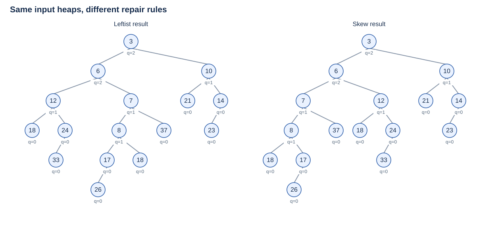
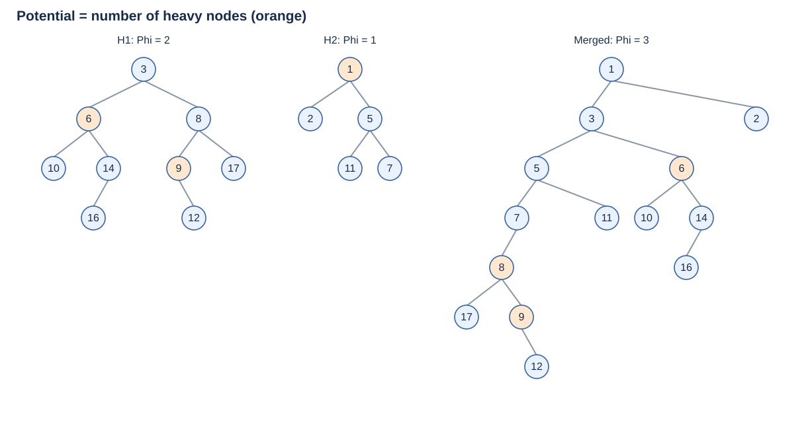
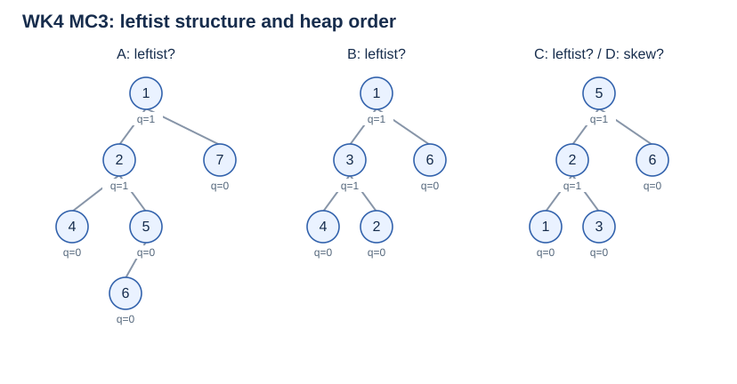
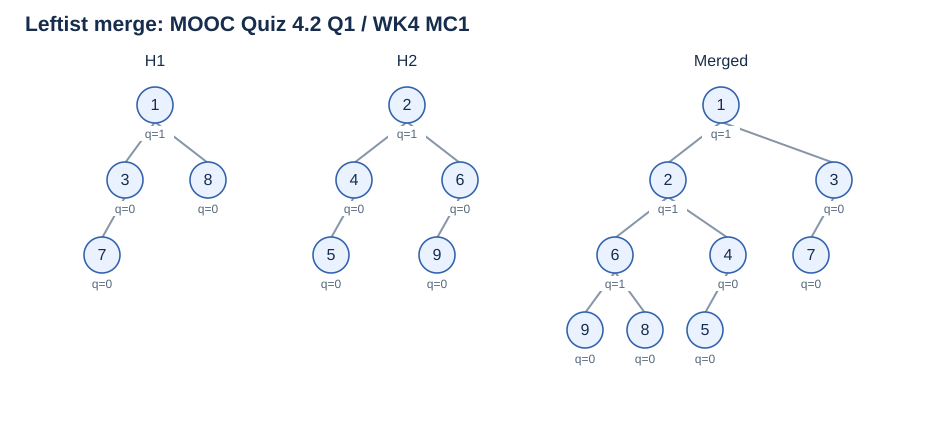
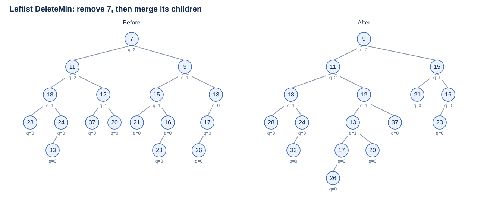
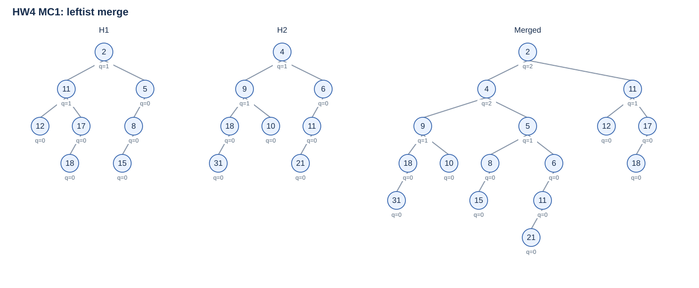
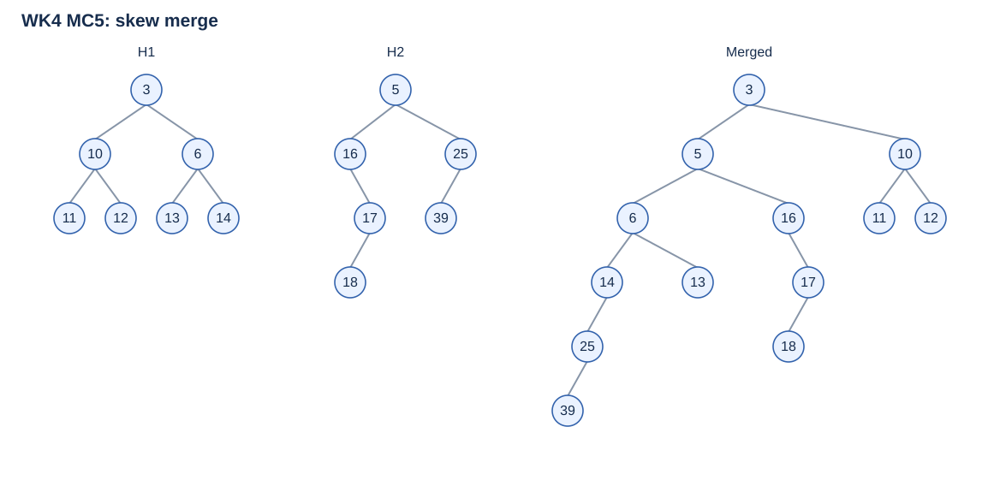
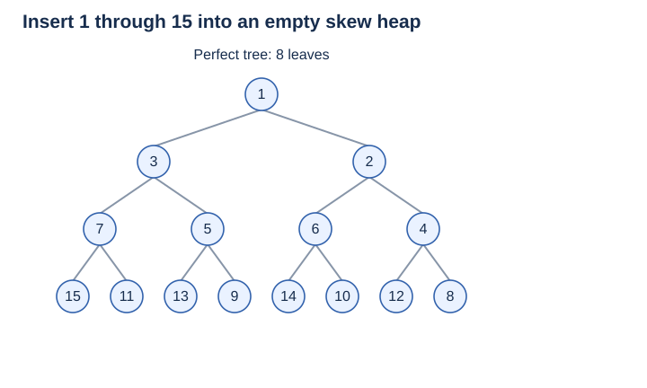
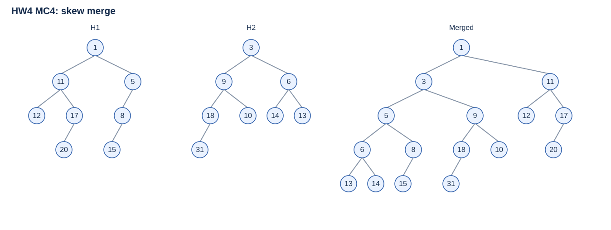

# Lecture 4: Leftist Heaps and Skew Heaps（左式堆与斜堆）

**主线：make Merge fast（高效合并）→ keep a short right path（保证短右路径）or pay for a long one with potential（用势能支付长路径）。** Leftist heaps enforce a rank invariant; skew heaps swap children without rank tests.

[Course overview（课程信息）](index.md)

## 1. Why another heap?（为什么需要另一种堆）

A **priority queue（优先队列）** inserts items and removes the highest-priority item. Here we use **min-heaps（最小堆）**: every parent's key is **≤ its children's keys（堆序性质）**. Max-heaps reverse the comparison.

| Structure | Shape（结构） | Merge / meld（合并） |
| --- | --- | --- |
| Array binary heap（数组二叉堆） | Complete binary tree（完全二叉树）. | Concatenate the two arrays and bottom-up BuildHeap: **$\Theta(n_1+n_2)$**. |
| Leftist heap（左式堆／左偏堆） | Heap-ordered binary tree with an NPL invariant; may be highly unbalanced. | **$O(\log(n_1+n_2+1))$ worst case（最坏界）**. |
| Skew heap（斜堆） | Heap-ordered binary tree, no NPL invariant. | **$O(\log(n_1+n_2+1))$ amortized（摊还界）**; $O(n_1+n_2)$ for one operation. |

**Merge is the motivation（为合并而生）.** The offline example combines separately maintained service-priority queues. If merging is rare, an array's locality（局部性）and small constants may suffice. Pointers avoid moving every item, but add indirection（间接访问）, allocation and possible cache misses. Array indexing uses simple arithmetic: with 1-based indices, parent $i/2$, children $2i,2i+1$. Pointer representation alone does not guarantee faster execution.

**Heap ≠ BST（堆不是搜索树）:** FindMin reads the root in $O(1)$; arbitrary Find can take $\Theta(N)$. Leftist heap height can be $\Theta(N)$: the logarithmic guarantee concerns its **right path**, not all root-to-leaf paths. The slide's target “$O(N)$” means improving on linear rebuilding; the achieved merge bound is logarithmic.

**MOOC 4.1.1 checkpoint:** how fast can two ordinary size-$N$ heaps be merged? The export lists three text options—$O(\log N)$, $O(N\log N)$, $O(1)$—and stores **$\Theta(N)$ as a separate formula image**, with answer letter **B**. The image and following explanation give **$\Theta(N)$** via concatenate + BuildHeap. **导出丢失了公式选项的位置，不能把 B 映射为剩余文本的第二项。** Repeated insertion gives an $O(N\log N)$ upper bound but is not the best method here. **WK4 T/F10:** complete-binary-tree heaps can be merged in $\Theta(N)$, each of size $N$ — **True** for the array-copy/rebuild model.

## 2. Leftist heaps（左式堆）

### 2.1 Null path length and invariant（零路径长与不变量）

**Null path length, NPL（零路径长）** of a real node $x$: the number of edges on its shortest path to a descendant with **fewer than two real children（实孩子数小于 2）**, possibly $x$ itself. Define $\operatorname{npl}(\mathrm{NULL})=-1$.

$$
\operatorname{npl}(x)=1+\min\{\operatorname{npl}(x_L),\operatorname{npl}(x_R)\}.
$$

- A leaf **or one-child node** has NPL **0**. Count the missing child in the recurrence; do not take the minimum over only present children.
- Compute **bottom-up / postorder（自底向上／后序）**, because a parent's value depends on its children's values. MOOC 4.1.2 choices A top-down / B bottom-up / C random / D level order → **B**. **WK4 T/F9** (“top-down”) → **False**.
- **Leftist property（左式性质）:** at **every node**, $\operatorname{npl}(x_L)\ge\operatorname{npl}(x_R)$. Therefore $\operatorname{npl}(x)=\operatorname{npl}(x_R)+1$.

“Leftist” compares **NPL**, not keys, subtree heights or node counts. A left subtree with larger NPL can still contain fewer nodes than a long right subtree. Left and right children need no key ordering relative to each other. A lone real child must be **left**; a pure left chain is valid and has NPL 0 throughout. A **leftist tree（左式树）** satisfies the structural invariant; a **leftist heap** additionally satisfies heap order.

### 2.2 Right-path bound（右路径长度界）

Let $r$ count **real nodes** on the root's right path. Then $r=\operatorname{npl}(\mathrm{root})+1$ for a nonempty leftist heap.

$$
N\ge2^r-1,\qquad r\le\lfloor\log_2(N+1)\rfloor.
$$

**Proof（归纳）：** for root NPL $q$, both child NPLs are at least $q-1$. The smallest possible subtree therefore satisfies $S(-1)=0$ and

$$
S(q)\ge1+2S(q-1)=2^{q+1}-1.
$$

Equality is achieved by a perfect binary tree（满层二叉树）. **注意两种参数：右路径节点数 $r$ 对应 $2^r-1$；根的 NPL $q$ 对应 $2^{q+1}-1$。**

**Quiz 4.1 / WK4 T/F6:** root NPL $r$ implies at least $2^{r+1}-1$ nodes — **True**. **MOOC 4.1.2 discussion:** right-path length is $O(\log N)$; **do the work along this path**, even if the whole tree is tall. [Independent rank proof](https://www.classes.cs.uchicago.edu/archive/2020/spring/22300-1/lectures/LeftistHeaps/index.html) uses rank = NPL + 1, with empty rank 0.

### 2.3 Recursive Merge and HW4 code（递归合并与代码题）

Keep the smaller root → merge its **right** subtree with the other heap → swap children **if NPL order is violated** → update NPL. Both subtrees remain heaps; attaching below the smaller root preserves heap order. Swapping changes no internal keys or subtree invariants.

**MOOC 4.2.1 root checkpoint:** for the pictured heaps rooted at 3 and 6, which node is the final root? Choices **A 3 / B 6 / C 7 / D 8** → **A (3)**, the global minimum.

**HW4 code fill-in · 9 points:** fill the root-comparison condition, the no-left-child assignment, and the NPL update. Complete C answer:

```c
#include <stddef.h>

typedef struct TreeNode *PriorityQueue;
struct TreeNode {
    int Element;
    PriorityQueue Left, Right;
    int Npl;
};

static void SwapChildren(PriorityQueue h)
{
    PriorityQueue tmp = h->Left;
    h->Left = h->Right;
    h->Right = tmp;
}

PriorityQueue Merge(PriorityQueue H1, PriorityQueue H2)
{
    if (H1 == NULL) return H2;
    if (H2 == NULL) return H1;
    if (H1->Element > H2->Element) {  /* blank 1 */
        PriorityQueue tmp = H1;
        H1 = H2;
        H2 = tmp;
    }
    if (H1->Left == NULL)
        H1->Left = H2;             /* blank 2 */
    else {
        H1->Right = Merge(H1->Right, H2);
        if (H1->Left->Npl < H1->Right->Npl)
            SwapChildren(H1);
        H1->Npl = H1->Right->Npl + 1; /* blank 3 */
    }
    return H1;
}
```

**Implementation checks（实现检查）：**

- `Element` is the key field, as clarified offline; compare **keys** to choose the root, **NPLs** to decide a child swap. Node fields were omitted from the archived question.
- If `H1->Left == NULL`, a valid leftist heap also has no right child. Attach H2 on the left; H1's NPL stays **0**. In the other branch H1's left child and the merged right child are nonnull, so the displayed NPL dereferences are safe.
- **MOOC 4.2.1 discussion:** why update using only the right child? After the swap test, right NPL is the minimum. **If NPL is not updated**, later comparisons use stale ranks and can violate the invariant/right-path guarantee, even if heap order still holds.
- The textbook splits the algorithm into mutually recursive（相互递归）`Merge` and `Merge1`; this combines them. Define empty cases before accessing roots. Ties keep H1 here; other consistent tie rules can produce different valid shapes.
- Merge **consumes disjoint input heaps（破坏式合并、不共享节点）**; it relinks nodes rather than copying keys. Do not merge a heap with itself or reuse the old roots as independent heaps.

### 2.4 Iterative view, operations and BuildHeap（迭代理解、基本操作与建堆）

**Iterative Merge:** merge the two already sorted right paths by key, keeping attached left subtrees → retrace the selected path bottom-up, swap if needed and update NPL. “Sort the paths” means **merge two sorted sequences（归并）**, not quicksort. An explicit stack replaces recursion; tie choices and repair order must match for the same result.

Each step advances one input right path and costs $O(1)$; at most $r_1+r_2$ nodes are considered:

$$
T_{\mathrm{Merge}}=O(r_1+r_2+1)
=O(\log(n_1+1)+\log(n_2+1)+1).
$$

This also proves the recursive bound, since recursion performs the same selections and repairs. Its auxiliary stack is $O(r_1+r_2+1)$, even if the left subtrees are tall.

| Operation | Implementation | Leftist worst-case time |
| --- | --- | --- |
| FindMin（取最小值） | Read root. | $O(1)$. |
| Insert（插入） | Merge with a one-node heap, NPL 0. | $O(\log(N+1))$. |
| DeleteMin（删除最小值） | Save the two children, remove/free the root, merge its subtrees. | $O(\log(N+1))$. |
| BuildHeap（建堆） | Queue singleton heaps; repeatedly dequeue two, merge and enqueue the result. | **$\Theta(N)$**. |

Sequential insertion only gives an $O(N\log N)$ build bound. Pairwise construction keeps most merges small: for $N=2^K$, round $k$ has $N/2^k$ merges of size-$2^{k-1}$ heaps. Hence

$$
T(N)=O\!\left(\sum_{k=1}^{K}\frac{N}{2^k}(1+k-1)\right)
=O\!\left(N\sum_{k\ge1}\frac{k}{2^k}\right)=O(N).
$$

Creating/reading $N$ nodes gives $\Omega(N)$. Non-power-of-two sizes leave partial groups; the FIFO pairwise schedule still has a linear bound.

**HW4 MC2: which statement is false?**

- **A.** Round $k$ forms $\lceil N/2^k\rceil$ heaps of $2^k$ nodes each.
- **B.** The worst case is when $N=2^K$.
- **C.** $T(N)=O((N/2)\log2^0+(N/2^2)\log2^1+\cdots+(N/2^K)\log2^{K-1})$, for $N=2^K$.
- **D.** Worst-case time is $\Theta(N\log N)$.

**Intended answer: D; the bound is $\Theta(N)$.** A–C use the ideal **power-of-two round model**: for arbitrary $N$, A's “each” needs an exception for incomplete groups, and B is a simplifying analysis case rather than a literal characterization of the worst input for every $N$. C suppresses constant work per merge; the rigorous sum above includes it, since merging singletons is not free. **保留题目答案，也要区分理想分轮模型与一般输入。**

## 3. Skew heaps（斜堆）

### 3.1 Self-adjusting Merge（自调整合并）

A **skew heap（斜堆）** keeps heap order but drops the NPL field and invariant. Choose the smaller root and **unconditionally swap（无条件交换）** its children as merging proceeds. Insert and DeleteMin still reduce to Merge. **WK4 T/F3:** skew:leftist is analogous to splay:AVL — **True**: self-adjustment replaces maintained balance metadata. The algorithms and invariants themselves are different. [Sleator & Tarjan's original paper](https://www.cs.cmu.edu/~sleator/papers/Adjusting-Heaps.htm).

**Course tracing convention（本课画树约定）：** merge the complete original right paths by key; swap the children of **every node except the final/largest node on that merged path**. Keep that last node's children unchanged. Equivalently, finish processing a remaining right tail before returning; only a terminal node on that path is returned unchanged.

```text
SkewMerge(A, B):
    if A is empty: A = B; B = empty
    if A is empty: return empty
    if B is nonempty and A.key > B.key: swap A, B
    if B is empty and A.right is empty: return A
    A.right = SkewMerge(A.right, B)
    swap A.left, A.right
    return A
```

**为何明确约定？** A common short implementation immediately returns the other heap when either argument is empty. That also implements a valid skew heap, with the same asymptotic bounds, but leaves a remaining multi-node right tail unswapped. The supplied slide's potential example and **HW4 MC4** use the **complete-path** convention above; applying the short base case can change their stated relationships. “最后节点不换”不是任意遗漏一次交换；要看题目采用的停止条件。

**MOOC example:** inputs have roots 3 and 6, right paths `3→8` and `6→7→18`. Both merge along `3,6,7,8,18`; leftist repair swaps only when required, skew repair swaps at **3,6,7,8**, leaving 18 unchanged. Below uses the 16-node inputs from the operations example; the later slide also illustrates a version with an extra node 35 below 37.



**Insert 15** into the displayed skew result: the comparison path is **3→10→14→15**. Swap at 3, 10 and 14; 15 becomes the left child of 14, whose right child is now 23. The result need not be leftist.

### 3.2 Guarantees and checkpoints（保证与判断题）

| Source | Question | Answer / reason |
| --- | --- | --- |
| Quiz 4.3 Q1 / WK4 T/F1 | With identical operations, a skew heap is always more balanced than a leftist heap. | **False**: no such shape guarantee. |
| Quiz 4.3 Q2 / HW4 T/F2 | A skew heap's right path can be arbitrarily long. | **True**: it can contain $\Theta(N)$ nodes. |
| Quiz 4.4 Q2 | Skew insertion has $O(\log N)$ amortized time. | **True**, by the Merge analysis below. |
| WK4 T/F5 | Merge, Insert, DeleteMin have $O(N)$ worst-case and $O(\log N)$ amortized time; skew heaps support efficient merging compared with complete binary heaps. | **True** as upper bounds; individual operations may be much cheaper. |

**Quiz 4.4 Q1: which is false?** A no NPL maintenance; B always more space-efficient than leftist heaps; **C $O(\log N)$ worst-case Merge**; D $O(\log N)$ amortized cost. **Answer: C.** B refers to omitted NPL **metadata（元数据）** in the course model; actual `sizeof` can be unchanged because of padding（内存对齐）, and recursive stack space is separate. A recursive skew operation can use $O(N)$ stack space; it saves stored rank fields, not all auxiliary memory.

**Amortized ≠ expected（摊还不等于期望）.** The guarantee is over an operation sequence, with no random-input assumption. The slides call precise expected right-path length an open question, but specify no probability model; that historical aside supplies no average-case theorem.

## 4. Amortized analysis of skew heaps（斜堆的摊还分析）

### 4.1 Potential and heavy nodes（势函数与重节点）

Let $s(x)$ be subtree size **including $x$（含自身）**, with $s(\mathrm{NULL})=0$.

$$
x\text{ is heavy（重）}\iff s(x_R)\ge\frac{s(x)}2
\iff s(x_R)>s(x_L);
\qquad x\text{ is light（轻） otherwise}.
$$

Because $s(x)=1+s(x_L)+s(x_R)$ and sizes are integers, **equal child sizes mean light**. The video's “right no smaller than left” is imprecise: the correct child-size comparison is **strictly greater**. A leaf is light; a leftist node can be heavy because NPL and size are different measures.

Use the state of **all current heaps（整个堆集合）** and

$$
\Phi=\text{total number of heavy nodes},\qquad
\Phi(\varnothing)=0,\quad\Phi\ge0.
$$

**WK4 T/F4:** “the potential can be the number of right nodes” — **False for the claimed logarithmic proof**. Nonnegativity alone is insufficient; expensive work needs a compensating potential decrease. Example: a right spine of $k$ nodes, each with a left leaf, merged with a new largest singleton costs $\Theta(k)$, but its number of right-child nodes increases from $k-1$ to $k$. It cannot pay for that operation. The transcript's claim that this count is globally nondecreasing is not needed and is not a general invariant.



In this example heavy nodes before merging are **6,9,1**; afterward **6,9,8**. Nodes 6 and 9 keep their subtrees; 1 becomes light and 8 becomes heavy. NPL tests are not needed to maintain this potential: **势函数用于证明，程序不必真的统计它。**

### 4.2 Cancellation and logarithmic bound（抵消与对数界）

Let $l_i,h_i$ be the counts of light/heavy nodes on input heap $i$'s right path; let $h$ count heavy nodes outside both paths.

1. **Only original right-path nodes can change status.** Attached off-path subtrees remain internally unchanged, even when moved.
2. **Every processed heavy node becomes light.** Its old larger right subtree becomes its new left subtree and can only gain nodes; its new right subtree is its old smaller left subtree. The unswapped final node has no right child and was already light.
3. At most $l_1+l_2$ original light nodes become heavy. Thus

$$
\Phi_{\mathrm{before}}=h_1+h_2+h,\qquad
\Phi_{\mathrm{after}}\le l_1+l_2+h.
$$

**MOOC 4.4.2 checkpoint:** the upper bound on the new potential is **$l_1+l_2+h$**.

In units of constant work per path node, $c\le l_1+h_1+l_2+h_2+O(1)$. Therefore

$$
\widehat c=c+\Phi_{\mathrm{after}}-\Phi_{\mathrm{before}}
\le2(l_1+l_2)+O(1).
$$

For a real implementation with a larger constant per step, multiply $\Phi$ by a sufficient constant; the cancellation and asymptotic result remain the same.

**Why $l_i=O(\log n_i)$?（为什么轻节点只有对数个？）** At every light node, $s(x_R)\le(s(x)-1)/2<s(x)/2$. Following the right path through a light node therefore at least halves the remaining subtree size. Heavy nodes cannot increase it. At most $O(\log(n_i+1))$ such halvings occur, giving

$$
\widehat c=O(\log(n_1+1)+\log(n_2+1)+1)=O(\log(N+1)).
$$

Insert adds a light singleton of potential 0. DeleteMin first removes the root (potential cannot increase at that step), then merges its children. Starting with empty heaps, $M$ operations with at most $N$ live nodes in total cost **$O(M\log(N+1))$**, by telescoping（望远镜求和）. An arbitrary nonempty initial state adds its initial potential $\Phi_0=O(N_0)$; “any sequence” must account for that initialization.

### 4.3 Offline discussion: DecreaseKey without parent fields（无父指针的减键）

**Task:** for a min-leftist heap, really decrease a designated key and restore the heap in $O(\log N)$ **after locating it**. No permanent parent pointer and **no lazy deletion（不允许惰性删除后另插新节点）**.

**Cut-and-meld（切下再合并）：**

1. Find the node $x$ and retain its **incoming child link（指向它的孩子指针位置）** plus the ancestor path in a temporary search/recursion stack. This does not add parent fields to tree nodes.
2. If $x$ is the root, decrease its key; the subtree remains valid. Otherwise detach **the entire subtree rooted at $x$**. Decreasing its root preserves heap order inside that subtree and changes no NPL there.
3. Repair the remaining heap upward: at each affected ancestor, swap if necessary, recompute NPL; **stop as soon as NPL is unchanged**. Higher ancestors depend only on that rank; a local child swap does not itself require further propagation.
4. Merge the repaired remainder with the detached subtree. No obsolete copy of $x$ remains.

**Repair bound（修复界）：** after a cut, NPL can decrease, never increase. Whenever a change propagates to the next ancestor, the changed child's new NPL is below the sibling's, so the next changed NPL is **that value + 1**. Along continuing propagation these new ranks strictly increase, while every leftist NPL is $O(\log N)$. Hence only $O(\log N)$ repairs/swaps, plus one logarithmic Merge. **不是因为整条祖先链短；左式堆的高度可能是线性的。**

Another class proposal removes $x$ alone, replaces it with `Merge(x.left,x.right)`, repairs the ancestors, then reinserts the same node with its decreased key as a singleton. It also needs an incoming link/path and a repair-bound argument. Do not assume deleting a root cannot decrease NPL; e.g. a root with two leaves has NPL 1, but merging its two children yields NPL 0.

**接口前提不能省略：** a pointer to $x$ gives $O(1)$ access to its key, but **does not reveal its parent or ancestor path** in a tree with only downward links. Finding/retaining that path may take $\Theta(N)$ time and $O(\text{height})$ temporary space; it is outside the stated repair bound. If only a bare node pointer is supplied and no path/incoming link is available, the lecture's restrictions do not by themselves establish $O(\log N)$ total DecreaseKey. Simply bubbling a key upward can likewise traverse a linear-height chain.

## 5. Exercises with trees（配图题解析）

Figures below redraw the supplied inputs and independently computed outputs. Children drawn left/right retain that orientation; NPL labels (`q=…`) are not keys.

### 5.1 Validity（合法性）· WK4 MC3

**Which is true?** A–C “may be a leftist heap”; D “may be a skew heap” (D uses the same tree as C).



**Answer: A.** Its heap order and all NPL inequalities hold. B has parent **3 > child 2**; C/D have **5 > 2** and **2 > 1**, so even heap order fails. Dropping the leftist invariant does not permit arbitrary parent–child keys.

### 5.2 Leftist merge（左式合并）· Quiz 4.2 Q1 / WK4 MC1



MOOC: **A** NPL(6) = NPL(2); **B** root 1, right child 3; **C** leftmost path `1,2,4,5`; **D** 6 is left child of 2. **False: C.** Actual leftmost path is **`1,2,6,9`**; NPL(6) = NPL(2) = **1**.

WK4 uses the same inputs, but **C says `1,2,6,8`**, and **D says 5 is left child of 4**. **False: C** again: **8 is the right child of 6**, while 9 is its left child. The other three statements hold. 不要因答案字母相同而混用两个题面的选项。

### 5.3 Leftist DeleteMin（删除最小值）· Quiz 4.2 Q2



Which is true? **A** 9 is not root; **B** 24 is left child of 18; **C** 18 is right child of 11; **D** 13 is left child of 12. **Answer: D.** Remove 7 and merge roots 11 and 9: root becomes **9**; 18 is **left** child of 11, and 24 is **right** child of 18.

### 5.4 Leftist merge（左式合并）· HW4 MC1



Which is false? **A** root 2, right child 11; **B** 9 and 12 have equal depth; **C** deepest node 21 has parent 11; **D** NPL(4) < NPL(2). **Answer: D:** both NPLs are **2**. B's two nodes are at depth 2 (root depth 0); the deepest 21 is at depth 5. Two distinct nodes carry key 11; distinguish them by their positions.

### 5.5 Skew merge（斜堆合并）· WK4 MC5



Which is false? **A** root 3; **B** 17 is right child of 16; **C** 39 is right child of 25; **D** 25 is left child of 14. **Answer: C.** 25 is the final node of the merged right path; its original **left** child 39 stays on the left. The other relationships hold.

### 5.6 Skew insertion（斜堆插入）· HW4 T/F1 / MC3



**MC3:** insert `1,…,15`; which is false? **A** complete binary tree; **B** 6 leaves; **C** 6 is left child of 2; **D** 11 is right child of 7. **Answer: B**, since there are **8 leaves**. All 15 nodes occupy four full levels; C/D can be read directly from the tree.

**T/F1:** inserting `1,…,2^k−1` into an empty skew heap always gives a full binary tree for $k>4$ — **True**; in fact the result is **perfect（每层全满）**, and the claim holds for every $k\ge1$. Induct on $k$: root 1 stays minimum; unconditional root swaps distribute later arrivals alternately between two subheaps, each receiving an increasing sequence of $2^{k-1}-1$ keys. Both are perfect by induction. `full` sometimes means only “0 or 2 children”; the stronger perfect property removes that ambiguity here.

### 5.7 Skew merge（斜堆合并）· HW4 MC4



Which is false? **A** 15 is right child of 8; **B** 14 is right child of 6; **C** root 1; **D** 9 is right child of 3. **Answer: A:** 15 remains **left** child of 8. Merged right path is **`1,3,5,6,13`**; swap at **1,3,5,6**, leaving terminal 13 unchanged. This is why the tail-processing convention in §3.1 matters.

## 6. Review, code and references（复习、代码与来源）

**复习抓手：**堆序与搜索树顺序不同；NPL 的 −1／0 基准；NPL 与右路径节点数差 1；“左偏”比较 NPL；沿右路径归并、回溯换孩子；忘记更新 NPL 的后果；成对建堆的线性求和；斜堆停止条件；heavy 的严格大小关系；轻节点的减半与重节点的势能抵消；无父指针时 DecreaseKey 的路径前提。

[Complete C merge routines（左式／斜堆合并的完整 C 函数）](assets/meldable-heaps.c): the leftist routine matches HW4's three blanks; the skew routine uses the course tracing convention. The skew node type contains **no NPL field**. Compile as a reusable module with `cc -std=c11 -Wall -Wextra -Wpedantic -c meldable-heaps.c`.

All supplied `~/ADS-docs/4` materials were inspected: MOOC merged/lesson transcripts and quizzes, manifest units **1320673551–1320673566** (14 exported units), **94** video frames and **7** checkpoint images, the **13-page** PDF, offline `lecture-record-18/course_content.md` and **88** captures, plus WK4/HW4 archives and their linked problem figures. Repeated exports share one explanation; ASR mistakes and inconsistent shorthand are corrected above.

- **MOOC:** all **13** checkpoint/quiz questions appear by the relevant concept or in §5.
- **WK4:** all **10** current-topic questions appear here, including the two drawing questions whose variants differ from MOOC/HW4.
- **HW4:** both true/false questions, all **four** multiple-choice questions and the **three-blank** programming question are included.
- **Offline:** motivation, key-field clarification, real DecreaseKey without parent fields/lazy deletion, upward repair and its rank argument. Previously excluded project presentations remain outside the course notes.

Reading specified in the supplied slides: Weiss, *Data Structures and Algorithm Analysis in C*, 2nd ed., **陈越改编，人民邮电出版社，2005：Ch. 5 pp. 161–169; Ch. 11 pp. 435–437**. This is the adapted edition's chapter/page numbering; do not transfer it to a different edition.

Supplementary references: [ZJU MOOC](https://www.icourse163.org/course/ZJU1-1460402161); [Sleator & Tarjan, *Self-Adjusting Heaps*, 1986](https://www.cs.cmu.edu/~sleator/papers/Adjusting-Heaps.htm); [University of Chicago leftist-heap invariants and rank proof](https://www.classes.cs.uchicago.edu/archive/2020/spring/22300-1/lectures/LeftistHeaps/index.html).

Nine editable SVG diagrams are original redrawings of supplied course/PTA examples, not screenshots of student presentations. Status remains `draft` pending instructor/textbook review.
