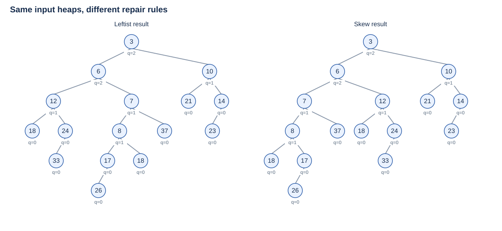
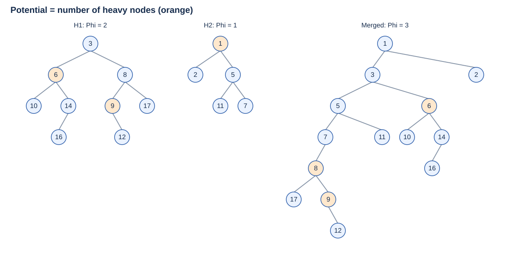
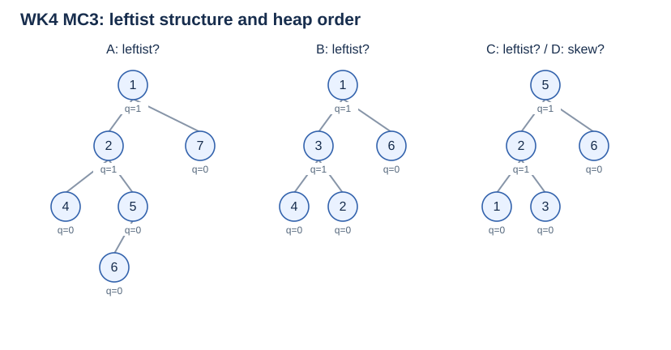
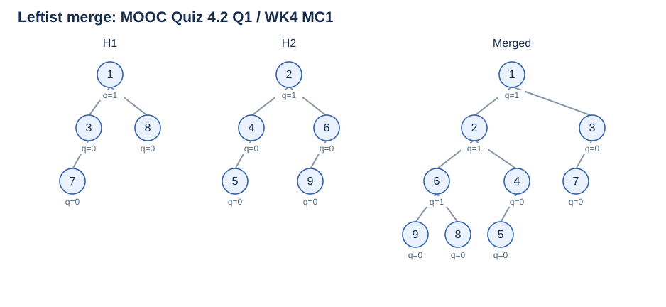
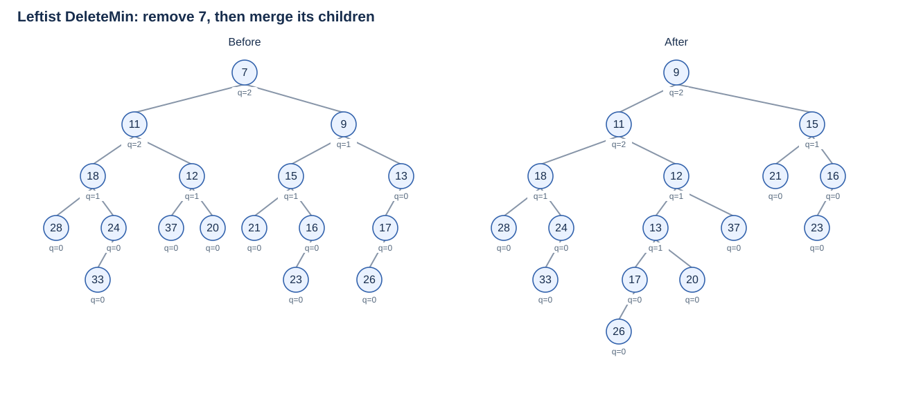
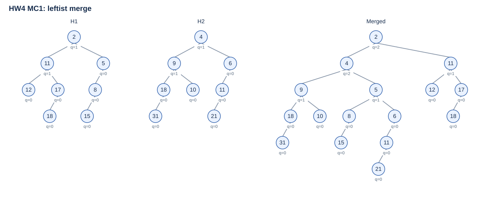
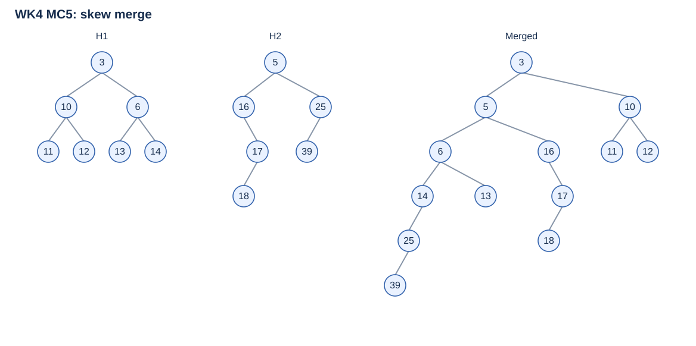
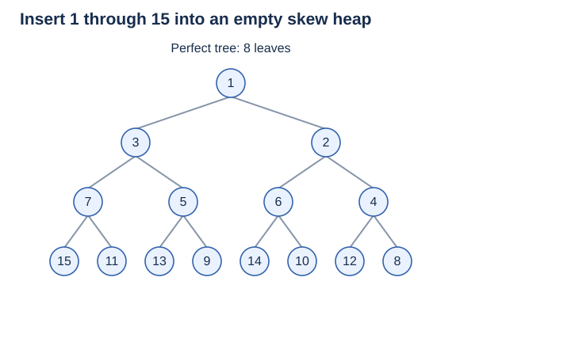
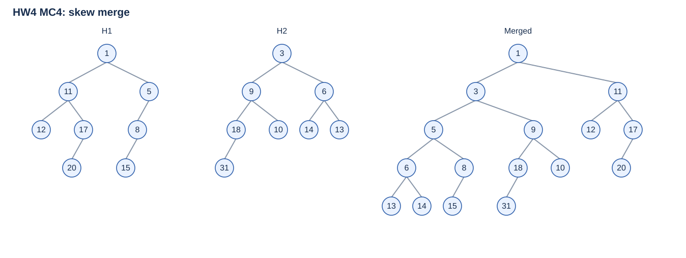
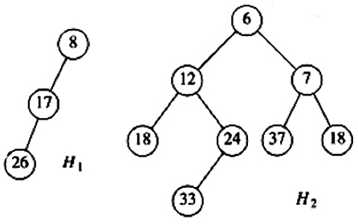

# Lecture 4: Leftist Heaps and Skew Heaps（左式堆与斜堆）

**Merge:** leftist heaps maintain a short right path; skew heaps pay for long paths through potential.

[Course overview（课程信息）](index.md)

## 1. Why another heap?（为什么需要另一种堆）

**Priority queue（优先队列）:** insert items, remove the highest priority. Here **min-heap（最小堆）:** parent key ≤ child keys; reverse comparisons for max-heaps.

| Structure | Shape（结构） | Merge / meld（合并） |
| --- | --- | --- |
| Array binary heap（数组二叉堆） | Complete binary tree（完全二叉树）. | Concatenate the two arrays and bottom-up BuildHeap: **$\Theta(n_1+n_2)$**. |
| Leftist heap（左式堆／左偏堆） | Heap-ordered binary tree with an NPL invariant; may be highly unbalanced. | **$O(\log(n_1+n_2+1))$ worst case（最坏界）**. |
| Skew heap（斜堆） | Heap-ordered binary tree, no NPL invariant. | **$O(\log(n_1+n_2+1))$ amortized（摊还界）**; $O(n_1+n_2)$ for one operation. |

**Use case:** merge separate service-priority queues. Arrays offer locality/simple 1-based indexing (parent $i/2$, children $2i,2i+1$); pointers avoid moving items but add indirection/allocation/cache misses. Rare merges may favor arrays.

**Heap ≠ BST:** FindMin $O(1)$; arbitrary Find $\Theta(N)$. Leftist height can be $\Theta(N)$: only its **right path** is logarithmically bounded.

**MOOC 4.1.1:** merging two size-N array heaps → **B: $\Theta(N)$** (concatenate + BuildHeap); the formula image was separated from text options $O(\log N),O(N\log N),O(1)$. Repeated insertion costs $O(N\log N)$. **WK4 TF10: True** for linear rebuild.

## 2. Leftist heaps（左式堆）

### 2.1 Null path length and invariant（零路径长与不变量）

**NPL（零路径长）:** shortest edge path from x to a node with <2 real children (possibly x). Set $\operatorname{npl}(\mathrm{NULL})=-1$.

$$
\operatorname{npl}(x)=1+\min\{\operatorname{npl}(x_L),\operatorname{npl}(x_R)\}.
$$

- A leaf **or one-child node** has NPL **0**. Count the missing child in the recurrence; do not take the minimum over only present children.
- Compute **bottom-up / postorder（自底向上／后序）**, because a parent's value depends on its children's values. MOOC 4.1.2 choices A top-down / B bottom-up / C random / D level order → **B**. **WK4 T/F9** (“top-down”) → **False**.
- **Leftist property（左式性质）:** at **every node**, $\operatorname{npl}(x_L)\ge\operatorname{npl}(x_R)$. Therefore $\operatorname{npl}(x)=\operatorname{npl}(x_R)+1$.

“Leftist” compares **NPL, not size, height or sibling keys**; larger left NPL can coexist with fewer left nodes. A lone child must be left; a pure left chain has all NPL=0. A leftist **heap** also needs heap order.

### 2.2 Right-path bound（右路径长度界）

Let $r$ count **real nodes** on the root's right path. Then $r=\operatorname{npl}(\mathrm{root})+1$ for a nonempty leftist heap.

$$
N\ge2^r-1,\qquad r\le\lfloor\log_2(N+1)\rfloor.
$$

**Proof（归纳）：** for root NPL $q$, both child NPLs are at least $q-1$. The smallest possible subtree therefore satisfies $S(-1)=0$ and

$$
S(q)\ge1+2S(q-1)=2^{q+1}-1.
$$

Equality is achieved by a perfect binary tree（满层二叉树）. **注意两种参数：右路径节点数 $r$ 对应 $2^r-1$；根的 NPL $q$ 对应 $2^{q+1}-1$。**

**Quiz 4.1 / WK4 T/F6:** root NPL $r$ implies at least $2^{r+1}-1$ nodes — **True**. **MOOC 4.1.2 discussion:** right-path length is $O(\log N)$; **do the work along this path**, even if the whole tree is tall. [Independent rank proof](https://www.classes.cs.uchicago.edu/archive/2020/spring/22300-1/lectures/LeftistHeaps/index.html) uses rank = NPL + 1, with empty rank 0.

### 2.3 Recursive Merge and HW4 code（递归合并与代码题）

Keep the smaller root → merge its **right** subtree with the other heap → swap children **if NPL order is violated** → update NPL. Both subtrees remain heaps; attaching below the smaller root preserves heap order. Swapping changes no internal keys or subtree invariants.

**MOOC 4.2.1 root checkpoint:** for the pictured heaps rooted at 3 and 6, which node is the final root? Choices **A 3 / B 6 / C 7 / D 8** → **A (3)**, the global minimum.

**HW4 code fill-in · 9 points:** fill the root-comparison condition, the no-left-child assignment, and the NPL update. Complete C answer:

```c
#include <stddef.h>

typedef struct TreeNode *PriorityQueue;
struct TreeNode {
    int Element;
    PriorityQueue Left, Right;
    int Npl;
};

static void SwapChildren(PriorityQueue h)
{
    PriorityQueue tmp = h->Left;
    h->Left = h->Right;
    h->Right = tmp;
}

PriorityQueue Merge(PriorityQueue H1, PriorityQueue H2)
{
    if (H1 == NULL) return H2;
    if (H2 == NULL) return H1;
    if (H1->Element > H2->Element) {  /* blank 1 */
        PriorityQueue tmp = H1;
        H1 = H2;
        H2 = tmp;
    }
    if (H1->Left == NULL)
        H1->Left = H2;             /* blank 2 */
    else {
        H1->Right = Merge(H1->Right, H2);
        if (H1->Left->Npl < H1->Right->Npl)
            SwapChildren(H1);
        H1->Npl = H1->Right->Npl + 1; /* blank 3 */
    }
    return H1;
}
```

**Implementation checks:**

- Root comparison uses **Element keys**; child-swap comparison uses **NPL**.
- No left child implies a singleton: attach H2 left, NPL stays 0. Otherwise left and merged-right are nonnull, making the dereferences safe.
- **MOOC 4.2.1:** right NPL suffices after the swap; omitting its update leaves stale ranks and breaks the structural guarantee, even if heap order survives.
- This combines textbook `Merge`/`Merge1` mutual recursion. Empty cases precede dereferences; ties keep H1 (other consistent rules can change shape).
- Destructive merge requires **disjoint input heaps**; do not merge a heap with itself or reuse consumed roots independently.

### 2.4 Iterative view, operations and BuildHeap（迭代理解、基本操作与建堆）

**Iterative Merge:** merge the two already sorted right paths by key, keeping attached left subtrees → retrace the selected path bottom-up, swap if needed and update NPL. “Sort the paths” means **merge two sorted sequences（归并）**, not quicksort. An explicit stack replaces recursion; tie choices and repair order must match for the same result.

Each step advances one input right path and costs $O(1)$; at most $r_1+r_2$ nodes are considered:

$$
T_{\mathrm{Merge}}=O(r_1+r_2+1)
=O(\log(n_1+1)+\log(n_2+1)+1).
$$

This also proves the recursive bound, since recursion performs the same selections and repairs. Its auxiliary stack is $O(r_1+r_2+1)$, even if the left subtrees are tall.

| Operation | Implementation | Leftist worst-case time |
| --- | --- | --- |
| FindMin（取最小值） | Read root. | $O(1)$. |
| Insert（插入） | Merge with a one-node heap, NPL 0. | $O(\log(N+1))$. |
| DeleteMin（删除最小值） | Save the two children, remove/free the root, merge its subtrees. | $O(\log(N+1))$. |
| BuildHeap（建堆） | Queue singleton heaps; repeatedly dequeue two, merge and enqueue the result. | **$\Theta(N)$**. |

Sequential insertion only gives an $O(N\log N)$ build bound. Pairwise construction keeps most merges small: for $N=2^K$, round $k$ has $N/2^k$ merges of size-$2^{k-1}$ heaps. Hence

$$
T(N)=O\!\left(\sum_{k=1}^{K}\frac{N}{2^k}(1+k-1)\right)
=O\!\left(N\sum_{k\ge1}\frac{k}{2^k}\right)=O(N).
$$

Creating/reading $N$ nodes gives $\Omega(N)$. Non-power-of-two sizes leave partial groups; the FIFO pairwise schedule still has a linear bound.

**HW4 MC2: which statement is false?**

- **A.** Round $k$ forms $\lceil N/2^k\rceil$ heaps of $2^k$ nodes each.
- **B.** The worst case is when $N=2^K$.
- **C.** $T(N)=O((N/2)\log2^0+(N/2^2)\log2^1+\cdots+(N/2^K)\log2^{K-1})$, for $N=2^K$.
- **D.** Worst-case time is $\Theta(N\log N)$.

**D: $\Theta(N)$**, not $\Theta(N\log N)$. A/B assume ideal power-of-two rounds; arbitrary N has partial groups. C omits constant work per merge; singleton merges are not free.

## 3. Skew heaps（斜堆）

### 3.1 Self-adjusting Merge（自调整合并）

**Skew heap:** heap order, no NPL metadata/invariant; choose smaller root, swap children unconditionally. Insert/DeleteMin reduce to Merge. **WK4 TF3:** skew:leftist ≈ splay:AVL → **True** (self-adjustment vs maintained metadata). [Original paper](https://www.cs.cmu.edu/~sleator/papers/Adjusting-Heaps.htm).

**Course convention:** merge the **complete original right paths** by key; swap every path node **except the final/largest**. Process any remaining tail before returning; leave that last node’s children unchanged.

```text
SkewMerge(A, B):
    if A is empty: A = B; B = empty
    if A is empty: return empty
    if B is nonempty and A.key > B.key: swap A, B
    if B is empty and A.right is empty: return A
    A.right = SkewMerge(A.right, B)
    swap A.left, A.right
    return A
```

**Variant:** returning the other heap immediately on an empty argument is also valid, with the same bounds, but leaves its remaining right tail unswapped. HW4 MC4 and the potential diagram use the **complete-path** variant; tree shapes differ.

**MOOC:** paths `3→8` and `6→7→18` merge to `3,6,7,8,18`. Leftist swaps only as needed; skew swaps at **3,6,7,8**. Figure: original 16-node inputs; a later slide adds 35 below 37.



**Insert 15** into the displayed skew result: the comparison path is **3→10→14→15**. Swap at 3, 10 and 14; 15 becomes the left child of 14, whose right child is now 23. The result need not be leftist.

### 3.2 Guarantees and checkpoints（保证与判断题）

| Source | Question | Answer / reason |
| --- | --- | --- |
| Quiz 4.3 Q1 / WK4 T/F1 | With identical operations, a skew heap is always more balanced than a leftist heap. | **False**: no such shape guarantee. |
| Quiz 4.3 Q2 / HW4 T/F2 | A skew heap's right path can be arbitrarily long. | **True**: it can contain $\Theta(N)$ nodes. |
| Quiz 4.4 Q2 | Skew insertion has $O(\log N)$ amortized time. | **True**, by the Merge analysis below. |
| WK4 T/F5 | Merge, Insert, DeleteMin have $O(N)$ worst-case and $O(\log N)$ amortized time; skew heaps support efficient merging compared with complete binary heaps. | **True** as upper bounds; individual operations may be much cheaper. |

**Quiz 4.4 Q1:** A no NPL / B less storage / C worst-case Merge $O(\log N)$ / D amortized $O(\log N)$ → **C false**. B refers to rank fields: padding may leave `sizeof` unchanged, and recursive skew Merge may still use $O(N)$ stack.

**Amortized ≠ expected:** no random-input assumption. The slide’s historical “expected right-path length open” aside specifies no distribution and supplies no average-case bound.

## 4. Amortized analysis of skew heaps（斜堆的摊还分析）

### 4.1 Potential and heavy nodes（势函数与重节点）

Let $s(x)$ be subtree size **including $x$（含自身）**, with $s(\mathrm{NULL})=0$.

$$
x\text{ is heavy（重）}\iff s(x_R)\ge\frac{s(x)}2
\iff s(x_R)>s(x_L);
\qquad x\text{ is light（轻） otherwise}.
$$

Since $s(x)=1+s(x_L)+s(x_R)$, equal child sizes are **light**; heavy requires **right > left**, not ≥. Leaves are light; a leftist node may be heavy because size ≠ NPL.

Use the state of **all current heaps（整个堆集合）** and

$$
\Phi=\text{total number of heavy nodes},\qquad
\Phi(\varnothing)=0,\quad\Phi\ge0.
$$

**WK4 TF4:** right-node count as potential → **False for this proof**. Counterexample: a k-node right spine with one left leaf per node, merged with a new largest singleton, costs $\Theta(k)$ but right-child count rises $k-1\to k$. Nonnegativity alone cannot pay for work; that count is not generally monotone either.



Heavy nodes **6,9,1 → 6,9,8**: off-path 6/9 stay unchanged; 1 becomes light, 8 heavy. Potential is a proof tool, not stored metadata.

### 4.2 Cancellation and logarithmic bound（抵消与对数界）

Let $l_i,h_i$ be the counts of light/heavy nodes on input heap $i$'s right path; let $h$ count heavy nodes outside both paths.

1. **Only original right-path nodes can change status.** Attached off-path subtrees remain internally unchanged, even when moved.
2. **Every processed heavy node becomes light.** Its old larger right subtree becomes its new left subtree and can only gain nodes; its new right subtree is its old smaller left subtree. The unswapped final node has no right child and was already light.
3. At most $l_1+l_2$ original light nodes become heavy. Thus

$$
\Phi_{\mathrm{before}}=h_1+h_2+h,\qquad
\Phi_{\mathrm{after}}\le l_1+l_2+h.
$$

**MOOC 4.4.2 checkpoint:** the upper bound on the new potential is **$l_1+l_2+h$**.

In units of constant work per path node, $c\le l_1+h_1+l_2+h_2+O(1)$. Therefore

$$
\widehat c=c+\Phi_{\mathrm{after}}-\Phi_{\mathrm{before}}
\le2(l_1+l_2)+O(1).
$$

Scale $\Phi$ by the constant work per step when needed; the same cancellation holds.

**Light-node bound:** at a light node, $s(x_R)\le(s(x)-1)/2<s(x)/2$. Each such step halves remaining size; intervening heavy steps cannot increase it. Thus $l_i=O(\log(n_i+1))$ and

$$
\widehat c=O(\log(n_1+1)+\log(n_2+1)+1)=O(\log(N+1)).
$$

Insert adds a light singleton (potential 0); removing DeleteMin’s root cannot increase potential before melding. From empty, M operations with ≤N live nodes cost **$O(M\log(N+1))$** by telescoping. Arbitrary initial heaps add $\Phi_0=O(N_0)$.

### 4.3 Offline discussion: DecreaseKey without parent fields（无父指针的减键）

**Task:** for a min-leftist heap, really decrease a designated key and restore the heap in $O(\log N)$ **after locating it**. No permanent parent pointer and **no lazy deletion（不允许惰性删除后另插新节点）**.

**Cut-and-meld（切下再合并）：**

1. Save x’s **incoming child link** and ancestor path in a temporary search stack (no parent fields).
2. Root x: decrease directly. Otherwise detach **its entire subtree**; decreasing the root preserves its internal heap order/NPL.
3. Repair ancestors: swap if needed, update NPL, **stop at unchanged NPL**; higher nodes depend only on rank.
4. Meld the detached decreased subtree with the repaired remainder. No stale copy remains.

**Repair bound:** cutting cannot increase NPL. Each propagated decrease makes the next changed rank **new child rank +1** (below the sibling’s rank). These ranks strictly increase but are $O(\log N)$ → O(log N) repairs, then one logarithmic meld. The ancestor chain itself may be linear.

**Alternative:** replace x by `Merge(x.left,x.right)`, repair ancestors, reinsert the same decreased node as a singleton. It needs the same incoming link/path and repair proof. Deleting a root can lower NPL: root with two leaves has 1; merging its children gives 0.

**Access precondition:** a bare x pointer gives $O(1)$ key access, not its incoming link/ancestors. Without parent fields, obtaining that path can cost $\Theta(N)$ time and $O(\text{height})$ stack, excluded from the repair bound. Thus total DecreaseKey is not automatically logarithmic; bubbling upward can also traverse linear height.

## 5. Exercises with trees（配图题解析）

Figures below redraw the supplied inputs and independently computed outputs. Children drawn left/right retain that orientation; NPL labels (`q=…`) are not keys.

### 5.1 Validity（合法性）· WK4 MC3

**Which is true?** A–C “may be a leftist heap”; D “may be a skew heap” (D uses the same tree as C).



**Answer: A.** Its heap order and all NPL inequalities hold. B has parent **3 > child 2**; C/D have **5 > 2** and **2 > 1**, so even heap order fails. Dropping the leftist invariant does not permit arbitrary parent–child keys.

### 5.2 Leftist merge（左式合并）· Quiz 4.2 Q1 / WK4 MC1



MOOC: **A** NPL(6) = NPL(2); **B** root 1, right child 3; **C** leftmost path `1,2,4,5`; **D** 6 is left child of 2. **False: C.** Actual leftmost path is **`1,2,6,9`**; NPL(6) = NPL(2) = **1**.

WK4 uses the same inputs, but **C says `1,2,6,8`**, and **D says 5 is left child of 4**. **False: C** again: **8 is the right child of 6**, while 9 is its left child. The other three statements hold. 不要因答案字母相同而混用两个题面的选项。

### 5.3 Leftist DeleteMin（删除最小值）· Quiz 4.2 Q2



Which is true? **A** 9 is not root; **B** 24 is left child of 18; **C** 18 is right child of 11; **D** 13 is left child of 12. **Answer: D.** Remove 7 and merge roots 11 and 9: root becomes **9**; 18 is **left** child of 11, and 24 is **right** child of 18.

### 5.4 Leftist merge（左式合并）· HW4 MC1



Which is false? **A** root 2, right child 11; **B** 9 and 12 have equal depth; **C** deepest node 21 has parent 11; **D** NPL(4) < NPL(2). **Answer: D:** both NPLs are **2**. B's two nodes are at depth 2 (root depth 0); the deepest 21 is at depth 5. Two distinct nodes carry key 11; distinguish them by their positions.

### 5.5 Skew merge（斜堆合并）· WK4 MC5



Which is false? **A** root 3; **B** 17 is right child of 16; **C** 39 is right child of 25; **D** 25 is left child of 14. **Answer: C.** 25 is the final node of the merged right path; its original **left** child 39 stays on the left. The other relationships hold.

### 5.6 Skew insertion（斜堆插入）· HW4 T/F1 / MC3



**MC3:** insert `1,…,15`; which is false? **A** complete binary tree; **B** 6 leaves; **C** 6 is left child of 2; **D** 11 is right child of 7. **Answer: B**, since there are **8 leaves**. All 15 nodes occupy four full levels; C/D can be read directly from the tree.

**T/F1:** inserting `1,…,2^k−1` into an empty skew heap always gives a full binary tree for $k>4$ — **True**; in fact the result is **perfect（每层全满）**, and the claim holds for every $k\ge1$. Induct on $k$: root 1 stays minimum; unconditional root swaps distribute later arrivals alternately between two subheaps, each receiving an increasing sequence of $2^{k-1}-1$ keys. Both are perfect by induction. `full` sometimes means only “0 or 2 children”; the stronger perfect property removes that ambiguity here.

### 5.7 Skew merge（斜堆合并）· HW4 MC4



Which is false? **A** 15 is right child of 8; **B** 14 is right child of 6; **C** root 1; **D** 9 is right child of 3. **Answer: A:** 15 remains **left** child of 8. Merged right path is **`1,3,5,6,13`**; swap at **1,3,5,6**, leaving terminal 13 unchanged. This is why the tail-processing convention in §3.1 matters.

### 5.8 Week 5 review（第五周复习）

**WK5 TF3:** leftist Insert/DeleteMin/Merge all have worst-case $\Theta(N)$ — **False**, logarithmic upper bounds. **WK5 TF6** repeats HW4 TF1's perfect tree after increasing insertions — **True**, see §5.6. **WK5 TF7:** leftist always more balanced than skew under the same operations — **False**; reversing the comparison does not create a universal shape ordering. **WK5 MC1** repeats HW4 MC2: pairwise leftist BuildHeap is $\Theta(N)$, so D is false.



**WK5 MC5:** A root 6/right child 7; B same depths for 24 and 8; C 37 is left child of 7; D equal NPL for 7 and 12. **False: C**. Merge right paths `8` and `6,7,18`: after repair, 7 has **left child 8, right child 37**; 24 and 8 are both at depth 2, NPL(7)=NPL(12)=1.

## 6. Review, code and references（复习、代码与来源）

[Complete C merge routines（左式／斜堆合并的完整 C 函数）](assets/meldable-heaps.c): the leftist routine matches HW4's three blanks; the skew routine uses the course tracing convention. The skew node type contains **no NPL field**. Compile as a reusable module with `cc -std=c11 -Wall -Wextra -Wpedantic -c meldable-heaps.c`.

资料：对应课时的慕课、线下记录及小测／作业；配图沿用课程／PTA 图或重绘。

Adapted Weiss C 2nd ed. (2005): Ch.5 pp.161–169, Ch.11 pp.435–437. [Sleator–Tarjan (1986)](https://www.cs.cmu.edu/~sleator/papers/Adjusting-Heaps.htm); [leftist-rank proof](https://www.classes.cs.uchicago.edu/archive/2020/spring/22300-1/lectures/LeftistHeaps/index.html).
