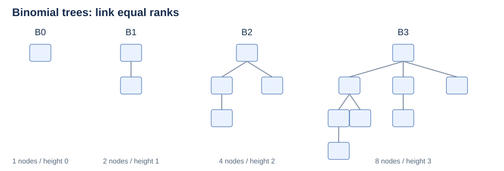
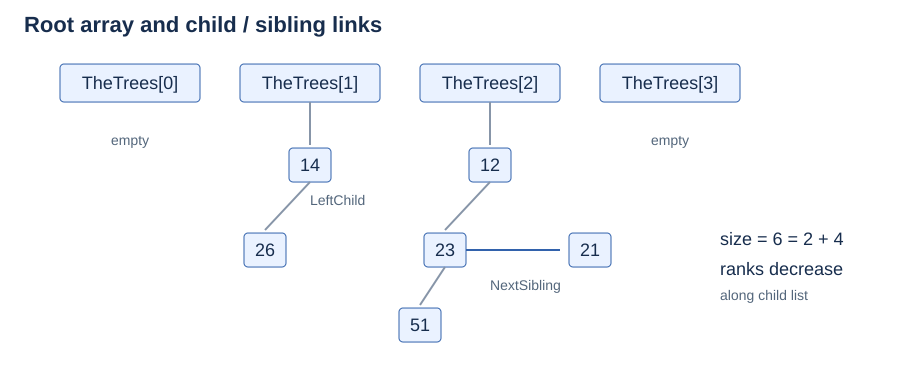
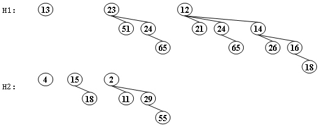
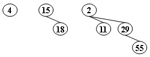
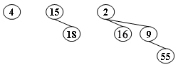

# Lecture 5: Binomial Queues（二项队列）

[Course overview（课程目录）](index.md)

## 1. Structure（结构）

**A binomial queue is a forest（森林）, not one binary heap.** It contains at most one heap-ordered binomial tree of each rank. Heap order means parent ≤ child; it does not order siblings by key.

- $B_0$ is one node. Link two $B_k$ trees by making the larger root a child of the smaller root → $B_{k+1}$, in **$O(1)$**.
- $B_k$ has **height $k$, root degree $k$, $2^k$ nodes**, and $\binom{k}{d}$ nodes at depth $d$. Its root's child subtrees are $B_{k-1},\ldots,B_0$.
- The present ranks are precisely the **1-bits of $N$（二进制表示）**. Thus the rank set is unique, but key assignments/tree labels need not be unique.
- Root count is **popcount$(N)$**, bounded by $\lfloor\log_2N\rfloor+1$, not exactly $\log N$. The slide's ceiling-only bound fails at $N=1$ and $N=2^k-1$.



**Checkpoints 5.1–5.2:** root degree $k$; size $2^k$; root count logarithmically bounded. **Quiz 5.1 / HW5 MC1:** $42=101010_2=2^5+2^3+2$ → **B: $B_1,B_3,B_5$** (other rank sets represent 63, 34 and 20).

## 2. Operations and representation（操作与表示）

| Operation | Method | Bound |
| --- | --- | --- |
| FindMin | Scan roots; cache and maintain the minimum if required. | $O(\log N)$; cached $O(1)$. |
| Merge | Binary addition of rank slots with a carry tree. | $O(\log(N_1+N_2+1))$. |
| Insert | Carry a singleton through consecutive occupied low ranks; **stop at the first empty slot**. | Worst $O(\log N)$, amortized $O(1)$. |
| DeleteMin | Find winning root, detach its tree, remove root, form child forest, merge back. | $O(\log N)$ worst/amortized bound. |
| Find arbitrary key | Traverse candidates; prune a subtree whose root exceeds the key. | Worst $O(N)$, not logarithmic. |

**Representation:** `TheTrees[k]` roots $B_k$; `CurrentSize` counts nodes. Node fields: `Element,LeftChild,NextSibling`. Link children in **decreasing rank/size**, not key order: prepend the new largest child in O(1).

```c
/* Preconditions: nonnull disjoint trees of equal rank. */
BinTree CombineTrees(BinTree a, BinTree b) {
    if (a->Element > b->Element) { BinTree t = a; a = b; b = t; }
    b->NextSibling = a->LeftChild;
    a->LeftChild = b;
    return a;
}
```



### Merge = full adder（合并就是全加器）

At rank $i$, let `A,B,C` denote the two input trees and carry. Each tree represents $2^i$ nodes. The eight cases are:

| Present trees | Output at rank $i$ | Carry to $i+1$ |
| --- | --- | --- |
| none | empty | none |
| A only / B only / C only | that tree | none |
| A+B / A+C / B+C | empty | link the pair |
| A+B+C | one tree (course code keeps C) | link the other two |

```c
/* At rank i: A = H1->TheTrees[i], B = H2->TheTrees[i].
   Carry is either NULL or a rank-i tree. CombineTrees takes equal ranks. */
switch (!!A + 2 * !!B + 4 * !!Carry) {
case 0: case 1:
    break;
case 2:
    H1->TheTrees[i] = B;
    H2->TheTrees[i] = NULL;
    break;
case 3:
    Carry = CombineTrees(A, B);
    H1->TheTrees[i] = H2->TheTrees[i] = NULL;
    break;
case 4:
    H1->TheTrees[i] = Carry;
    Carry = NULL;
    break;
case 5:
    Carry = CombineTrees(A, Carry);
    H1->TheTrees[i] = NULL;
    break;
case 6:
    Carry = CombineTrees(B, Carry);
    H2->TheTrees[i] = NULL;
    break;
case 7:
    H1->TheTrees[i] = Carry;
    Carry = CombineTrees(A, B);
    H2->TheTrees[i] = NULL;
    break;
}
```

Process every rank contributing to the total size. Clear moved slots/consumed size, enforce disjoint ownership, check capacity and counter/shift overflow. Insert must stop at the first empty slot; a full fixed-capacity scan loses its constant amortized bound.

**DeleteMin:** expose children $B_{k-1},\ldots,B_0$, detach each `NextSibling`, and place them in matching slots. Child forest size $2^k-1$; subtract $2^k$ before melding back → old size−1. Free removed root/temporary header, not transferred subtrees.

## 3. Why Insert is amortized constant（插入摊还分析）

If the lowest empty rank is $i$, insertion makes $i$ links and costs $c=i+1$ units. It replaces $i$ trees by one, so for potential **$\Phi=$ number of trees**:

$$
\Delta\Phi=1-i=2-c,\qquad \widehat c=c+\Delta\Phi=2.
$$

From empty, $2N-\Phi_N\le2N$ work plus a node-allocation lower bound gives $\Theta(N)$. Total links **$N-\operatorname{popcount}(N)$**; long carries occur geometrically less often. This is amortized, not probabilistic.

**Heap comparison:** pairwise leftist BuildHeap is also linear; link-vs-right-path-merge constants imply no universal timing ratio. Binary heaps favor locality; binomial queues favor meld/insertion. Fibonacci heaps defer consolidation and use cascading cuts: amortized Insert/Meld/DecreaseKey O(1), DeleteMin O(log N). Dijkstra benchmarks must distinguish true DecreaseKey from lazy duplicate insertion and match workloads, allocation and correctness checks.

## 4. Exercises（小测与作业）

| Source | Question | Answer / reason |
| --- | --- | --- |
| WK5 TF1, TF2 | DeleteMin / Merge are constant on average. | **Both False** as general guarantees; only optimized insertion gets the stated constant amortized bound. |
| Quiz 5.3 / WK5 TF4 | First-child/next-sibling? Increasing child sizes? | **True / False**: decreasing ranks allow front insertion. |
| Quiz 5.4 / WK5 TF5 / WK6 TF5 | $N$ insertions from empty take $O(N)$, or $\Theta(N\log N)$? | First **True**, second **False**. |
| Quiz 5.2 / WK5 TF8 | Insert into size 15 costs less than size 19. | **False**: `1111` has 4 carries; `10011` has 2. |
| WK6 TF1 | Insert into size 11 costs more than size 17. | **True** in the carry model: 2 links versus 1. |
| HW5 MC2 | Which is constant amortized: merge, find-max, delete-min, insertion? | **D: insertion**. |
| Quiz 5.4 | Merge sizes 12 and 13: potential change? | **C: −2**, popcount$(25)-$popcount$(12)-$popcount$(13)=3-2-3$. |
| WK5 MC4 | Same question for 22 and 13. | **D: −3**, $3-3-3$. |
| Quiz 5.2 / WK5 MC2 | Insert 20 into size 6, keys 12,13,14,23,24,35: which is impossible? A 20.LeftChild null; B 20.NextSibling null; C 14.NextSibling=20; D 12.LeftChild=14. | **C**. $6\to7$ fills vacant $B_0$; node 20 remains a separate root, not a sibling in a child list. |
| WK5 MC3 | Delete 14 from size 5, keys 12,13,14,23,24: impossible relation among A 12.LeftChild null; B 12.NextSibling null; C 13.NextSibling=23; D 24.LeftChild null? | **A** under a valid normalized queue: remaining size 4 is $B_2$, rooted at minimum 12, which must have children. C is possible: root 12 has child 13 (itself with child 24) followed by sibling 23. The archive's selected C is not a valid structural conclusion. |

### Pictured merge · Quiz 5.2 / HW5 MC3



**Which must be false?** A result has $B_2,B_4$; B 4 has children 13 and 15; C if 23 is child of 2 then 12 is another child; D if 4 is child of 2 then 23 is another child. **D.** Total size $13+7=20=10100_2$. In the three-tree carry case, retaining a different same-rank tree gives different valid shapes: 4 can become a child of 2 while the tree rooted at 23 is retained separately as $B_2$. Trace ranks before key comparisons; the result is not uniquely labeled.

### Pictured deletion · Quiz 5.2 / HW5 MC4; WK6 MC4 variant



Which must be false? A ranks $B_1,B_2$; B 11/15 can be children of 4; C 29 can never root a tree; D if 29 child of 4, 15 roots $B_1$. **C:** after deleting 2, six nodes remain. Of three rank-1 candidates, retain 29 as $B_1$ and link the other two into $B_2$.



**WK6 MC4:** A “9 can never be root”; B “16 and 15 can be children of 4”; C “if 9 child of 4, 15 roots $B_1$”; D ranks $B_1,B_2$. **A is false** for the same reason; this is a different labeled input.

### Code completions（程序填空）

**WK5 Insert blanks:** `H->TheTrees[i]`, then `H->TheTrees[i] = Carry`. Clear occupied slots while carrying; initialize singleton links, increment size once, check allocation/capacity.

**HW5 / WK6 Find blanks:** `>= T->Element`, `T->NextSibling != NULL`. Guard empty root slots; a safe traversal is:

```c
BinTree Recur_Find(BinTree t, ElementType x) {
    for (; t != NULL; t = t->NextSibling) {
        if (x == t->Element) return t;
        if (x > t->Element) {
            BinTree found = Recur_Find(t->LeftChild, x);
            if (found != NULL) return found;
        }
    }
    return NULL;
}
/* For each occupied root slot call Recur_Find(root, x).
   Alternatively test root != NULL && x >= root->Element first. */
```

Do not prune an entire sibling list because its first key is too large: sibling keys are unordered. Worst-case search remains $O(N)$.

**WK6 “Legal Binomial Queue”:** only options 6/26/28/1041 and placeholder answer **C (28)** are supplied; the substantive condition/figure is missing.

## 5. References（参考）

Adapted Weiss C 2nd ed.: Ch.5 pp.170–180, Ch.11 pp.430–435; CLRS 3rd ed. Ch.19 pp.505–530 (Fibonacci heaps).
