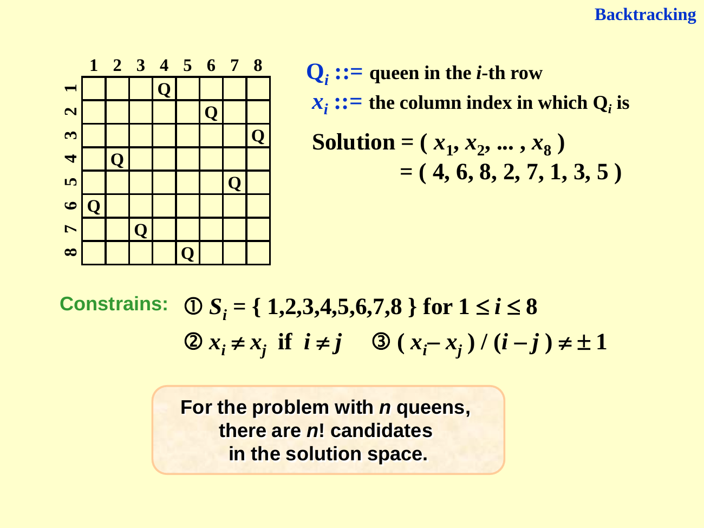
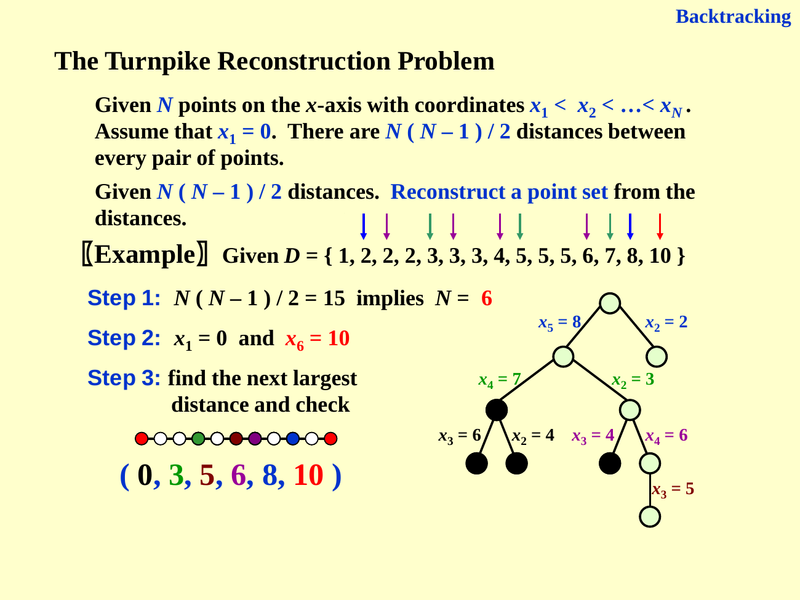
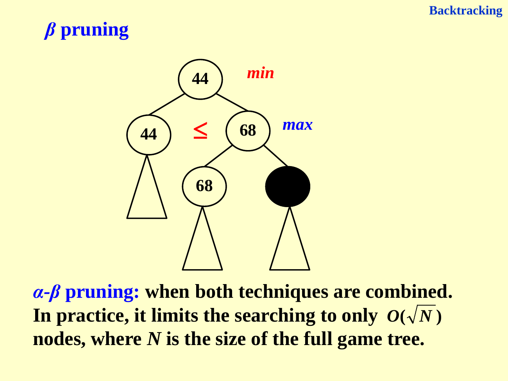
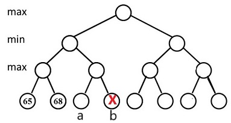
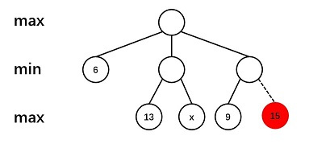
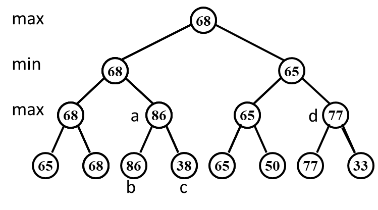

# Lecture 6: Backtracking（回溯）

[Course overview（课程目录）](index.md)

## 1. Search with reversible decisions（可撤销决策的搜索）

**Backtracking = depth-first search of partial solutions + safe pruning（深搜＋剪枝）.** Exhaustive search tests complete candidates; backtracking rejects an infeasible prefix before constructing its descendants. A search tree is an **implicit model**, not a structure to allocate in memory.

```text
search(state):
    if complete: record/return solution
    choose an unassigned variable (prefer a small remaining domain)
    for each candidate in the chosen order:
        if constraints and objective bounds permit:
            apply candidate
            recurse
            undo every modified value/count before trying the next candidate
```

**Correctness:** enumerate all allowed choices; prune only when **no completion can satisfy the goal or improve the incumbent（当前最优解）**. First-solution search may return immediately; all-solutions search must undo even after success. Memory is generally recursion depth plus state, not the entire search tree. More constrained variables first (**minimum remaining values，最少剩余值**) can expose failure earlier; it does not change the set of solutions.

**Quiz 6.1 / WK6 TF4:** exhaustive search always finds a solution in finite time — **False without finite-search-space and existence assumptions**. Finite exhaustive enumeration does terminate and can certify “no solution”. **WK6 TF3 / WK7 TF3:** surviving partial-solution counts are difficult to predict; that is why a precise backtracking running time is problem/input dependent. **WK7 TF5** claiming universal $\Omega(S)$ work for the entire candidate space is **False**: pruning can skip most candidates. Use $O(\text{visited states}\times\text{work/state})$; outputting all actual answers alone costs their total output size.

## 2. N queens（N 皇后）

Let $x_i$ be the column of the queen in row $i$. This encodes the two-dimensional board with one variable per row:

$$
1\le x_i\le n,\qquad x_i\ne x_j,\qquad |x_i-x_j|\ne|i-j|\ (i\ne j).
$$

No repeated columns → **$n!$ candidate permutations**, rather than $n^n$ unrestricted row choices. For 4 queens the implicit permutation tree has **24 leaves** (MOOC checkpoint B); valid answers are **(2,4,1,3), (3,1,4,2)**. Check each placement against earlier rows, or maintain columns and the two diagonal sets `row-col`, `row+col` for constant-time conflict tests.



**MOOC request for two 8-queen solutions:** `(4,6,8,2,7,1,3,5)` and its reflection `(5,3,1,7,2,8,6,4)`.

**Quiz 6.2:** in increasing-column DFS, `(1,3,4,?)` precedes `(1,4,2,?)`, neither extends to a solution — **True** (the first already conflicts and is pruned). **WK6 TF2 variant:** `(1,4,2,?)` precedes `(2,4,1,?)`, neither has a solution — **False**, because the latter extends with **3**. “Visited prefix” and “fully expanded branch” are different.

## 3. Turnpike reconstruction（收费站／点集重构）

Input is the **multiset（多重集）** of all pair distances, not an ordinary set: repeated distances have multiplicities. From $m=n(n-1)/2$ obtain $n$; normalize translation by $x_1=0$, set $x_n=L=\max D$, and remove one $L$. Fifteen distances mean **6 points** (checkpoint B).

Let $d=\max D$ among unused distances. The next point must be **$d$ or $L-d$**, because a largest remaining distance must span an unplaced extreme to an endpoint. For each candidate $y$:

1. Compute the **multiset** $\{|y-x|:x\text{ already placed}\}$.
2. Check every required count before subtracting anything; reject collisions/out-of-range positions.
3. Subtract the counts, recurse, and restore **exactly those counts** on failure.
4. Success requires the right number of distinct points and no leftover distances.



Course example `1,2,2,2,3,3,3,4,5,5,5,6,7,8,10` → **(0,3,5,6,8,10)**. Choosing a plausible point without multiplicity checks is not sufficient. Reflection $x\mapsto L-x$ preserves distances; normalization at 0 removes translations but not reflections or other ambiguities. Worst-case branching can be exponential; early contradictions often help.

| Source | Input / claim | Answer |
| --- | --- | --- |
| Quiz 6.3 | `2,2,4,4,6,8`: `(0,2,4,8)` is the only normalized answer. | **False**: `(0,4,6,8)` is another. |
| WK6 MC1 | `1,1,3,3,4,4,4,5,7,8`; A `(x1,x3,x5)=(0,4,8)`; B `(x1,x2,x3)=(0,1,5)`; C `(0,3,5)`; D `(x3,x4,x5)=(4,6,8)`. | **A**, witness `(0,1,4,5,8)` (its reflection is also valid). |
| WK6 MC5 | After endpoints 0,8 for `1,1,2,2,2,2,3,3,3,4,5,5,6,6,8`, next choices: A `(x2,x5)=(1,6)`; B `(2,6)`; C `(x3,x5)=(3,6)`; D `(1,5)`. | **B** in the supplied right-first search: try $x_5=6$, then $x_2=2$ as required counts dictate. This is a search order, not a uniqueness theorem. |

**Offline discussion:** largest remaining distance guarantees two endpoint-derived candidates. Replacing it by the smallest distance loses that argument: it may lie between two interior points, so two guessed placements are no longer exhaustive. Store a sorted multiset or count map; deletion must remove only one occurrence.

## 4. Minimax and alpha–beta pruning（极小极大与 α–β 剪枝）

Tic-tac-toe has $3^9=19683$ raw board assignments and $9!=362880$ full move permutations; many are **illegal or terminate earlier**, so these are not counts of legal finished games.

A heuristic evaluation can be $f(P)=W_{computer}-W_{human}$, where each $W$ counts rows/columns/diagonals still open to that side. It is an estimate at a search cutoff, not an exact winning probability. Computer nodes maximize; opponent nodes minimize. Terminal wins/losses must receive consistent decisive scores.

**Minimax recurrence:** leaf → evaluation; MAX → maximum child; MIN → minimum child. Search children left to right unless specified otherwise.

- $\alpha$: best lower bound already guaranteed to MAX.
- $\beta$: best upper bound already guaranteed to MIN.
- MAX updates $\alpha\gets\max(\alpha,v)$; MIN updates $\beta\gets\min(\beta,v)$.
- **Prune when $\alpha\ge\beta$**: remaining children cannot change an ancestor's decision. Bounds are passed down; updates are local to the current search context.



The slide's $O(\sqrt S)$ ideal node count assumes favorable move ordering in a roughly balanced full game tree. Worst case remains $O(S)$; good ordering changes work, not minimax's exact root value at the same depth. **AlphaGo is motivational context; minimax alone is not its full algorithm.**

### Game-tree questions（博弈树题）



First MAX child returns 68, so its MIN parent has $\beta=68$. At the next MAX child, prune b if **$a\ge68$**. Among “a>65 / a<65 / a>68 / a<68”, only **A: a>65** is necessarily true; `a=68` shows why C is too strong. The archive's B is incorrect.



Root first gets 6, then $\min(13,x)$. Before the last MIN subtree, $\alpha=\max(6,\min(13,x))$. After its first leaf 9, prune red 15 iff $\alpha\ge9$, equivalent to **$x\ge9$ (D)**. Other options restrict x unnecessarily.


**HW6 MC1:** goodness options −1/0/4/5 → **B: 0**. Both sides have **3** open winning lines; count unblocked lines, not occupied squares.



**HW6 MC2:** which of a/b/c/d is pruned first? **C: c**. Leftmost MAX returns 68; the next MAX sees 86 with $\beta=68$, so it skips its second leaf 38 (c). The whole node a is not skipped: one child was examined.

## 5. Branch and bound: 0–1 knapsack（分支限界与背包）

**WK7 code review:** `W` is remaining capacity; `val` is current profit; `r` bounds remaining profit; each object is used 0 or 1 time. For nonnegative profits, `val+r <= optp` cannot improve the incumbent. Keep `n` unchanged, advance `i`, subtract only chosen weight, and undo the profit added in that branch:

```c
/* Fill the recursive call and the backtrack statement. */
optp = Knapsack01(W - s[i].w*x[i], n, s, x,
                 val, r, i+1, optx, optp);
/* after the recursive/pruning test, inside the feasible branch: */
val -= s[i].p*x[i];
```

At the current level first do `r -= s[i].p`, then loop `x[i]=0,1`; at `i==n` copy the improved solution. The archived `W-1, n-1, val+r` call is wrong: it mixes state meanings and can miss the termination condition. Fractions may supply a tighter bound only when their relaxed optimum is computed correctly.

## 6. HW6: Werewolf（狼人杀）

[Full problem, three samples and C source](hw6-werewolf.md). Choose exactly $M$ wolves, test exactly $L$ liars and **$1\le$ wolf-liars $<M$**. Descending-index wolf-first DFS returns the lexicographically largest descending answer. This is exponential worst case, even though the supplied accepted submission passes its tests.

## 7. Offline extension: nonogram constraints（数织约束）

The subsequent backtracking presentations use row/column clues consisting of lengths of consecutive filled runs. For line length L and k runs totaling s filled cells, placements must reserve k−1 separating blank cells; if feasible, there are $\binom{L-s+1}{k}$ raw line patterns (k=0 gives the all-blank pattern). Generate feasible line masks, intersect row/column constraints, force cells agreed on by all surviving patterns, and branch on a constrained line/cell when propagation stalls. Undo removals and cell assignments on backtracking. Empty candidate sets certify a contradiction; a complete assignment must satisfy **both** row and column clues. Propagation is a pruning method, not a general polynomial solver; candidate spaces can still grow exponentially. Distinguish first-solution search, uniqueness testing and enumeration of all solutions.

## 8. Sources（来源）

`~/ADS-docs/6`: MOOC merged/lesson notes/quizzes and PDF; offline `downloads/course_87216_sub_1983135`; WK6/HW6. WK7 backtracking-only review belongs here. Pictures are supplied lecture/PTA figures, retained for study. Heap-only questions belong to Lectures 4–5. Reading: adapted Weiss Ch.10 pp.403–414. Status `draft`; malformed exports are identified rather than silently completed.
