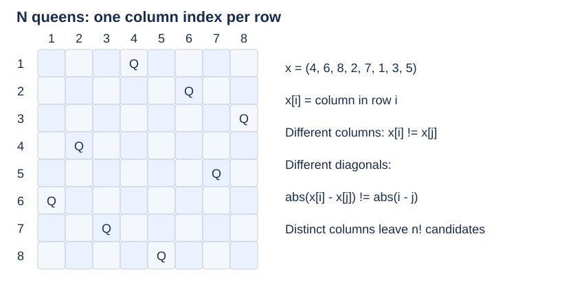
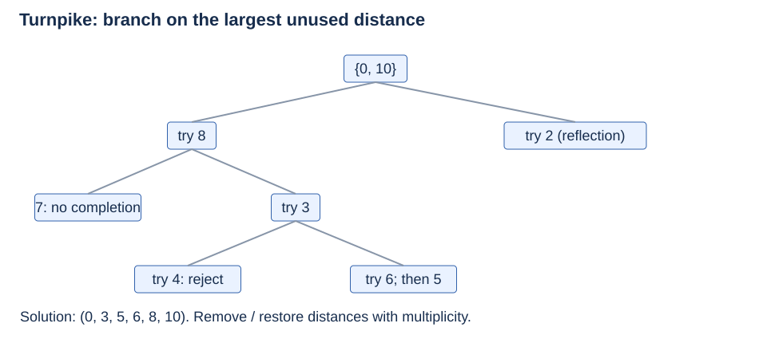
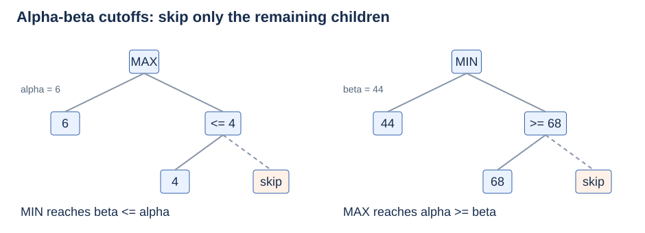
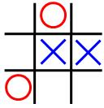

# Lecture 6: Backtracking（回溯）

[Course overview（课程目录）](index.md)

## 1. Search with reversible decisions（可撤销决策的搜索）

**Backtracking= DFS of partial solutions + safe pruning（剪枝）.** Reject infeasible prefixes before constructing descendants. The search tree is implicit, not allocated.

```text
search(state):
    if complete: record/return solution
    choose an unassigned variable (prefer a small remaining domain)
    for each candidate in the chosen order:
        if constraints and objective bounds permit:
            apply candidate
            recurse
            undo every modified value/count before trying the next candidate
```

Enumerate every allowed choice; prune only if **no completion meets the goal/improves the incumbent**. First-solution search may return immediately; all-solutions search must undo after success. Store depth/state, not the whole tree. **MRV（最少剩余值）:** choose a small remaining domain to expose failure earlier without losing solutions.

**Quiz 6.1 / WK6 TF4:** exhaustive search always finds a solution in finite time → **False** without finiteness/existence; finite enumeration terminates, possibly with no solution. **WK6 TF3 / WK7 TF3:** surviving-prefix counts are hard to predict → **True**. **WK7 TF5:** universal $\Omega(S)$ over the full candidate space → **False**, since pruning skips candidates. Cost = visited states × work/state; enumerating answers also costs their output size.

## 2. N queens（N 皇后）

Let $x_i$ be the column of the queen in row $i$. This encodes the two-dimensional board with one variable per row:

$$
1\le x_i\le n,\qquad x_i\ne x_j,\qquad |x_i-x_j|\ne|i-j|\ (i\ne j).
$$

Distinct columns leave **n!** permutations, rather than nⁿ unrestricted row choices. Four queens: **24 leaves (B)**, solutions **(2,4,1,3), (3,1,4,2)**. Check earlier rows, or use occupied-column/`row-col`/`row+col` sets for O(1) conflict tests.



**MOOC request for two 8-queen solutions:** `(4,6,8,2,7,1,3,5)` and its reflection `(5,3,1,7,2,8,6,4)`.

**Quiz 6.2:** in increasing-column DFS, `(1,3,4,?)` precedes `(1,4,2,?)`, neither extends to a solution — **True** (the first already conflicts and is pruned). **WK6 TF2 variant:** `(1,4,2,?)` precedes `(2,4,1,?)`, neither has a solution — **False**, because the latter extends with **3**. “Visited prefix” and “fully expanded branch” are different.

## 3. Turnpike reconstruction（收费站／点集重构）

Input is the **multiset（多重集）** of all pair distances, not an ordinary set: repeated distances have multiplicities. From $m=n(n-1)/2$ obtain $n$; normalize translation by $x_1=0$, set $x_n=L=\max D$, and remove one $L$. Fifteen distances mean **6 points** (checkpoint B).

Let $d=\max D$ among unused distances. The next point must be **$d$ or $L-d$**, because a largest remaining distance must span an unplaced extreme to an endpoint. For each candidate $y$:

1. Compute the **multiset** $\{|y-x|:x\text{ already placed}\}$.
2. Check every required count before subtracting anything; reject collisions/out-of-range positions.
3. Subtract the counts, recurse, and restore **exactly those counts** on failure.
4. Success requires the right number of distinct points and no leftover distances.



`1,2,2,2,3,3,3,4,5,5,5,6,7,8,10` → **(0,3,5,6,8,10)**. Verify multiplicities. Fixing x₁=0 removes translations, not reflections $x\mapsto L-x$ or other ambiguities. Branching can be exponential.

| Source | Input / claim | Answer |
| --- | --- | --- |
| Quiz 6.3 | `2,2,4,4,6,8`: `(0,2,4,8)` is the only normalized answer. | **False**: `(0,4,6,8)` is another. |
| WK6 MC1 | `1,1,3,3,4,4,4,5,7,8`; A `(x1,x3,x5)=(0,4,8)`; B `(x1,x2,x3)=(0,1,5)`; C `(0,3,5)`; D `(x3,x4,x5)=(4,6,8)`. | **A**, witness `(0,1,4,5,8)` (its reflection is also valid). |
| WK6 MC5 | After endpoints 0,8 for `1,1,2,2,2,2,3,3,3,4,5,5,6,6,8`, next choices: A `(x2,x5)=(1,6)`; B `(2,6)`; C `(x3,x5)=(3,6)`; D `(1,5)`. | **B** in the supplied right-first search: try $x_5=6$, then $x_2=2$ as required counts dictate. This is a search order, not a uniqueness theorem. |

Largest-unused distance gives the two endpoint-derived candidates. The smallest may connect interior points, so two analogous guesses are incomplete. Use a sorted multiset/count map; remove one occurrence at a time.

## 4. Minimax and alpha–beta pruning（极小极大与 α–β 剪枝）

Tic-tac-toe has $3^9=19683$ raw board assignments and $9!=362880$ full move permutations; many are **illegal or terminate earlier**, so these are not counts of legal finished games.

$f(P)=W_{computer}-W_{human}$ counts the difference in unblocked winning lines. It is a cutoff heuristic, not a winning probability; give terminal wins/losses decisive scores.

**Minimax recurrence:** leaf → evaluation; MAX → maximum child; MIN → minimum child. Search children left to right unless specified otherwise.

- $\alpha$: best lower bound already guaranteed to MAX.
- $\beta$: best upper bound already guaranteed to MIN.
- MAX updates $\alpha\gets\max(\alpha,v)$; MIN updates $\beta\gets\min(\beta,v)$.
- **Prune when $\alpha\ge\beta$**: remaining children cannot change an ancestor's decision. Bounds are passed down; updates are local to the current search context.



Ideal $O(\sqrt S)$ node search assumes favorable ordering in a balanced game tree; worst case O(S). Ordering changes work, not the exact same-depth minimax result. Minimax alone is not AlphaGo’s full algorithm.

### Game-tree questions（博弈树题）


First MAX child returns 68, so its MIN parent has $\beta=68$. At the next MAX child, prune b if **$a\ge68$**. Among “a>65 / a<65 / a>68 / a<68”, only **A: a>65** is necessarily true; `a=68` shows why C is too strong. The archive's B is incorrect.


Root first gets 6, then $\min(13,x)$. Before the last MIN subtree, $\alpha=\max(6,\min(13,x))$. After its first leaf 9, prune red 15 iff $\alpha\ge9$, equivalent to **$x\ge9$ (D)**. Other options restrict x unnecessarily.



**HW6 MC1:** goodness options −1/0/4/5 → **B: 0**. Both sides have **3** open winning lines; count unblocked lines, not occupied squares.


**HW6 MC2:** which of a/b/c/d is pruned first? **C: c**. Leftmost MAX returns 68; the next MAX sees 86 with $\beta=68$, so it skips its second leaf 38 (c). The whole node a is not skipped: one child was examined.

## 5. Branch and bound: 0–1 knapsack（分支限界与背包）

**WK7 knapsack:** W=remaining capacity, val=chosen profit, r=remaining-profit bound. With nonnegative profits, prune when `val+r <= optp`. Keep n fixed, advance i, subtract chosen weight and undo chosen profit:

```c
/* Fill the recursive call and the backtrack statement. */
optp = Knapsack01(W - s[i].w*x[i], n, s, x,
                 val, r, i+1, optx, optp);
/* after the recursive/pruning test, inside the feasible branch: */
val -= s[i].p*x[i];
```

Do `r -= s[i].p` before trying x[i]=0/1; copy improvements at i==n. The submitted `W-1,n-1,val+r` mixes states/termination. A fractional relaxation can tighten the bound if computed correctly.

## 6. HW6: Werewolf（狼人杀）

[Full problem, three samples and C source](hw6-werewolf.md). Choose exactly $M$ wolves, test exactly $L$ liars and **$1\le$ wolf-liars $<M$**. Descending-index wolf-first DFS returns the lexicographically largest descending answer. This is exponential worst case, even though the supplied accepted submission passes its tests.

## 7. Offline extension: nonogram constraints（数织约束）

**Nonogram（数织）：** rows/columns specify filled-run lengths. For length L and k runs totaling s cells, reserve k−1 separators; feasible raw line patterns number $\binom{L-s+1}{k}$ (k=0 → all blank). Generate masks, intersect row/column constraints, force cells common to all surviving masks; branch on a constrained cell/line when propagation stalls. Undo assignments/candidate removals. Empty domain → contradiction; final grid must satisfy both clue directions. Propagation does not remove exponential worst cases. First solution, uniqueness test and full enumeration are different tasks.

## 8. References（参考）

Adapted Weiss C 2nd ed.: Ch.10 pp.403–414.
