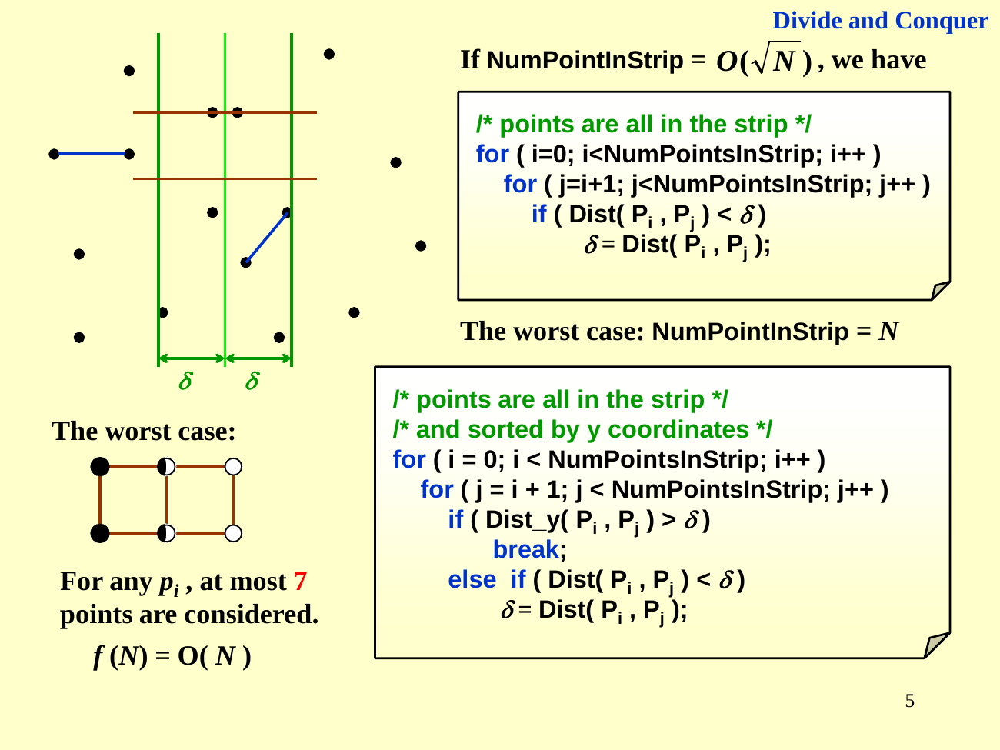
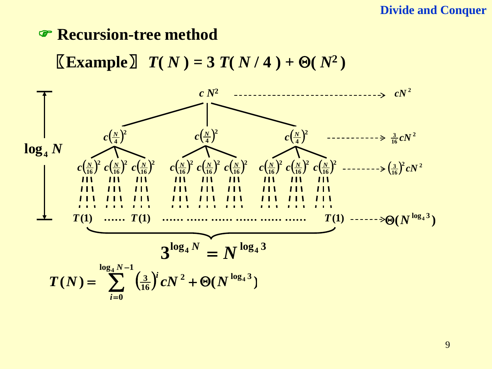
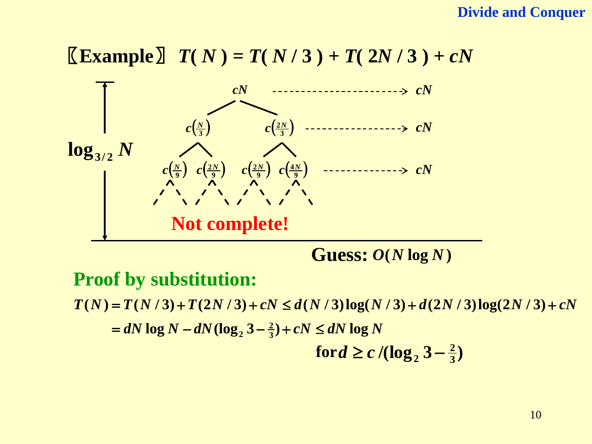

# Lecture 7: Divide and Conquer（分治）

[Course overview（课程目录）](index.md)

## 1. Model（模型）

**Divide（划分）→ conquer（递归求解）→ combine（合并）.** For a subproblems of size n/b and nonrecursive cost f(n):

$$
T(n)=aT(n/b)+f(n),\qquad T(n)=\Theta(1)\text{ for bounded }n.
$$

$a\ge1,b>1$ must be constants for the standard theorem. Floors/ceilings usually preserve regular bounds; establish bounded-size bases. Count recursive and combine work. Examples: max-subarray D&C Θ(n log n) (linear alternative exists), traversal Θ(n), mergesort Θ(n log n), quicksort expected Θ(n log n)/worst Θ(n²).

**Quiz 7.1 / WK7 MC2:** among heap/insertion/merge/quick/selection/Shell sorts, the standard D&C examples are **merge and quick: A (2)**. **WK7 TF7 / WK8 TF3:** the recurrence's stated meaning is **True**.

## 2. Closest pair（最近点对）

Exhaustive search checks **$n(n-1)/2$ pairs**, $\Theta(n^2)$ (checkpoint D). Duplicated coordinates immediately give distance 0.

1. Sort points by x, divide by **rank** into balanced halves; retain unique point IDs for equal x coordinates.
2. Recursively obtain $\delta_L,\delta_R$; put $\delta=\min(\delta_L,\delta_R)$.
3. Only cross pairs in the **width-$2\delta$ vertical strip** can improve the result.
4. Scan strip points in **y order**, comparing each to at most the next **7** points, stopping when y difference exceeds $\delta$.

**Packing proof（装箱论证）：** the $2\delta\times\delta$ candidate rectangle divides into two $\delta\times\delta$ halves. Split each half into four $\delta/2$ squares; each can hold at most one point **from that side** because its diagonal is $\delta/\sqrt2<\delta$. At most eight points including the current point → seven later candidates. Boundary ties may be resolved consistently; pairs at distance exactly $\delta$ need not improve the answer.

Maintain y order by **linear partition/merge** → $T(n)=2T(n/2)+O(n)=O(n\log n)$. Sorting every strip gives $O(n\log^2n)$; all cross pairs can cost $O(n^2)$. **WK7 TF1: True for this method**, not an impossibility theorem for all algorithms. **MOOC squares:** closer same-side points contradict δ.

## 3. Solving recurrences（递推式求解）

### Substitution（代入归纳）

Guess, fix its constant, substitute and close **the same bound**, including bases. For $T(n)=2T(\lfloor n/2\rfloor)+n$, induct from $n_0\ge2$:

$$
T(n)\le cn\log_2 n-cn+n\le cn\log_2n\quad(c\ge1).
$$

Choose c for all bases. The linear guess fails: $(c+1)n=O(n)$ does not prove $T(n)\le cn$ with the same c.

### Recursion tree（递归树）

At level $j$: $a^j$ problems of size $n/b^j$, work $a^jf(n/b^j)$; height $\log_b n$, leaves $n^{\log_ba}$. Sum internal levels **plus leaves**.

- $2T(n/2)+cn$: each level cn, $\log_2n$ levels → $\Theta(n\log n)$.
- $2T(n/2)+cn^2$: level ratio 1/2 → $\Theta(n^2)$ (checkpoint **C**).
- $3T(n/4)+cn^2$: height **$\log_4n$ (checkpoint C)**, ratio 3/16, leaves $n^{\log_43}$ → $\Theta(n^2)$.
- $T(n/3)+T(2n/3)+cn$: unequal-depth tree, height at most $\log_{3/2}n$; substitution yields $\Theta(n\log n)$. For an upper bound choose $d\ge c/(\log_23-2/3)$. Do not apply the equal-size Master theorem directly.

### Master theorem（主定理）

Let $p=\log_ba$ and assume eventually nonnegative regular costs.

| Compare $f(n)$ to $n^p$ | Required condition | Result |
| --- | --- | --- |
| Polynomially smaller | $f(n)=O(n^{p-\epsilon})$ for fixed $\epsilon>0$ | $\Theta(n^p)$ |
| Same scale | $f(n)=\Theta(n^p)$ | $\Theta(n^p\log n)$ |
| Polynomially larger | $f(n)=\Omega(n^{p+\epsilon})$ **and** $af(n/b)\le cf(n)$ for some fixed $c<1$ | $\Theta(f(n))$ |

**Polynomial gap（多项式差距）** is essential: a log factor alone is not $n^\epsilon$. For $f(n)=\Theta(n^k\log^q n)$, $q\ge0$, the useful extension is:

$$
T(n)=\begin{cases}
\Theta(n^{\log_ba}),&a>b^k,\\
\Theta(n^k\log^{q+1}n),&a=b^k,\\
\Theta(n^k\log^q n),&a<b^k.
\end{cases}
$$

Proof idea: level costs form a decreasing geometric sum (root-dominated), equal contributions (extra log), or an increasing sum (leaf-dominated). In case 1 the total inner work is $O(n^p)$ and the leaves already cost $\Theta(n^p)$; in case 2 each level costs $\Theta(n^p)$.

**Ratio form:** if $af(n/b)=Kf(n)$ for a fixed K, then K<1 → $\Theta(f)$; K=1 → $\Theta(f\log_bn)$; K>1 → $\Theta(n^p)$, **not $\Theta(f)$**. Merely approaching 1 does not give the equality case. **MOOC:** $n\log n=O(n^{2-\epsilon})$ is true for some fixed $0<\epsilon<1$ (e.g. 1/2), not for every positive epsilon.

## 4. Exercises and parameter traps（习题与参数陷阱）

| Source | Recurrence / task | Answer and derivation |
| --- | --- | --- |
| Quiz 7.2 / HW7 MC3 | Three-way mergesort: n log²n / n²logn / nlogn / n? | **C**, $3T(n/3)+\Theta(n)=\Theta(n\log n)$. |
| Quiz 7.3 / HW7 MC1 | $8T(n/3)+n^2\log n$ | **A: $\Theta(n^2\log n)$**, since $\log_38<2$. |
| Quiz 7.3 / HW7 MC2 | Worst among $2T(n/3)+n$, $2T(n/3)+n\log n$, $3T(n/2)+n$, $3T(n/3)+n\log n$? | **C**: respective bounds $\Theta(n),\Theta(n\log n),\Theta(n^{\log_23}),\Theta(n\log^2 n)$. |
| WK7 TF2 / WK8 TF4 | K>1 implies $T=\Theta(f)$? | **False**: leaves dominate. Archived WK7 “True” is wrong. |
| WK7 TF4 | $8T(n/2)+n^3\log n=O(n^3\log n)$? | **False**, tight $\Theta(n^3\log^2n)$. |
| WK7 TF6 | Ratio exactly 1 implies $\Theta(f\log_bn)$? | **True** under the theorem's assumptions. |
| WK7 MC1 | Find min and max from two half-results: combine cost? | **B: $O(1)$**, two comparisons, total $\Theta(n)$. |
| WK8 MC7 | $4T(n/2)+n$ | **A: $\Theta(n^2)$**. |
| HW7 TF1 | Block matrix multiplication with eight half-size products beats cubic? | **False**, $8T(n/2)+\Theta(n^2)=\Theta(n^3)$. Seven-product Strassen is a different algorithm. |
| HW7 TF2 | Fibonacci $F_{n^3}$ via 2×2 matrix exponentiation takes $O(\log n)$? | **True in unit-cost arithmetic**, $O(\log(n^3))$ matrix products. Exact integer bit complexity is larger because output length grows with $n^3$. |
| HW7 MC4 | $T(n)=2T(\sqrt n)+\log n$ | **A: $\Theta(\log n\log\log n)$**. Let $m=\log n$, giving $S(m)=2S(m/2)+m$. |

**WK8 “Concepts About Divide-and-Conquer”:** only a placeholder saying **C (2)** and numeric options 0/1/2/3 is supplied; the substantive question is missing. It cannot support a reconstructed derivation.

**k-way mergesort:** k is a parameter. Heap merge costs Θ(n log k) per level; depth logₖn → Θ(n log n), 2≤k≤n. Scanning k heads costs Θ(nk) per level → Θ(nk logₖn), quadratic at k=n. Sorting heads once does not maintain order after replacement; hiding k inside O(n) is invalid.

## 5. References（参考）

CLRS 3rd ed.: Ch.4 pp.65–113; adapted Weiss Ch.10 pp.370–375; Erickson CS373 recurrence notes (2003), pp.10–13.
