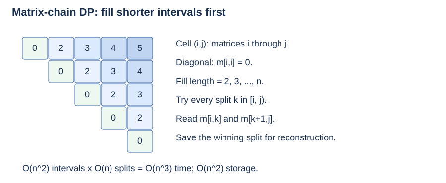
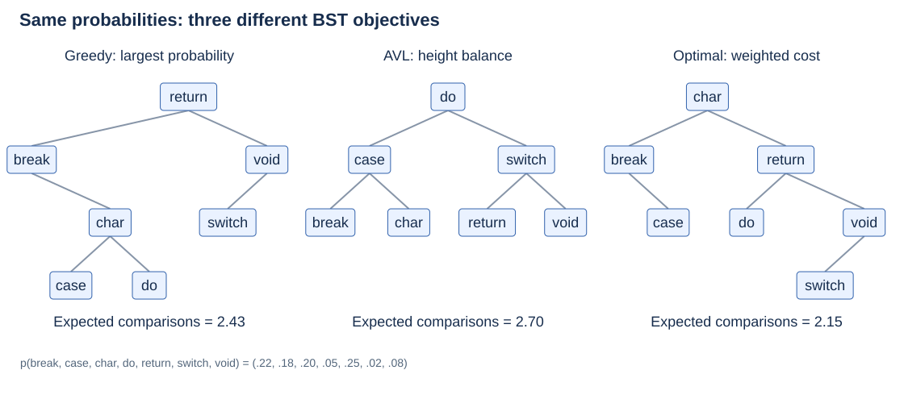
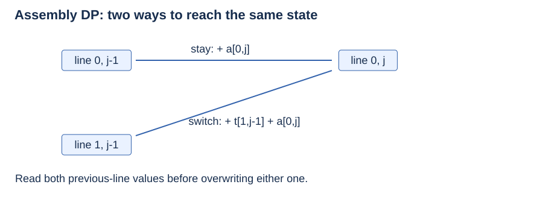

# Lecture 8: Dynamic Programming（动态规划）

[Course overview（课程目录）](index.md)

## 1. State, dependency, reuse（状态、依赖与复用）

**DP（动态规划）：** compute each subproblem once and retain results in arrays/hash tables. Bottom-up tabulation（制表）or top-down memoization（记忆化）both work; recursion is allowed. **Quiz 8.1 / WK8 TF1: True.**

**State → optimal substructure（最优子结构）→ transitions/bases → dependency order → reconstruction → cost.** Prove substructure by replacing a nonoptimal component. Overlap makes reuse useful; independent subproblems favor D&C.

**History-dependency（历史依赖）** invalidates an insufficient state: add needed history, potentially causing exponential state growth. E.g. assembly discounts based on earlier choices cannot use `(line,stage)` alone.

## 2. Fibonacci（斐波那契数）

**F(0)=F(1)=1**, F(n)=F(n−1)+F(n−2). Naive recursion repeats work: $\Theta(\varphi^n)$ unit-cost steps. Memoization/tabulation: O(n) time; last-two-value storage: O(1) extra space. Compute the sum before overwriting inputs. Exact arithmetic adds bit costs; fixed-width integers overflow.

## 3. Matrix-chain multiplication（矩阵链乘）

Matrix $A_i$ has dimensions $r_{i-1}\times r_i$. Multiplication is **associative, not commutative（可结合，不可交换次序）**. Parenthesization changes arithmetic work, not the matrix sequence.

$$
m[i,j]=\min_{i\le k<j}\{m[i,k]+m[k+1,j]+r_{i-1}r_kr_j\},\qquad m[i,i]=0.
$$

Store `split[i][j]` and reconstruct its two intervals. Fill by increasing **interval length**: $n(n+1)/2=\Theta(n^2)$ states × O(n) splits → **Θ(n³) time/Θ(n²) space**.



Example dimensions **10,20,50,1,100**: right-nested $A_1(A_2(A_3A_4))$ costs **125000**; **$(A_1(A_2A_3))A_4$ costs 2200**, the optimum. Cost counts scalar multiplications, not just the n−1 matrix products.

**MOOC 8.2 checkpoint:** $b_n=\sum_{k=1}^{n-1}b_kb_{n-k}$, $b_1=1$ (D). Parenthesization count is Catalan $C_{n-1}=\Theta(4^n/n^{3/2})$; $b_2=1,b_3=2,b_4=5$. **Quiz 8.2 / WK8 MC6:** only **B: $O(n^2)$** distinct intervals despite exponentially many complete parenthesizations. Thus repeated subproblems are unavoidable in naive enumeration.

## 4. Optimal BST（最优二叉搜索树）

For static keys $w_1<\cdots<w_n$ and successful-search probabilities $p_i$, minimize $\sum_i p_i(\mathrm{depth}(w_i)+1)$. BST order restricts subtree keys; highest probability need not be root. AVL targets height, not weighted cost.

$$
C[i,j]=W[i,j]+\min_{i\le k\le j}\{C[i,k-1]+C[k+1,j]\},\quad
W[i,j]=\sum_{t=i}^{j}p_t.
$$

**Bases:** empty=0, singleton=$p_i$; correct the slide’s cᵢᵢ=0/exclusive split limit. Prefix sums give W in O(1). Increasing-length fill over all roots: O(n³) time/O(n²) space; save `root[i][j]`. Knuth’s O(n²) optimization requires root monotonicity/valid weights. This model omits unsuccessful-search probabilities; full OBST includes them.



Keys `break,case,char,do,return,switch,void`, probabilities `.22,.18,.20,.05,.25,.02,.08`: greedy root=return cost **2.43**; shown AVL root=do cost **2.70**; optimal root=char cost **2.15**. Optimal tree: char → left break (right case), right return (left do; right void with left switch). **MOOC interval case..do:** cost **0.66**, root **char**. **Quiz 8.3 / WK8 TF2:** highest-probability key always root — **False**. **WK8 MC3:** loop by `k=j-i`, then valid i, then candidate roots → **C**; initialize singletons first.

## 5. Floyd–Warshall（全源最短路）

State $D^{(k)}[i,j]$ permits only the first k vertices as **intermediate vertices（中间顶点）**; endpoints are unrestricted.

$$
D^{(k)}[i,j]=\min\{D^{(k-1)}[i,j],D^{(k-1)}[i,k]+D^{(k-1)}[k,j]\}.
$$

Initialize diagonal 0, existing edges to the minimum parallel-edge cost, absent edges to infinity. In-place recurrence is valid without negative cycles; guard infinity additions against overflow. Record `next[i][j]=next[i][k]` when an improvement goes through k to reconstruct paths.

```text
for intermediate k:
    for source i:
        for destination j:
            if i→k and k→j are finite:
                D[i][j] = min(D[i][j], D[i][k] + D[k][j])
```

**O(V³) time/O(V²) space.** Negative edges are allowed; a negative diagonal detects a negative cycle. Pairs reaching/leaving it have no finite shortest walk, though Floyd terminates. **Quiz 8.4 / WK8 MC2: B.** Sparse graphs may favor repeated single-source algorithms; cost depends on representation/queue.

**Offline / WK8 MC1: loop order is about roles, not variable names.** A `i,k,j` updating D[i][j] uses source outermost → wrong. B `i,j,k` → wrong. **C `i,k,j` updating D[k][j] via D[k][i]+D[i][j] is correct**: i is actually the intermediate vertex. D `k,i,j` with that same update uses source outermost → wrong. The archived answer D is incorrect.

**Counterexample to i,j,k:** unit edges `0→3→2→1`; processing (0,1) too early leaves ∞ instead of 3. Swapping inner source/destination loops is safe if intermediate stays outermost.

**Dijkstra:** reuse distances and relax $d[v]\gets\min(d[v],d[u]+w(u,v))$. Nonnegative edges let the unsettled minimum be finalized; negative edges break that proof. The state invariant follows **settled vertices**, not numerical vertex order. Reuse and greedy finalization are separate arguments.

## 6. Product assembly（装配线）

At each stage choose a line; the current state must retain which line was reached. Let $a_{\ell,j}$ be processing time at line ℓ, stage j; $t_{\ell,j}$ be **transfer-only** time from ℓ after stage j to the other line.

$$
f_{\ell,j}=a_{\ell,j}+\min\{f_{\ell,j-1},\ f_{1-\ell,j-1}+t_{1-\ell,j-1}\}.
$$

Add entry costs in the bases and exit costs at the end when specified. The slides instead attach **complete edge costs** to stay/move edges; if their `t_transit` already includes processing, do not add processing again. State the convention before applying a formula.



Save predecessor line `L[line][stage]` and backtrack from the best final line. O(n) time/space with reconstruction; O(1) value space by reading both old states before overwriting. Enumeration costs O(2ⁿ). Substructure: replace a slower prefix reaching the same line/stage; later edge costs stay unchanged.

## 7. Additional DP exercises（补充题）

| Source | Task | Answer / reasoning |
| --- | --- | --- |
| WK8 MC5 | Which is best solved by DP: merge/closest-pair/quick/LCS? | **D: LCS**, overlapping prefix states; matching final chars → diagonal+1, otherwise maximum of dropping either last char. O(mn) time. |
| Quiz 8.5 / HW8 MC2 | Which dependency prevents ordinary bottom-up evaluation? A upper/left/diagonal; B smaller diagonal states; C previous row and left; D `(i-2,j-2)` and `(i+2,j+2)`. | **D**: mutual cyclic dependencies. A rows/columns increasing; B compute diagonal states first; C rows increasing. Additional fixed-point methods are outside this question's DP model. |
| HW8 MC3 | $f_{i,j,k}=f_{i,j+1,k}+\min_{0\le l\le k}(f_{i-1,j,l}+w_{j,l})$. Which order is invalid? A k↑ i↑ j↓; B i↑ j↑ k↑; C i↑ j↓ k↓; D i↑ j↓ k↑. | **B**, needs larger j first. A works since smaller k layers are already done and same-k previous i is done; C/D work by previous i. Provide boundary states before filling. |
| HW8 MC1 | Rod prices at lengths 1..10: `1,5,8,9,10,17,17,20,23,28`; identify wrong recurrence. | **D** using fixed $R_{N-M}$ regardless of split. Correct $R_0=0$, $R_N=\max_{1\le l\le\min(N,M)}(P_l+R_{N-l})$, O(NM), O(N²) if M≤N. $R_8=22$ via 2+6; $R_3=8$ without cutting. For N≤M, splitting into $R_i+R_{N-i}$ plus the uncut price is also valid. |

### Decode · WK8 code completion

Map **A–Z to 0–25**, not 1–26. A single `0` is valid (A), but `07` is not a two-digit code. Let dp[i] count suffix decodings. If the first two digits form **10..25**, add the two choices; otherwise use only the single-digit choice:

```c
/* Archived blanks; widen before addition if BASE is near INT_MAX. */
dp[i] = (int)(((long long)dp[i+1] + dp[i+2]) % BASE);
/* else */
dp[i] = dp[i+1];
```

For a clean implementation set internal empty-suffix dp[L]=1 and scan right to left; retain the supplied API's empty-input return 0. The submitted constants 3 and 2 are wrong. Example `1213407` has **5** decodings: BCBDEAH, MBDEAH, BCNEAH, BVDEAH, MNEAH. Time O(L), rolling space O(1) if only the count is needed.

### HW8 Programming Contest（竞赛选题）

[Full problem, sample and C function](hw8-programming-contest.md). Each problem is taken once or skipped; minimize time subject to score **at least** H. Let dp[s] be minimum time to reach at least s points:

$$
dp_{new}[s]=\min(dp_{old}[s],\ dp_{old}[\max(0,s-score_i)]+time_i).
$$

Initialize dp[0]=0, other states infinity; update **s decreasing** so the same problem cannot be reused. Return −1 if H is unreachable. O(nH) time/O(H) space, **pseudo-polynomial（伪多项式）** in binary-encoded H; a numeric parameter cannot be hidden as a constant. This corrects the offline misconception that every table DP is polynomial in input bit length.

## 8. Offline extension: contiguous process batching（连续工序分段）

For adjacent-process merging, preserve original order as contiguous blocks. With workload prefix Q, block [l,r] costs $t_l(Q_r-Q_{l-1})$ using its first process’s unit time. Track merge fees separately; minimize **(total time,fee) lexicographically**, not their unscaled sum.

For exactly b nonempty blocks:

$$
F[i,b]=\min_{b\le l\le i}\{F[l-1,b-1]+\operatorname{cost}(l,i)\},\qquad F[0,0]=(0,0).
$$

Other bases are ∞. Exactly b blocks use i−b merges; **at most K merges** requires the best final b≥n−K, not exactly K. Equivalent merge-count states must use consistent bases. Prefix-sum block costs → O(n³), or O(n²K) for bounded merges. Two rolling b layers give O(n) value space; reconstruction needs choices/recomputation.

Local merges change future leaders/boundaries and can lose the best partition. Convex-hull optimization rewrites time candidates as lines, e.g. $t_lQ_i+(F[l-1,b-1]-t_lQ_{l-1})$. A monotone hull needs proven slope/query order; equal-time fee ties and general cost models require separate treatment.

## 9. References（参考）

CLRS 3rd ed.: Ch.15 pp.359–413. Lecture 8 exports repeated with Lecture 9 are merged here.
