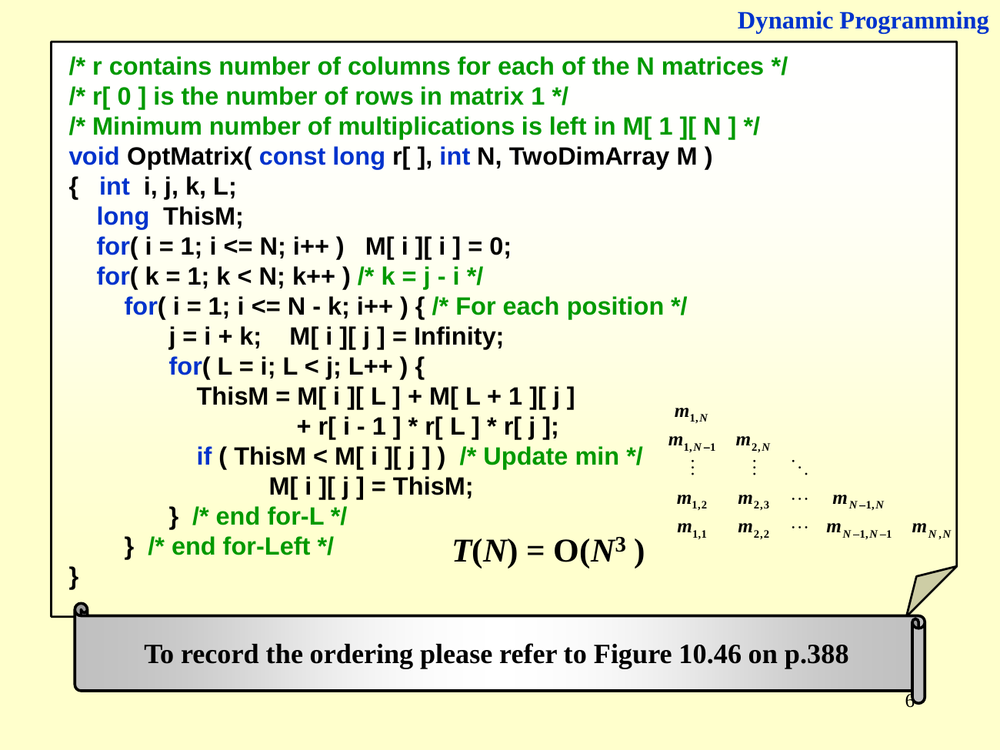
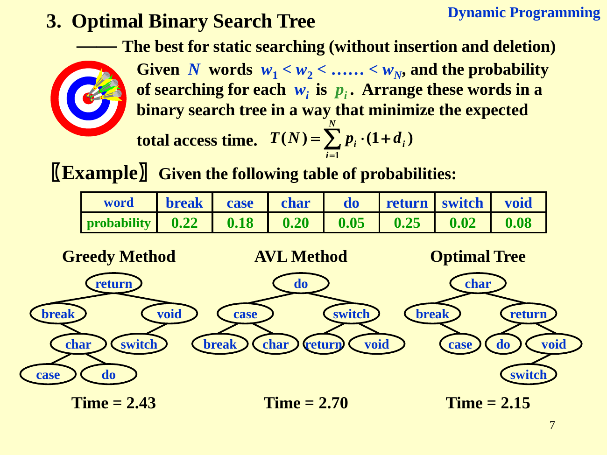
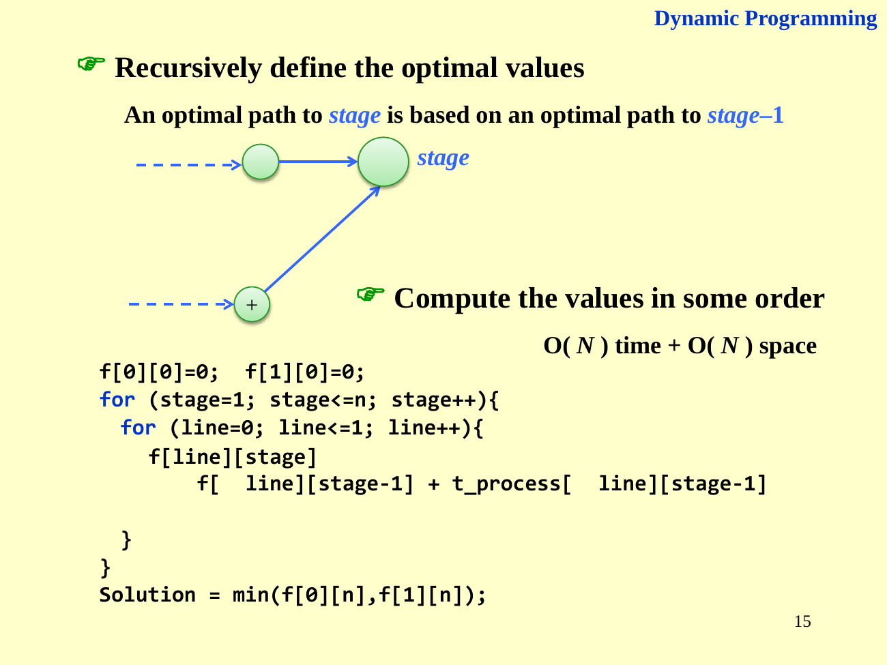

# Lecture 8: Dynamic Programming（动态规划）

[Course overview（课程目录）](index.md)

## 1. State, dependency, reuse（状态、依赖与复用）

**Solve each distinct subproblem once and store its result.** DP is a dependency-ordered computation, implemented by bottom-up tabulation（制表）or top-down memoization（记忆化）, with arrays or hash tables. It does not prohibit recursion. **Quiz 8.1 / WK8 TF1: True.**

Design in this order: **state meaning → optimal substructure（最优子结构）→ transition → bases → dependency order → reconstruct choices → time/space**. Prove optimal substructure by replacing a supposedly nonoptimal component with a better one. Overlapping subproblems（重叠子问题）explain the benefit of reuse; independently solved subproblems are better handled by ordinary D&C.

**History-dependency（历史依赖）** invalidates an insufficient state, not all possible DP solutions: add the necessary history to the state, possibly causing exponential growth. If an assembly discount depends on earlier line choices, `(line,stage)` alone is not enough. Distinguish an invalid state model from a valid but impractical one.

## 2. Fibonacci（斐波那契数）

The lecture uses **$F(0)=F(1)=1$**, $F(n)=F(n-1)+F(n-2)$. Naive recursion recomputes the same values, taking $\Theta(\varphi^n)$ unit-cost operations. Memoization/bottom-up DP uses $O(n)$ time; retaining the last two values reduces auxiliary space to $O(1)$. Update both only after computing their sum. Arbitrary-precision arithmetic adds bit costs; machine integers overflow eventually.

## 3. Matrix-chain multiplication（矩阵链乘）

Matrix $A_i$ has dimensions $r_{i-1}\times r_i$. Multiplication is **associative, not commutative（可结合，不可交换次序）**. Parenthesization changes arithmetic work, not the matrix sequence.

$$
m[i,j]=\min_{i\le k<j}\{m[i,k]+m[k+1,j]+r_{i-1}r_kr_j\},\qquad m[i,i]=0.
$$

Store the winning split `split[i][j]`; reconstruct recursively around it. Compute by increasing **interval length（区间长度）**. There are $n(n+1)/2=\Theta(n^2)$ interval states and O(n) splits per state → **$\Theta(n^3)$ time, $\Theta(n^2)$ space**.



Example dimensions **10,20,50,1,100**: right-nested $A_1(A_2(A_3A_4))$ costs **125000**; **$(A_1(A_2A_3))A_4$ costs 2200**, the optimum. Cost counts scalar multiplications, not just the n−1 matrix products.

**MOOC 8.2 checkpoint:** $b_n=\sum_{k=1}^{n-1}b_kb_{n-k}$, $b_1=1$ (D). Parenthesization count is Catalan $C_{n-1}=\Theta(4^n/n^{3/2})$; $b_2=1,b_3=2,b_4=5$. **Quiz 8.2 / WK8 MC6:** only **B: $O(n^2)$** distinct intervals despite exponentially many complete parenthesizations. Thus repeated subproblems are unavoidable in naive enumeration.

## 4. Optimal BST（最优二叉搜索树）

For static ordered keys $w_1<\cdots<w_n$ with successful-search probabilities $p_i$, minimize **$\sum_i p_i(\mathrm{depth}(w_i)+1)$**. BST ordering restricts which keys can lie in each subtree. The most probable key need not be root; AVL minimizes a height constraint rather than this weighted cost.

$$
C[i,j]=W[i,j]+\min_{i\le k\le j}\{C[i,k-1]+C[k+1,j]\},\quad
W[i,j]=\sum_{t=i}^{j}p_t.
$$

Empty interval cost **0**; singleton cost **$p_i$**, not 0. The slide's `c_ii=0` and exclusive lower split limit are inconsistent with its worked example; these are corrected here. Prefix sums compute W in O(1). Increasing interval length, all possible roots → **O(n³) time, O(n²) space**; `root[i][j]` reconstructs the tree. Knuth root monotonicity permits O(n²) with its valid weight conditions; simply restricting root trials without proving those conditions is unsound. This course model does **not** include unsuccessful-search probabilities; the full textbook OBST model adds them.



Keys `break,case,char,do,return,switch,void`, probabilities `.22,.18,.20,.05,.25,.02,.08`: greedy root=return cost **2.43**; shown AVL root=do cost **2.70**; optimal root=char cost **2.15**. Optimal tree: char → left break (right case), right return (left do with right switch; right void). **MOOC interval case..do:** cost **0.66**, root **char**. **Quiz 8.3 / WK8 TF2:** highest-probability key always root — **False**. **WK8 MC3:** loop by `k=j-i`, then valid i, then candidate roots → **C**; initialize singletons first.

## 5. Floyd–Warshall（全源最短路）

State $D^{(k)}[i,j]$ permits only the first k vertices as **intermediate vertices（中间顶点）**; endpoints are unrestricted.

$$
D^{(k)}[i,j]=\min\{D^{(k-1)}[i,j],D^{(k-1)}[i,k]+D^{(k-1)}[k,j]\}.
$$

Initialize diagonal 0, existing edges to the minimum parallel-edge cost, absent edges to infinity. In-place recurrence is valid without negative cycles; guard infinity additions against overflow. Record `next[i][j]=next[i][k]` when an improvement goes through k to reconstruct paths.

```text
for intermediate k:
    for source i:
        for destination j:
            if i→k and k→j are finite:
                D[i][j] = min(D[i][j], D[i][k] + D[k][j])
```

**$O(V^3)$ time, $O(V^2)$ space.** Negative edges are allowed. A negative diagonal after the algorithm detects a negative cycle; pairs able to reach and leave such a cycle have **no finite shortest walk**. The algorithm still terminates. **Quiz 8.4 / WK8 MC2: B**; it neither loops forever nor prohibits all negative weights. Repeating suitable single-source algorithms may be preferable on sparse graphs; the exact bound depends on graph representation/priority queue, not always V³.

**Offline / WK8 MC1: loop order is about roles, not variable names.** A `i,k,j` updating D[i][j] uses source outermost → wrong. B `i,j,k` → wrong. **C `i,k,j` updating D[k][j] via D[k][i]+D[i][j] is correct**: i is actually the intermediate vertex. D `k,i,j` with that same update uses source outermost → wrong. The archived answer D is incorrect.

**Concrete counterexample to `i,j,k`:** edges `0→3→2→1`, all weight 1. When pair `(0,1)` is processed, neither required suffix nor intermediate entry is ready; it remains infinite although the true distance is 3. Swapping the inner source/destination loops while keeping the intermediate outermost is safe.

**Dijkstra viewed through DP（线下讨论）：** maintain best-known distances, relax $d[v]\gets\min(d[v],d[u]+w(u,v))$. With nonnegative edges, the unsettled minimum can be finalized greedily; its optimal prefix cannot later improve via a longer route. With negative edges that finalization proof fails. The state invariant concerns settled vertices, not merely a vertex-number order. Keeping distances is DP-style reuse; the choice of the next vertex is a separate greedy correctness argument.

## 6. Product assembly（装配线）

At each stage choose a line; the current state must retain which line was reached. Let $a_{\ell,j}$ be processing time at line ℓ, stage j; $t_{\ell,j}$ be **transfer-only** time from ℓ after stage j to the other line.

$$
f_{\ell,j}=a_{\ell,j}+\min\{f_{\ell,j-1},\ f_{1-\ell,j-1}+t_{1-\ell,j-1}\}.
$$

Add entry costs in the bases and exit costs at the end when specified. The slides instead attach **complete edge costs** to stay/move edges; if their `t_transit` already includes processing, do not add processing again. State the convention before applying a formula.



Store the winning predecessor line `L[line][stage]`; choose the best final line and backtrack to reconstruct the plan. Time **O(n)**; O(n) space with plan reconstruction, O(1) extra value space with rolling previous-stage values. Read both old-line states before overwriting them. Exhaustive line choices take O(2ⁿ). **Optimal substructure proof:** replace a nonoptimal prefix reaching the same line/stage by the better prefix; subsequent edge costs are unchanged.

## 7. Additional DP exercises（补充题）

| Source | Task | Answer / reasoning |
| --- | --- | --- |
| WK8 MC5 | Which is best solved by DP: merge/closest-pair/quick/LCS? | **D: LCS**, overlapping prefix states; matching final chars → diagonal+1, otherwise maximum of dropping either last char. O(mn) time. |
| Quiz 8.5 / HW8 MC2 | Which dependency prevents ordinary bottom-up evaluation? A upper/left/diagonal; B smaller diagonal states; C previous row and left; D `(i-2,j-2)` and `(i+2,j+2)`. | **D**: mutual cyclic dependencies. A rows/columns increasing; B compute diagonal states first; C rows increasing. Additional fixed-point methods are outside this question's DP model. |
| HW8 MC3 | $f_{i,j,k}=f_{i,j+1,k}+\min_{0\le l\le k}(f_{i-1,j,l}+w_{j,l})$. Which order is invalid? A k↑ i↑ j↓; B i↑ j↑ k↑; C i↑ j↓ k↓; D i↑ j↓ k↑. | **B**, needs larger j first. A works since smaller k layers are already done and same-k previous i is done; C/D work by previous i. Provide boundary states before filling. |
| HW8 MC1 | Rod prices at lengths 1..10: `1,5,8,9,10,17,17,20,23,28`; identify wrong recurrence. | **D** using fixed $R_{N-M}$ regardless of split. Correct $R_0=0$, $R_N=\max_{1\le l\le\min(N,M)}(P_l+R_{N-l})$, O(NM), O(N²) if M≤N. $R_8=22$ via 2+6; $R_3=8$ without cutting. For N≤M, splitting into $R_i+R_{N-i}$ plus the uncut price is also valid. |

### Decode · WK8 code completion

Map **A–Z to 0–25**, not 1–26. A single `0` is valid (A), but `07` is not a two-digit code. Let dp[i] count suffix decodings. If the first two digits form **10..25**, add the two choices; otherwise use only the single-digit choice:

```c
/* Archived blanks; widen before addition if BASE is near INT_MAX. */
dp[i] = (int)(((long long)dp[i+1] + dp[i+2]) % BASE);
/* else */
dp[i] = dp[i+1];
```

For a clean implementation set internal empty-suffix dp[L]=1 and scan right to left; retain the supplied API's empty-input return 0. The submitted constants 3 and 2 are wrong. Example `1213407` has **5** decodings: BCBDEAH, MBDEAH, BCNEAH, BVDEAH, MNEAH. Time O(L), rolling space O(1) if only the count is needed.

### HW8 Programming Contest（竞赛选题）

[Full problem, sample and C function](hw8-programming-contest.md). Each problem is taken once or skipped; minimize time subject to score **at least** H. Let dp[s] be minimum time to reach at least s points:

$$
dp_{new}[s]=\min(dp_{old}[s],\ dp_{old}[\max(0,s-score_i)]+time_i).
$$

Initialize dp[0]=0, other states infinity; update **s decreasing** so the same problem cannot be reused. Return −1 if H is unreachable. O(nH) time/O(H) space, **pseudo-polynomial（伪多项式）** in binary-encoded H; a numeric parameter cannot be hidden as a constant. This corrects the offline misconception that every table DP is polynomial in input bit length.

## 8. Offline extension: contiguous process batching（连续工序分段）

The following lecture's presentations model merging adjacent processes as partitioning their original order into contiguous blocks. Let workload prefix sums be $Q_i$; if a block starts at l, its processing-time contribution is $t_l(Q_r-Q_{l-1})$, using the first process's per-unit time. Add the specified merge-fee contribution separately; optimize **lexicographically（字典序）** by total time first, then fee, rather than adding incomparable objectives.

For exactly b nonempty blocks:

$$
F[i,b]=\min_{b\le l\le i}\{F[l-1,b-1]+\operatorname{cost}(l,i)\},\qquad F[0,0]=(0,0).
$$

Other impossible bases are infinity. Exactly b blocks use i−b merges; **at most K merges** means taking the best feasible final block count b≥n−K, rather than silently forcing exactly K merges. Equivalent states can count used/allowed merges directly, but the semantics and base cases must agree. Prefix sums make block evaluation constant time when the fee model also supports them. Enumerating b,i,l costs O(n³), or O(n²K) with a merges-bounded state. Rolling two b layers gives O(n) value space; recovering a full plan needs saved choices or recomputation.

**Why not repeatedly take the locally best merge?** Merging changes future block leaders and feasible boundaries, so a local time saving need not preserve the globally best partition. The presented convex-hull optimization rewrites candidate costs into affine functions, e.g. $t_lQ_i+(F[l-1,b-1]-t_lQ_{l-1})$ for the time component. A monotone hull requires proven slope/query order and careful handling of equal time with different fee; it is not a drop-in optimization for arbitrary data or arbitrary lexicographic cost models.

## 9. Sources（来源）

`~/ADS-docs/8` and duplicated Lecture 8 exports/PDF in `~/ADS-docs/9`; offline `downloads/course_87216_sub_1990026` plus the subsequent DP review in `1993131`; WK8/HW8. Duplicate questions share one explanation; recurrence-only review is in Lecture 7. Slide screenshots retained for study. Reading: CLRS 3rd ed. Ch.15 pp.359–413 (as supplied). Status `draft`.
