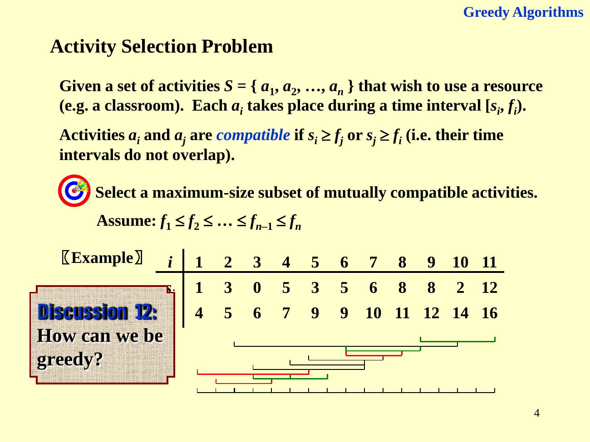

# Lecture 9: Greedy Algorithms（贪心算法）

[Course overview（课程目录）](index.md)

## 1. Safe local choices（安全的局部选择）

A **feasible solution（可行解）** obeys constraints; an **optimal solution（最优解）** optimizes the objective. Greedy algorithms make irrevocable local choices（不可撤销局部决策）. An appealing rule is not automatically correct.

To prove a greedy algorithm: define the residual problem → prove some optimum contains the greedy choice (**exchange argument，交换论证**) → prove the residual solution is optimal (**optimal substructure，最优子结构**). It is enough that **some**, not **all**, optimal solutions can take that choice. A failure to find a counterexample is not a proof.

**Quiz 9.1:** local choices must lead to a global optimum for an exact solver; decisions are not revised — **both True** in the lecture's intended sense. A heuristic（启发式）has no general approximation guarantee; an approximation algorithm（近似算法）needs a proved bound. The slide's suggestion that greedy is “generally close” supplies no such bound. Dijkstra and MST are earlier greedy examples with their own preconditions; a theorem for one problem does not transfer to another.

## 2. Activity selection（活动选择）

Each activity occupies a **half-open interval $[s_i,f_i)$（左闭右开）**; compatibility allows touching endpoints. Goal: **maximum number of activities in one room**, not maximum occupied time or maximum total weight.

Sort by finish time. Select the earliest-finishing activity compatible with the previously selected activity, then repeat. Sorting O(n log n), scan O(n); already sorted input needs only O(n).

For starts `1,3,0,5,3,5,6,8,8,2,12` and finishes `4,5,6,7,9,9,10,11,12,14,16`, one answer is **activities 1,4,8,11**. There may be other optimal sets.

**Proof:** let a be earliest-finishing and b the first activity in an optimum. Replace b by a: since $f_a\le f_b$, every later activity remains feasible and cardinality is unchanged. Solve the suffix after a similarly. This proves existence of an optimum containing a, not necessity in every optimum. **Quiz 9.2 existential claim: True; HW9 TF1 universal claim: False.** Two overlapping intervals can form two different singleton optima.

### Wrong rules and DP alternatives（错误规则与 DP）

- **Earliest start:** `(0,10)` blocks `(1,2),(2,3),(3,4)`; earliest-start greedy gets 1 instead of 3.
- **Shortest duration:** `(2,4)` blocks `(0,3),(3,6)`; one short interval loses to two longer compatible ones.
- **Fewest conflicts:** also not generally safe; conflict count does not encode the number of later activities that can coexist. **MOOC 9.2.3** earliest-start and fewest-conflicts claims are **False**.
- Interval DP can enumerate a first separator: $c[i,j]=\max_{k\in S_{ij}}(c[i,k]+c[k,j]+1)$, empty S → 0. The straightforward interval/split implementation is **O(n³)**, not automatically the slide's O(n²).
- For activities sorted by finish, let p(j) be the last compatible earlier activity. Prefix DP: **$F[j]=\max(F[j-1],1+F[p(j)])$**, F[0]=0. With weights replace 1 by $w_j$; the base becomes `max(0,w1)` (or w1 for positive weights), not the slide's unchanged 1. Binary-search predecessor computation gives O(n log n) total. **Weighted earliest-finish greedy fails:** `(0,2,w=1)` versus `(0,3,w=100)`.

## 3. Minimum classrooms（最少教室数）

Different objective: **schedule all activities, minimize rooms**. Sort by **start** time; reuse any available room, or open one if every existing room is occupied. A min-heap of room finish times implements this in O(n log n). At a tie, a room finishing at s is available at s.

**Lower-bound proof（峰值重叠下界）：** opening room k means the k−1 existing rooms are occupied at the new activity's start; those activities and the new one overlap. Every schedule needs at least k rooms. The greedy schedule uses exactly that many → optimal.

**Quiz 9.2 / offline discussion:** Greedy1 repeatedly extracts a maximum compatible one-room subset; Greedy2 uses start-order room assignment. **C: only Greedy2 is always optimal.** Solving one room optimally can leave a badly arranged remainder. Counterexample to repeated earliest-finish extraction: `[0,2),[1,4),[3,7),[5,6),[6,8)`; first extract `[0,2),[5,6),[6,8)`, leaving the overlapping middle intervals → 3 rooms, although peak overlap and optimum are 2.

## 4. Huffman coding（哈夫曼编码）

Fixed-width binary codes for C symbols need $\lceil\log_2 C\rceil$ bits/symbol. For 1000 one-byte characters → 8000 bits; four-symbol fixed-width encoding → 2000 bits, **plus the code table**. Variable-length codes can favor frequent symbols.

**Prefix-free（前缀无歧义）：** no complete symbol code is a prefix of another; symbols occur only at **leaves of a binary trie（字典树）**. Decode by following bits from the root, emit a symbol at a leaf and restart. A truncated/invalid bit sequence must be detected; not every arbitrary bit string necessarily ends at a leaf.

A prefix trie need not initially be full, but with positive weights an **optimal** binary prefix tree has no one-child internal nodes: contracting one reduces weighted length. Thus an optimal tree can be taken full (each internal node has two children).

Example `aaaxuaxz`: counts a=4,u=1,x=2,z=1. Fixed codes use 16 bits. Codes `a=0,u=110,x=10,z=111` use **14 bits**; `00010110010111` decodes as **aaaxuaxz** (MOOC checkpoint). Code-table overhead matters for short files.

### Algorithm and proof（算法与证明）

Insert all character frequencies in a min-priority queue. Repeatedly remove the **two smallest weights**, join them under a parent with their sum, and insert that parent. Build **bottom-up（自底向上）** (MOOC answer B). Stop with one root; assign left/right bits consistently. Time **O(C log C)** with a heap, space O(C); decoding takes O(encoded bits). A one-symbol alphabet needs a stated empty-code/one-bit convention plus message-length framing.

$$
\text{WPL}=\sum_c f_c\,\mathrm{depth}(c)=\sum_{\text{merges}}(\text{two merged weights}).
$$

**Greedy-choice lemma:** there is an optimal tree in which the two least frequent symbols x,y are deepest sibling leaves. Starting with deepest siblings, swapping smaller weights down cannot increase WPL; assign x,y there. **Optimal-substructure lemma:** contract x,y into z of weight $f_x+f_y$. Expanding an optimum for the contracted alphabet increases cost by exactly $f_x+f_y$. If the expanded tree were nonoptimal, contracting a better tree would contradict the smaller optimum. These two lemmas establish global optimality, not uniqueness.

Ties can produce different optimal code tables; left/right bit swaps also preserve cost. Huffman is not the only way to obtain an optimal table. Equal frequencies usually give little/no gain over fixed length; for non-power-of-two alphabet sizes, even equal frequencies can admit a small gain. Avoid claiming equality in every alphabet size.

### Questions（小测与作业）

| Source | Question | Answer / reason |
| --- | --- | --- |
| Quiz 9.3 Q1 | Four frequency cases: (1) 4,2,11,6; (2) 6,5,7,12; (3) 3,2,3,4; (4) 8,3,10,7. When does Huffman equal two-bit fixed coding? | **C: (3),(4)**. Huffman costs **41,59,24,56**; fixed costs **46,60,24,56**. |
| Quiz 9.3 Q2 | Distinct frequencies, a/b smallest. A `000,001,01,1`; B `000,001,01,11`; C `000,001,10,1`; D `010,001,01,1`: possible Huffman codes? | **A**. a/b are siblings; B has a one-child internal node and is not optimal; C/D violate prefix freedom. |
| HW9 TF2 | With n characters, every optimal binary prefix codeword has length ≤n−1. | **True for n≥2 with positive frequencies**: a full binary tree with n leaves has n−1 internal nodes, bounding depth. State the single-symbol convention separately. |
| HW9 MC1 | Greedy coin change optimal for (I) 25,10,5,1; (II) powers of integer c>1; (III) every denomination set containing 1? | **C: III is false**. Counterexample 1,3,4 for 6: greedy 4+1+1 vs 3+3. Powers of c admit carrying c small coins into one larger coin; standard US denominations admit the usual exchange normalization. |

## 5. HW9: To Fill or Not to Fill（加油问题）

[Full problem, samples and executable Python solution](hw9-to-fill-or-not-to-fill.md).

Sort stations by distance; coalesce equal locations at the lowest price; append destination as price-0 station. Start with an **empty tank**, requiring a station at distance 0.

- If a **strictly cheaper reachable station** exists, go to the **first** such station; buy only enough to reach it, retaining existing fuel.
- Otherwise buy as much as needed up to a full tank (or only enough for the destination), then go to the **cheapest reachable station**. Equal-price ties do not affect optimum cost.
- If none is reachable, maximum reachable distance is current location + full-tank range. If no station at 0, that distance is 0.

**Exchange rationale:** expensive fuel should not be bought for use after a cheaper station becomes available; if no cheaper fuel is reachable, carrying more current fuel cannot cost more than replacing it before the next chosen cheaper opportunity. Preserve fuel left on arrival. Using the cheapest station globally ignores reachability and is wrong. Simple implementation O(N²) after sorting, O(N) memory; sufficient for N≤500. Use careful comparisons and format exactly two decimal places.

## 6. Sources（来源）

`~/ADS-docs/9`: Lecture 9 MOOC transcript/quizzes/PDF and captures, offline `downloads/course_87216_sub_1993131`, HW9. This directory also contains Lecture 8 exports; they are consolidated into Lecture 8. No WK9 quiz archive was supplied. Reading: CLRS 3rd ed. Ch.16 pp.415–437. Images are supplied course material, retained for study. Status `draft`.
