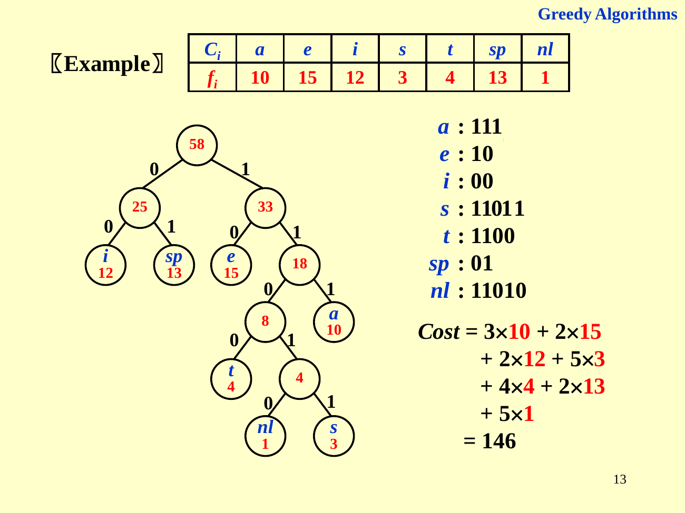
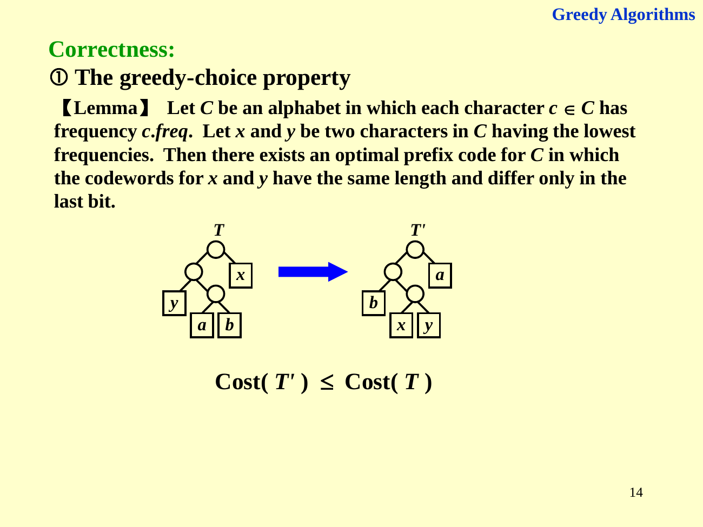

# Lecture 9: Greedy Algorithms（贪心算法）

[Course overview（课程目录）](index.md)

## 1. Safe local choices（安全的局部选择）

**Feasible（可行）:** obeys constraints; **optimal（最优）:** best objective. Greedy uses irrevocable local choices; intuition alone proves nothing.

**Proof:** define residual problem → exchange an optimum to contain the greedy choice → prove optimal residual solutions extend optimally. **Some optimum**, not every optimum, must permit the choice. No known counterexample ≠ proof.

**Quiz 9.1: both True**—safe local choices must reach a global optimum, and decisions are not revised. **Heuristic（启发式）** supplies no approximation ratio; **approximation（近似算法）** needs a proved bound. “Generally close” is no theorem. Dijkstra/MST need their own preconditions.

## 2. Activity selection（活动选择）

Each activity occupies a **half-open interval $[s_i,f_i)$（左闭右开）**; compatibility allows touching endpoints. Goal: **maximum number of activities in one room**, not maximum occupied time or maximum total weight.

Sort by finish time. Select the earliest-finishing activity compatible with the previously selected activity, then repeat. Sorting O(n log n), scan O(n); already sorted input needs only O(n).

For starts `1,3,0,5,3,5,6,8,8,2,12` and finishes `4,5,6,7,9,9,10,11,12,14,16`, one answer is **activities 1,4,8,11**. There may be other optimal sets.

**Exchange:** replace an optimum’s first activity b by earliest-finishing a; $f_a\le f_b$ preserves all later choices/cardinality. Recurse on the suffix. **Quiz 9.2: some optimum contains a → True; HW9 TF1: all optima contain a → False.** Two overlapping activities can be alternative singleton optima.

### Wrong rules and DP alternatives（错误规则与 DP）

- **Earliest start:** `(0,10)` blocks `(1,2),(2,3),(3,4)`; earliest-start greedy gets 1 instead of 3.
- **Shortest duration:** `(2,4)` blocks `(0,3),(3,6)`; one short interval loses to two longer compatible ones.
- **Fewest conflicts:** also not generally safe; conflict count does not encode the number of later activities that can coexist. **MOOC 9.2.3** earliest-start and fewest-conflicts claims are **False**.
- Interval DP can enumerate a first separator: $c[i,j]=\max_{k\in S_{ij}}(c[i,k]+c[k,j]+1)$, empty S → 0. The straightforward interval/split implementation is **O(n³)**, not automatically the slide's O(n²).
- For activities sorted by finish, let p(j) be the last compatible earlier activity. Prefix DP: **$F[j]=\max(F[j-1],1+F[p(j)])$**, F[0]=0. With weights replace 1 by $w_j$; the base becomes `max(0,w1)` (or w1 for positive weights), not the slide's unchanged 1. Binary-search predecessor computation gives O(n log n) total. **Weighted earliest-finish greedy fails:** `(0,2,w=1)` versus `(0,3,w=100)`.

## 3. Minimum classrooms（最少教室数）

Different objective: **schedule all activities, minimize rooms**. Sort by **start** time; reuse any available room, or open one if every existing room is occupied. A min-heap of room finish times implements this in O(n log n). At a tie, a room finishing at s is available at s.

Opening room k means k−1 rooms are occupied at that start: these activities overlap the new one, so every schedule needs ≥k rooms. Greedy uses exactly k → optimal.

**Quiz 9.2: C.** Greedy1 repeatedly fills one room maximally; Greedy2 assigns rooms in start order. Only 2 is always optimal. Counterexample to 1: `[0,2),[1,4),[3,7),[5,6),[6,8)`; extract `[0,2),[5,6),[6,8)`, leaving two overlapping intervals → 3 rooms, versus optimum/peak overlap 2.

## 4. Huffman coding（哈夫曼编码）

Fixed-width binary codes for C symbols need $\lceil\log_2 C\rceil$ bits/symbol. For 1000 one-byte characters → 8000 bits; four-symbol fixed-width encoding → 2000 bits, **plus the code table**. Variable-length codes can favor frequent symbols.

**Prefix-free（前缀无歧义）：** no complete symbol code is a prefix of another; symbols occur only at **leaves of a binary trie（字典树）**. Decode by following bits from the root, emit a symbol at a leaf and restart. A truncated/invalid bit sequence must be detected; not every arbitrary bit string necessarily ends at a leaf.

A prefix trie need not be full; an **optimal positive-weight** trie has no unary internal node, since contraction lowers cost. Thus take a full tree (two children per internal node).

Example `aaaxuaxz`: counts a=4,u=1,x=2,z=1. Fixed codes use 16 bits. Codes `a=0,u=110,x=10,z=111` use **14 bits**; `00010110010111` decodes as **aaaxuaxz** (MOOC checkpoint). Code-table overhead matters for short files.

### Algorithm and proof（算法与证明）

Insert all character frequencies in a min-priority queue. Repeatedly remove the **two smallest weights**, join them under a parent with their sum, and insert that parent. Build **bottom-up（自底向上）** (MOOC answer B). Stop with one root; assign left/right bits consistently. Time **O(C log C)** with a heap, space O(C); decoding takes O(encoded bits). A one-symbol alphabet needs a stated empty-code/one-bit convention plus message-length framing.

$$
\text{WPL}=\sum_c f_c\,\mathrm{depth}(c)=\sum_{\text{merges}}(\text{two merged weights}).
$$

**Greedy choice:** swap the two smallest weights x/y into deepest sibling leaves; weighted length cannot increase. **Substructure:** contract them into z of weight $f_x+f_y$; expansion adds exactly that cost. A better expanded tree would contract to a better smaller optimum—a contradiction. This proves optimality, not uniqueness.

Ties/bit swaps permit different optimal codes. Equal frequencies offer little saving; non-power-of-two alphabets can still gain slightly over fixed width.

### Questions（小测与作业）

| Source | Question | Answer / reason |
| --- | --- | --- |
| Quiz 9.3 Q1 | Four frequency cases: (1) 4,2,11,6; (2) 6,5,7,12; (3) 3,2,3,4; (4) 8,3,10,7. When does Huffman equal two-bit fixed coding? | **C: (3),(4)**. Huffman costs **41,59,24,56**; fixed costs **46,60,24,56**. |
| Quiz 9.3 Q2 | Distinct frequencies, a/b smallest. A `000,001,01,1`; B `000,001,01,11`; C `000,001,10,1`; D `010,001,01,1`: possible Huffman codes? | **A**. a/b are siblings; B has a one-child internal node and is not optimal; C/D violate prefix freedom. |
| HW9 TF2 | With n characters, every optimal binary prefix codeword has length ≤n−1. | **True for n≥2 with positive frequencies**: a full binary tree with n leaves has n−1 internal nodes, bounding depth. State the single-symbol convention separately. |
| HW9 MC1 | Greedy coin change optimal for (I) 25,10,5,1; (II) powers of integer c>1; (III) every denomination set containing 1? | **C: III is false**. Counterexample 1,3,4 for 6: greedy 4+1+1 vs 3+3. Powers of c admit carrying c small coins into one larger coin; standard US denominations admit the usual exchange normalization. |

## 5. HW9: To Fill or Not to Fill（加油问题）

[Problem, samples and C / Python implementations](hw9-to-fill-or-not-to-fill.md).

Sort stations by distance; coalesce equal locations at the lowest price; append destination as price-0 station. Start with an **empty tank**, requiring a station at distance 0.

- Scan reachable stations in distance order. At the **first station priced ≤ current price**, buy only enough to reach it: `target = distance / mileage`.
- If all reachable stations cost more, **fill the tank** and choose the **cheapest reachable station**. Buy only `max(0, target − fuel)`; keep residual fuel on arrival.
- No reachable next station → maximum distance = current position + full-tank range. No station at 0 → maximum distance 0.

**Exchange:** before a cheaper station, buy only the fuel needed to reach it; before more expensive stations, buy as much cheaper current fuel as capacity allows. At an equal-price station, buying later costs the same. The supplied C uses **≤**; Python uses **<** and handles ties in the fill/cheapest branch. Both are optimal, though their chosen stops may differ.

C sorts by **(distance, price)**, keeping the cheapest station first at a shared position; Python coalesces those positions. Both append a price-0 destination, so no unnecessary final fill is needed. Each move advances the station index. Total **O(N²) time/O(N) space** for N≤500; round only the final output to two decimals.

## 6. References（参考）

CLRS 3rd ed.: Ch.16 pp.415–437. No WK9 quiz archive was supplied.
