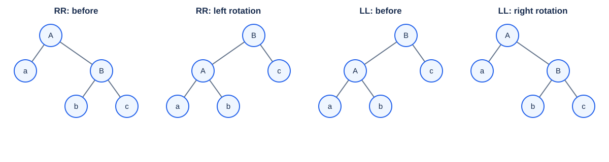
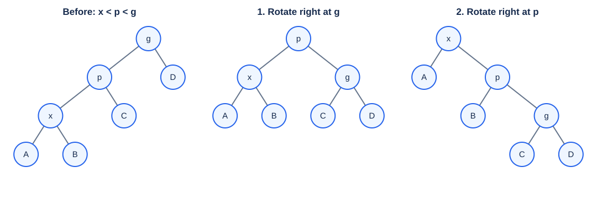
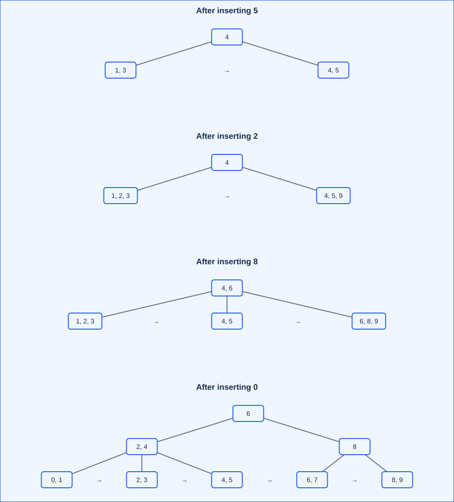
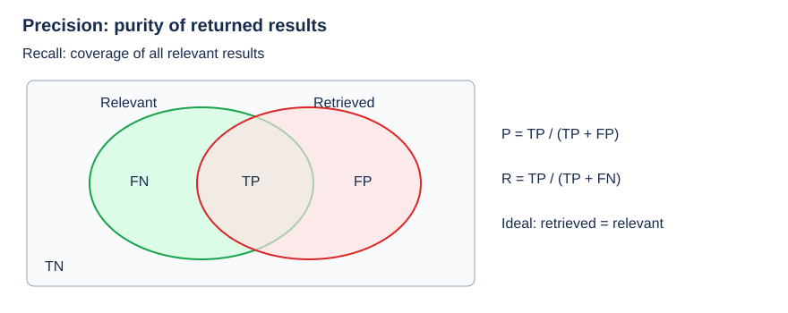
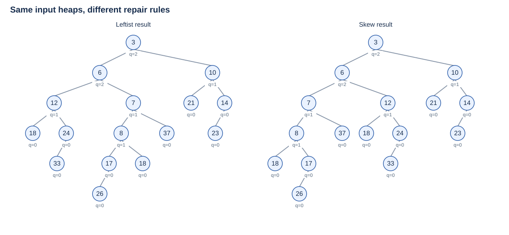
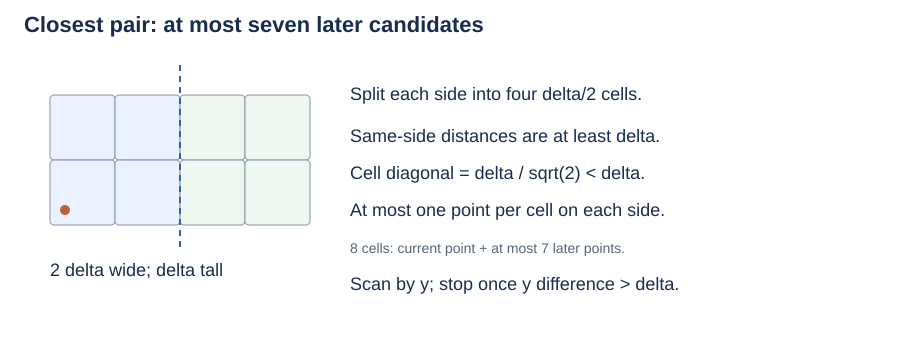

# ADS 期中复习 · 180 分钟精要

[课程目录](../index.md) · [22 分钟原题自测](practice.md) · [考前速查](quick-reference.md)

范围：第 1–9 课，**包含 Greedy Algorithms（贪心算法）**。课堂记录：考试 45 分钟，无独立编程题，可能有代码填空；允许带一张 A4，单双面未说明，以公告为准。

## 0. 三小时安排与读题约定 {#plan}

按表计时。每节先看规则，再遮住结论完成“动笔”；卡住时只回看对应规则。最后集中做英文原题，答案默认折叠。

| 累计时间 | 内容 | 动笔目标 |
| --- | --- | --- |
| 0–8 min | 本节：符号、复杂度 | 分清 worst / amortized / expected |
| 8–30 min | [1. AVL、Splay、摊还](#search-trees) | 画旋转；写势能等式 |
| 30–53 min | [2. RBT、B+](#rbt-bplus) | 按情况修复；插入后校验树 |
| 53–65 min | [3. 倒排索引](#index) | 算 precision / recall；辨别分区 |
| 65–87 min | [4. 三类可合并堆](#heaps) | 合并右路径；二进制进位 |
| 87–102 min | [5. 回溯](#backtracking) | 恢复状态；标 α、β 和剪枝位置 |
| 102–118 min | [6. 分治](#divide-conquer) | 写递推式并判主导项 |
| 118–141 min | [7. DP](#dp) | 写状态、边界、转移、填表顺序 |
| 141–153 min | [8. 贪心](#greedy) | 区分目标；写交换论证 |
| 153–175 min | [原题自测](practice.md) | 限时独立作答，再核对解析 |
| 175–180 min | [考前速查](quick-reference.md) | 复查错题涉及的条件和代码 |

### 符号与复杂度：先看题目到底在数什么

- $N,n$ 通常为节点数／输入规模，$h$ 为高度；$log$ 无下标时复杂度中底数不影响阶。精确高度界使用指定底数。
- **Worst-case（最坏）**约束单次最坏输入；**amortized（摊还）**约束任意操作序列的总成本；**expected（期望）**依赖随机变量。摊还不需要输入随机，也不保证每一步都快。
- $O$ 是上界，$\Omega$ 是下界，$\Theta$ 是紧界。算出紧界再比选项；题目问最低上界时不能只找一个成立的宽松上界。
- 区分**比较次数、旋转次数、总时间、I/O 页访问、空间、位运算成本**。例如 RBT 删除最多三旋，仍需 $O(\log N)$ 时间。
- 树题先写高度、空节点、相等键、合并规则。以下 AVL 空树高 −1、叶高 0；RBT 的高度到 NIL 为止。
- 代码填空先确定每个参数含义、当前不变量、递归后返回的新根；检查空指针、数组边界、溢出和状态恢复。

**选算法：**有序动态查找 → 平衡 BST；页式范围检索 → B+；频繁 meld → 可合并堆；可撤销枚举 → 回溯；独立子问题 → 分治；重叠子问题 → DP；能证明局部选择安全 → 贪心。

## 1. AVL、Splay 与摊还分析 · 22 min {#search-trees}

### BST 与 AVL：旋转保持中序，修复高度

**BST（binary search tree，二叉搜索树）：**每个节点的所有左键 < 自己 < 所有右键；不是只比较直接孩子。查找／插入／删除为 $O(h+1)$，有序插入可退化成链 $\Theta(N)$。有序数组二分查找快，但插入／删除搬移仍可能 $O(N)$。Treap（树堆）用键的 BST 序与独立随机优先级的堆序，得到期望 $O(\log N)$ 高度。

等概率成功查找的 **ASL（平均查找长度）**为 $\sum_v(\operatorname{depth}(v)+1)/N$。根比较一次；它是在一棵固定树上对查找取平均，与摊还不同。12 节点链为 6.5；月名按字母序比较，不按月份。

**AVL 不变量：**每个节点 $BF=h_L-h_R\in\{-1,0,1\}$，$h=1+\max(h_L,h_R)$。缓存高度，沿路径更新；每次遍历子树求高会破坏对数时间。

| 从最低失衡祖先出发的前两步 | 修复 |
| --- | --- |
| LL | 祖先右旋 |
| RR | 祖先左旋 |
| LR | 左孩子左旋，祖先右旋 |
| RL | 右孩子右旋，祖先左旋 |



**画法：**先圈出三节点中序，再挂回各区间子树；单旋的中间子树不能丢。更新“降下去的节点 → 升上来的节点”的高度，接回父节点／整树根。

- 插入：普通 BST 插入，修复**最低**失衡处；修复后恢复插入前高度，一处、至多两旋。
- 删除：两孩子可换前驱／后继再删；高度下降可能继续上传，最多 $O(\log N)$ 处修复。重孩子 $BF=0$ 时用单旋，不能照搬插入的一处结论。
- 高为 $h$ 的最少节点数：$n_{-1}=0,n_0=1,n_h=1+n_{h-1}+n_{h-2}=F_{h+3}-1$，此处 $F_0=0,F_1=1$。数列 **0,1,2,4,7,12,20,33**；$n_h=\Theta(\varphi^h)$，$h\lesssim1.44\log_2N$。
- “高度 4”若指四层，与四条边相差一层。求最大子树规模差时，要同时满足两侧高度差 ≤1，不能拿任意满树减空树。

**动笔：**依次插入 `2,1,4,5,9,3,6,7`。答案为 `4(2(1,3),6(5,9(7,∅)))`；3 与 7 不同父。表示法 `根(左,右)`，未写的孩子为空。

### Splay：操作后把访问点伸展到根

**Splay tree（伸展树）**只保持 BST 序，不保持高度平衡，不存 BF。自底向上处理访问点 $x$、父 $p$、祖父 $g$：

| 情况 | 次序 |
| --- | --- |
| Zig：$p$ 是根 | 旋转 $x,p$ |
| Zig-zag：两条边异向 | 先 $x,p$，再 $x,g$ |
| Zig-zig：两条边同向 | **先 $p,g$，再 $x,p$** |



查找成功伸展目标；失败伸展最后访问点。FindMax 后根无右孩子。插入可先插叶再伸展，或按新键分裂旧树。删除先伸展目标并移根，再伸展左树最大值、接右树；左树空则直接取右树。

**单次最坏 $\Theta(N)$，摊还 $O(\log(N+1))$**。从空树开始，至多 $N$ 键的 $m$ 次操作共 $O(m\log(N+1))$；任意初始树还需计初势能。逐次仅把 $x$ 与父交换的 move-to-root 不等于 splay：链上反复访问 `1..N` 每轮仍为 $\Theta(N^2)$。

### 摊还：把本次费用与结构变化一起算

三种方法：**aggregate（聚合）**算总成本；**accounting（记账）**预收费存信用且不透支；**potential（势能）**把信用写成状态函数。

$$
\widehat c_i=c_i+\Phi_i-\Phi_{i-1},\qquad
\sum c_i=\sum\widehat c_i+\Phi_0-\Phi_m.
$$

若要任意前缀的摊还费用覆盖实际费用，需 $\Phi_j\ge\Phi_0$；常取 $\Phi_0=0,\Phi_j\ge0$。**初始势能取最大**通常方向相反。

| 题型 | 势能／计费 | 算法与边界 |
| --- | --- | --- |
| 栈 + MultiPop(k) | $\Phi=\lvert S\rvert$；Push 收 2，Pop／MultiPop 收 0 | 实际弹出 $k'=\min(k,\lvert S\rvert)$，时间 $\Theta(1+k')$；每个元素只弹一次，从空栈 $m$ 次总 $O(m)$。初始 $s_0$ 个元素需加 $O(s_0)$；失败调用仍有常数开销 |
| 容量倍增 buffer | 普通插入 1；满时复制 $k$ 个再插入，$k+1$ | 复制量为几何和。若最终满、$N$ 为 2 的幂，总成本 $2N-1$ |
| buffer 的题设势能 | $\Phi=n-C=$ 空位数的相反数 | 每步摊还 2，但中途势能可能低于初值；最终满时首尾均为 0，才能直接用 $2N$ 界 |
| buffer 的任意前缀 | $\Psi=2n-C+1$，初始 $n=0,C=1$ | 非负，每步摊还至多 3；全部前缀均有线性总界 |

**Splay 证明骨架：**$s(v)$ 是含自身的子树大小，$r(v)=\log_2s(v)$，$\Phi=\sum_vr(v)$。rank 是分析用的秩，不是高度或存储字段。

1. 只需计算参与旋转节点的势能差；双旋后 $r'(x)=r(g)$。
2. 用 $a+b\le c\Rightarrow\log a+\log b\le2\log c-2$：zig-zag 取新 $p,g$ 的不交子树；zig-zig 取旧 $x$ 与新 $g$ 的不交子树。
3. 旋转单位成本下，Zig ≤ $1+\Delta r(x)$；zig-zag ≤ $2\Delta r(x)$；zig-zig ≤ $3\Delta r(x)$。
4. 伸展路径望远镜相消：**Access lemma（访问引理）** $\widehat c\le1+3(r(\mathrm{root})-r(x))\le1+3\log N$。任意初树 $\Phi_0=O(N\log N)$ 要保留；实际成本单位改变时同步缩放势能。

[原笔记与全部树图](../lecture-01-avl-splay-amortized-analysis.md) · [HW1 实现](../hw1-avl-root.md)

## 2. 红黑树与 B+ 树 · 23 min {#rbt-bplus}

### Red-black tree：黑数相等，无红红边

**五条：**BST 中节点红／黑；根黑；NIL 黑；红节点两孩子黑；**每个节点**到所有后代 NIL 的黑节点数相等。黑节点的两孩子可以异色。红节点不能只有一个真实孩子；黑节点只有一个真实孩子时，该孩子只能是红色末端节点。

本课 $bh(x)$ **不含自己、含 NIL**，$bh(\mathrm{NIL})=0$；$h$ 计到最远 NIL 的边数。孩子黑则 $bh(\mathrm{child})=bh(x)-1$，孩子红则相等。

$$
\operatorname{size}(x)\ge2^{bh(x)}-1,\qquad bh(T)\ge h(T)/2,
\qquad h(T)\le2\log_2(N+1).
$$

第一式是**下界**。最长根—NIL 路径 ≤ 最短的两倍；不能随意把 NIL 改成真实叶。$N$ 真实节点有 $N+1$ 个空孩子位置，可共用一个黑哨兵，但删除时仍要知道亏缺位置的父节点。若去掉 NIL 定义，须检查到所有度为 0 **或 1** 的真实端点的黑数，包含端点及相应零长路径，不能只看真实叶。

**插入（bottom-up）：**新节点红，最后根黑。父黑即止；父红时看叔，NIL 也算黑叔。以下父在祖父左侧，右侧镜像：

| 情况 | 操作 |
| --- | --- |
| 红叔 | 父、叔变黑，祖父变红；把祖父作为新冲突点继续 |
| 黑叔、LR 折线 | 父左旋，化成 LL 直线 |
| 黑叔、LL 直线 | 父黑、祖父红，祖父右旋；结束 |

至多两旋，翻色可上传 $O(\log N)$。**Top-down（自顶向下）**沿途把“黑节点 + 两红孩子”翻色，立即修复实际红红冲突，再沿更新后的树下降；同为对数时间，但不沿用 bottom-up 的两旋保证。

**删除：**两孩子先换前驱／后继键，**保留原位置颜色**；看实际被移走节点的原颜色。移红无事；移黑、补红则补点变黑；移黑、补黑／NIL 则该位置缺一黑，记 extra black（额外黑色）。

以下亏缺 $x$ 在父 $p$ 左边，兄弟 $w$ 在右；近侄 $w_L$，远侄 $w_R$：

| 顺序 | 条件 | 修复 |
| --- | --- | --- |
| 1 | 红兄弟 | 兄黑父红，父左旋，**重取兄弟**；转成黑兄情况 |
| 2 | 黑兄弟、双黑侄 | 兄红，亏缺移到父；父红则变黑结束，否则继续上传 |
| 3 | 黑兄弟、近红远黑 | 近侄黑、兄红，兄右旋；转 4 |
| 4 | 黑兄弟、远红 | 兄取父色，父和远侄黑，父左旋；结束 |

根处可丢弃额外黑。至多各用一次 1、3、4，**最多三旋**；2 可以重复但不旋转。画完逐条检查 BST、根黑、无红红、各路黑数。

**对比：**AVL 更严格限制高度；两者查／增／删最坏均 $O(\log N)$。AVL 删除旋转可达对数次，RBT 至多三次；实际速度还取决于布局与负载，不存在通用固定快多少。

**动笔：**插入 `41,38,31,12,19,8`，得到 `38B(19R(12B(8R,∅),31B),41B)`。19 与 41 是兄弟但颜色不同。3 个固定有序键的合法 RBT 恰有两种着色：两孩子全红或全黑。

### B+ tree：分隔键导航，数据只在叶

**本课约定：**阶 $M\ge3$，$q=\lceil M/2\rceil$；非根内部节点有 $q..M$ 个孩子，根若非叶有 $2..M$ 个孩子；叶有 $q..M$ 个数据键，根叶可更少。所有叶同深。本课把 order-3 B+ 称为 **2-3 tree**，不是内部节点也存数据的经典 2-3 搜索树。

内部 $d$ 孩子配 $d-1$ 个 separator（分隔键），为**除首孩子外各子树的最小键**。内部键与叶键可重复。叶顺序链是逻辑连接，不要求物理连续。

| 操作 | 解题步骤 |
| --- | --- |
| Find / range | 内部二分定位，**相等走右边**；只有叶才能确认记录存在。范围查找到首叶，再沿叶链 |
| Insert | 叶内有序插入；$M+1$ 个数据键时分叶，把右叶最小值**复制**到父。内部溢出是 $M+1$ 个孩子／$M$ 分隔键，分指针并重建分隔键；可先向未满邻兄弟重分配 |
| Delete | 删叶数据；即使未下溢，最小键变了也要更新祖先分隔键。少于 $q$ 时向有余量的邻兄弟借，否则合并，向父继续修复 |
| Height | 只有根分裂会增高；内部根只剩一个孩子时提升孩子而降高 |



**计数：**令内部节点中二孩子节点数 $a$、三孩子节点数 $b$，叶数 $L$，由边数得 $L=1+a+2b$。3 个非叶节点至多 6 叶、每叶至多 3 键 → **18 数据键**。21 数据键最多 10 叶 → 三孩子节点至多 4；12 叶的内部节点数最大为 10，通用松界 $L-1=11$ 此处不可取等号。

**复杂度：**高度 $O(\log_qN)$。节点内二分查找的 CPU 总计 $O(\log N)$；插删搬移每层 $O(M)$，总 $O((M/\log M)\log N)$。一节点一页时 I/O 为 $O(\log_MN)$。CPU 模型 $M/\ln M$ 最小在 $e$ 附近，不能据此说磁盘索引一定选 3／4 阶；页容量和记录大小决定扇出。$M=2$ 时最小扇出 1，不能使用对数底 1。

**B-tree vs B+：**前者数据可在内部，点查可早停；后者必须到叶，内部只存导航键，通常更大扇出且叶链便于范围扫描。

[原笔记、删除例题与 FindKey 填空](../lecture-02-red-black-bplus-trees.md)

## 3. 倒排索引与检索评价 · 12 min {#index}

### 查询与构建：先分清 term、document、position

**Forward index（正排）：**文档 → 词；**inverted index（倒排）：**词 → postings（出现文档、位置／偏移、词频）。可视为 term × document 稀疏矩阵。$df$ 是出现该词的文档数，$tf$ 是某文档内次数，不能与总出现次数混用。

- AND：有序 docID 表双指针求交，长 $a,b$ 的两表耗 $O(a+b)$；优先处理小 $df$ 词以缩小中间结果。OR 求并，NOT 相对整个文档集合补集。
- Phrase query（短语）还需相邻位置，不能仅做 AND；原位置／字符偏移支持短语、摘要和高亮。不要把 docID 序、词典词序、相关性分数序混为一谈。
- 流程：采集 → tokenize（分词）→ case normalization（大小写归一）→ stemming（词干）／可选 stop-word filter（停用词过滤）→ 词典 → postings。中英文切词不同；词干不一定是合法单词，`said→say` 需词形还原等额外处理。索引与查询必须同一规范；是否删 `a/the` 依场景，HW3 **保留**。
- 模块：分析器、停用词过滤、词典查找／插入、内存管理；precision 是检索评价指标，不是索引生成步骤。

| 词典 | 适用与代价 |
| --- | --- |
| B / B+ | 有序访问、范围查询 |
| Trie（字典树） | 前缀匹配 |
| Hash（散列） | 合理散列／负载下精确查找期望 $O(1)$；碰撞需判原词；范围查找贵 |

词典中字母序相邻不等于编辑距离近，纠错不能只取邻词。内存不够时分块排序写盘，**末尾不足一块也要写出**，再按 term、docID 多路合并并统一局部词 ID。

### 扩展、更新、压缩

| 考点 | 要点 |
| --- | --- |
| Term-partitioned（按词分区） | 节点负责部分词的完整 postings；按词路由，留意热门词倾斜 |
| Document-partitioned（按文档分区） | 每节点负责一部分文档，保存这些文档的全部词；查询广播后合并 |
| Dynamic indexing（动态索引） | 主索引 + 辅助索引，新数据先入辅助；查询两者，定期合并。删除用 bitmap／tombstone（墓碑）标记，后续清理；辅助索引不是查询缓存 |
| Dictionary compression | 拼接词串 + offset／length，减对象和指针开销 |
| Gap encoding（差分编码） | 升序 ID：$g_1=d_1,g_i=d_i-d_{i-1}$，配 variable-byte／gamma 等变长编码；只换成差值但仍固定宽度不保证省空间 |
| Random access | 每块保存绝对起点和字节偏移，块内解码 $O(B)$；块小跳转快但目录更大。校验／重启点限制损坏传播 |
| Gap update | 在 $a,b$ 间插入 $x$，逻辑上把 $b-a$ 换成 $x-a,b-x$，只改邻近两 gap；压缩字节仍可能搬移、目录仍可能重建 |
| Other layouts | 块基准 + 偏移与相邻 gap 是不同编码；若 p 个 posting 各存 log p 个跳跃字段，空间为 $O(p\log p)$ 个字段，还要计每字段位宽；稀疏／随机层级另分析。热词可用小块、多重启点、bitmap 等；直接存舍入的 $\log ID$ 会丢失精确信息 |
| Thresholding（阈值截断） | 按文档分数取 top-k，或先查少量低 $df$ 查询词，均可能牺牲精确性；删 AND 条件会放宽结果，不保证相关性。逐步扩大 20%／40%／80% 仍是近似策略 |

### Precision、recall：分母先写文字

$$
P=\frac{TP}{TP+FP}=\frac{\text{找对}}{\text{找出}},\qquad
R=\frac{TP}{TP+FN}=\frac{\text{找对}}{\text{应找出}}.
$$



**高 P 低 R：**返回的多数相关，但漏了很多。返回全部 → R=1、P=相关文档占比；只返回一个正确结果 → P=1、R 可能低。P 与 R 不必反向变化；accuracy（准确率）是 $(TP+TN)/\text{全部}$，不能替换 P。空分母需明确定义。

**动笔：**检索出相关 4000、不相关 12000；未检出相关 8000、不相关 4000。$P=1/4,R=1/3$。防爆／监控重视漏报通常优先 R；误报昂贵则重视 P。先定义 positive class（正类），再决定指标；“P 更高”等于“误报数量更少”是错的。

基准需**文档集 + 查询集 + 各查询—文档的相关性标注**。系统指标还包括构建吞吐、查询延迟、空间与表达能力；课程 data retrieval 重正确性和效率，information retrieval（信息检索）还重相关性。课堂界面选项不属其技术指标，不代表真实产品无需界面。PageRank 的重要性、语义信息可辅助排序，不直接保证 P／R。发展实例：Archie、Wanderer → Yahoo／搜狐目录 → 天网、Google、百度搜索。

### HW3：从词频到文档夹角

字母数字串为词，大小写不敏感，Porter 处理 `es/ed/ing/ies` 等，保留停用词。共享词 ID 建**稀疏词频向量**，排序后双指针求点积；不是集合去重，也不保留词序。

$$
\theta=\arccos\frac{\sum_wF_1(w)F_2(w)}{\sqrt{\sum_wF_1(w)^2}\sqrt{\sum_wF_2(w)^2}}\in[0,\pi/2].
$$

这里必须用 2-norm（欧氏范数）；点积不是投影长度。预存范数，多查询可缓存 $N^2$ 个文档对答案；计算用 double，将舍入后的余弦夹到 $[0,1]$，零向量单独约定，输出弧度。若总文本长 $S$、第 $i$ 篇不同词数 $u_i$、$Q$ 次查询，排序词向量与预计算成本为期望 $O(S+\sum_i u_i\log u_i+N\sum_i u_i)$；若名称线性查找再加 $O(QN)$，用映射可降查询查找开销。空间含总词表、稀疏向量、词典与 $N^2$ 缓存。

[原笔记与指标题](../lecture-03-inverted-file-index.md) · [HW3 完整实现](../hw3-document-distance.md)

## 4. 左式堆、斜堆与二项队列 · 22 min {#heaps}

### 先判断堆序，再判断结构

Min-heap（最小堆）只要求**父 ≤ 孩子**，不要求左 < 右；不是 BST，任意键查找仍可能 $\Theta(N)$。数组二叉堆可连接数组后 BuildHeap，合并为 $\Theta(N_1+N_2)$。

| 结构 | Merge / Insert / DeleteMin | 额外约束 |
| --- | --- | --- |
| Leftist heap（左式堆） | 最坏 $O(\log N)$ | $NPL_L\ge NPL_R$ |
| Skew heap（斜堆） | 摊还 $O(\log N)$，单次可 $\Theta(N)$ | 合并时按规则交换，不存 NPL |
| Binomial queue（二项队列） | Merge／DeleteMin 最坏 $O(\log N)$；Insert 摊还 $O(1)$ | 每阶最多一棵二项树 |

左式／斜堆 FindMin 为根 $O(1)$；二项队列无最小根缓存时扫描根 $O(\log N)$，维护缓存可 $O(1)$。

### Leftist：只走右路径，回程修 NPL

**NPL（null path length，零路径长）**是到度 <2 节点的最短边数：

$$
NPL(\varnothing)=-1,\quad NPL(x)=1+\min(NPL_L,NPL_R),\quad NPL_L\ge NPL_R.
$$

叶／单孩子节点 NPL=0；唯一孩子必须在左。**不是比较高度、节点数或键。**合法左式堆中 $NPL(x)=NPL_R+1$。右路径真实节点数 $r=NPL(root)+1$，$N\ge2^r-1$；所以右路径对数长，但整树高度可线性。

**Merge：**取较小根 $a$，递归 `a.right = Merge(a.right,b)`，若左 NPL < 右则交换，更新 NPL。若 $a$ 无左孩子，它本来是单节点，可直接 `a.left=b`，NPL 仍 0。空堆直接返回另一堆。Insert=合并单节点，DeleteMin=删根后合并左右堆。

### Skew：本课的尾段也要处理

合并两条原右路径并按键排成链；**除最终尾节点外，链上每个节点都交换左右孩子**，其原左子树随交换挂到右侧。没有 NPL 检查。



**本课画树约定：**当一条右路径耗尽，另一条的剩余路径仍要处理到尾。常见“任一参数空就原样返回剩余堆”的斜堆变体也合法，但可能画出不同的作业答案。不要在同一道题里混用两种规则。

**动笔：**依次插入 `1..15`，本课规则得到四层完美二叉树，8 叶；根 1，左 3、右 2；3 下 7、5；2 下 6、4；7 下 15、11。插入 `1..(2^k−1)` 为完美形状不代表任意输入都平衡。

### 摊还证明、建堆与减键

斜堆令 $s(x)$ 为含自身子树大小；**heavy（重）**当 $s(R)\ge s(x)/2$，等价 $s(R)>s(L)$；其余 light（轻）。左右相等、叶均为轻。$\Phi=$ 全部堆的重节点总数。

若两条右路径有 $l_1,l_2$ 轻节点、$h_1,h_2$ 重节点：

$$
c\le l_1+h_1+l_2+h_2+O(1),\qquad
\Delta\Phi\le l_1+l_2-h_1-h_2,
\quad\widehat c\le2(l_1+l_2)+O(1).
$$

处理过的重节点变轻，路径外重轻状态不变；每经轻节点往右，子树规模至少减半，所以 $l_i=O(\log N_i)$。从空堆初势能 0；任意初堆另加 $O(N_0)$。把势能直接设成“右孩子数”不能抵消长链成本，带左叶的右链就是反例。

- **BuildHeap：**单节点入队，每次取两堆合并再入队，$\sum_{k\ge1}(N/2^k)O(k)=O(N)$，含读入下界为 $\Theta(N)$；逐个 Insert 的一般最坏界则为 $O(N\log N)$。轮次恰为等大堆需注意 $N$ 是否为 2 的幂。
- **Leftist DecreaseKey：**若已给父入边与祖先路径，切下整棵子树、减其根键；沿原路径修 NPL，未变即停，再合并回去。变化的 NPL 沿上传链严格增长，修复 $O(\log N)$。只有裸节点指针、无 parent／无路径时，找父仍可能 $O(N)$；不能因“修复快”漏算定位。也可删点、合并两孩子再重插，须修复祖先。
- 迭代合并仍需保存回程信息；斜堆递归深度可线性。少一个字段不保证 `sizeof` 一定更小，受对齐影响。

### Binomial：先算二进制，再画键

**$B_k$：**$2^k$ 节点、高 $k$、根度 $k$，深 $d$ 有 $\binom{k}{d}$ 个节点；根孩子依次为 $B_{k-1},\ldots,B_0$。相同阶两树让大根接到小根的孩子链首，$O(1)$ link，孩子按**阶递减**，键无序。

二项队列的阶集合恰为 $N$ 的 1 位，根数 popcount$(N)\le\lfloor\log_2N\rfloor+1$。如 $42=32+8+2$ → $B_5,B_3,B_1$。

| 同一阶出现的树数（两输入 + carry） | 本阶与进位 |
| --- | --- |
| 0 | 空 |
| 1 | 留下该树，无进位 |
| 2 | link 成下一阶，本阶空 |
| 3 | 留一棵，另两棵 link；课程实现留 carry |

三树时留哪棵可能改变键标记树形，但不改变合法阶集合；题目问 **must** 时不能只画一种合法结果。

- 表示：`TheTrees[k]` 指 $B_k$，节点 `LeftChild/NextSibling`；移动树要清空旧槽，不能重用所有权。
- Insert：单节点从低阶进位，**第一个空槽就停**。若做 $i$ 次 link，$c=i+1$，$\Phi=$ 树数，$\Delta\Phi=1-i$，$\widehat c=2$。从空开始 $N$ 次总 $\Theta(N)$，link 总数 $N-\operatorname{popcount}(N)$。固定扫描全部容量会丢掉常数摊还界。
- DeleteMin：扫根取最小，移除所在 $B_k$ 的根；孩子拆成 $B_{k-1}..B_0$，断开 sibling 并放回对应槽。先从原大小扣 $2^k$，再合入 $2^k-1$，最后大小减一。
- Find：树根 > 查询键可剪掉**该子树**，但兄弟键无序，仍要搜兄弟；根槽先判空。最坏 $O(N)$。
- 势能变化可直接算 popcount：合并 12、13 为 $3-2-3=-2$；合并 22、13 为 $3-3-3=-3$。插入 size 15 有 4 次 link，size 19 有 2 次。
- Fibonacci heap（斐波那契堆）延迟合并同阶树，使用级联切割：Insert／Meld／DecreaseKey 摊还 $O(1)$，DeleteMin 摊还 $O(\log N)$。Dijkstra 性能对比要区分真实减键与插入重复项，不能只比结构名。

[左式／斜堆原笔记](../lecture-04-leftist-skew-heaps.md) · [二项队列原笔记与代码](../lecture-05-binomial-queues.md)

## 5. 回溯、约束与博弈剪枝 · 15 min {#backtracking}

### Backtracking：选择、检查、递归、完整撤销

在隐式解空间树上 DFS。先检查部分解，只有**不存在合法补全／不能改善当前最优**时才剪枝；先选候选少的变量是 **MRV（minimum remaining values，最少剩余值）**。改变试探顺序能提速，不能丢候选。

```text
search(state):
    if complete: record solution; return
    choose a variable
    for each candidate:
        if feasible and bound permits:
            apply
            search(next state)
            undo every changed value and count
```

找首解可成功即返；找所有解或判断唯一性不能首解即止。成本为**实际访问状态数 × 每状态工作**，不一定遍历整个候选空间；有限枚举可无解，“穷举总能有限时间找到解”为假。输出所有答案还有输出量下界。

| 题型 | 状态、剪枝与恢复 |
| --- | --- |
| N queens（N 皇后） | $x_i$ 为第 $i$ 行列号：列不重复，$\lvert x_i-x_j\rvert\ne\lvert i-j\rvert$。排列候选 $n!$；列、`row-col`、`row+col` 集合让冲突检查 $O(1)$。4 皇后解 `2413/3142`；访问到前缀不代表该前缀全部展开 |
| Turnpike（点集重构） | 距离是**多重集**，$m=n(n-1)/2$。定端点 $0,L=\max D$ 并删一次 L；最大未用距离 d 导出候选 $d$ 或 $L-d$。检查到所有已放点的距离及重数，减去、递归、恢复；成功须点数正确且距离耗尽 |
| Turnpike 边界 | 归一化只消除平移，反射仍可能；最小距离可能在内部，不能照搬端点两分支。`2,2,4,4,6,8` 对应 `0,2,4,8` 和 `0,4,6,8` |
| 0–1 knapsack（分支限界背包） | `W` 剩余容量，`val` 已选利润，`r` 未决物品利润和，非负利润时是上界；仅 `val+r>best` 才可能改善。先从 r 扣当前物品，再分选／不选；递归 W 扣 `w[i]*x[i]`，n 不变、i+1，回退 val |
| Werewolf（HW6） | 选恰好 M 狼，检查恰好 L 谎言且 $1\le\text{说谎狼数}<M$。正号称人，目标是狼则说谎；负号称狼，目标是人则说谎。倒序编号、优先选狼，首解即最大降序序列；检查剩余人数是否够补足。最坏 $O(N\binom NM)$ |
| Nonogram（数织） | 长 L、k 段、填格总数 s，预留 k−1 空格后候选数 $\binom{L-s+1}{k}$；k=0 全空。行列候选交叉约束、强制共同格；空候选即失败，传播停滞再分支，撤销格与候选；最坏仍指数 |

### Minimax 与 alpha–beta：先算界，再划掉分支

MAX 取孩子最大，MIN 取最小。截断叶可用启发式 $f(P)=W_{computer}-W_{human}$，$W$ 是未被对方堵住的获胜线数，**不是棋子数或获胜概率**；终局胜负应压过普通估值。井字棋 $3^9$ 是原始盘面赋值数，$9!$ 是满步序列排列数，都不是合法完整对局数。

- $\alpha$：MAX 已有的下界；$\beta$：MIN 已有的上界。初始 $(-\infty,+\infty)$，界随递归传下。
- MAX 更新 $\alpha=\max(\alpha,v)$；MIN 更新 $\beta=\min(\beta,v)$；**$\alpha\ge\beta$ 就停止搜索该节点的剩余孩子**。
- 左到右处理，标明哪一个叶／分支首次未被访问；不要把已经展开过的父节点也划成“未访问”。
- 排序只改变工作量，不改变同深度精确 minimax 值。平衡树且理想顺序时搜索约 $O(\sqrt S)$，最坏 $O(S)$。

**动笔：**MIN 的首个 MAX 孩子返回 68；第二个 MAX 首叶 a 多大即可剪另一叶？**$a\ge68$**。选项只有 `a>65`、`a<65`、`a>68`、`a<68` 时，必要条件选 `a>65`，因为 68 本身也能剪。

[原笔记与博弈树图](../lecture-06-backtracking.md) · [HW6 完整题目与实现](../hw6-werewolf.md)

## 6. 分治与递推式 · 16 min {#divide-conquer}

### 先写递推：子问题数量、规模、递归外工作

**Divide and conquer（分治）：**划分 → 递归 → 合并。$T(n)=aT(n/b)+f(n)$ 中 $f$ 包括划分和合并，$a\ge1,b>1$ 为常数，有限小规模基本情况为 $\Theta(1)$。

**Recursion tree（递归树）：**第 j 层 $a^j$ 个子问题，每个规模 $n/b^j$；层成本 $a^jf(n/b^j)$，高 $\log_bn$，叶数 $n^{\log_ba}$。总和**不能漏叶**。不等规模如 $T(n/3)+T(2n/3)+n$ 不能直接套等规模主定理，结果仍为 $\Theta(n\log n)$。

**Substitution（代入归纳）：**猜界后用同一个常数闭合并覆盖基本情况。$2T(n/2)+n$ 代入 $cn$ 得 $(c+1)n$，虽然仍是 $O(n)$，却没证明 $T(n)\le cn$。代入 $cn\log_2n$ 得 $cn\log_2n-cn+n$，$c\ge1$ 才闭合。

### Master theorem：比较 $f(n)$ 与叶规模 $n^p$

令 $p=\log_ba$：

| 条件 | 紧界 |
| --- | --- |
| $f=O(n^{p-\epsilon})$，固定 $\epsilon>0$ | $\Theta(n^p)$ |
| $f=\Theta(n^p)$ | $\Theta(n^p\log n)$ |
| $f=\Omega(n^{p+\epsilon})$，且 $af(n/b)\le cf(n)$、固定 $c<1$ | $\Theta(f)$ |

第三种别漏 **regularity（正则条件）**；只有一个 log 的差距不是多项式差距。常用扩展：$f=\Theta(n^k\log^qn),q\ge0$ 时，比较 $a$ 与 $b^k$：大于 → $n^p$；相等 → $n^k\log^{q+1}n$；小于 → $n^k\log^qn$。

若**精确**有 $af(n/b)=Kf(n)$：K<1 根主导 $\Theta(f)$；K=1 多一层 log；K>1 叶主导 $\Theta(n^p)$。比值趋于 1 不等于始终为 1。

| 必会递推 | 答案与关键判断 |
| --- | --- |
| $2T(n/2)+n$；$3T(n/3)+n$ | 均 $\Theta(n\log n)$ |
| $2T(n/2)+n^2$；$3T(n/4)+n^2$ | 均 $\Theta(n^2)$，层比 1/2、3/16 |
| $8T(n/3)+n^2\log n$ | $\Theta(n^2\log n)$，$\log_38<2$ |
| $8T(n/2)+n^3\log n$ | $\Theta(n^3\log^2n)$，同指数再多一 log |
| $4T(n/2)+n$ | $\Theta(n^2)$ |
| $2T(\sqrt n)+\log n$ | 置 $m=\log n$，$S(m)=2S(m/2)+m$ → $\Theta(\log n\log\log n)$ |
| $2T(n/3)+n$；$2T(n/3)+n\log n$ | $\Theta(n)$；$\Theta(n\log n)$ |
| $3T(n/2)+n$；$3T(n/3)+n\log n$ | $\Theta(n^{\log_23})$；$\Theta(n\log^2n)$，前者最终更大 |

### Closest pair：条带为何只看七个后继

先按 x 排序并按**排名**均分，坐标相等用点 ID 区分；递归得 $\delta=\min(\delta_L,\delta_R)$。跨区更优对只在宽 $2\delta$ 的条带内。



按 y 扫，每点只需比较后续至多 **7 点**：$2\delta\times\delta$ 矩形，两侧各分四个边长 $\delta/2$ 格，同侧一格最多一点；含当前点最多 8 点。y 差已超 $\delta$ 即停，重复坐标直接得到 0。

用线性分配／归并维护 y 序 → $2T(n/2)+O(n)=O(n\log n)$；每层重排条带 → $O(n\log^2n)$；直接枚举全部跨区对可退化 $O(n^2)$。朴素全点对数为 $n(n-1)/2$。

**其他模型：**归并、快速排序是标准分治；快排期望 $n\log n$、最坏 $n^2$。最大子段和分治 $n\log n$（另有线性算法）；遍历树为线性。min/max 两半结果只需两次比较，合并 $O(1)$、总 $O(n)$。矩阵分块仍做 8 次半规模乘法 → $\Theta(n^3)$，Strassen 的 7 次才改变指数。$F_{n^3}$ 用 2×2 快速幂需 $O(\log n)$ 次单位成本矩阵运算，但大整数位成本更大。

**k 路归并：**堆选最小头每层 $\Theta(n\log k)$，深 $\log_kn$，总 $\Theta(n\log n)$；每次扫描 k 个头则 $\Theta(nk\log_kn)$，k=n 时平方级。k 是参数，不能藏进常数。

[原笔记与递归树图](../lecture-07-divide-and-conquer.md)

## 7. 动态规划：状态、边界、依赖顺序 · 23 min {#dp}

**Dynamic programming（DP）：**最优子结构保证转移，重叠子问题使复用有效；top-down memoization（记忆化）允许递归，bottom-up tabulation（制表）按依赖填。状态必须保留影响未来的全部信息；历史优惠等条件可能迫使扩充状态，甚至指数增长。

写题顺序：**状态含义 → 最后一步／划分点 → 转移 → 基本情况 → 依赖方向 → 答案位置／重建 → 状态数 × 每状态枚举数**。用替换非最优子解证明最优子结构。

### 三个主模型：区间、允许的中间点、到达位置

**Matrix-chain multiplication（矩阵链乘）：**$A_i$ 为 $r_{i-1}\times r_i$，可结合不可交换。

$$
m[i,j]=\min_{i\le k<j}\{m[i,k]+m[k+1,j]+r_{i-1}r_kr_j\},\quad m[i,i]=0.
$$

按区间长递增，$O(n^2)$ 状态各枚举 $O(n)$ 划分 → **$O(n^3)$ 时间、$O(n^2)$ 空间**。存 split 递归重建括号。完整括号方案 Catalan $C_{n-1}=\Theta(4^n/n^{3/2})$，四矩阵 5 种，但不同子问题只有二次个。

**动笔：**维度 `10,20,50,1,100`，先算 $A_2A_3$ 为 1000 次，再乘 $A_1$ 为 200，最后乘 $A_4$ 为 1000，共 **2200**；右结合最坏例要 125000。计标量乘法，不能只计矩阵乘了 n−1 次。

**Optimal BST（最优二叉搜索树）：**本课只考虑成功概率 $p_i$，键已排序，目标 $\sum_i p_i(depth_i+1)$。

$$
C[i,j]=W[i,j]+\min_{i\le k\le j}\{C[i,k-1]+C[k+1,j]\},\quad W[i,j]=\sum_{t=i}^jp_t.
$$

空区间 0，单键 **$p_i$**；前缀和算 W，按长度填，存最优根；朴素时间 $O(n^3)$、空间 $O(n^2)$。最大概率键不一定当根，AVL 也不一定最小加权代价。课例最优根 char、代价 2.15；贪心 return 为 2.43，AVL do 为 2.70。Knuth 二次优化需根单调性等条件；带失败概率的完整 OBST 不是此公式。

**Floyd–Warshall（全源最短路）：**$D^{(k)}[i,j]$ 只允许前 k 个顶点作**中间点**，不限制端点。

$$
D^{(k)}[i,j]=\min\{D^{(k-1)}[i,j],D^{(k-1)}[i,k]+D^{(k-1)}[k,j]\}.
$$

初始化对角 0、边为权（平行边取最小）、无边 ∞；**中间点必须在最外层**，源与终点内层可换。$O(V^3)$ 时间、$O(V^2)$ 空间；改进路径时 `next[i][j]=next[i][k]`。允许负边；负环使相关点对无有限最短路，`D[i][i]<0` 可检出；∞ 不要直接相加溢出。

题中即使用 `for i, for k, for j`，若更新的是 `D[k][j] = min(D[k][j],D[k][i]+D[i][j])`，**i 才是中间点，仍正确**。按字母背循环次序会错。反例：单边链 `0→3→2→1`，以源 i、终点 j、中间 k 顺序只扫一次会错过 `D[0][1]=3`。

**Dijkstra（单源）：**非负边使“未确定点中距离最小者”可以贪心确定；松弛复用先前距离。状态随已确定集合推进，不按顶点编号；负边会破坏确定最小点的证明。重复单源算法的成本依队列和图表示而定，不能一律说与 Floyd 同阶。

**Assembly line（装配线）：**$f_{\ell,j}$ 为到第 j 站、当前在线 ℓ 的最小时间；$a$ 为加工、$t$ 为纯换线时间：

$$
f_{\ell,j}=a_{\ell,j}+\min\{f_{\ell,j-1},f_{1-\ell,j-1}+t_{1-\ell,j-1}\}.
$$

首站加入进入时间，结束加入离开时间。若题目边权已含加工，不能再加一遍。每次读取两个旧状态再写新值，$O(n)$ 时间、$O(1)$ 求值空间；存前驱重建路线则 $O(n)$ 空间。穷举路线 $O(2^n)$。

### 填表与代码题：先画依赖箭头

| 模型 | 转移／初始化 | 顺序与复杂度 |
| --- | --- | --- |
| Fibonacci | 本课 $F_0=F_1=1$，$F_n=F_{n-1}+F_{n-2}$ | 递增，保存最近两项；$O(n)$／$O(1)$，朴素递归 $\Theta(\varphi^n)$，注意整数溢出 |
| Rod cutting（钢条切割） | $R_0=0$；$R_n=\max_{1\le l\le\min(n,M)}(P_l+R_{n-l})$ | n 递增；$O(NM)$ 时间／$O(N)$ 空间，M≤N 时可写 $O(N^2)$。价格表课例 $R_8=22=5+17$、$R_3=8$ |
| LCS（最长公共子序列） | $L_{0,j}=L_{i,0}=0$；末字符同则左上 +1，否则 max(上,左) | 行列递增；$O(mn)$ 时间 |
| Decode（0–25 编码） | 空后缀 dp[L]=1；`dp[i]=dp[i+1]`，两位为 10..25 再加 dp[i+2]，按 BASE 取模 | 从右到左，$O(L)$／滚动 $O(1)$；单个 0 合法，07 不能作两位。API 空输入仍返回 0；`1213407` 有 5 种 |
| Contest（HW8，分数至少 H） | `dp[0]=0`，其余 ∞；$dp_{new}[s]=\min(dp_{old}[s],dp_{old}[\max(0,s-score_i)]+time_i)$ | 每题只选一次，s **递减**；$O(nH)$／$O(H)$，不可达返回 −1。这是伪多项式，H 的数值不等于输入位数 |

普通二维表若只依赖上、左、左上，可行列递增；若依赖上一行的 j+1，也可先完整算上一行；若只依赖更小的对角线状态，可先算全部对角线。依赖 `(i−2,j−2)` 和 `(i+2,j+2)` 会成环，不能用普通拓扑制表。

三维题 $f_{i,j,k}=f_{i,j+1,k}+\min_{0\le l\le k}(f_{i-1,j,l}+w_{j,l})$：可 **i↑、j↓、k 任意**；也可 k↑、i↑、j↓。i↑、j↑、k↑ 不行，因为同一 i 的更大 j 未算。

### 连续工序分段：把“最多合并 K 次”变成块数

保持原顺序，区间 $[l,r]$ 的时间为 $t_l(Q_r-Q_{l-1})$，Q 为工作量前缀和。状态 F[i,b] 表示前 i 个工序恰分 b 个非空块；代价为 **(总时间,费用) 的字典序**，不能直接相加。

$$
F[i,b]=\min_{b\le l\le i}\{F[l-1,b-1]+\operatorname{cost}(l,i)\},\quad F[0,0]=(0,0).
$$

其他不可达状态 ∞。b 块用 i−b 次合并，最终从 **$b\ge n-K$** 取最优，而非强制恰 K 次。朴素 $O(n^3)$，按合并次数限制可 $O(n^2K)$；滚动求值 $O(n)$，重建另存选择。凸包优化需证明斜率／查询顺序及费用平局处理，不能见线性项就套。

[原笔记与状态图](../lecture-08-dynamic-programming.md) · [HW8 完整题目与 C 实现](../hw8-programming-contest.md)

## 8. 贪心：先确认目标，再证明选择安全 · 12 min {#greedy}

**Greedy choice property（贪心选择性质）：**存在**某个**最优解包含本次选择；再证明剩余问题的最优解能拼回整体最优。已作决策不撤回。证明常用 exchange argument（交换论证），没有反例不等于证明。Feasible（可行）只满足约束，optimal（最优）还达到目标；heuristic（启发式）无必然近似保证，approximation（近似算法）需已证界。

### 同一组区间，三个不同问题

| 目标 | 算法 | 正确性／反例 |
| --- | --- | --- |
| 一间房、最多活动数 | 按**结束**时间排序，每次选兼容的最早结束活动 | 用它替换某最优解首活动，不会挤掉后续活动；$O(n\log n)$，已排序则 $O(n)$ |
| 全部活动、最少房间 | 按**开始**时间排序，最小堆记录各房最晚结束；有空房复用，无则新开 | 新开第 k 房时存在 k 个同时占用活动，任何排法至少 k 房；答案等于峰值重叠，$O(n\log n)$ |
| 一间房、最大总权重 | 按结束排序；$F[j]=\max(F[j-1],w_j+F[p(j)])$ | p(j) 是最后兼容前驱，二分找；$F[0]=0$，$O(n\log n)$，最早结束贪心不再成立 |

时间区间为 **$[s,f)$**，结束等于下一开始可兼容；分房事件同刻先释放。

错误规则的反例：最早开始 `(0,10)` 挡住 `(1,2),(2,3),(3,4)`；最短时长 `(2,4)` 挡住 `(0,3),(3,6)`；最少冲突也无一般保证。把“一间房的最大集合”反复取出不保证最少房间：`[0,2),[1,4),[3,7),[5,6),[6,8)` 可能取成 3 房，实际只需 2。

无权活动也能用前缀 DP，把 $w_j$ 换 1；按区间枚举分隔活动的朴素 DP 则三次时间，不能只数二维状态就写 $O(n^2)$。最大概率根、最便宜局部工序合并等也不因“看起来局部最优”而成立。

### Huffman：两个最小权重合并，代价累加

**Prefix-free code（前缀码）：**任一符号码不为另一符号码的前缀；字符放在二叉 trie 的叶。沿比特走到叶就输出并回根，截断码须报错。正权最优树没有单孩子内部节点，否则压缩该边即可降低代价。

$$
WPL=\sum_cf_c\,depth(c)=\sum_{\text{每次合并}}(\text{两权之和}).
$$

用 min-PQ 反复取两最小频率合成父，插回，**自底向上**；$C$ 个字符耗 $O(C\log C)$ 时间／$O(C)$ 空间，解码线性于比特数。

**证明：**把两最小权重交换到最深兄弟叶，代价不增；缩成一个权重为和的字符，若缩后方案不优，可换更优方案并展开，矛盾。平局与左右位交换使编码不唯一，但最小 WPL 相同。正权、$C\ge2$ 时码长 ≤C−1；单字符另定空码／一位码及长度表示。

**动笔：**频率 `4,2,11,6`：合并 2+4=6，6+6=12，11+12=23，总代价 **41**；定长 2 位为 $2\times23=46$。`3,2,3,4` 则 WPL=24，恰等定长。等频但字符数非 2 的幂时，变长仍可能略省；完整文件还要计码表。课例 `aaaxuaxz`，`a=0,u=110,x=10,z=111` 共 14 位，定长 16 位。

### Coin change 与加油：不能脱离币制／可达范围

**找零：**每次取不超余额的最大币，对 `25,10,5,1` 与整数 c>1 的幂次币制正确（可交换／进位归一）。任意含 1 的币制不保证：`1,3,4` 凑 6，贪心 `4+1+1` 不如 `3+3`。

**To Fill or Not to Fill（HW9）：**起点空油箱，容量 C、每单位油行驶 D，满箱可走 CD。按距离排序，同位置留最低价，终点视为价格 0 的站。

1. 在满箱可达范围内，按距离找**第一个价格 ≤ 当前价**的站，只买足够到它的油；已有余油足够则不买。
2. 没有不贵的站：当前加满，去**可达站中最便宜**的站。它不一定是最近／最远。
3. 买油量 `max(0, target-fuel)`，到达后扣距离／D，不能丢余油；无下一可达站，最远距离 = 当前距离 + CD；起点没站则为 0。

交换理由：到更便宜站之前少买；后面都更贵时尽量在当前买。等价站推迟购买不损最优；C 实现用 ≤，Python 用 < 并在另一分支处理等价，均可正确。N 站朴素扫描 $O(N^2)$／空间 $O(N)$，仅最终金额保留两位。

[原笔记与活动／Huffman 图](../lecture-09-greedy-algorithms.md) · [HW9 完整题目与实现](../hw9-to-fill-or-not-to-fill.md)

## 9. 最后 27 分钟 {#finish}

现在做 [22 分钟英文原题自测](practice.md)，每题先写答案与一行依据。核对时按错误类型回查：**约定**（高度／尾段／0–25）、**不变量**（黑高／NPL／DP 状态）、**量词**（some／all／must）、**成本模型**（旋转／总时间／位成本）。最后用 [5 分钟速查](quick-reference.md) 覆盖错点。
