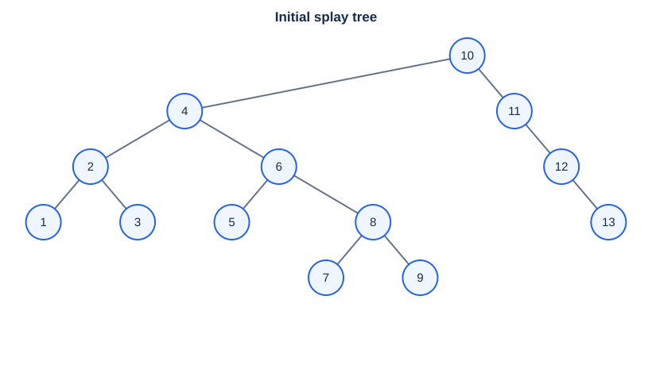
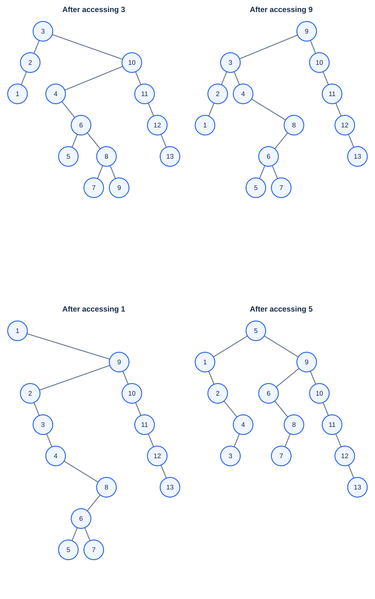
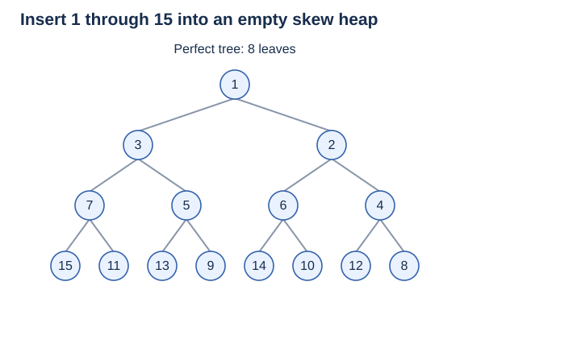
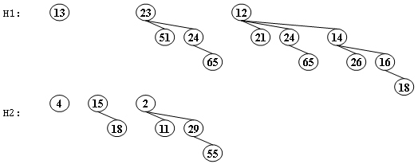
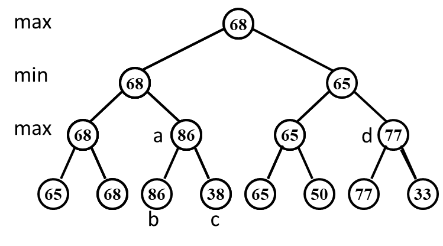

# ADS 期中复习 · 22 分钟原题自测

[180 分钟精要](essential-notes.md) · [考前速查](quick-reference.md)

17 题，限时 22 分钟；每题写选项及一行依据，再展开解析。英文题干与选项保留原文，仅规范数学／代码标记、替换为站内配图。题号旁是来源与建议用时；解析中的字母按原选项顺序。

## 1. AVL 最少节点 · 1 min

**来源：HW1 MC1**

If the depth of an AVL tree is 6 (the depth of an empty tree is defined to be -1), then the minimum possible number of nodes in this tree is:______

A. 13

B. 17

C. 20

D. 33

??? success "答案与解法"

    **D：33。** 空高 −1，叶高 0；依次为 0,1,2,4,7,12,20,33。用 $n_h=1+n_{h-1}+n_{h-2}$，不能套完全树节点数。

    [回查规则](essential-notes.md#search-trees)

## 2. AVL 插入 · 2 min

**来源：HW1 MC2**

Insert 2, 1, 4, 5, 9, 3, 6, 7 into an initially empty AVL tree.  Which one of the following statements is FALSE?______

A. 4 is the root

B. 3 and 7 are siblings

C. 2 and 6 are siblings

D. 9 is the parent of 7

??? success "答案与解法"

    **B。** 最终 `4(2(1,3),6(5,9(7,∅)))`；3 的父是 2，7 的父是 9。逐次只修最低失衡处，不能把普通 BST 的最终结果统一旋一次。

    [回查规则](essential-notes.md#search-trees)

## 3. Splay 访问 · 2 min

**来源：HW1 MC3**

For the result of accessing the keys 3, 9, 1, 5 in order in the splay tree in the following figure, which one of the following statements is FALSE?______



A. 5 is the root

B. 1 and 9 are siblings

C. 6 and 10 are siblings

D. 3 is the parent of 4

??? success "答案与解法"

    **D。** 最终根 5，孩子 1、9；9 的孩子 6、10；4 的左孩子是 3。每次都在上一次伸展结果上操作。zig-zig 先转父／祖父。

    

    [回查规则](essential-notes.md#search-trees)

## 4. 势能方向 · 1 min

**来源：HW1 MC4**

When doing amortized analysis, which one of the following statements is FALSE?______

A. Aggregate analysis shows that for all $n$, a sequence of $n$ operations takes worst-case time $T(n)$ in total.  Then the amortized cost per operation is therefore $T(n)/n$

B. For potential method, a good potential function should always assume its maximum at the start of the sequence

C. For accounting method, when an operation's amortized cost exceeds its actual cost, we save the difference as credit to pay for later operations whose amortized cost is less than their actual cost

D. The difference between aggregate analysis and accounting method is that the later one assumes that the amortized costs of the operations may differ from each other

??? success "答案与解法"

    **B。** $\sum c_i=\sum\widehat c_i+\Phi_0-\Phi_m$；要用摊还和上界实际和，需终势能不低于初势能。任意前缀均要成立时，初值通常取可达最小值 0。

    [回查规则](essential-notes.md#search-trees)

## 5. RBT 插入与颜色 · 2 min

**来源：HW2 MC1**

In the red-black tree that results after successively inserting the keys 41; 38; 31; 12; 19; 8 into an initially empty red-black tree, which one of the following statements is FALSE?______

A. 38 is the root

B. 19 and 41 are siblings, and they are both red

C. 12 and 31 are siblings, and they are both black

D. 8 is red

??? success "答案与解法"

    **B。** `38B(19R(12B(8R,∅),31B),41B)`。19 和 41 是兄弟，但 41 黑。新点先红；红叔翻色上传，黑叔处理折线／直线；最后根黑。

    [回查规则](essential-notes.md#rbt-bplus)

## 6. B+ 根的例外 · 1 min

**来源：HW2 MC5**

Which of the following statements concerning a B+ tree of order $M$ is TRUE?______

A. the root always has between 2 and $M$ children

B. not all leaves are at the same depth

C. leaves and nonleaf nodes have some key values in common

D. all nonleaf nodes have between $\lceil M/2\rceil$ and $M$ children

??? success "答案与解法"

    **C。** 内部分隔键复制叶中的值。A 漏根本身为叶；B 违反叶同深；D 漏非叶根可只有 2 个孩子、少于 $\lceil M/2\rceil$ 的例外。

    [回查规则](essential-notes.md#rbt-bplus)

## 7. P 与 R 的含义 · 1 min

**来源：HW3 MC1**

When measuring the relevancy of the answer set, if the precision is high but the recall is low, it means that:______

A. most of the relevant documents are retrieved, but too many irrelevant documents are returned as well

B. most of the retrieved documents are relevant, but still a lot of relevant documents are missed

C. most of the relevant documents are retrieved, but the benchmark set is not large enough

D. most of the retrieved documents are relevant, but the benchmark set is not large enough

??? success "答案与解法"

    **B。** P 高说明找出的多数相关，R 低说明应找到的仍漏了很多。先把 P、R 的分母写成“找出的”“所有相关的”。

    [回查规则](essential-notes.md#index)

## 8. 斜堆画树 · 2 min

**来源：HW4 MC3**

Insert keys 1 to 15 in order into an initially empty skew heap.  Which one of the following statements is FALSE?______

A. the resulting tree is a complete binary tree

B. there are 6 leaf nodes

C. 6 is the left child of 2

D. 11 is the right child of 7

??? success "答案与解法"

    **B。** 最终四层完美二叉树，叶数 8。根 1，左 3、右 2；2 的左孩子为 6；7 的右孩子为 11。完整右路径合并后，除尾节点外逐个交换左右。

    

    [回查规则](essential-notes.md#heaps)

## 9. 二项队列的 must · 1 min

**来源：HW5 MC3**

Merge the two binomial queues in the following figure.  Which one of the following statements must be FALSE?______



A. there are two binomial trees after merging, which are $B_2$ and $B_4$

B. 13 and 15 are the children of 4

C. if 23 is a child of 2, then 12 must be another child of 2

D. if 4 is a child of 2, then 23 must be another child of 2

??? success "答案与解法"

    **D。** 总大小 13+7=20，所以阶只能是 $B_2,B_4$。三树同阶时可留不同树；存在 4 成为 2 的孩子、但 23 单独留作 $B_2$ 根的合法结果，故 D 的 must 不成立。

    [回查规则](essential-notes.md#heaps)

## 10. 首次 α–β 剪枝 · 1 min

**来源：HW6 MC2**

Given the following game tree, which node is the first one to be pruned with α-β pruning algorithm?______

{ style="background-color: white;" }

A. a

B. b

C. c

D. d

??? success "答案与解法"

    **C：c。** 左侧首 MAX 返回 68，故上层 MIN 的 $\beta=68$；下个 MAX 先见 86，已有 $\alpha\ge\beta$，第二叶 38（c）不再访问。a 的孩子已经访问过，不能说 a 整个未被展开。

    [回查规则](essential-notes.md#backtracking)

## 11. 递推式比较 · 2 min

**来源：HW7 MC2**

To solve a problem with input size $N$ by divide and conquer algorithm, among the following methods, __ is the worst.______

A. divide into 2 sub-problems of equal complexity $N/3$ and conquer in $O(N)$

B. divide into 2 sub-problems of equal complexity $N/3$ and conquer in $O(NlogN)$

C. divide into 3 sub-problems of equal complexity $N/2$ and conquer in $O(N)$

D. divide into 3 sub-problems of equal complexity $N/3$ and conquer in $O(NlogN)$

??? success "答案与解法"

    **C。** A 为 $\Theta(N)$；B 为 $\Theta(N\log N)$；C 为 $\Theta(N^{\log_23})$；D 为 $\Theta(N\log^2N)$。固定正幂最终超过任意固定次 log；不要凭递归分支多少直接选。

    [回查规则](essential-notes.md#divide-conquer)

## 12. 变量代换 · 1 min

**来源：HW7 MC4**

Which one of the following is the lowest upper bound of $T(n)$ for the following recursion  $T(n) = 2T(\sqrt{n}) + \log n$?______

A. $O(\log n\log \log n)$

B. $O(\log^2 n)$

C. $O(n\log n)$

D. $O(n^2)$

??? success "答案与解法"

    **A。** 令 $m=\log n$，$S(m)=T(2^m)$，则 $S(m)=2S(m/2)+m=\Theta(m\log m)$。换回 n 后是 $\Theta(\log n\log\log n)$。

    [回查规则](essential-notes.md#divide-conquer)

## 13. DP 依赖顺序 · 1 min

**来源：HW8 MC3**

Given a recurrence equation $f_{i,j,k} =f_{i,j+1,k}+\min_{0 \le l \le k}\{f_{i-1,j,l}+w_{j,l}\}$. To solve this equation in an iterative way, we **cannot** fill up a table as follows:______

A. `for k in 0 to n: for i in 0 to n: for j in n to 0`

B. `for i in 0 to n: for j in 0 to n: for k in 0 to n`

C. `for i in 0 to n: for j in n to 0: for k in n to 0`

D. `for i in 0 to n: for j in n to 0: for k in 0 to n`

??? success "答案与解法"

    **B。** 同一 i 层要先有 j+1，故 j 不能递增。A 也合法：外层 k 递增保证小于 k 的层已算，同 k 时较小 i 也已完成；C／D 则先完成整个 i−1 层。

    [回查规则](essential-notes.md#dp)

## 14. Floyd 的中间点是谁 · 1 min

**来源：WK8 MC1**

When solving the problem All-Pairs Shortest Path by Floyd method, which one of the following iterations can give us the correct answer?

A.

```c
for( i = 0; i < N; i++ )
    for( k = 0; k < N; k++ )
        for( j = 0; j < N; j++ )
            if( D[ i ][ k ] + D[ k ][ j ] < D[ i ][ j ] )
                D[ i ][ j ] = D[ i ][ k ] + D[ k ][ j ];
```

B.

```c
for( i = 0; i < N; i++ )
    for( j = 0; j < N; j++ )
        for( k = 0; k < N; k++ )
            if( D[ i ][ k ] + D[ k ][ j ] < D[ i ][ j ] )
                D[ i ][ j ] = D[ i ][ k ] + D[ k ][ j ];
```

C.

```c
for( i = 0; i < N; i++ )
    for( k = 0; k < N; k++ )
        for( j = 0; j < N; j++ )
            if( D[ k ][ i ] + D[ i ][ j ] < D[ k ][ j ] )
                D[ k ][ j ] = D[ k ][ i ] + D[ i ][ j ];
```

D.

```c
for( k = 0; k < N; k++ )
    for( i = 0; i < N; i++ )
        for( j = 0; j < N; j++ )
            if( D[ k ][ i ] + D[ i ][ j ] < D[ k ][ j ] )
                D[ k ][ j ] = D[ k ][ i ] + D[ i ][ j ];
```

??? success "答案与解法"

    **C。** 更新 `D[k][j]`、使用 `D[k][i]+D[i][j]`，所以中间点是 i，恰在最外层。D 虽然写着 k 外层，但该更新中 k 是源。原提交选 D 为错误答案。

    [回查规则](essential-notes.md#dp)

## 15. some 与 all · 1 min

**来源：HW9 TF1**

Let S be the set of activities in Activity Selection Problem.  Then the earliest finish activity $a_m$ must be included in all the maximum-size subset of mutually compatible activities of S.  ______

??? success "答案与解法"

    **False。** 只需存在某个最优活动集合包含最早结束者；并非所有最优集合都包含它。例如两个互相重叠的活动，任取一个都是最大集合。

    [回查规则](essential-notes.md#greedy)

## 16. 前缀码与最优树 · 1 min

**来源：MOOC Quiz 9.3 Q2**

Given four characters $a, b, c, d$ with distinct frequencies in a text. Suppose that a and b are the two characters having the lowest frequencies. Which of the following sets of code is a possible Huffman code for this text?

A. a: 000, b:001, c:01, d:1

B. a: 000, b:001, c:01, d:11

C. a: 000, b:001, c:10, d:1

D. a: 010, b:001, c:01, d:1

??? success "答案与解法"

    **A。** a、b 是最深兄弟叶，树为满二叉树；可由不同的正频率构造。B 虽前缀无歧义，但有单孩子内部节点，可压缩而降低 WPL；C 的 1 是 10 的前缀；D 的 01 是 010 的前缀。

    [回查规则](essential-notes.md#greedy)

## 17. 币制决定贪心是否成立 · 1 min

**来源：HW9 MC1**

Consider the problem of making change for $n$ cents using the fewest number of coins. Assume that each coin's value is an integer.
The coins of the lowest denomination（面额） is the cent.

(I) Suppose that the available coins are quarters (25 cents), dimes (10 cents), nickels (5 cents), and pennies (1 cent). The greedy algorithm always yields an optimal solution.

(II) Suppose that the available coins are in the denominations that are powers of c, that is, the denominations are $c^0$, $c^1$, ..., $c^k$ for some integers $c>1$ and $k>=1$. The greedy algorithm always yields an optimal solution.

(III) Given any set of $k$ different coin denominations which includes a penny (1 cent) so that there is a solution for every value of $n$, greedy algorithm always yields an optimal solution.

Which of the following is correct?

A. Statement (I) is false.

B. Statement (II) is false.

C. Statement (III) is false.

D. All of the three statements are correct.

??? success "答案与解法"

    **C。** III 错：币 `1,3,4` 凑 6，贪心 3 枚，最优 2 枚。I 可交换归一化；II 由 c 枚小币可换成一枚上一级币证明。

    [回查规则](essential-notes.md#greedy)

## 核对后怎么补

选对但说不出依据，按未掌握处理。树题补一张中间树；分析题补成本等式；DP 补依赖方向；贪心补交换步骤或最小反例。先纠正自己的错误，再看 [考前速查](quick-reference.md)。
